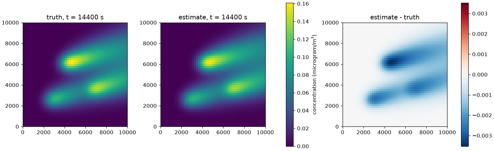
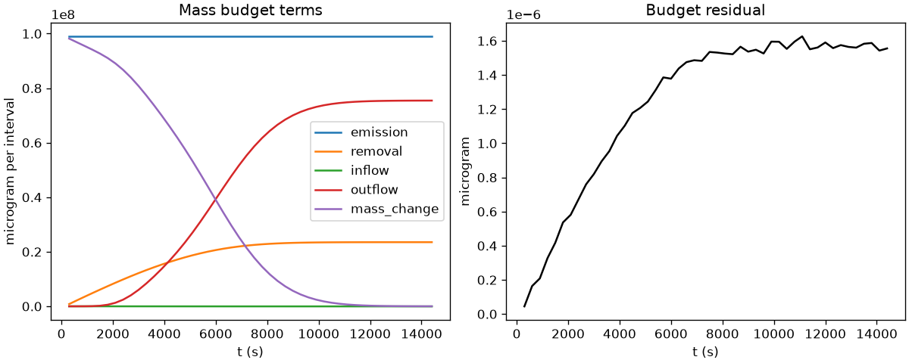
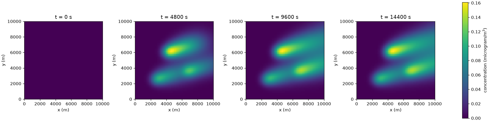
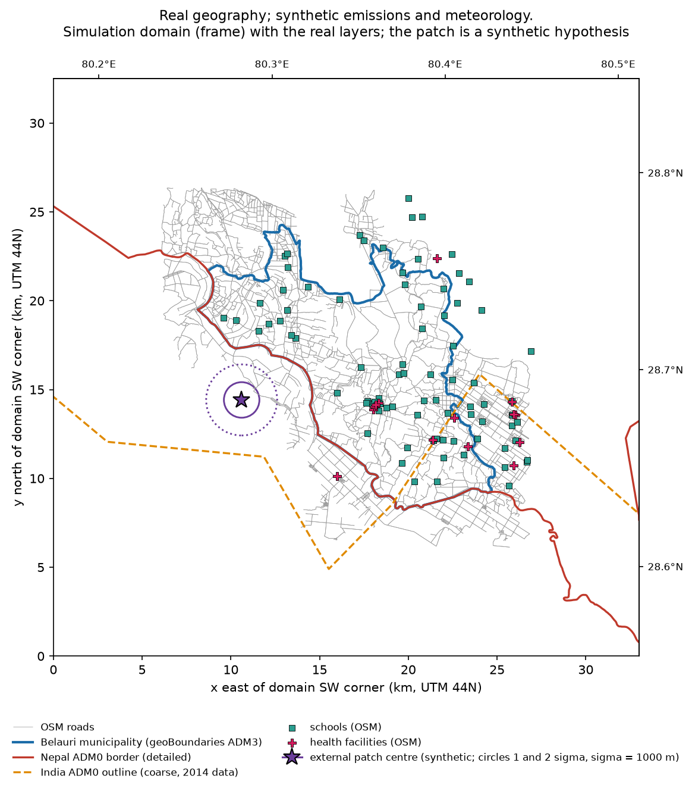
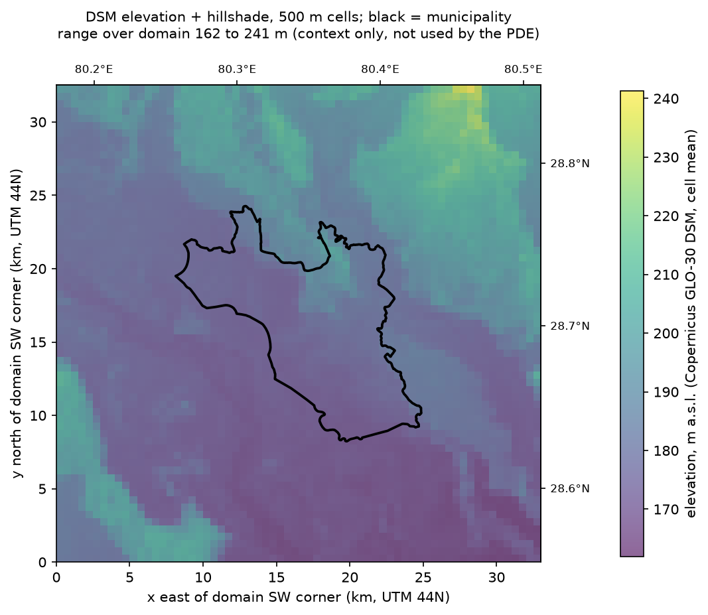
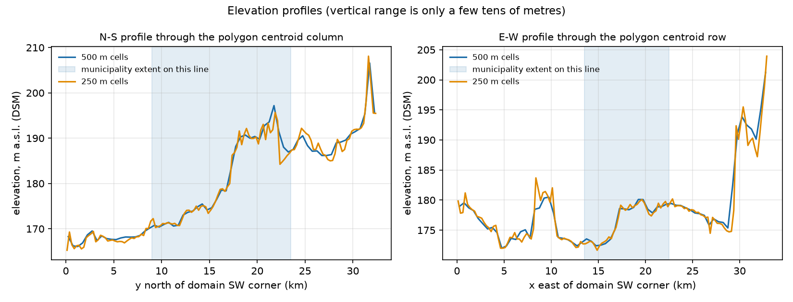
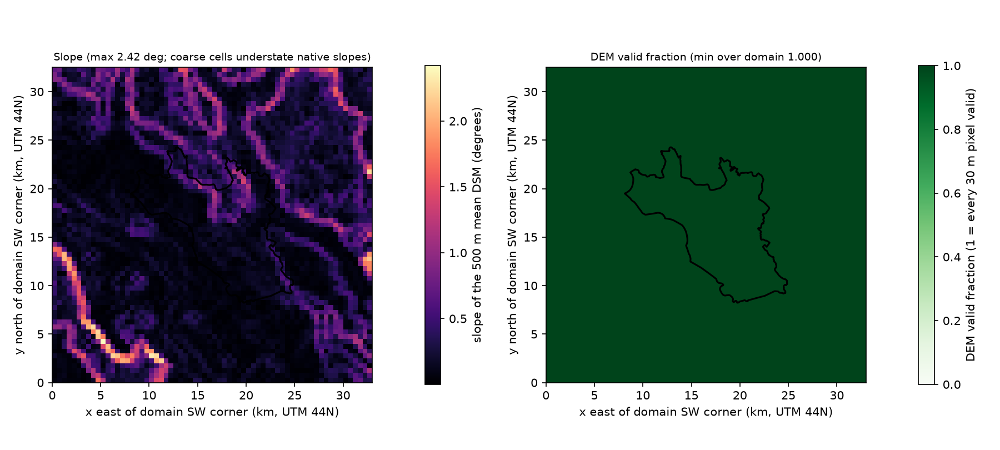

# Research report: pravah

_Generated 2026-10-10 21:45 · git `master` @ `5d7a68334a`_

**Goal:** Simulate the air pollution field evolution

## Where things stand

- **Current understanding:** - Solver routing refactor preserves every deterministic FiPy output bit-for-bit (F-009, supported)
- FINAL: hidden wind error and unmodelled source dominate discretisation mismatch; poor layout unidentifiable (F-007, supported)
- FINAL: greedy layouts beat spread/random on fresh test scenarios with alpha frozen on validation (matched, synthetic) (F-006, supported)
- Matched synthetic recovery of three amplitudes works; cached and direct routes agree (F-002, supported)
- Geographic design robustness: an unknown wind error dominates the sensor-count effect; the identifiability flags cannot show it (saturated by construction); ranking changes are not resolved against noise (synthetic) (F-021, preliminary)
- Geographic sensor design on Belauri: small-budget rankings depend on the noise level and on the design noise used for selection; reference-site use depends on it too (synthetic, matched) (F-020, preliminary)
- Forward scheme: mass-consistent, first order in time, observed spatial order ~1.4 in the periodic test (~2.2-2.7 in the steady strip), large numerical diffusion (F-016, preliminary)
- Matched-design layouts are not robust at 2-3 sensors under model mismatch, but per-case counts are mixed (v0 mismatch, synthetic) (F-017, preliminary)
- **Next step:** Optional, only if the sensor-design conclusions matter: add a chi-square-per-dof model check to geodesign_robust and rerun geodesign + geodesign_robust with the test noise level fixed from the validation scale (about 1 h compute). Otherwise: decide whether to commit or clear the executed notebook outputs in the working tree (user-owned); apply or drop git stash G2-unshipped.
- **Baseline:** EXP-002 — EXP inverse recovery (frozen reference)

## What we learned

### F-002 · Matched synthetic recovery of three amplitudes works; cached and direct routes agree

> With 4 fit sensors, noise 0.005 ug/m3, q_hat within 2.5% of truth, rank 3, condition 5.6, direct vs linear 4e-9 relative.

_supported, high confidence · by claude-code · reviewed by scientific-reviewer: supported_

**Evidence:** EXP-002 EXP inverse recovery (frozen reference); RUN-0003 inverse-direct-vs-linear

**Limitations:** Inverse crime (same solver/grid), single noise draw and layout, everything but q known

### F-006 · FINAL: greedy layouts beat spread/random on fresh test scenarios with alpha frozen on validation (matched, synthetic)

> alpha=0.1 selected on validation seed 44. Test seed 33: mean RMSE greedy 0.021/0.017/0.0015/0.00045/0.00041 vs spread 0.022/0.020/0.014/0.014/0.0013 for b=1/2/3/5/8; paired greedy-spread win rate 78/61/78/100/78% (n=18); advantage clear from 3 sensors, not established at 1-2; greedy test RMSE 1.1-2.5x its design RMSE.

_supported, medium confidence · by claude-code · reviewed by scientific-reviewer: supported_

**Evidence:** EXP-005 EXP alpha selection on validation ensemble; EXP-006 EXP deployment comparison FINAL (alpha frozen on validation; fresh test seeds); RUN-0008 alpha-selection; RUN-0009 benchmark-final

**Limitations:** 6+6 scenarios, 3 noise draws, sd not CI, matched model, greedy not optimal; supersedes F-003 whose alpha was chosen after seeing test results

### F-007 · FINAL: hidden wind error and unmodelled source dominate discretisation mismatch; poor layout unidentifiable

> Greedy b=8 RMSE: matched 4.1e-4, refined truth 1.0e-3 (lower bound), wind-perturbed 0.017, extra source 0.010; poor corner layout effective rank 0 in 18/18 rows, RMSE 0.049 vs greedy 0.0015.

_supported, medium confidence · by claude-code · reviewed by scientific-reviewer: supported_

**Evidence:** EXP-007 EXP mismatch FINAL (fixed benchmark-final layouts, frozen alpha, fresh test seeds); RUN-0011 mismatch-final

**Limitations:** One magnitude per kind; uniform metric only; supersedes F-004

### F-009 · Solver routing refactor preserves every deterministic FiPy output bit-for-bit

> 21 files (fields, fitted amplitudes, layouts, benchmark/alpha-selection/mismatch metrics) identical before and after routing all workflows through one ForwardSolver; the comparison detects a real alternate FiPy configuration; 22 routing tests prove injected solvers reach truth, inference, response-basis, direct-fit, case-building and CLI paths.

_supported, high confidence · by claude-code · reviewed by scientific-reviewer: supported_

**Evidence:** EXP-008 EXP solver routing regression (FiPy before/after); RUN-0012 fipy-before; RUN-0013 fipy-after

**Limitations:** No independent alternative solver exists yet; routing tests use FiPy-derived stand-ins

### F-016 · Forward scheme: mass-consistent, first order in time, observed spatial order ~1.4 in the periodic test (~2.2-2.7 in the steady strip), large numerical diffusion

> Open-boundary budget residual <=1.9e-14 relative; no negative values; periodic Gaussian test relative L2 error 0.155/0.0607/0.0238 at nx 20/40/80 (ratios 2.56/2.55, observed order ~1.4, time-error floor present); steady open-boundary 1-D strip against the analytic solution has errors 6.5e-3, 1.4e-3, 2.6e-4, 3.9e-5 at nx 25/50/100/200 (orders 2.2-2.7); effective diffusivity at 50x50, dt=60 s about 1.6 K (exponential scheme), matching theory within 3%.

_preliminary, high confidence · by claude-code · not yet independently reviewed_

**Evidence:** EXP-001 EXP numerical verification; RUN-0001 verification

**Limitations:** Uniform-wind periodic and 1-D strip cases only; synthetic verification, not validation. Supersedes F-001 whose '~second order in space' wording was not supported by the periodic test

### F-017 · Matched-design layouts are not robust at 2-3 sensors under model mismatch, but per-case counts are mixed (v0 mismatch, synthetic)

> results/mismatch-final, greedy vs spread mean total RMSE: wind-perturbed b=2 0.0748 vs 0.0247 (spread lower in 5/6 cases), b=3 0.0263 vs 0.0218 (3/6); extra source b=2 0.0895 vs 0.0324 (5/6), b=3 0.0459 vs 0.0312 (spread lower in only 1/6 cases: a few large cases drive the mean); matched b=3 greedy 0.0015 vs spread 0.0144 (spread lower in 1/6). At b>=5 greedy is better or equal.

_preliminary, medium confidence · by claude-code · not yet independently reviewed_

**Evidence:** EXP-007 EXP mismatch FINAL (fixed benchmark-final layouts, frozen alpha, fresh test seeds); RUN-0011 mismatch-final

**Limitations:** 6 test scenarios x 3 noise draws; one magnitude per mismatch kind; means are outlier-sensitive; supersedes F-008

### F-018 · Belauri forward: the external patch reaches the municipality whenever the wind carries it from the WSW side (initially or throughout), not under steady north/east winds; numerical diffusion dominates the nominal K (real geography, synthetic emissions/meteorology)

> Centroid arrival after onset 2627 s (WSW and reversal), 3108 s (channelled demo); external concentration fraction 0.22 (WSW), 0.051 (reversal), 0.194 (channelled demo), <3e-4 (north, east); smaller outer domain changes the study mean by -10.5% only under the reversal; K_eff/K 2.5-4.9 on the 250/500 m meshes at 1.5 m/s (higher at higher speeds); replacing DEM/hillshade/slope by constants changes no concentration.

_preliminary, high confidence · by claude-code · not yet independently reviewed_

**Evidence:** EXP-012 EXP Belauri forward simulation sensitivity (real geography, synthetic emissions/meteorology); RUN-0025 belauri-forward-production

**Limitations:** Synthetic emissions and winds; K_eff/K range is for 1.5 m/s; terrain dynamics unresolved; supersedes F-011 whose 'only under WSW' wording was wrong

### F-019 · Boundary-condition input (whole-side bases) removes part of the error from an omitted localised external plume (synthetic; corrected values)

> Truth E1 explicit; fitted models omit E1: study-region RMSE/peak 0.172 (local-only); with a basis onset matching E1 0.118 (uniform) and 0.114 (four-side bases); with the onset mismatched (7200 s vs 3600 s) 0.135 (uniform) and 0.133 (four-side); E1 explicit with the true amplitudes 0.009 (no fit); omitting E1 biases local amplitudes upward (1.27e5/1.03e5 vs 1e5/0.7e5).

_preliminary, medium confidence · by claude-code · not yet independently reviewed_

**Evidence:** EXP-011 EXP external vs local identifiability RERUN (after independent review fixes); RUN-0024 transboundary-rerun

**Limitations:** Whole-side bases only; synthetic matched model; temporal profile assumed known; the 0.009 reference uses true theta; supersedes F-012 (values were listed in swapped order)

### F-020 · Geographic sensor design on Belauri: small-budget rankings depend on the noise level and on the design noise used for selection; reference-site use depends on it too (synthetic, matched)

> Interior-only, selected alpha=0.01, 6 test scenarios, mean total RMSE (ug/m3) for 1/2/3/5/8 sensors. 5% noise: greedy_total 0.0223/0.0093/0.00525/0.00353/0.00272; greedy_attribution 0.0105/0.0065/0.00542/0.0037/0.00327; spread 0.0148/0.0117/0.0058/0.00512/0.00323; random 0.025/0.0135/0.0103/0.00666/0.00328. 15% noise: greedy_total 0.0366/0.0174/0.0156/0.0108/0.00833; greedy_attribution 0.0625/0.0298/0.0212/0.0086/0.0079; spread 0.0285/0.0214/0.0158/0.0116/0.0082; random 0.0422/0.0227/0.0182/0.0128/0.00826. Layouts are re-selected per noise level (design sigma), so the two noise levels compare different layouts. External reference sites: at 5% noise greedy_total never chose one and greedy_attribution chose 1 (budget 5) and 2 (budget 8); at 15% noise greedy_attribution chose a domestic reference site FIRST (refd_c008004) at every budget, and at one sensor its total RMSE is 0.0988 with_reference vs 0.0625 interior-only. Spread layouts that include reference sites had higher total error than interior-only spread. Differences beyond 5 sensors are within noise.

_preliminary, medium confidence · by claude-code · not yet independently reviewed_

**Evidence:** EXP-013 EXP geographic sensor design on Belauri (greedy total vs greedy attribution vs spread vs random); RUN-0026 geodesign-production

**Limitations:** 6 test scenarios x 3 noise draws; sd is a standard deviation; test sigma was derived from the test ensemble's own signal scale (0.0158 vs 0.0154 for design: a mild independence leak, not corrected); numerically diffusive mesh (K_eff/K 2.4-9.4); supersedes F-014

### F-021 · Geographic design robustness: an unknown wind error dominates the sensor-count effect; the identifiability flags cannot show it (saturated by construction); ranking changes are not resolved against noise (synthetic)

> Fixed layouts, interior-only, 5% noise, greedy_total total RMSE (ug/m3) at 3/5/8 sensors: matched 0.0053/0.0035/0.0027; unknown wind error 0.044/0.046/0.031; unseen winds 0.041/0.041/0.029 but 0.0047/0.0033/0.0028 when those winds are declared; omitted facility source 0.014-0.016; refined 250 m truth 0.0082/0.0081/0.0066. Flags are identical to the matched rows and weakly_constrained fires on every row (frac_flagged = 1, because the emission scale 1e5 ug/s is small next to the true 0.75-2.25e6 ug/s), so 'flags equal matched' is true by construction and says nothing about the model. The share of method contrasts keeping their matched sign is about 0.45-0.5 under wind errors, but this counts contrasts with an exactly zero matched difference as kept (30 of 240 rows per condition), is for the interior-only 5% subset, and has no noise baseline: most matched contrasts are smaller than their sd, so ~50% is close to chance. Layouts re-selected on the 250 m model share Jaccard 0-0.2 of sites with the 500 m layouts, but that used 3 fine design cases against 6 and has no 500 m resampling baseline.

_preliminary, medium confidence · by claude-code · not yet independently reviewed_

**Evidence:** EXP-014 EXP geographic design robustness and numerical-refinement stability (fixed layouts); RUN-0027 geodesign-robust-production

**Limitations:** One perturbation per condition; 6 test scenarios (3 fine); numerically diffusive mesh; matched-scheme refined truth; supersedes F-015

## Failed directions and contradicted claims

- **F-005** Unregularised bounded least squares is unstable for layouts blind to the plumes [preliminary] — Mitigated by alpha=1 prior in the primary benchmark; not a defect of the diagnostics

## Decisions in force

- **D-003** (2026-10-10) Phase 2 baseline: solver interface (results/solver-regression), external/local study (results/transboundary-rerun), verified Belauri geography (data/belauri/manifest.json, results/geography), Belauri forward (results/belauri-forward), geographic design and robustness (results/geodesign, results/geodesign-robust) — all synthetic emissions/meteorology; v0 baseline D-002 stands — based on F-002, F-006, F-007, F-009, F-016, F-017, F-018, F-019, F-020, F-021
- **D-002** (2026-10-10) Baseline v0: results/reference-v0 + results/inverse-v0 (configs/reference.json); comparison evidence is results/alpha-selection, results/benchmark-final, results/mismatch-final (alpha=0.1 frozen on validation, fresh test seeds 33/7000). results/benchmark, benchmark-unregularized, mismatch are exploratory and superseded. — based on F-001, F-002, F-005, F-006, F-007

## Questions and experiments

### Q-001 · Does the FiPy forward model reproduce analytical, conservation and refinement behaviour? [answered]

#### EXP-001 · EXP numerical verification [completed]

**Hypothesis:** Scheme reproduces exact discrete symbols, conserves mass, converges with refinement; numerical diffusion matches theory

**Success criteria:** budget residual<1e-9 rel; observed spatial order>1.5; K_eff matches theory within 3%

| run | status | max_rel_budget_residual | max_rel_budget_residual_reference | fourier_rel_L2_nx20 | fourier_rel_L2_nx40 | fourier_rel_L2_nx80 | dt_refine_rmse_change_60v30 | dt_refine_rmse_change_30v15 | grid_refine_rmse_50v100_rel_to_max |
|---|---|---|---|---|---|---|---|---|---|
| RUN-0001 | completed | — | 1.86e-14 | 0.1552 | 0.0607 | 0.0238 | 0.0001758 | 9.22e-05 | 0.00399 |

- **What happened:** Verification script ran (RUN-0001, 1m42s): Fourier spatial error 0.155/0.061/0.024 at nx=20/40/80 (ratio ~2.55), time error halves differences with dt, dt-refinement RMSE change 1.76e-4 -> 9.2e-5 (first order), grid 50 vs 100 differs by 0.40% of max, budget residual <=1.9e-14 relative, quadrature ratios 1+9e-8 at worst
- **Interpretation:** Scheme behaves as designed (first order in time, ~second order in space) but the reference grid/dt carry substantial numerical diffusion (K_eff about 1.6K). Synthetic verification only.
- **What failed:** Nothing failed. Initial claim of +31% numerical diffusion was incomplete (reviewer: total +61% at dt=60 s, 50 grid)
- **Next:** Run inverse recovery experiment

### Q-002 · Can sparse noisy sensors reconstruct the regional field, and do random, spread and greedy layouts differ on independent cases? [answered]

#### EXP-002 · EXP inverse recovery (frozen reference) [completed, baseline]

**Hypothesis:** With 4 fit sensors and 0.005 ug/m3 noise, the three amplitudes and the regional field are recovered; direct and cached routes agree

**Success criteria:** rank 3, direct vs linear rel diff <1e-6, held-out sensor rmse reported

| run | status | regional_rmse | min_concentration | n_negative | n_steps | max_abs_budget_residual | max_rel_budget_residual | total_emission | total_removal | total_inflow | total_outflow | runtime_s | max_concentration | linear.source_error.relative_l2 | linear.weighted_residual | linear.n_obs | linear.rank | linear.effective_rank | linear.condition | linear.regional_rmse | linear.heldout_sensor_rmse | linear.fit_sensor_rmse | linear.wall_s | direct.source_error.relative_l2 | direct.weighted_residual | direct.n_obs | direct.rank | direct.effective_rank | direct.condition | direct.regional_rmse | direct.heldout_sensor_rmse | direct.fit_sensor_rmse | direct.wall_s | direct_vs_linear_max_rel_diff |
|---|---|---|---|---|---|---|---|---|---|---|---|---|---|---|---|---|---|---|---|---|---|---|---|---|---|---|---|---|---|---|---|---|---|---|
| RUN-0002 | completed | — | 0 | 0 | 240 | 1.626e-06 | 1.643e-14 | 4.752e+09 | 8.868e+08 | -1.149e+06 | 2.171e+09 | 2.781 | 0.1608 | — | — | — | — | — | — | — | — | — | — | — | — | — | — | — | — | — | — | — | — | — |
| RUN-0003 | completed | — | — | — | — | — | — | — | — | — | — | — | — | 0.02169 | 8.214 | 96 | 3 | 3 | 5.62 | 0.0009686 | 0.0004334 | 0.0009214 | 22.35 | 0.02169 | 8.214 | 96 | 3 | 3 | 5.62 | 0.0009686 | 0.0004334 | 0.0009214 | 113.2 | 3.963e-09 |

- **What happened:** Reference simulate (RUN-0002, 2.8 s solve; max budget residual 1.6e-14, 0 negatives) and inverse (RUN-0003, 2m21s incl. direct route). 5 sensors every 600 s, S5 held out, noise 0.005 ug/m3 (~3% of 0.161 peak). q_hat=[97531,146718,78807] vs true [1e5,1.5e5,8e4]: relative L2 error 2.2%; regional RMSE 9.7e-4 ug/m3; held-out sensor RMSE 4.3e-4; rank 3, effective rank 3, condition 5.6; direct (least_squares) and cached (lsq_linear) agree to 4e-9 relative
- **Interpretation:** In this idealised matched experiment (same solver and grid for truth and inference: inverse crime) the amplitudes are well identified. This says nothing about real data.
- **What failed:** none
- **Next:** Deployment comparison across layouts and cases

    

#### EXP-003 · EXP deployment comparison (random vs spread vs greedy) [completed]

**Hypothesis:** Greedy-optimized layouts selected on design scenarios give lower held-out regional RMSE than spread and random layouts on independent test scenarios, on average, not necessarily in every case

**Success criteria:** paired differences reported honestly with sd and win fraction; design-vs-test gap visible

| run | status | rmse |
|---|---|---|
| RUN-0004 | completed | — |
| RUN-0005 | completed | — |
| RUN-0006 | completed | — |

- **What happened:** RUN-0004 smoke (18 s); RUN-0005 benchmark alpha=1 (4m56s, peak mem ~176 MB; 6 design + 6 test scenarios, 3 noise reps, 20 random layouts/budget); RUN-0006 same with alpha=0 (4m46s). Alpha=1 uniform-weight mean test RMSE (ug/m3), budgets 1/2/3/5/8: greedy 0.019/0.0037/0.00089/0.00039/0.00036; spread 0.022/0.015/0.0086/0.0086/0.0018; random(mean of layouts) 0.035/0.024/0.018/0.0076/0.0037. Paired greedy-minus-spread mean diff -0.0035/-0.0116/-0.0077/-0.0082/-0.0014, greedy better in 78/100/83/94/94% of 18 pairs. Alpha=0: unregularised fits blow up for layouts blind to the plumes (random 1-sensor mean RMSE 2e19, spread 4.8); medians sane. Greedy at alpha=0 is stable (0.019/0.0057/0.0012/0.00047/0.00026).
- **Interpretation:** Within this synthetic matched setting, designing for the regional error with design scenarios helps; the main driver is avoiding plume-blind layouts (identifiability), so much of the gap vs spread/random is about covering the plume corridor rather than fine optimisation. Greedy is not globally optimal (tiny-fixture exhaustive gap up to 3.7x was seen in tests) and does not win every case.
- **What failed:** alpha=0 headline means are dominated by a few unidentifiable draws; weak prior alpha=1 was adopted AFTER seeing this, chosen a priori (not tuned) and the alpha=0 run is kept as sensitivity. greedy_weighted is not reliably better than greedy even on the population metric (budget 2 worse).
- **Next:** Mismatch experiment

#### EXP-004 · EXP mismatch (refined truth, hidden wind error, unmodelled source, poor layout) [completed]

**Hypothesis:** Fixed design-stage layouts degrade under mismatch; effect sizes reported per kind; a deliberately poor layout shows unidentifiability

**Success criteria:** all four conditions executed; paired mismatch-minus-matched differences and poor-layout diagnostics saved

| run | status | rmse |
|---|---|---|
| RUN-0007 | completed | — |

- **What happened:** RUN-0007 (7m51s). Fixed design-stage layouts from results/benchmark on the regenerated 6 test scenarios x 3 noise reps. Greedy mean test RMSE (ug/m3) matched vs refined-truth vs wind-perturbed vs extra-source at budget 3: 0.0009 / 0.0015 / 0.018 / 0.011; at budget 8: 0.00036 / 0.0010 / 0.016 / 0.010. Paired mismatch-minus-matched (greedy): refined truth +0.0005 to +0.0007 (worse in 78-100% of pairs); wind +0.012 to +0.017 (worse in 100%); extra source +0.008 to +0.010 (worse in 83-100%), unmodelled-source attribution error 15-50%. Poor corner layout (3 sensors): effective rank 0 in every case, condition inf or >1e8, singular values ~1e-9 or smaller; estimates collapse to the prior (source relative error ~1.0) while regional RMSE 0.03-0.08.
- **Interpretation:** Hidden wind error and an unmodelled source dominate over discretisation mismatch in this setup; refined truth shows the matched benchmark was only mildly optimistic from the inverse-crime effect (~+0.0006 ug/m3 at budgets >=3). More sensors do not fix wind or missing-source error: the floor is set by the model error.
- **What failed:** Not every individual draw worsens under mismatch (frac_worse 0.78-1.0 for refined truth and 0.83 in some budgets), reported as observed.
- **Next:** Final scientific review and freeze

#### EXP-005 · EXP alpha selection on validation ensemble [completed]

**Hypothesis:** A Tikhonov strength chosen on a validation ensemble (seed 44) using only alpha-independent layouts (random+spread) gives a stable, test-independent regularisation level

**Success criteria:** alpha_selected.json written before any run on test seed 33; selection independent of test seeds (unit-tested)

| run | status | mean_rmse | selected_alpha |
|---|---|---|---|
| RUN-0008 | completed | — | 0.1 |

- **What happened:** RUN-0008 (1m21s): 6 validation scenarios (seed 44, noise 9000) x 3 noise reps x (20 random layouts + spread) x 5 budgets = 1890 rows per alpha. Mean regional RMSE (ug/m3) by alpha: 0 -> 1.7e18 (413 rows >10x no-emission RMSE); 1e-4 -> 0.0709; 1e-3 -> 0.0302; 1e-2 -> 0.0175; 0.1 -> 0.0143 (selected); 1 -> 0.0146; 10 -> 0.0162; 100 -> 0.0191; 1000 -> 0.0247. Frozen to results/alpha-selection/alpha_selected.json before any run on test seed 33.
- **Interpretation:** The earlier alpha=1 (chosen after looking at test results) was close to but not equal to the validation-selected value. Selected alpha=0.1 is used for all final runs.
- **What failed:** none
- **Next:** Final benchmark on fresh test seeds 33/7000

#### EXP-006 · EXP deployment comparison FINAL (alpha frozen on validation; fresh test seeds) [completed]

**Hypothesis:** Greedy layouts selected on design scenarios (seed 11) give lower regional RMSE than spread and random layouts on fresh independent test scenarios (seed 33, noise 7000), with alpha=0.1 frozen from the validation ensemble

**Success criteria:** paired differences reported honestly with sd and win fraction; no use of test results in any choice

| run | status | rmse |
|---|---|---|
| RUN-0009 | completed | — |
| RUN-0010 | completed | — |

- **What happened:** RUN-0009 benchmark-final (2m35s) and RUN-0010 alpha=0 sensitivity (2m36s) on FRESH test scenarios (seed 33, noise 7000) with alpha=0.1 read from results/alpha-selection/alpha_selected.json (sha256 cd526c9d...). Uniform-weight mean test RMSE (ug/m3), budgets 1/2/3/5/8: greedy 0.021/0.017/0.0015/0.00045/0.00041; spread 0.022/0.020/0.014/0.014/0.0013; random(mean over 20 layouts) 0.034/0.024/0.020/0.0093/0.0047. Paired greedy-minus-spread mean diff -0.0020/-0.0031/-0.0129/-0.0139/-0.0009 (sd 0.0105/0.0107/0.0134/0.0124/0.0015), greedy better in 78/61/78/100/78% of 18 pairs. Greedy design RMSE 0.012/0.0067/0.0013/0.00042/0.00029, i.e. test is 1.8x/2.5x/1.2x/1.1x/1.4x design. alpha=0 sensitivity: greedy means blow up at b=1,2 (0.44, 0.34) and random reaches 1e21; medians sane (greedy 0.024/0.0015/0.00091/0.00056/0.00033).
- **Interpretation:** In this matched synthetic setting a design-optimised layout helps on average, mostly from 3 sensors up where it avoids plume-blind sites; the small-budget advantage is not established with 6+6 scenarios. This replaces EXP-003 as the deployment evidence; EXP-003's alpha=1 was chosen after seeing its test results.
- **What failed:** At b=1 and 2 the greedy-vs-spread advantage is small relative to the case-to-case sd (61-78% wins); greedy is 2.5x worse on test than on design at b=2 (selection optimism / design-case specificity); greedy_weighted is indistinguishable from greedy
- **Next:** Mismatch on the fixed benchmark-final layouts

#### EXP-007 · EXP mismatch FINAL (fixed benchmark-final layouts, frozen alpha, fresh test seeds) [completed]

**Hypothesis:** Fixed design-stage layouts degrade under hidden wind error and an unmodelled source more than under refined-grid truth; poor layout is unidentifiable

**Success criteria:** all conditions executed on the same cases/noise as matched baseline

| run | status | rmse | alpha.value |
|---|---|---|---|
| RUN-0011 | completed | — | 0.1 |

- **What happened:** CORRECTION to synthesis S1 (poor-layout statement was wrong; it pooled methods). poor_layout_diagnostics.csv has 54 rows = greedy 18 + spread 18 + poor 18 at budget 3. The poor corner layout has effective rank 0 in ALL 18 of its rows (singular values <~1e-5), mean regional RMSE 0.049 (max 0.060). Greedy at the same budget: effective rank 3 in all 18 rows, mean RMSE 0.0015. Spread: effective rank 2 in 9 rows and 3 in 9, mean RMSE 0.014. All other numbers in S1 stand.
- **Interpretation:** As in EXP-004, estimates for the poor layout collapse to the zero prior mean; its RMSE is close to the no-emission error
- **What failed:** S1 misread pooled rows; no change to any computed result

### Q-003 · Does routing every workflow through one ForwardSolver interface leave all FiPy results bit-identical, and do injected solvers reach every call? [answered]

#### EXP-008 · EXP solver routing regression (FiPy before/after) [completed]

**Hypothesis:** Routing all workflows through ForwardSolver leaves deterministic FiPy outputs bit-identical

**Success criteria:** fields, q_hat, layouts, raw metrics, mismatch metrics identical excluding volatile metadata; routing tests prove injected solvers reach all calls

| run | status | n_differences | n_files_captured | determinism_check_n_differences | n_files_compared |
|---|---|---|---|---|---|
| RUN-0012 | completed | — | 21 | 0 | — |
| RUN-0013 | completed | 0 | — | — | 21 |

- **What happened:** RUN-0012 captured the pre-refactor FiPy outputs (revision cb8146e); a repeat capture of the same code compared identical (21 files, 0 differences), so the baseline is deterministic. After routing every workflow through one injected ForwardSolver (revision 699b76e), RUN-0013 compared against it: 21 files, 0 differences (fields, q_hat, layouts, raw benchmark/alpha-selection/mismatch metrics). 22 routing tests (recording solvers for truth vs inference roles in benchmark, alpha-selection and mismatch; FiPy sentinel; distinguishable-marker backend; FipyForward(upwind) changes results and cache keys; non-linear/undeclared backends refused; CLI routing) plus 196 earlier tests pass; Pyright 0 errors. Negative control: the upwind configuration is flagged by the comparison.
- **Interpretation:** The interface gate passes: the FiPy reference is preserved and replacement solvers reach every call site.
- **What failed:** none
- **Next:** Phase 2 contracts and external/local physics

### Q-004 · Is the Belauri Municipality boundary, DEM and feature set acquired from public sources verifiable, and what does it show about the surrounding terrain and national border? [answered]

#### EXP-009 · EXP geography acquisition and verification (Belauri) [completed]

**Hypothesis:** A verifiable municipal polygon (geoBoundaries ADM3), Copernicus GLO-30 DEM and OSM layers can be fetched within bounded requests and checked against an independent locator

**Success criteria:** boundary_status verified (or explicitly approximate with the requirement marked incomplete); manifest with checksums/licences; no fabricated geography

| run | status | boundary_area_km2 |
|---|---|---|
| RUN-0014 | cancelled | — |
| RUN-0015 | cancelled | — |
| RUN-0016 | completed | — |
| RUN-0018 | completed | — |
| RUN-0019 | completed | — |
| RUN-0020 | completed | — |
| RUN-0021 | completed | — |
| RUN-0022 | completed | — |
| RUN-0023 | completed | — |

- **What happened:** Final geography state: RUN-0016 fetched all layers (geoBoundaries ADM0 NPL/IND, ADM2, ADM3 commit-pinned 9469f09, Nominatim locator + OSM relation polygon, OSM roads/buildings/landuse/amenities via the maps.mail.ru Overpass mirror, Copernicus GLO-30 DEM window); RUN-0020/RUN-0022 geo prepare: boundary_status=verified (name, shapeID, validity, area 122.96 km2, bbox, UTM 32644, OSM relation 5927493 IoU 0.938 / Hausdorff 238 m / area diff 0.05%, hierarchy names Kanchanpur, no other district overlaps; the raw ADM2 coverage 71.7% is recorded as an informational failed check because that ADM2 outline has 36 vertices); external patch classified external_outside_home (2.9 km WSW of the polygon edge, outside the Nepal ADM0 polygon; the IND outline is too coarse to assert containment). Study polygon touches the Nepal-India border (37% of the perimeter within 50 m, south and west). DEM: domain elevation 162-241 m (relief 79 m), mean slope 0.2 deg, high ground NNE 11 km; wider strip (RUN-0021): terrain exceeds the 178 m local level by 50 m only 28.5 km north of the centroid, by 200 m at 34.5 km, 500 m at 37 km, max 1947 m at 77.5 km — outside the simulated domain. OSM counts: 1025 road km in the polygon, 50,510 buildings in the domain, 60 facilities inside. Raw data checksummed in data/belauri/manifest.json.
- **Interpretation:** Geography milestone met with one caveat: the polygon is geoBoundaries ADM3 (derived from government data) cross-checked against OSM, not an official survey-department file. Terrain: essentially flat in the simulated domain; the northern relief is >20 km beyond the municipality's northern edge, so terrain-driven flow is unresolved.
- **What failed:** Main Overpass endpoint refused/504 during the work (two runs cancelled); mirror fallback added. First prepare was 'approximate' until the independent-evidence district check was added (threshold not loosened)
- **Next:** Belauri forward production and geographic sensor design

      

### Q-005 · Can total synthetic concentration observations separate local from external contributions, when is the decomposition unidentifiable, and does an upwind/background site help? [answered]

#### EXP-010 · EXP external vs local identifiability (synthetic, domains A/B) [completed]

**Hypothesis:** Whitened nonnegative least squares on total observations recovers local and external contributions when the sensitivity matrix is well conditioned; recovery fails (flagged, not hidden) for no-arrival and confounded cases; an upwind/background site helps decomposition more than an equal-budget interior sensor; boundary-basis input cannot mimic a localised plume

**Success criteria:** all sub-studies executed; raw rows saved; identifiability flags raised where expected; no test data used for any choice

| run | status | rmse_total | cos_L1_E1c_confounded | no_arrival_ext_to_local_ratio | domain_AvsB_rmse_rel_peak_external_sources | domain_AvsB_rmse_rel_peak_mixed | bbasis_rmse_rel_peak_uniform | localonly_rmse_rel_peak | interior8_total_rmse_2pct | interior_up8_total_rmse_2pct |
|---|---|---|---|---|---|---|---|---|---|---|
| RUN-0017 | completed | — | 0.991 | 4.09e-06 | 0.009 | 0.033 | 0.25 | 0.257 | 0.000294 | 0.00264 |

- **What happened:** CORRECTION to S1 after the independent Opus review: the boundary-basis equivalence sub-study of RUN-0017 contained a coordinate bug (observation layout built in domain-A coordinates while the truth was sampled in domain B, whose study region is shifted by buffer_B-buffer_A), so most sensors read the wrong place and every fit returned L1=0. The statement 'whole-side boundary input cannot mimic a localised plume; 0.257 -> 0.250 of peak' is NOT supported and is withdrawn. On smoke settings with the layout corrected the reviewer found RMSE/peak 0.097 (local-only) vs 0.080 (uniform basis) vs 0.079 (four-side bases), i.e. the opposite direction. Also: the confounded diagnostics quoted in S1 (effective rank 2, rank_deficient) belong to the 30% noise level, not 2%; at 2% the only flag is confounded and the split is recovered; tangential faces were classified by floating-point round-off (v=1.2e-16), affecting the 90/180/270 degree rows of the wind sweep; the scale vector (1e5 µg/s, 0.05 µg/m3) acts as a prior width when alpha>0; the inversion is given the true temporal profiles. All other production numbers in S1 matched the CSVs. A fix worker and a clean-commit rerun (new run, variant experiment) are in progress; until then the recovery, domain-size and special-case tables stand with these caveats and the equivalence study does not.
- **Interpretation:** Superseded by the rerun once fixes land
- **What failed:** RUN-0017's boundary-basis equivalence result is invalid
- **Next:** Rerun production on a clean commit and supersede F-010

#### EXP-011 · EXP external vs local identifiability RERUN (after independent review fixes) [completed]

**Hypothesis:** After fixing the equivalence-study layout bug, tangential-face round-off, per-noise diagnostics and disclosure of known profiles/scales, the production external/local study reproduces the recovery results and gives a valid boundary-basis vs localised-plume comparison

**Success criteria:** all sub-studies executed; equivalence study uses matching study-relative sites; scale sensitivity and onset variants reported

| run | status | rmse_total | equiv_localonly_rmse_rel_peak | equiv_uniform_basis_matched_onset | equiv_sector_basis_matched_onset | equiv_uniform_basis_mismatched_onset | equiv_explicit_E1_reference | interior8_total_rmse_2pct | wind_mismatch_total_rmse_rel_peak | emission_scale_x0.1_total_rmse_10pct |
|---|---|---|---|---|---|---|---|---|---|---|
| RUN-0024 | completed | — | 0.172 | 0.118 | 0.114 | 0.135 | 0.00925 | 0.000294 | 0.486 | 0.00737 |

- **What happened:** RUN-0024 (27.8 min; code revision b270276 whose transboundary-relevant sources are identical to HEAD; provenance flags dirty because other workers edited unrelated files during the run: the recorded list is .research records, one design test, geodesign.py and the run's own outputs). Recovery, prior-sensitivity and domain-size numbers reproduce RUN-0017 (same seeds, alpha=1 selected on validation; 8 interior sensors recover local/external amplitudes to 1.1%/0.6% at 2% noise). CORRECTED boundary-basis equivalence (truth: E1 explicit in domain B; fitted models in domain A omit E1; sensors at the same study-relative sites): RMSE/peak 0.172 local-only, 0.118 uniform basis and 0.114 four-side bases with a basis onset matching E1, 0.135/0.133 with a mismatched onset (7200 s vs 3600 s), against 0.009 for E1 explicit; omitting E1 biases the local amplitudes upward (L1/L2 estimates 1.27e5/1.03e5 vs truth 1e5/0.7e5; 1.03e5/0.94e5 with a uniform basis). Scale sensitivity (interior8): inflow scale x0.1/x10 and emission scale x10 barely change results; emission scale x0.1 raises 10%-noise total RMSE from 0.00147 to 0.00737 and external amplitude error from 0.028 to 0.34, so the scale acts as a prior width. Confounded: 2% noise flags [confounded] only (effective rank 3, amplitude errors 0.05/0.03); 30% noise flags [weakly_constrained, confounded] (effective rank 2, errors 0.32/0.21, F_ext error 0.11). No-arrival at alpha=0: E1 estimate 7.3e10 µg/s, total RMSE/peak 1.47, F_ext 0.39 vs 4e-6 true, flags unidentifiable:E1 and rank_deficient; with alpha=1 the estimate is ~0. Wind mismatch: total RMSE/peak 0.486, F_ext 0.212 vs 0.397, NO flag.
- **Interpretation:** Whole-side boundary bases capture part (22-34%) of the study-region error caused by a localised external plume but leave most of it; the benefit depends on the assumed temporal profile; omitting an external source biases local amplitudes, so a pure local-only fit would misattribute.
- **What failed:** No identifiability flag detects a wrong wind; strong prior can lower error under a wrong model (shrinks to zero) which must not be read as better inference
- **Next:** Geographic sensor design

### Q-006 · How does the Belauri flow field respond to wind direction, outer-domain size and mesh/time-step choices when emissions and meteorology are synthetic, and how large is numerical diffusion relative to the nominal K? [answered]

#### EXP-012 · EXP Belauri forward simulation sensitivity (real geography, synthetic emissions/meteorology) [completed]

**Hypothesis:** Local and external contributions on the real Belauri grid respond to wind direction and outer-domain size; mesh/time-step changes alter regional means by <1% while numerical diffusion dominates nominal K; DEM layers do not change any number

**Success criteria:** tags sum to total; budget residual <1e-9; plotting-only check exact; all comparisons saved

| run | status | peak_ug_m3 | wsw_external_fraction | reversal_outer_domain_mean_change_pct | mesh500_vs_250_mean_change_pct | mesh500_vs_250_peak_change_pct | Keff_over_K_500m_dt100 | Keff_over_K_250m_dt50 | arrival_polygon_nearest_after_onset_s | arrival_centroid_after_onset_s |
|---|---|---|---|---|---|---|---|---|---|---|
| RUN-0025 | completed | — | 0.2207 | -10.5 | 1.03 | -3.26 | 4.88 | 2.53 | 788.8 | 2627 |

- **What happened:** RUN-0025 (4m45s, clean commit f29f96b): four prescribed synthetic winds on the real Belauri grid (500 m, 66x65 cells, T=8 h), emissions road 1.5e6 / built-up 1.0e6 / external patch 5e5 µg/s (external onset 2 h; synthetic). Tags sum to the direct combined solve to 3e-15 relative; budget residual <=1.9e-14; no negative values. Combined study-region peaks 0.261-0.395 µg/m3; external fraction 0.22 (WSW), 7e-5 (north), 2e-4 (east), 0.05 (reversal), 0.19 (channelled demo). The external patch reaches the polygon only under WSW (nearest polygon cell 789 s after onset, nearest facility 2020 s, centroid 2627 s; the far cells are not reached in 8 h). Outer domain 2 km buffer vs 8 km: no change for steady winds, -10.5% in the study-region mean under the wind reversal (mass that left cannot return). Mesh: 500 m dt100 vs 250 m dt50: mean +1.0%, peak -3.3%, centroid arrival shifts up to 260 s; dt halving at 500 m changes the mean by 0.04 percentage points. Numerical diffusion estimate K_eff/K = 4.9 (500 m, dt 100), 4.3 (500 m, dt 50), 2.5 (250 m, dt 50) against nominal K=100 m2/s; doubling K changes the regional mean by 0.15%. Plotting-only layers (DEM, hillshade, slope, profile) change no number (replacing them by constants gives exactly 0.0 change).
- **Interpretation:** On this flat region the wind direction, the outer-domain size under reversing wind, the mesh and the numerical diffusion matter far more than the nominal K; DEM layers are context only. All is synthetic: real geography with synthetic emissions and meteorology.
- **What failed:** none
- **Next:** Geographic sensor design on the same region

### Q-007 · On the Belauri geography, do greedy layouts selected for regional reconstruction or for local/external attribution outperform random and spread layouts on independent scenarios, and does an external reference site help at equal budget? [answered]

#### EXP-013 · EXP geographic sensor design on Belauri (greedy total vs greedy attribution vs spread vs random) [completed]

**Hypothesis:** Greedy layouts selected on design scenarios beat spread and random layouts on independent test scenarios for their own objective; an external reference site at equal budget improves external-term errors but not necessarily total error; spatial-block held-out error exceeds random held-out error

**Success criteria:** raw rows, paired comparisons, infeasible budgets and exports saved; no test data used for any choice

| run | status | rmse_total | alpha_selected_validation | total_rmse_b1_greedy_attribution | total_rmse_b1_greedy_total | total_rmse_b1_spread | total_rmse_b8_greedy_total | total_rmse_b8_spread | production_wall_min |
|---|---|---|---|---|---|---|---|---|---|
| RUN-0026 | completed | — | 0.01 | 0.0105 | 0.0223 | 0.0148 | 0.00272 | 0.00323 | 11.8 |

- **What happened:** CORRECTION S3 (found by the documentation pass and verified in results/geodesign/summary.csv): the layout ranking depends on the noise level. At 5% noise (interior-only, selected alpha) greedy_attribution has the lowest total RMSE at 1-2 sensors (0.0105, 0.0065 vs greedy_total 0.0223, 0.0093). At 15% noise the order changes: total RMSE greedy_attribution 0.0625/0.0298/0.0212/0.0086/0.0079 vs greedy_total 0.0366/0.0174/0.0156/0.0108/0.00833 vs spread 0.0285/0.0214/0.0158/0.0116/0.0082 vs random 0.0422/0.0227/0.0182/0.0128/0.00826 for 1/2/3/5/8 sensors, i.e. greedy_attribution is the WORST of the four at 1-3 sensors (paired greedy_attribution minus greedy_total +0.026/+0.012/+0.006, lower in only 2/3/2 of 6 cases) and best at 5-8; its attribution error is also worse at 1-3 sensors at 15% (0.553/0.348/0.269 vs 0.436/0.226/0.189). The S1/F-013 statement that attribution-objective layouts are 'not worse on total error at small budgets' therefore holds at 5% noise only and is withdrawn as a general statement.
- **Interpretation:** Layouts are selected at a design noise level and alpha; their small-budget ranking is sensitive to the noise level on 6 test scenarios, so no small-budget method ordering is established; beyond 5 sensors differences are within noise at both levels
- **What failed:** F-013 title and claim

#### EXP-014 · EXP geographic design robustness and numerical-refinement stability (fixed layouts) [completed]

**Hypothesis:** Fixed design-stage layouts degrade most under hidden/unseen wind errors; omitted sources, profile errors and refined truth matter less; identifiability flags do not detect a wrong model; layouts selected on a 250 m model overlap partially with the 500 m layouts

**Success criteria:** paired condition-minus-matched rows, ranking changes, flags-vs-error, numerical-diffusion table and 250 m comparison saved

| run | status | rmse_total | greedy_total_b5_matched_rmse | greedy_total_b5_hidden_wind_rmse | greedy_total_b5_unseen_wind_rmse | greedy_total_b5_unseen_wind_declared_rmse | greedy_total_b8_refined_truth_rmse | greedy_total_b8_matched_rmse | jaccard_500_vs_250_greedy_total_b3 | compute_minutes |
|---|---|---|---|---|---|---|---|---|---|---|
| RUN-0027 | completed | — | 0.00353 | 0.0462 | 0.0413 | 0.0033 | 0.00662 | 0.00272 | 0.2 | 44.8 |

- **What happened:** RUN-0027 (compute 44.8 min by perf_counter, peak 375 MB; the run wrapper reports 3h17m wall, consistent with the laptop sleeping while idle — inferred, not observed). Fixed design-stage layouts from results/geodesign were re-evaluated on the regenerated test ensemble; matched rows reproduce the main test_raw (pairing check passed in-run). Interior-only, 5% noise, selected alpha, mean total RMSE (µg/m3) for greedy_total at budgets 1/2/3/5/8: matched 0.0223/0.0093/0.00525/0.00353/0.00272; hidden_wind_error (truth +20% speed, +15 deg, not told) 0.0436/0.0385/0.0442/0.0462/0.0312; unseen_wind (speeds 2.6-3.5 m/s, directions off the design sectors, nominal wind declared) 0.0446/0.0418/0.0412/0.0413/0.0294; unseen_wind_declared (same winds told to the estimator) 0.0174/0.0128/0.00467/0.0033/0.0028; omitted_facility 0.0303/0.017/0.0144/0.0156/0.0145; omitted_external 0.0233/0.0108/0.0071/0.00477/0.00409; boundary_time_profile 0.0221/0.00925/0.00547/0.00428/0.00361; refined_truth (250 m) 0.0245/0.011/0.00817/0.00805/0.00662. Same pattern for greedy_attribution and spread. Identifiability flags: identical to the matched rows in every condition (fraction equal 1) while the error grows ~10x under unknown wind errors, so flags do not detect a wrong model. Method rankings: the sign of the contrast between methods agrees with the matched sign in 100% of boundary_time_profile contrasts, 83-90% for omitted sources and refined truth, 45-50% for hidden/unseen wind (coin-flip). Numerical diffusion at the design mesh (500 m, dt 100): K_eff/K 2.4-9.1 over the drawn speeds (0.8-2.5 m/s), higher at the 3.5 m/s of the unseen winds. 250 m re-selection (3 design + 3 test fine cases, budgets 3 and 5): layouts overlap weakly with the 500 m layouts (Jaccard 0-0.2, mean nearest-site distance 1.4-4.6 km); greedy_total 250 m layouts have lower error on the fine test truth in 3/3 cases at budget 3 (0.00475 vs 0.00591), greedy_attribution 250 m layouts do not (1/3, 0.00994 vs 0.00622).
- **Interpretation:** In this synthetic setting the dominant uncertainty for sensor-design conclusions is the meteorology the estimator is told, not the sensor count: an unknown 20%/15 degree wind error costs about an order of magnitude in total error at 3-8 sensors, far more than omitted sources or a profile error, and no diagnostic flags it. The 500 m layouts are properties of this numerically diffusive model and should not be read as sites.
- **What failed:** Layout rankings do not survive hidden/unseen wind errors; site selection is not stable under mesh refinement (3 design cases only)
- **Next:** Final scientific review of the geographic results

## Plans

### PLAN-002 · PRAVAH phase 2: solver interchange, external/local, Belauri geography, geographic design [active] — 11/11 tasks done

Solver interchangeability; synthetic external vs local identifiability + indoor box; real Belauri geography and forward sims; geographic sensor design

- T-012 [done] A1: capture FiPy regression baseline (before edits) — FiPy baseline captured and verified deterministic
- T-013 [done] A2: route every workflow through ForwardSolver; routing tests; compare_runs; docs — gate A passed
- T-014 [done] Contracts: config/source extensions (groups, raster, study, bases, param_table) — contracts written and tested
- T-015 [done] B1: boundary bases, stream-function wind, tag physics in forward — forward physics for bases and psi wind
- T-016 [done] C1: geo fetch/prepare/regionio + GIS fixtures — geo fetch/prepare/regionio implemented
- T-017 [done] B2: generalised inverse, attribution, indoor box, notebook 04, transboundary study — external/local modelling, inference, indoor box, notebook 04
- T-018 [done] C2: acquire + verify Belauri geography; geometry checks; docs/geography.md — Belauri geography acquired, verified, documented
- T-019 [done] D: Opus review of external/local modelling and inference; fixes — review 1 complete, fixes verified (376 tests, regression 0 differ)
- T-020 [done] E: Belauri forward scenarios, domain/mesh sensitivity, notebook 05 — Belauri forward scenarios, sensitivity runs, notebook 05
- T-021 [done] F: geographic candidates, objectives, designs, notebook 06 — geographic candidates, objectives, designs, notebook 06 (production run complete)
- T-022 [done] G: Opus review of geographic deployment; integration, docs, reviews, synthesis, checkpoint — phase 2 reviewed, documented and wrapped up; known limitations logged

### PLAN-001 · PRAVAH v0 baseline [active] — 11/11 tasks done

Runnable v0: forward model, inverse, sensor design, notebooks, CLI

- T-001 [done] A: environment, contracts, config — config contracts + env done; tests pass, pyright clean
- T-002 [done] B: forward model + analytical verification — forward model delivered + verified
- T-003 [done] C: observations, io, plotting — observations/io/plotting delivered; tests+pyright verified by coordinator
- T-004 [done] C2: transport notebook — 01_transport + verify_notebooks.py + wind_change.json; notebook executes clean
- T-005 [done] D: inverse (direct+cached), metrics, inverse notebook — inverse/metrics/02 notebook verified
- T-006 [done] E: scientific review 1 — review 1 findings fixed; m5 deferred to G (matched/mismatched tagging)
- T-007 [done] F: design + layouts + evaluation — design.py delivered
- T-008 [done] G: experiments, mismatch, deployment notebook — Completed in phase 1 (experiments, mismatch, notebook 03); closed late
- T-009 [done] H: CLI, docs, typing, notebook checks, Research integration — CLI, docs, typing, notebooks, solver interface
- T-010 [done] I: scientific review 2, freeze, synthesis — final review done; fixes applied; baseline frozen (D-001, EXP-002)
- T-011 [done] J: freeze alpha on validation ensemble; rerun benchmark+mismatch on fresh test scenarios — alpha selection redone on validation; final benchmark/mismatch on fresh test scenarios
