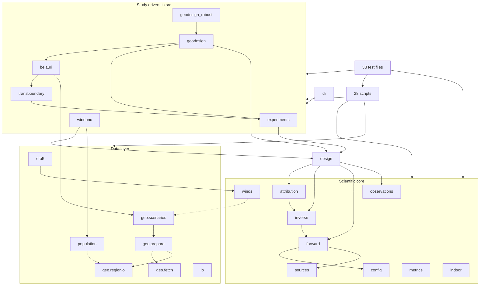
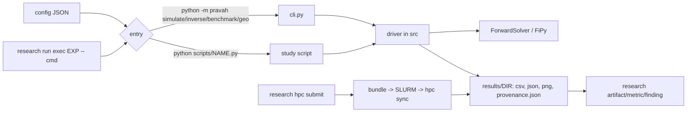

# PRAVAH architecture and workflow audit (Phase 2)

Audit of commit `4d9d68b` (baseline `baseline/pre-refactor-2026-10`, D-007) plus the uncommitted Research OS 1.0.0 upgrade. Research OS plan: **PLAN-005**
(T-039..T-043). Nothing in `src/`, `scripts/`, `configs/`, HPC config or the research records was changed by this audit.

Evidence labels: **[V]** verified by a command run during this audit; **[S]** suspected, evidence needed is stated; **[H]** historical or read from a document, not re-run.
Not done: the 24-minute test suite was not re-run (D-007 records 585 passed; `pytest --collect-only` still collects 585 [V]); no timing profile; no cluster command beyond
`research hpc doctor|datasets list|config` (read-only).

---

## 1. Executive assessment

**Health: sound core, over-grown periphery.** The scientific core is in good shape. `pyright` reports 0 errors [V]. The import graph of `src/pravah` has **no cycles** [V].
FiPy is imported in exactly one source file (`forward.py`) [V]. The `ForwardSolver` protocol is real and regression-locked (D-005, F-009). Nothing in `src/` imports
`research` [V], so the numerical kernels are not coupled to Research OS. The weakness is everything built on top of the core during Phase 2/3.

| Most serious debt | Evidence |
|---|---|
| **Experiment drivers live inside the library package and are re-implemented per study.** About 5,500 of 11,281 `src` lines (49%) are study drivers (`transboundary` 1128, `geodesign` 1091, `experiments` 985, `geodesign_robust` 933, `belauri` 771, `windunc` 598), plus 8,000 lines in `scripts/`. | `wc -l` [V] |
| **The test-set discipline (disjoint seeds, frozen-choice hash, "test is spent") is implemented 3-5 times independently.** | `check_ensembles` in `experiments.py:118`, `geodesign.py:361`, `transboundary.py` (3 copies with different signatures) [V]; `assert_frozen` in `windunc.py:127`, `scripts/population_design.py:100`, `population_design_exact.py`, `population_belauri.py` (4 copies) [V]. |
| **Docs describe an older architecture.** `README.md`, `architecture.md`, `extending.md` do not mention `windunc`, `population`, `era5` at all (0 matches) [V]. Six docs are plans or phase logs. | grep [V] |
| **Research OS strategy is selected but orchestration is not enabled** (`orchestration.enabled: false`, no hooks, MCP server not registered for this project, no Scientist Guide file). | `research config show --effective`, `~/.claude.json` [V] |
| **Evidence is not bound.** All four `supported` findings have `numerical: no_bindings` with 6-29 legacy numbers each. | `research evidence status` [V] |

**Biggest simplification:** one shared "study protocol" module (seeds, freeze, spend-once test) and one shared script runner (`say`/progress, atomic write, provenance,
resume). That removes an estimated 1,000-1,500 lines and, more importantly, makes the leakage guard something to test once.

**Biggest Research OS opportunities:** (1) bind evidence for F-002/6/7/9 and every new finding; (2) the native `tuning` one-shot test replaces hand-rolled test-spending in future
studies; (3) one approved `post_implementation` hook (regression gate) so cheaper models can iterate safely; (4) retire `scripts/register_research.py` and the
manifest/bundle logic in `scripts/hpc_run.py` once Research OS covers them (see section 6).

**Main risks:** a refactor silently changing FiPy outputs (mitigated by the regression gate, arm64 only on the laptop); a refactor changing seeds/ensembles and so
invalidating frozen pre-registered studies (EXP-026/027 are pre-registered against current code); the unresolved science (Q-013, F-035) being mistaken for an
engineering problem. This audit does not address Q-013.

**Correction to an earlier statement in this session:** `research strategy use sonnet_first` writes `orchestration.active_strategy` but `orchestration.enabled` is still
`false`. `strategy show` and `orchestrate route` already resolve against `sonnet_first`, but I did not verify what `enabled: false` blocks for `dispatch`/`verify`
(open item O-3). Also note `orchestrate route T-040` classed an *engineering audit* task as `scientific -> deep (Opus)` because the class comes from task type
`analysis`; use `--type implementation|verification` for engineering tasks or per-task overrides.

---

## 2. Current architecture

### 2.1 Layers as they actually are (by responsibility, not directory name)

| Responsibility | Modules (lines) | Notes |
|---|---|---|
| **Scientific core** | `forward` 482 (FiPy + `ForwardSolver`), `config` 438 (frozen dataclasses), `sources` 109, `inverse` 483, `observations` 149, `metrics` 101, `winds` 123, `indoor` 213, `attribution` 208 | Clean. `forward` -> `config`,`sources` only. |
| **Design / decision science** | `design` 884 (objectives, greedy, `build_case`, ensembles) | Core-adjacent; also holds `random_distribution` (unused outside tests) and a 144-line `build_case`. |
| **Data layer** | `geo/{fetch 463, prepare 654, regionio 370, scenarios 243}`, `population` 247, `era5` 78, `io` 134 | `prepare_region` is 255 lines [V]. `winds -> geo.scenarios` and `population -> geo.regionio` make the "core" depend on the data layer. |
| **Study drivers (experiment layer) inside the package** | `experiments` 985 (benchmark, alpha_selection, mismatch), `transboundary` 1128, `belauri` 771, `geodesign` 1091, `geodesign_robust` 933, `windunc` 598 | Each has its own seeds, freeze, progress, figure saving, CLI dispatch. |
| **Study drivers outside the package** | 28 scripts, 8,024 lines (`population_*` 2,900, `convergence_*` 1,000, `wind_error` 513, `prescribed_winds*` 700, ...) | Carry the Phase 3 studies; import the package, are imported by tests. |
| **Execution** | `cli.py` 235; `scripts/hpc_run.py` 257, `hpc_smoke.py`, `hpc_*.sh`, `slurm/phase3.sbatch` (superseded), `slurm/setup_env.sh` | Research OS owns submission since D-005/EXP-024. |
| **Research management** | `.research/`, `scripts/register_research.py`, `tools/architecture-explorer/` | See sections 5-6. |
| **Presentation** | `plotting` 147; 10 notebooks; per-module `_save_fig` | Notebooks belong to the user (do not modify). |

### 2.2 Dependency map (verified from imports)



Dotted edges = core depends on data layer (wrong direction). `geodesign_robust -> geodesign -> belauri -> transboundary -> experiments` is a four-deep chain of
study drivers importing each other for shared helpers: the helpers (seeds, ensembles, progress, saving figures) are the missing shared module.

### 2.3 Execution flow



`cmd_benchmark` dispatches on `cfg["experiment"]`, but only **18 of 46 configs** carry that key (28 have none; 7 of the 18 use an experiment id such as `EXP-023` instead of a driver name) [V]. The remaining
configs are consumed by named scripts. There are therefore two incompatible dispatch conventions.

---

## 3. Technical debt inventory

Action vocabulary: retain / consolidate / refactor / relocate / deprecate / remove. "Tests needed" is what must exist before the change.

### 3.1 Duplicated logic

| # | Where | Problem and evidence | Action | Risk | Tests needed |
|---|---|---|---|---|---|
| D1 | `experiments.py:118` `check_ensembles`, `transboundary.py` and `geodesign.py:357` variants; `_draw_key` x3 [V] | Same leakage guard, three signatures (CaseSpec / CaseDraw / dict) | Consolidate into one `protocol.disjoint(ensembles)` | **High** (guards pre-registered studies; behaviour must be identical incl. error messages tests assert on) | Existing guard tests plus a table-driven test over all three call shapes |
| D2 | `windunc.py:127`, `population_design.py:100`, `population_design_exact.py`, `population_belauri.py` `assert_frozen` + `frozen_hash`/`frozen_payload`/`config_hash` [V] | Freeze-before-test hash, 4 implementations; two hash different payloads | Consolidate; keep per-study payload builders | **High** (hash values recorded in provenance of past runs; new function must reproduce them or be versioned) | Golden hash test from an existing `provenance.json` |
| D3 | `_say` in `belauri`, `experiments`, `geodesign`, `transboundary`, `selection_stability`; `say` in 5 scripts [V] | Progress print wrapper x10 | Consolidate | Low | none beyond import |
| D4 | `_save_fig` in `belauri`, `geodesign`, `geodesign_robust` (the latter two byte-identical [V]) | Figure saving | Consolidate into `plotting` | Low | smoke figure test |
| D5 | `block_average` in `belauri` and `experiments`; `uniform_wind` in `geo/scenarios` and `transboundary`; `make_ensemble` in `experiments` and `windunc`; `select_alpha` in `geodesign` and `scripts/population_design.py`; `build_scenario` x4 | Same operation, near-identical logic [S: confirm equivalence by reading bodies] | Consolidate after reading each pair | Medium | Equivalence test per pair on shared fixture |
| D6 | `scripts/hpc_smoke.py:24` and `hpc_run.py:46` `sha256` (identical [V]); also in `capture_regression.py` | Hash helper x3 | Replace with one util | Low | none |
| D7 | `scripts/population_design.py` `main` and `population_design_exact.py` `main` have identical AST bodies for a function [V]; shared helpers `finish`, `finalise`, `guard_out`, `walk`, `values`, `check_seeds`, `historic_seeds`, `eval_stage`, `paired_tables` across 4 scripts | 2,900-line script family with copy-pasted scaffolding | Consolidate into one study module with per-study configs | Medium-high (EXP-016/026/020 pre-registered) | Smoke configs exist (16 smoke/full pairs [V]); run all smoke profiles before and after and diff outputs |
| D8 | `scripts/prescribed_winds.py` vs `prescribed_winds_converged.py`: `build_wind`, `case_list`, `run_case`, `stamp` duplicated [V] | Two scripts, one shared scaffold | Consolidate | Low-medium | smoke diff |
| D9 | `scripts/convergence_stage1.py` vs `bench_resolution.py`: `child`, `rss_gb`, memory probing | Duplicate subprocess probe | Consolidate or archive one | Low | none |
| D10 | `scripts/register_research.py` (51 lines) | Re-implements run-to-artifact/metric registration that `research run exec` + `research.log_metric/register_artifact` (documented in AGENTS.md) provide | Remove after confirming no workflow uses it (referenced only by `README.md`, `docs/architecture.md`, `docs/implementation-plan.md` [V]) | Low | none |

### 3.2 Dead or legacy code

Only items with **zero references outside their own file and tests** by AST + text search over `src scripts tests tools notebooks slurm configs` [V]:

| Item | Verdict |
|---|---|
| `design.py:874 random_distribution` | Suspected dead; referenced by one test only. Confirm intent with git log before removing. |
| `era5.py:59 box_mean` | Library API with a test; keep unless ERA5 ingestion is dropped. |
| `forward.py:141 _boundary_coefficients` | Private; one test uses it. Test of an internal; relocate the test. |
| `geo/regionio.py:32 to_metric` | Public helper, tested, unused by code. Keep or remove with its test. |
| `plotting.py:87 plot_layout`, `:137 plot_error_vs_budget` | Not called from src/scripts/tests/notebooks by name [V] (notebooks searched as raw JSON). Suspected dead. |
| `slurm/phase3.sbatch` (+ `slurm/setup_env.sh` which it and `hpc_run.py` mention) | **Superseded** by Research OS submission (hpc-runbook says so) but still referenced by AGENTS.md, notebook 10, PLAN-004/T-033 text. Deprecate; do not delete while T-033's text still says "submit slurm/phase3.sbatch". |
| `scripts/hpc_regression_selfcheck.sh` | No references anywhere [V]. Suspected unused; confirm before removal. |
| `tools/PRAVAH_CLAUDE_CODE_PROMPT.md` (15 KB) | A task prompt for building the explorer, not documentation. Relocate to `.research/notes` or delete. |
| `.claude/skills/*` (322 tracked files, 23 MB: design, impeccable, ui-ux, vercel-react, ...) | Generic front-end design skills; not related to a numerical Python project. They enlarge the skill list every session. Remove from tracking or move to user scope. Needs your decision (O-6). |
| `tools/architecture-explorer/` (27 files, 81 MB on disk incl. `node_modules`) | A separate React app unrelated to run/test of PRAVAH. Keep if you use it; otherwise move out of the repo. Needs your decision (O-7). |
| `slow` pytest marker | Declared in `pyproject.toml`, used **0 times** [V]. The 21-24 minute suite cannot be split into fast/slow without it. |
| `jupyter`, `ipykernel` as hard dependencies | Dev-only needs; move to `dev` extra. Verify with `deptry`-style search before. |

Do **not** treat the 28 scripts as dead: each is an executable entry point named in a pre-registered experiment, config or doc [S: per-script confirmation is task 1.2 of Phase 3].

### 3.3 Structural problems

| # | Where | Problem | Action |
|---|---|---|---|
| S1 | `geo/prepare.py:306 prepare_region` (255 lines), `design.py:459 build_case` (144), `geodesign_robust.py:811 run_geodesign_robust` (123), `forward.py:227 simulate` (119), `belauri.py:658` (114) | Oversized functions | Refactor only when touched for another reason; `simulate` is regression-locked, do not split without the gate |
| S2 | `winds -> geo.scenarios`, `population -> geo.regionio` | Core depends on data layer | Move the specific function(s) used, or invert the call |
| S3 | `cli.py` dispatch (`cfg["experiment"]` for 15/43 configs) | Two dispatch conventions | Choose one registry (see 8) |
| S4 | `ResponseCache` keys exclude code (AGENTS/runbook: "config hashed, code not") | A code change can return a stale cache hit [H, runbook] | Add a code-version component to the key or document and enforce cache wipe in the harness |
| S5 | Hidden state | Not found at module level in the sampled modules [S]; `_prep` in `geodesign`/`geodesign_robust` duplicated | Check during Phase 3 batch 3 |
| S6 | Hard-coded paths | `grep` for `/Users/`, `/home/`, `sys.path` in `src scripts tests slurm configs` found **nothing** [V] | none (the rule in AGENTS.md is being obeyed) |
| S7 | Tests | 38 files / 585 tests; `tests/test_geo_real.py` and 6 more skip without `data/belauri/manifest.json`; imports from `scripts/` are tested (`test_hpc_run`, `test_convergence_stage2`) which ties tests to script layout | Add the `slow` marker and a fast subset; keep script tests until scripts are folded |

---

## 4. Scientific architecture assessment

**Strengths.** Parameter kinds are explicit in `config` (emission amplitude vs inflow-basis amplitude); `ForwardSolver` allows solver substitution without touching
callers (F-009); the study polygon is a mask not a wall; the `windunc.strategy_c` function is guarded to see only an ensemble, `y` and a layout (no truth leakage),
which is the right pattern. Held-out discipline is taken seriously.

**Risks to extensibility (by task):**
- *Change the solver*: easy via `ForwardSolver`; cost is re-passing the architecture-scoped regression gate.
- *Add a physical mechanism (e.g. chemistry)*: `forward.simulate` is a 119-line function with tag physics mixed in (T-015). No term-registry; each term is an edit to `forward.py`. Acceptable until a second mechanism is needed. **Do not generalise now.**
- *Substitute meteorology*: `winds` + `era5` give a series-to-segments path, but `winds` imports `geo.scenarios` (S2). Clean this one dependency.
- *Add an observation-based objective*: `observations` + `inverse.solve_linear` are fine; `design` couples objectives to synthetic case generation (`build_case`). A real-data objective needs a `Case` that is built from measurements, not from `q` + noise. This is the key interface to design before Belauri measurements arrive.

**Toy vs observational separation.** Currently maintained by **naming and prose** (every doc says "SYNTHETIC"), not by structure. `belauri.py` is "real geography + synthetic emissions/winds",
which is neither toy nor observational. Nothing in code or result metadata marks a result as `synthetic | semi-real | observed`. Recommendation: add one required
field, `data_provenance: synthetic|geography_only|observed`, to `provenance.json` (written by the shared runner), and keep toy studies under an `experiments/toy/` area so
the future `experiments/belauri_obs/` is physically separate. No observational validation exists and none should be implied.

---

## 5. Research OS opportunity matrix

Installed version `1.0.0` [V]; `config check` valid; `upgrade --dry-run` nothing to do; `agents-md --diff` up to date.

| Current PRAVAH workflow | Existing implementation | Research OS capability | Recommendation | Priority | Benefit |
|---|---|---|---|---|---|
| Run tracking, experiment IDs, provenance | `research run exec` + per-run `provenance.json` in `results/` | Native run records, artifacts | **Adopt native** for tracking; **retain** `provenance.json` for scientific facts (config hash, seeds) | Done | - |
| Metric/artifact registration | `scripts/register_research.py` | `research.log_metric/register_artifact`, `artifact add` | **Adopt native**, remove script (D10) | Low | -51 lines, one path |
| Numbers in findings | prose in `findings/F-*.md`; `no_bindings` for all 4 supported | `evidence bind/verify/suggest/provenance` | **Adopt native** for every new finding; backfill F-002/6/7/9 only after checking records | **High** | Catches transcription errors (a past layout bug slipped through) |
| Test-set spending | `assert_frozen` x4, `check_ensembles` x3, hand-tracked "seed 303 burned" | `tuning declare/trial/select/test` (one-shot test) | **Adopt native** for new tuning studies (alpha, layouts); **retain** project guards for studies not framed as tuning | High | Enforced one-shot; the burned-seed note becomes a record |
| Task contracts / delegation | AGENTS.md prose | `task context`, `orchestrate contract/verify`, frozen tests, pins | **Adopt native**; needs `orchestration.enabled: true` [S] | High | Cheap models get bounded, checkable work |
| Model allocation | none (all `claude-code`) | `strategy` (`sonnet_first` selected) | **Adopt native**; per-task overrides for science vs mechanical | High | Cost |
| Regression/quality gates | manual commands in AGENTS.md | `hook` stages, `task` checks | **Build project harness capability** (section 5.2); propose only | High | Safe iteration |
| HPC submit/sync | `hpc submit/sync`, `scripts/hpc_run.py` | Native, immutable bundles, submission identity | **Adopt native**; **retain** `hpc_run.py` as inner phase runner until proven redundant | Done | - |
| HPC datasets | `scripts/hpc_link_datasets.sh`, one dataset complete (`belauri-geography`), `datasets` dir has no manifest | `hpc datasets list/check/adopt` (filesystem is truth) | **Retain** the link script (paths frozen in configs); write a manifest for `datasets` via `adopt` after inspection | Low | removes "unknown" entry |
| Experiment completion | `needs_review` x4 experiments | `experiment check` (post_experiment hooks), `finding review` | **Adopt native**; process the 4 awaiting-review findings with an independent reviewer | Medium | Closes the evidence loop |
| Scientist Guide | `docs/SCIENTIST_GUIDE.md` missing; `guide status` lists pending syntheses | `guide init/refresh` (Opus) | **Defer**: valuable, expensive, not an engineering blocker; decide after Phase 3 (O-5) | Low | - |
| Literature | `source` records unused | `source add/mark` | **Defer** | Low | - |
| Usage accounting | none recorded | `usage` (only with headless dispatch) | **Defer**; interactive usage is not captured | Low | - |
| MCP | not registered in this project | `research mcp install --client claude` | **Optional**; CLI covers all uses and MCP omits orchestration/hooks/HPC. Skip unless you want it for the editor | Low | - |
| Doc status tables | `docs/phase3-findings.md`, `phase2-validation.md` repeat finding status | `research current/report` | **Adopt native**, trim docs | Medium | Removes a second source of truth |

### 5.1 Model allocation (for `sonnet_first`)

`sonnet_first` is a good default: balanced (Sonnet) coordinates and verifies, fast (Haiku) implements `checked` and `mechanical` work (3 attempts, then escalates to
Sonnet), deep (Opus) only for `scientific` class and the guide; Sonnet gets 2 attempts then hands to you. Alternatives: `haiku_max` is cheaper but PRAVAH has few
mature oracles outside the regression gate, so retries would cost more than they save; `sonnet_heavy` is the right fallback for batches without verifiers (Phase 3 batches
3-5); `opus_first` is not justified for engineering.

| Task class in PRAVAH | Model | Pre-condition before delegating |
|---|---|---|
| Dead-code removal, import moves, helper consolidation (D3, D4, D6) | Haiku | Regression gate + `pyright` + relevant test file; file boundary in contract |
| Consolidating guards (D1, D2) and script family (D7, D8) | Sonnet implements, **independent** verifier reviews | Golden hash test and smoke-output diff written **first** and frozen |
| Docs consolidation | Haiku drafts, Sonnet checks against code | Link/reference check |
| Anything touching `forward.py`, seeds, or frozen configs | Sonnet, regression gate mandatory | Gate green on arm64 |
| Interpreting results, closing Q-013/F-035 | Opus + human (GPT) | Not part of Phase 3 |
| Reviewing findings F-030..F-035 | Independent verifier (scientific-reviewer) | - |

Per-task pins are justified only for the guard consolidation (pin Sonnet; do not let a retry fall to Haiku). Keep single-file edits single-agent.

### 5.2 Proposed harness (propose only; **nothing enabled or approved**)

`harness.hooks` is empty today [V]. Stages: `preflight`, `post_implementation`, `pre_experiment`, `post_experiment` (the last runs through `research experiment check`).
Hooks run with your filesystem permissions, unsandboxed. Exact commands below are **drafts** that must be read and tested by a human first; the first two assume the
regression scripts' CLI which I did not execute.

| Name | Stage | Command (draft) | Blocks? | Runtime | Existing? |
|---|---|---|---|---|---|
| `types` | post_implementation | `.venv/bin/pyright` | yes | ~10 s [V: 9.4 s] | `pyright` exists |
| `fast-tests` | post_implementation | `.venv/bin/pytest -q -m "not slow" -x` | yes | needs the `slow` marker to be applied (currently 0 uses) | marker missing |
| `fipy-gate` | post_implementation (tasks that touch `forward.py`, `config.py`, `sources.py`, `inverse.py`) | `.venv/bin/python scripts/capture_regression.py <out> && .venv/bin/python scripts/compare_runs.py results/solver-regression/before <out>` expecting `21 files compared, 0 differ` | yes | **[H] unknown; read both scripts first** | scripts exist; arm64 only (D-005) |
| `smoke-diff` | post_implementation for script-family consolidation | run each `*_smoke.json` profile before/after, compare output hashes | yes | unknown | partly (16 smoke configs) |
| `config-valid` | preflight | validate a config against `config.py` dataclasses and, for EXP configs, check seed ranges are disjoint | yes | seconds | needs writing (small) |
| `hpc-preflight` | pre_experiment | `.research/bin/research hpc doctor` + `hpc datasets check belauri-geography` | yes | ~2 s [V for doctor] | exists |
| `result-complete` | post_experiment | check `provenance.json`, `summary.*`, RAW checksums present | no (advisory) | seconds | needs writing |

Informational (skills/instructions) vs enforced (hooks): the held-out rules and "never loosen a tolerance" remain instructions; only the commands above are enforced.
Candidate **project skills** (cheap to write, reusable): `regression-gate` (how/when, expected output, arch scoping), `study-protocol` (the seeds/freeze rules once the shared
module exists), `add-study-script`. Do not add skills until the shared protocol module exists.

### 5.3 Agent efficiency

- `research current` costs about 2.9k tokens [V header] and already holds the state; AGENTS.md is 160 lines, of which the managed Research OS block is ~100. This is acceptable.
- Cost drivers: (a) 20 docs / 4,987 lines with no "read this one" except `docs/README.md`; (b) 322 irrelevant tracked `.claude/skills` files inflate the skill list each session; (c) 28 scripts with no index mapping *experiment -> script -> config -> result dir*.
- Fixes: trim skills (O-6); add a generated one-line-per-script index (section 8); move phase logs out of the reading path.

---

## 6. HPC and data workflow assessment

**What works [V/H].** `hpc doctor` passes (ssh, sbatch, squeue, sacct, rsync, paths writable); one dataset `belauri-geography` is complete with a manifest; the Research OS
round trip is verified (EXP-024); cluster regression gate passes under its own x86_64 baseline (D-005); GPUs correctly 0.

**Duplicated.**
- `scripts/hpc_run.py` writes an `hpc_manifest.json` "for `research run attach`" and builds its own tar bundle with sha256. Research OS 1.0.0 builds immutable bundles and records provenance natively. [S] Confirm whether any phase of the inner runner still needs its own bundle; if not, drop the bundle/manifest half and keep the phase sequencing/resume.
- `slurm/phase3.sbatch` is superseded (said so in the runbook).
- `shared_data/datasets` is listed with "no manifest": inspect, then `research hpc datasets adopt datasets` rather than inventing a registry.

**What to change.** Almost nothing in the working path. Do not touch HPC config. Small cleanups only: deprecate `phase3.sbatch`, update PLAN-004/T-033 wording (history: it still instructs the superseded route), write the missing dataset manifest when approved.

**Risk to keep in view.** Checkpoint/resume hashes config but not code (S4); on the cluster this can silently reuse stale `ResponseCache` entries after a code change.

---

## 7. Documentation cleanup inventory

All docs except `baseline-qualification.md` (10-13) and `hpc-runbook.md` (10-12) were last changed 10-10..10-11 [V, git log].

| Doc | Lines | Class | Action |
|---|---|---|---|
| `README.md` | 273 | Current but incomplete: no `windunc`, `population`, `era5` | Refactor into install/run/links (target ~100 lines) |
| `docs/README.md` | 28 | Current, authoritative index | Retain |
| `docs/specification.md` | 67 | Current (equations, units) | Retain; the one equations doc |
| `docs/numerical-methodology.md` | 116 | Current | Retain |
| `docs/architecture.md` | 110 | **Outdated** (misses 3 modules; pre-Phase-3 layout) | Rewrite from section 8 of this audit |
| `docs/extending.md` | 812 | Current but long; no `windunc`/`population`/`era5` | Consolidate; split "how to add X" tasks |
| `docs/solver-interchangeability.md` | 111 | Current | Merge into `extending.md` |
| `docs/winds.md` | 159 | Current | Retain |
| `docs/population-data.md` | 119 | Current | Retain (data) |
| `docs/geography.md`, `belauri-forward.md`, `geodesign.md`, `transboundary.md`, `transfer.md` | 201/72/435/325/53 | Current area docs; `geodesign.md`, `transboundary.md` are results-heavy | Retain; strip result tables that duplicate findings |
| `docs/hpc-runbook.md` | 541 | Current in its top 150 lines; sections 5-11 are stage logs and a "state at handoff" | Cut to procedure (~150 lines); move EXP-specific specs to the experiments |
| `docs/baseline-qualification.md` | 176 | Authoritative for D-007 | Retain frozen |
| `docs/validation.md` | 501 | Historical (v0 results; 196/447-era test counts) | Archive to `docs/archive/` |
| `docs/phase2-validation.md` | 467 | Historical + "Wrap-up log" that AGENTS.md says to read before changing results | Retain until its wrap-up is moved into Research OS (D-003 covers part), then archive |
| `docs/phase3-findings.md` | 82 | Duplicates findings status | Replace by a pointer to `research current` + the "Phase 4 recommendations" list moved to a Research OS note |
| `docs/implementation-plan.md`, `docs/phase2-plan.md` | 192/147 | Superseded plans | Archive |
| `notebooks/*` (10) | - | User-owned outputs | Do not touch |
| `tools/PRAVAH_CLAUDE_CODE_PROMPT.md` | - | Temporary | Delete or move to a note |
| `AGENTS.md` | 169 | Current; PRAVAH part ~55 lines | Retain; keep compact |

Proposed minimal set (9 files): `README.md`, `docs/README.md` (index), `specification.md` (equations, numerics), `architecture.md` (this audit's section 8, kept current),
`extending.md` (including solver swap), `data.md` (geography + population + winds + transfer), `hpc.md` (procedure only), `baseline-qualification.md`, `docs/archive/`.
Nothing should be deleted outright: archive to preserve unrecovered knowledge (the phase2 wrap-up log and the Phase 3 reviewer findings, for example).

---

## 8. Proposed target architecture

Principle: small change, explicit data flow, no new framework. The goal is to move study drivers out of the library and give them one shared scaffold.

```
src/pravah/
  core/        config.py sources.py forward.py inverse.py observations.py metrics.py indoor.py attribution.py winds.py
  design/      design.py (objectives, greedy), cases.py (Case/CaseSpec/CaseDraw; build_case)
  data/        geo/ (fetch, prepare, regionio, scenarios)  population.py  era5.py  io.py
  protocol.py  seeds, disjoint-ensemble check, freeze-before-test hash, spend-once test      <- replaces D1, D2
  runner.py    progress, atomic write, provenance.json (+data_provenance), figure saving     <- replaces D3, D4, D6
  cli.py       one registry: {name -> function}
studies/                       # NOT in the installed package
  toy/         transboundary, wind_error, population_toy, prescribed_winds, convergence_stage1/2 ...
  belauri/     belauri_forward, geodesign, geodesign_robust, population_belauri, convergence on Belauri geography
  observed/    (empty until measurements exist)
configs/ <study>/..            # one folder per study; smoke next to full
scripts/       capture_regression.py compare_runs.py verify_notebooks.py hpc_* (infrastructure only)
docs/          see section 7
```

```mermaid
graph TD
  studies --> protocol; studies --> runner; studies --> design; studies --> core; studies --> data
  design --> core; data --> core
  runner -.-> RO[Research OS CLI: run exec / artifact / hpc]
  core -.x RO
```

Dependency direction: `studies -> {protocol, runner, design, data} -> core`; **nothing in `core` imports `data` or `research`** (fixes S2). Research OS is reached only
via CLI from `runner` or the shell, never by numerical kernels.

**Choices and trade-offs.**
1. *Move `transboundary/belauri/geodesign/...` out of the package.* Benefit: toy vs Belauri vs observed becomes physical. Cost: import paths change; notebooks (user-owned) import these modules, so keep **compat shims** in `pravah/` until you agree to update notebooks. Alternative: leave in place, add `pravah.studies` sub-package (cheaper, same logic, less physical separation). I recommend the cheaper alternative first (O-1).
2. *No plugin/registry classes.* A dict in `cli.py` mapping study name -> callable is enough.
3. *Keep scripts that are experiment entry points where they are until each is mapped to its EXP.* Moving them breaks documented commands in pre-registered records.
4. *Do not unify `population_*` scripts into one mega-script in a single step.* First extract shared helpers (D7), then decide.

**Testing strategy.** Add the `slow` marker to the longest tests (find them with `pytest --durations=30`, not done here); fast subset for hooks; regression gate for core; golden-hash test for protocol; smoke-profile diff for study consolidation; keep geo-real tests skipping without data.

---

## 9. Phase 3 roadmap

Ordered; each batch is independently committable (commit after each, per AGENTS.md). "Gate" = regression gate on arm64 + `pyright` + affected tests.

| # | Batch | Files | Change | Risk | Acceptance | Model | Class |
|---|---|---|---|---|---|---|---|
| 0 | Enable harness | `.research/config.yaml` | Set `orchestration.enabled` (after O-3), apply hooks `types`, `fast-tests` after human approval; add `slow` markers using `--durations` | Low | `research orchestrate verify` runs on a sample task | Sonnet | Necessary |
| 1 | Evidence | `.research/` | Bind numbers for F-002/6/7/9 only if records verify; review F-030..F-035 independently | Low | `evidence status` shows bindings | Sonnet + independent verifier | Necessary |
| 2 | Remove verified-dead and stray files | `tools/PRAVAH_CLAUDE_CODE_PROMPT.md`, `scripts/register_research.py`, `hpc_regression_selfcheck.sh`, `plotting.plot_*` (after confirming) | Delete/archive | Low | Gate + full tests | Haiku | Valuable |
| 3 | Shared helpers | new `runner.py`; D3, D4, D6 | Replace copies | Low | Gate; smoke outputs identical | Haiku | Valuable |
| 4 | Shared protocol | new `protocol.py`; D1, D2 | Replace 3+4 guards | **High** | Golden hashes reproduce; guard tests pass; pre-registered configs unchanged | Sonnet, independent reviewer | Necessary |
| 5 | Dependency direction | `winds.py`, `population.py`, `geo/scenarios.py` | Remove S2 edges | Medium | Import-graph test: core imports nothing from data | Sonnet | Necessary |
| 6 | Script family | D7, D8, D9 | Extract common module | Medium-high | Smoke-profile outputs equal before/after | Sonnet | Valuable |
| 7 | Study layout | `src/pravah` study drivers -> `pravah.studies`; config folders; one CLI registry | Move + shims | Medium | All notebooks still run (`verify_notebooks.py`, user-owned: **ask**) | Sonnet | Optional until O-1 |
| 8 | Provenance field | `runner.py`, `provenance.json` | add `data_provenance` | Low | New runs record it; old ones untouched | Haiku | Valuable |
| 9 | Docs | section 7 | Rewrite `architecture.md`, trim `README.md`, archive 4 docs, trim runbook | Low | Link check; `docs/README.md` index matches | Haiku draft + Sonnet check | Valuable |
| 10 | HPC cleanup | `slurm/`, `hpc_run.py` | Deprecate sbatch, decide on bundle half | Low | `hpc submit --dry-run` unchanged | Sonnet | Optional |
| 11 | Final | - | Full tests (24 min), gate, notebook verify, checkpoint | - | Same results as D-007 invariants | Sonnet | Necessary |

Do not start the science queue (EXP-027, Q-013) inside a refactor batch: EXP-027 and EXP-026 are pre-registered against current code and any change to seeds or ensembles needs a new decision.

---

## 10. Open questions and decisions needed from you

- **O-1** Move study drivers out of the installed package (physical toy/Belauri/observed split) or only into `pravah.studies` with shims? (Recommend the latter first.)
- **O-2** May I draft and test the hook commands in section 5.2? (Approval is yours via `research hook approve`.) The `fipy-gate` hook is arm64-only.
- **O-3** Should `orchestration.enabled` become true now that `sonnet_first` is selected? I did not test what `false` blocks.
- **O-4** Do you accept archiving (not deleting) `validation.md`, `implementation-plan.md`, `phase2-plan.md` and, after moving its wrap-up log, `phase2-validation.md`?
- **O-5** Scientist Guide (`guide init`): now, or after Phase 3?
- **O-6** Remove the 322 tracked front-end design skills in `.claude/skills` (23 MB, unrelated to PRAVAH), or keep?
- **O-7** Keep `tools/architecture-explorer` (81 MB with `node_modules`) in this repo?
- **O-8** Findings F-030..F-035 await independent review (F-035 reviewer says needs_work): schedule the review before refactoring or after?
- **O-9** Apply `research setup agents --provider claude --preset scientific --apply` (creates 3 `.claude/agents/research-*.md` files)? Not applied.
- **O-10** Test-count and runtime: run the 24-minute suite again before Phase 3 batch 2, or trust D-007's measurement?

## Limits of this audit

Not read line-by-line: the 28 scripts and 6 study drivers (similarity found by AST/name matching, so D5 pairs are *suspected*-equivalent until bodies are compared); no coverage
or timing run; no test of what `orchestration.enabled: false` blocks; hook commands untried; the remote cluster was only queried read-only.
