# Dynamic population-weighted sensor deployment and source-history inference in PRAVAH

**Status: PROVISIONAL.** All registered experiments except DYN-08 (Belauri, **not run**) and the decisive EXP-027b (needs approval) have a result, but no finding in this report has passed an independent review of its *final* wording: earlier versions of five findings were reviewed and all were overturned or corrected (described below), and DYN-03/DYN-04 (F-053, F-050) have not been reviewed at all. Everything is **synthetic**: real geography and a synthetic population fixture may appear, but there is **no measured pollutant concentration** anywhere and **no empirical air-quality validation**.

Research OS plan: `PLAN-007`. Records are cited as `Q-` (questions), `EXP-` (experiments), `RUN-` (runs), `F-` (findings), `D-` (decisions). Git: `master`, see Appendix A.

Vocabulary used for every result (as requested): **verified numerical behaviour** · **supported synthetic result** (reviewed) · **preliminary finding** (not reviewed, or reviewed with open items) · **inconclusive** · **contradicted** · **experiment invalid** · **not run** · **blocked**.

---

## 1. Executive summary

**What was built.** A time-dependent extension of the existing PRAVAH finite-volume advection–diffusion model: source histories $q_j(t)$ and boundary inflows are represented by temporal bins; the forward solver was **not changed** — each (source, bin) pair becomes one virtual source whose profile is that bin's indicator, so the existing linear-response cache, sampling and population-RMSE code are reused. On top of it: a synthetic event generator (8 families × 6 winds), three inverse estimators (static M0, independent-bin M1, temporally regularised nonnegative M2), a population-weighted evaluation, a Gaussian linear-Bayes sensor-design surrogate with exhaustive/swap search, and registered studies on HPC and laptop. Test counts: 637 pass in the default suite (15 tests ≥ 25 s are now marked `slow`); the architecture-scoped FiPy regression gate is `21 files compared, 0 differ` on both arm64 (laptop) and x86_64 (Duke, RUN-0066).

**Main conclusions** (all synthetic, toy geometry, matched model unless stated):

1. **Verified numerical behaviour (DYN-00, RUN-0091, 25/25 checks).** Mass budgets close to ≈1e-15 for activation/shutdown, simultaneous changes, pulses with wind reversal, rotating winds with changing inflow faces, tangential and zero wind; superposition holds to 1e-15; a closed-box analytic mass history converges with temporal order 0.997; bin-expanded responses reproduce direct time-varying runs to 1e-15; inflow bases switch face exactly as the wind reverses. Time/space refinement is only checked for monotone convergence.
2. **Temporal regularisation helps only where sensors are scarce (preliminary, F-054).** With 4 sensors, TV-regularised M2 lowers population-weighted RMSE by **16 % (2 % noise) and 20 % (10 % noise)** against a *fair* independent-bin baseline (same static prior), and by 26–32 % against a zero-prior baseline. With 9 sensors the gain is ≤ 2 %. The effect is wind-dependent (it sits in three of six winds), the 6-wind cluster-bootstrap interval just reaches zero, and an earlier, larger "24–25 %" result (F-037/F-039) was an artefact of an under-converged solver and an under-tuned baseline.
3. **Model error dominates sensor count (preliminary, F-049).** A 20° wind-direction error multiplies the 4-sensor error by 3.7–4.6 and the 9-sensor error by 7.3–7.5; the 9-sensor layout ends up *worse in absolute terms* than the 4-sensor one. M2's advantage over M1 shrinks from 20 % to 3 % at 20°. TV regularisation buys no robustness.
4. **The empirical design objective is not estimable with 6 episodes, and its proxy is unreliable (preliminary, F-046).** For the registered 5 %-regret criterion the number of independent design episodes needed is ≥ 24–48 in two of four cells and not reached by 192 in the other two; with 6 episodes sensor layouts are catastrophically wrong when an ensemble misses a wind (regret up to ×29). Evaluated with the real constrained estimator, the proxy-based verdicts do **not** carry over (e.g. a layout the proxy calls sufficient from N=24 costs +28 % [8, 54] in the real estimator).
5. **EXP-027 is VOID (preliminary, F-048).** On a common padded Belauri domain the deliberately coarse 2 km control passes the paired test in all cells; replicate design draws of 6 cases move layouts by 3–4 km, more than degrading the mesh 4–8×. The 500 m mesh stays *provisionally* admissible only; the test could not fail.
6. **Local vs transboundary attribution is limited by geometry, not by noise (preliminary, F-044).** With 9 sensors attribution errors fall below 10 % from a distinguishability of about 8 noise standard deviations; with 4 sensors two of six winds fail completely even at 16. A boundary-reference sensor buys no general benefit at equal budget. Some events (influx ending after a wind reversal) are unobservable by construction.
7. **Process lesson (important).** Eleven early findings (F-036, F-037, F-038, F-039, F-040, F-041, F-042, F-043, F-045, F-047, F-052) were wrong, vacuous or overstated for reasons found by independent review or by my own diagnostics (units bug, non-converged solver, vacuous check, wrong distinguishability axis, selection-biased reference, two miscounts). All are superseded in Research OS; the corrected versions are what this report uses.

8. **History is valuable, but not for the registered reason (preliminary, F-053).** A causal filter lowers population-weighted RMSE by 52–56 % (4 sensors) and 77–80 % (9 sensors) relative to a current-time-only estimator; retrospective smoothing (which uses future data) improves a further 32–58 %. The registered prediction that history helps *more under varying wind* is **contradicted**: the gain is as large on steady winds, because it comes from plume carry-over.
9. **Dynamic-optimal layouts beat random and spread layouts, but not the simplest informed heuristic (preliminary, F-050).** Layouts designed on the time-resolved surrogate lower held-out RMSE by 28–84 % against random and (k ≥ 2) spread layouts, by 40–50 % against static-optimal layouts at k = 3, but are *tied or worse* than putting sensors in the most populated cells at k = 3 and 5 (+8 to +23 %), and lose to source-oriented layouts at k = 2 with 10 % noise (+35 %). With three concentrated settlements, "go where people live" is a strong baseline.

**Unresolved / pending:** DYN-08 Belauri synthetic deployment was **not run** (and EXP-026 is not integrated); EXP-027b (≥ 48–96 cases per draw) needs approval; no independent review of the final wording of F-044, F-046, F-050, F-053, F-054, F-048, F-049.

**Next scientific priorities:** (i) a *constrained-estimator-aware* design objective and stratified design ensembles (the surrogate ranks layouts well only at k ≥ 3); (ii) EXP-027b with ≥ 48 cases per draw; (iii) model-error-aware tuning and wind-uncertain inversion; (iv) Belauri-scale dynamic study with ERA5 winds.

---

## 2. Motivation and scientific objective

*Why sparse monitoring matters.* Regulatory-grade monitors are expensive; a region of tens of kilometres is typically served by a handful of fixed sensors. Where to put them is a decision made once, under uncertainty about future sources and winds.

*Why time dependence matters.* Emissions are not constant: traffic cycles, factories switch on and off, and pollution crossing the boundary arrives in episodes. A static inversion forces one number per source and cannot represent a change; it also cannot separate "a local source increased" from "a plume arrived".

*Source identification ≠ exposure reconstruction.* The first asks "which sources are active and when"; the second asks "what concentration do people breathe". A layout good for one need not be good for the other (RQ-D8). A source can be non-identifiable while the exposure field is still well reconstructed, and vice versa.

*Why population weighting is the objective.* We weight reconstruction error by where people live, $w_i=\rho_i\Delta A_i/\sum_j\rho_j\Delta A_j$ ($\rho$ = population density). Population is an **evaluation weight only**: it is not a source, not a boundary condition, and unpopulated cells stay in the physical model (pollution still moves through them); sensors may sit in zero-population cells if that helps reconstruct populated ones.

*What this project is not.* It is not a model of Belauri air quality, not a calibration against data, and not an operational network design. Everything is a controlled numerical testbed for *methods*.

---

## 3. Mathematical foundations

### 3.1 Forward model: advection–diffusion–removal

On a rectangular domain $\Omega$, depth-averaged over a mixing height $H$ (m),

$$\partial_t C+\nabla\!\cdot(\mathbf u\,C)=\nabla\!\cdot(K\nabla C)-\lambda C+\sum_{j=1}^{M}\frac{q_j(t)}{H}\,\phi_j(\mathbf x).$$

$C$ is concentration (µg m⁻³), $\mathbf u(t)$ the prescribed wind, $K$ diffusivity, $\lambda$ first-order removal (s⁻¹), $q_j\ge 0$ the emission rate (µg s⁻¹), and $\phi_j$ a **known** spatial footprint normalised so that $\int\phi_j\,dA=1$ (m⁻²). Footprints are Gaussian (point), road rasters (line) or built-up rasters (area); `dyn00_verify.py` confirms $\sum_i\phi_{j,i}\Delta A=1$ to 2e-16 for all three types. Unknown are the histories $q_j(t)$.

**Boundary / transboundary input.** On each outer face the sign of $\mathbf u\cdot\mathbf n$ classifies it as inflow or outflow *per wind segment*. Outflow faces export mass by upwinding; inflow faces carry a prescribed concentration $a_k\,\varphi_k(t)$ (the *inflow basis* amplitude $a_k$ in µg m⁻³, not an emission). Therefore external pollution is a separate parameter class, and a basis on a face that is outflow under the current wind has **exactly zero** effect (verified, §7). This is also the source of structural non-identifiability discussed in §12.

### 3.2 Discretisation and the state-space form

PRAVAH uses a finite-volume discretisation (FiPy) with an *exponential* convection scheme and implicit Euler in time. One step is a linear map

$$\mathbf c_{t+1}=A_t(\mathbf u_t,K)\,\mathbf c_t+B_t\,\mathbf q_t+G_t\,\mathbf b_t,\qquad \mathbf y_t=H_{\mathcal D}\,\mathbf c_t+\boldsymbol\epsilon_t,$$

with $\mathcal D$ the sensor set, $H_{\mathcal D}$ the (interpolating) sampling operator and $\boldsymbol\epsilon_t\sim\mathcal N(0,\sigma^2)$. $A_t$ is **never** formed as a dense matrix; the solver is a black-box action. Implicit Euler is first order in time (observed order 0.997 on the closed-box analytic control, `fig03`), unconditionally stable, and numerically diffusive: the effective diffusivity exceeds the nominal $K$ by a factor 2.4–9.4 (established earlier in the project; see AGENTS.md). The Van Leer scheme is nonlinear and is **not** usable in the superposition-based inverse.

### 3.3 Temporal basis and response operators

The unknown histories are expanded in a small temporal basis: $N_b=6$ piecewise-constant bins of 1 h over 6 h. Because the scheme is linear in $\theta=(q,a)$, the concentration is

$$\mathbf c=\mathbf c_0+\sum_{j,b}\theta_{jb}\,\mathbf g_{jb},$$

where $\mathbf g_{jb}$ is the response to a unit source $j$ active only in bin $b$. **Implementation trick:** a `GaussianSource` already takes a piecewise-constant profile, so $\mathbf g_{jb}$ is obtained by running the *existing* forward solver on an "expanded" scenario in which each source/basis is replaced by $N_b$ copies with indicator profiles (`pravah.dynamic.expand`). The existing `ResponseCache` (whose key covers scenario, solver, parameters, schema and package version) is reused. Five parameters × six bins = 30 forward solves per wind; with the cache this is paid once per wind. A unit test (`test_expanded_responses_match_direct_history`) verifies that the bin sum equals one direct run with the same piecewise profile to $10^{-6}$, and DYN-00 repeats it to $10^{-15}$.

For sensor set $\mathcal D$ the observation operator $A_{\mathcal D}$ stacks the sampled $\mathbf g_{jb}$ over the observation times (every 600 s, 36 times) and sensors, time-major.

### 3.4 Inverse problem: three estimators

With whitened data $\tilde y=(y-y_0)/\sigma$ and **fixed physical reference amplitudes** $r_j$ ($10^5$ µg s⁻¹ for emissions, 0.1 µg m⁻³ for inflow; $x=\theta/r$):

- **M0 (static):** one constant per parameter, $\min_{x\ge0}\ \tfrac12\|\tilde A S x-\tilde y\|^2+\alpha\|x\|^2$ with $S$ the bin-sum matrix.
- **M1 (independent bins):** $\min_{x\ge0}\ \tfrac12\|\tilde Ax-\tilde y\|^2+\alpha\|x-x_0\|^2$, prior mean $x_0$ = the static M0 estimate (the *fair* baseline). A zero-prior variant **M1z** is also reported.
- **M2 (temporally regularised):** $\min_{x\ge0}\ \tfrac12\|\tilde Ax-\tilde y\|^2+\alpha\|x-x_0\|^2+\beta\|D_tx\|_1$ with $D_t$ the first-difference operator per parameter (total variation; Tibshirani et al. 2005's fused-lasso idea). $\beta=0$ reproduces M1, so M2 *nests* M1.

Solving: $\beta=0$ is an exact bounded least-squares problem (stacked system, `lsq_linear`/BVLS); $\beta>0$ uses ADMM with splitting $v=(D_tx,\ x)$, over-relaxation 1.6 and residual-balancing of $\rho$, stopping on relative primal *and* dual residuals $<10^{-7}$ and **raising** if the cap (3·10⁵ iterations) is reached. This detail is not cosmetic: with $\rho=1$ fixed and a cap of 2·10⁴ iterations the whitened problem (curvature up to $10^7$) never converged and every reported M1/M2 number was an early-stopped iterate (review F-037/R1). The final solver matches an independent trust-constr QP to 1.3·10⁻⁶ relative (reviewer re-derivation).

*Causal vs retrospective.* A *smoother* uses the whole window; a *causal filter* at bin $b$ may use only data up to $b$. Only retrospective smoothing is used in DYN-02; DYN-03 separates them.

*Why the dynamic problem is hard.* Columns of $A$ for different bins of one source are strongly correlated (a plume lasts hours); columns of different sources are correlated by wind; boundary-basis columns can be identically zero when the face is outflow. The whitened operator has rank 24 of 30 for most (wind, layout) pairs (review F-037/R1), so **identifiability must be checked per column** (`dynamic.sensitivity`); error metrics are reported only over identifiable columns.

### 3.5 Population-weighted loss and design

$$J_{\rm pop}(\mathcal D)=\mathbb E\Big[\tfrac1T\sum_{t}\sum_i w_i\,(C_{i,t}-\hat C^{\mathcal D}_{i,t})^2\Big],\qquad \text{reported as }\sqrt{J_{\rm pop}}\ (\mu\text{g m}^{-3}),$$

with trapezoidal weights in time. The *projection floor* is the smallest value attainable by any nonnegative 6-bin history, $\min_{x\ge0}\|W^{1/2}(\mathbf c-\sum x_{jb}r_j\mathbf g_{jb})\|$ — a representation limit independent of sensors (an earlier "oracle" row was *not* such a floor, review F-037/R1).

**Gaussian linear-Bayes design surrogate.** For a ridge estimator with prior $x\sim\mathcal N(0,I)$ the expected error given the sensor Gram matrix $H=I+\sum_{c\in\mathcal D}A_c^\top A_c/\sigma^2$ and truth second-moment matrix $C=\mathbb E[xx^\top]$ is, in closed form (noise expectation taken analytically),

$$J(\mathcal D;C)=\operatorname{tr}\!\big(Q\,H^{-1}\,[\,C+H-I\,]\,H^{-1}\big),\qquad Q=M^\top M,$$

$M=W^{1/2}G\,{\rm diag}(r)$ the population-weighted field operator. This is exact for the *unconstrained* ridge estimator (checked against Monte Carlo to 3 %), depends on design episodes **only through $C$**, and supports exact exhaustive search. It ignores nonnegativity and TV, which is its principal limitation (§10).

**Identifiability / distinguishability.** For two scenarios with change signatures $\Delta_a,\Delta_b$ the noise-sd distance $d=\min_{c\ge0}\|A_a\Delta_a-cA_b\Delta_b\|/\sigma$ measures whether the *fields* can be told apart; *attribution* additionally requires the group (local vs boundary) contribution to be well determined, which can fail even for large $d$ (§12).

---

## 4. Relationship to existing literature

All nine sources below have *verified identities* (title + DOI/arXiv via OpenAlex/arXiv); methods were read for SRC-001, 006, 007, 008, 009 (fetch tool returned model-summarised HTML, so exact equations were not copied); SRC-005 (Lin et al. 2026) was **not accessible** and nothing is claimed about its content; SRC-002/003/004 were used as background only.

| Candidate contribution | Closest work | What it already shows | Verdict |
|---|---|---|---|
| C1 TV nonnegative batch source-history inversion, local + boundary | Liu et al. 2025 (SRC-006): sparse nonnegative source recovery, steady plume; Mattuschka et al. 2025 (SRC-009) / Wu–Chen–Ghattas 2023 (SRC-008): time-dependent advection–diffusion but the unknown is the initial condition, zero Dirichlet inflow; Tibshirani 2005 | Each ingredient is known | **Uncertain; novelty weak** (combination only) |
| C2 Population-weighted vs source-ID dynamic placement | Attia et al. 2018 (SRC-007), SRC-008, SRC-009 goal-oriented OED: population exposure is a linear QoI, so formally an instance | QoI-oriented ≠ parameter-oriented designs | **Uncertain; method novelty not supported** |
| C3 Local vs transboundary separation under changing wind | none found in sources read | — | **Uncertain; plausible gap**, wider literature unsearched |
| C4 Scenario sufficiency | Liu 2025 sample-average approximation | generic SAA | **Uncertain; empirical characterisation at best** |
| C5 Discretisation instability of decisions | Sharrock & Kantas 2022 (SRC-001): MSE non-monotone in basis size | MSE not layout | **Uncertain, leaning gap** |

Sharrock & Kantas (stochastic advection–diffusion, joint parameter estimation and sensor placement) and Lin et al. (time-varying emissions, sensor optimisation) are the closest prior art and **limit any novelty claim**; this report claims none. Rauch–Tung–Striebel (1965) is the reference for smoothing; our estimator is a batch constrained smoother rather than a Kalman smoother. Adams & MacKay (2007) is conceptual background for change points only.

Reusable but *not* copied: SRC-008 offline–online decomposition and swapping greedy (fits our linear-Gaussian structure); SRC-007 A/D-GOODE criteria; Liu 2025's GPU code (paper CC BY-NC-ND, code licence unchecked).

---

## 5. Software and numerical architecture

```
configs / frozen hyperparameter files (hash-checked)        Research OS (plans, experiments, runs, findings)
        │                                                          ▲  provenance, metrics
        ▼                                                          │
 pravah.studies.toy.dynamic_study   ── truth + noise + estimators ──┤
   scenario(wind) ─► dynamic.expand ─► inverse.compute_responses ─► ResponseCache (.npz)
   make_history ─► dynamic.truth_scenario ─► forward.simulate (FiPy, dt 60 s)  ─► truth field
   A(layout) ─► dynamic.fit_history (M0 / M1 / M2: BVLS | adaptive ADMM) ─► x̂ ─► field ─► J_pop (population)
 studies.toy.dynamic_robustness   (perturbed truth, nominal inverse)           [DYN-07]
 studies.toy.dynamic_sufficiency  (closed-form ridge risk; episode moments)    [DYN-05]
 studies.toy.dynamic_separability(_threshold)  (distinguishability, attribution)[DYN-06]
 studies.toy.dynamic_history      (CT / CAUSAL / RETRO estimators)              [DYN-03]
 studies.toy.dynamic_design_study + dynamic_design (surrogate, exhaustive/swap) [DYN-04]
 scripts/convergence_stage2.py --paired  (EXP-027, parallel prebuild)           ─► Duke Slurm via research hpc
```

New modules and their reuse of the existing core: `src/pravah/dynamic.py` (≈150 lines: bin expansion, truth scenario, solvers), `dynamic_design.py` (surrogate search), and the six study drivers above. The FiPy forward solver, `compute_responses`, `ResponseCache`, `sample`, `population` and `jpop` helpers are unchanged. A shared episode-parallel pool (spawned processes, BLAS threads = 1) is used everywhere; the response cache is keyed on scenario, solver, parameter table, schema and package version, **not on code** — a documented limitation (a stale venv copy of `pravah` once caused two cluster failures; launchers now put the bundle's `src/` first on `PYTHONPATH`).

**Testing policy.** 15 tests ≥ 25 s (≈1100 of 1665 s) are in `tests/conftest.py::SLOW`, deselected by default; run all with `pytest -m ""`. The default suite (637 tests) runs in ~14 min on a loaded laptop. The regression gate is separate and mandatory after touching the solver.

---

## 6. Experimental design

Common design: 6 synthetic **winds** (steady ×2, rotation ×2, reversal, slow reversal), 8 event **families** (constant, activation, shutdown, ramp, opposing, pulse, influx-end, compensating), 12-bin jittered truth (±35 % of a bin) at dt 60 s vs a 6-bin inverse at dt 120 s, 4- and 9-sensor layouts (L4, L9), noise 2 % and 10 % of a wind-specific *reference* mean concentration (independent of the truth), **independent seeds per stage** (tune 6000–6047; tests 7300–7395, 7600–7695, 7800–7895, 8400–8495, 8500–8595; noise 9300–9499), frozen hyperparameters with a hash that the test stage verifies. Statistical unit: the episode (wind treated as a blocking factor, with leave-one-wind-out and wind-cluster checks). Effect criterion (registered): paired episode-bootstrap CI at Bonferroni level 0.05/4 excludes 0 **and** relative gain ≥ 10 % **and** sign persists leaving each wind out.

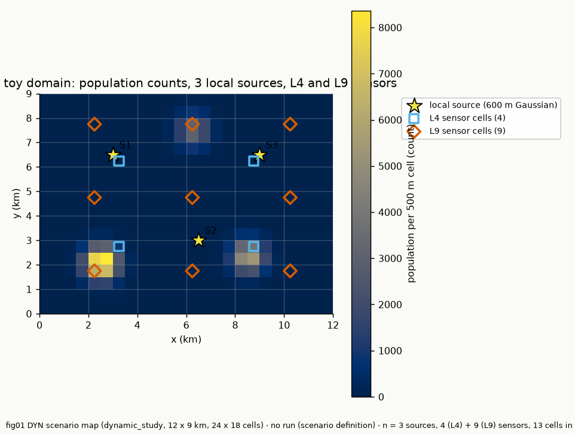
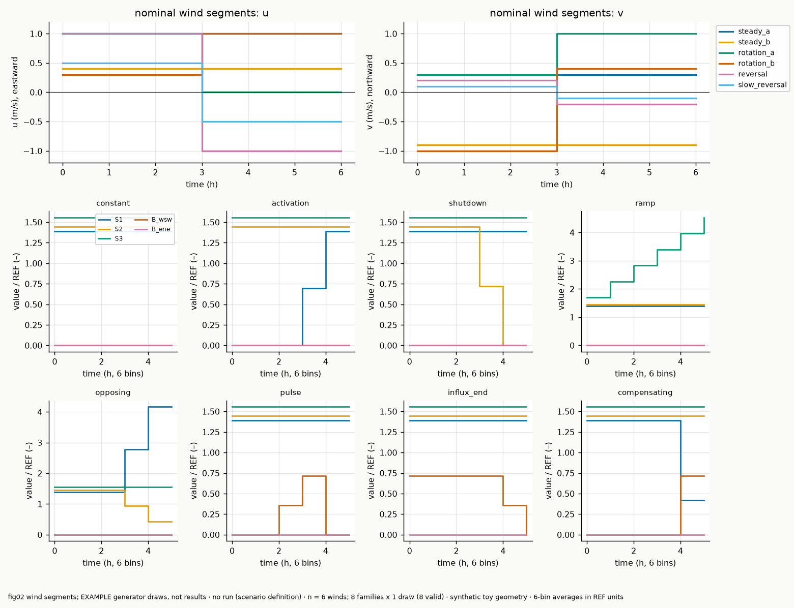

*Figures A and B — the synthetic testbed: 12 × 9 km domain, synthetic population (three settlements, 100 000 people), three local sources, the 4- and 9-sensor layouts, the six prescribed winds and one *example generator draw* per family (not results).*

| Label | Research OS | Question / hypothesis | Runs | Status |
|---|---|---|---|---|
| DYN-00 | EXP-028 | forward conserves mass and propagates time-varying sources | RUN-0059 (20 checks), RUN-0091 (25 checks) | **verified numerical behaviour** |
| DYN-01 | EXP-029 | generator gives coherent, reproducible episodes | (exercised inside DYN-02..07; tests) | **not run as a standalone experiment** |
| DYN-02 | EXP-030 | M2 < M1 on population RMSE | RUN-0060 (invalid), 0061 (superseded), 0064 (v2, superseded), **0087 (v3)** | preliminary (F-054) |
| DYN-03 | EXP-031 | history improves detection and $J_{\rm pop}$ | tune RUN-0084 (cluster), **test RUN-0092** | preliminary (F-053); registered wind-variation prediction **contradicted** |
| DYN-04 | EXP-032 | dynamic layouts beat static/heuristic | design (local), tune RUN-0085 (cluster), **test RUN-0090** | preliminary (F-050); partly supported |
| DYN-05 / P0 | EXP-033 | episodes needed for stable design | RUN-0077 (diagnostic), 0078 (design), 0079/0080 (check) | preliminary (F-046) |
| EXP-027 / P1 | EXP-027 | mesh decision stability | RUN-0081 (Duke, 32 workers) | **VOID** (F-048) |
| DYN-06 | EXP-034 | local vs transboundary separability | RUN-0082/0083 (flawed), **0086** | preliminary (F-044) |
| DYN-07 | EXP-035 | robustness to model error | RUN-0065 (superseded), **0088** | preliminary (F-049) |
| DYN-08 / EXP-026 | EXP-036 / EXP-026 | transfer to Belauri geography | — | **not run** |

Each experiment's hypothesis, null, criteria and stop conditions were registered before running (`D-010`…`D-023`; amendments are dated and listed in §16/Appendix C). Pre-registered protocols that were *amended after seeing outputs* are flagged explicitly: D-010→D-011→D-013→D-021 (DYN-02), D-012→D-016 (EXP-027 control, user-approved), D-018 (DYN-05 reference; post-hoc, disclosed), D-019→D-020→D-022 (DYN-06).

---

## 7. Numerical verification (DYN-00, RUN-0091)

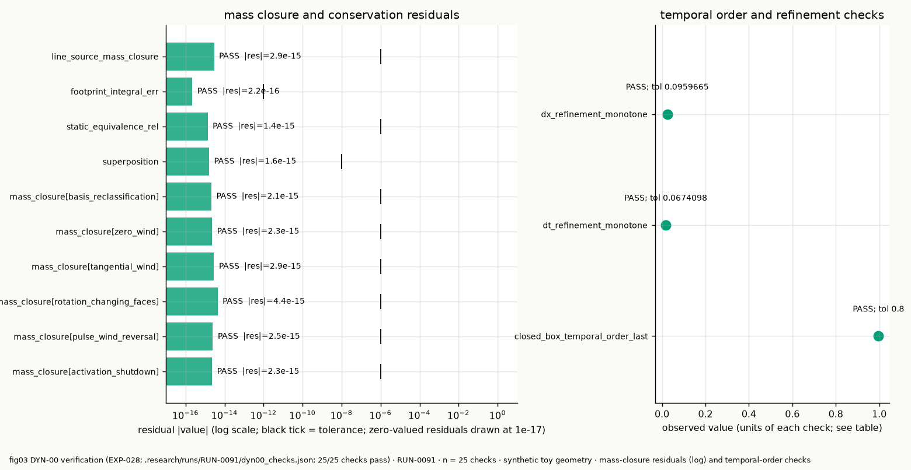

*Figure 1 — DYN-00 (EXP-028, RUN-0091, 25 of 25 checks pass; the earlier RUN-0059 had 20 checks; synthetic).* Verified (all tolerances fixed before running): zero forcing gives exactly zero; mass-budget residuals ≤ 4.4e-15 relative for five dynamic cases; no negative concentrations; superposition 1.6e-15; closed-box on/off emission vs the analytic history: error 1.7e-3 at dt = 30 s, order 0.73/0.99/1.0 as dt halves; dt refinement of a reversing-wind sensor series 6.7e-2 → 4.0e-2 → 1.7e-2; dx 16→32 cells vs 64: 9.6 % → 2.5 %; bin-expanded responses reproduce a direct constant and a non-trivial piecewise history to 1e-15; footprints integrate to 1; line-source mass closure 2.9e-15.

**Correction history.** One check (`west_no_import_after_reversal`) was amended after the first run because it was ill-posed, and an independent review then found the amended version *vacuous* (the west basis profile ended before the reversal). It was replaced in RUN-0091 by `basis_face_reclassification`: a constant west basis through a 3600 s reversal has cell-summed supply 3.36e-2 before and **exactly 0.0** after; an east basis has exactly 0.0 before and 3.36e-2 after; mass closure with both on is 2.1e-15. **Not verified:** the Van Leer (nonlinear) scheme, Belauri-scale dynamics, and spatial order (only monotone convergence).

---

## 8. Dynamic source reconstruction (DYN-02) and the value of history (DYN-03)

### DYN-02 (EXP-030) — result F-054 (preliminary), RUN-0087

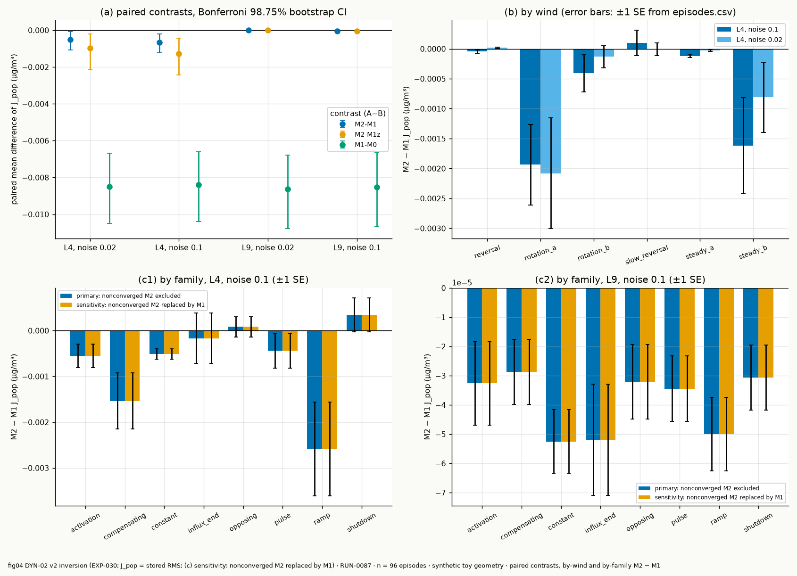

*Figure 2 — DYN-02 v3 confirmatory (EXP-030, RUN-0087; 96 test episodes, seeds 7300–7395; frozen hash 200ef2e894a62851; synthetic, wind known; the file name says "v2" for historical reasons but the data are RUN-0087). (a) paired mean differences with Bonferroni 98.75 % bootstrap CIs; (b) M2−M1 by wind; (c) M2−M1 by family.*

At 4 sensors M2 lowers $\sqrt{J_{\rm pop}}$ relative to the fair M1 by **16 %** at 2 % noise (−0.00051 [−0.00107, −0.00009] µg m⁻³; M1 mean 0.00324) and **20 %** at 10 % (−0.00067 [−0.00122, −0.00022]); relative to zero-prior M1z by 26–32 %; local-source RMSE falls by 34 %/45 %, boundary-amplitude RMSE by 12 %/23 % (episode CI includes 0; wind-cluster CI excludes it). At 9 sensors the gain is −1 % and −2 % (criterion not met). Both M1 and M2 beat the static M0 by 72–85 %. M1 is 2.4× the projection floor (mean 0.00137) at 4 sensors but 1.09× (2 %) and 1.17× (10 %) at 9 sensors, so at 9 sensors the estimator is close to its representation limit, at 4 sensors it is not.

**Heterogeneity and caveats.** The 4-sensor gain sits in steady_b and the rotation winds; steady_a, reversal and slow_reversal are ≈ 0; the wind-cluster bootstrap CI reaches zero (2 %: [−0.00139, −0.00000]). M2 is *worse* than M1 on abrupt shutdowns. The model equals the truth model and the wind is exact (spatial inverse crime remains; DYN-07 addresses model error). Nine of 16 selected hyperparameters sit on a grid bound (mostly $\alpha$ at the lower bound 0.01, where amplitude regularisation is negligible and TV carries the effect). **What the superseded versions got wrong:** RUN-0060 used emissions at 3–8 µg s⁻¹ instead of ~1e5 (invisible sources) — invalid (F-036); F-037 reported "30–45 %" with an unconverged solver, null-sensitivity parameters in truth and metrics, a layout-dependent prior scale, an under-tuned zero-prior baseline and a one-wind effect; F-039 reported "24–25 %" and "M2 worse at 9 sensors" which were solver-cap artefacts; F-047 contained a wrong count (7 vs 9 grid-bound selections) and was superseded by F-054. **Not independently reviewed in its final form.**

### DYN-03 (EXP-031) — value of measurement history, F-053 (preliminary), RUN-0092

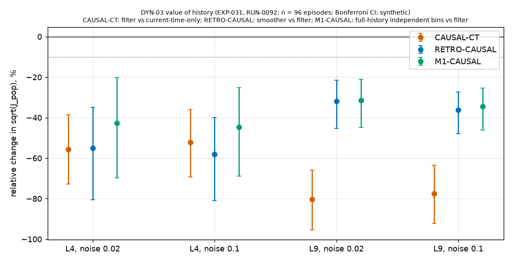

*Figure 3 — DYN-03 (EXP-031, RUN-0092; 96 test episodes, seeds 7600–7695; frozen hash be1de01dd5250121; synthetic, wind known; Bonferroni CIs).* Estimators share data, sensors, prior and scaling: **CT** current-bin observations and columns only (earlier emissions ignored), **CAUSAL** filter using data up to the end of bin $b$ and keeping bin $b$, **RETRO** the full-window smoother, **M1** full-history independent bins.

Causal filter vs CT: −56 %/−52 % $\sqrt{J_{\rm pop}}$ at 4 sensors (2 %/10 % noise; −0.00695 [−0.00910, −0.00482] and −0.00652 [−0.00865, −0.00449] µg m⁻³) and −80 %/−77 % at 9 sensors. Smoother vs causal filter (the smoother also uses *future* data): −55 %/−58 % (4 sensors), −32 %/−36 % (9 sensors). M1 vs causal filter: −43 %/−45 % and −31 %/−35 %. All 12 primary contrasts meet the registered criterion. **Change detection** (n = 58 episodes with a step in an identifiable parameter): CT misses 41–55 % of changes; the causal filter misses 2–5 % with a mean delay of 0.48 bins (≈ 29 min) at 4 sensors, against 0.32 for the smoother — the difference is partly hindsight.

**A registered prediction is contradicted.** Steady winds were the negative control ("history helps most where the wind varies"). The gain over CT is as large or larger on the two steady winds (4 sensors, 2 % noise: −0.0076 steady vs −0.0066 variable; smoother vs filter −0.0044 vs −0.0024) and all eight steady-group intervals exclude zero. The mechanism is *plume carry-over* — earlier emissions are still present in later observations — not wind-driven de-confounding, which this study neither tests nor supports. CT is a deliberately naive baseline (its tuned $\alpha$ of $10^5$–$10^6$ collapses it to the static prior), so the CT contrast mostly measures the cost of ignoring carry-over. Nine of 20 selected hyperparameters sit on a grid bound; one geometry/population fixture; matched model; **not independently reviewed.** (F-052 contained a wrong count and is superseded by F-053.)

---

## 9. Population-weighted deployment (DYN-04, EXP-032, F-050, preliminary)

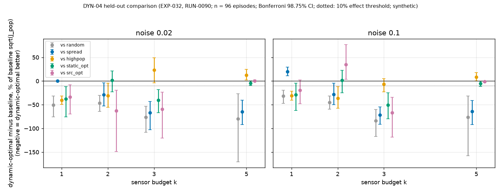

*Figure 4 — DYN-04 held-out comparison (EXP-032, RUN-0090; layouts hash 8bdef74d7c30fe2e frozen before any episode was simulated; hyperparameters hash 103b54317bac1be5 tuned on the spread layout only and applied unchanged to every layout of a budget; 96 test episodes, seeds 7800–7895; real nonnegative M2 estimator; points show the percentage change of $\sqrt{J_{\rm pop}}$ of the dynamic-optimal layout relative to each baseline, with Bonferroni 98.75 % CIs; synthetic).*

Layouts: 70 candidate cells; budgets 1, 2, 3, 5; families random (mean of 10), spread (farthest-point), high-population (separation ≥ 3 cells), static-model-optimal, dynamic-optimal (30 time-resolved parameters), source-identification-optimal (A-optimal); optimised families are designed on the Gaussian surrogate averaged over the six winds, exhaustively for $k\le3$ and by multi-start swap for $k=5$ (no optimality certificate). The surrogate uses no episodes, so there is no design/test leakage.

**Results** (effect criterion: CI excludes 0, ≥ 10 % relative change, sign persists leaving each wind out). *Random*: dynamic-optimal wins in all 8 budget × noise cells (−32 % to −84 %; at $k=3$, 2 % noise: 0.0030 vs 0.0128 µg m⁻³). *Spread*: wins in 7 of 8 (−28 % to −72 % at $k\ge2$) but **loses at $k=1$, 10 % noise (+20 %)**. *Static-optimal*: wins at $k=1$ (−38 %/−29 %) and $k=3$ (−40 %/−50 %); ties at $k=2$ and, below the 10 % criterion, at $k=5$ (−4 %/−5 %). *High-population*: wins at $k=1,2$ (−31 % to −41 %) but not at $k=3$ (+23 % n.s. at 2 %; −7 % at 10 %), and the heuristic is **better** at $k=5$ (+13 % [+0.00003, +0.00033] at 2 %, +8 % at 10 %). *Source-optimal*: wins at $k=1$ (−33 %), $k=2$ at 2 % noise (−63 %) and $k=3$ (−60 %/−67 %), ties at $k=5$, **loses at $k=2$, 10 % noise (+35 %)** — a visible population-vs-source trade-off. Registered H3 is therefore **supported against random and spread layouts at budgets ≥ 2, only partly against static and source-oriented layouts, and not supported against the high-population heuristic at $k=3,5$.**

**Surrogate vs reality.** Spearman rank agreement between surrogate risk and actual held-out RMSE over the 15 layouts per cell rises with budget: $k=1$: 0.43/0.37, $k=2$: 0.61/0.67, $k=3$: 0.81/0.88, $k=5$: 0.89/0.95 (2 %/10 % noise) — the proxy ranks layouts well at larger budgets and poorly at $k=1$, consistent with F-046. **Search:** greedy is far from the surrogate optimum at small budgets (surrogate risk ×2.1 at $k=3$, ×4.2 at $k=5$ for the dynamic problem, 2 % noise); swap multi-start nearly closes the gap. **Caveats:** evaluation hyperparameters were tuned on the spread layout (this could disadvantage other layouts), one source geometry and population fixture with three concentrated settlements (which flatters the high-population heuristic), known nominal wind (DYN-07: model error dominates), layouts designed at the evaluation noise level, multiple comparisons (stricter 0.05/40 CIs are in the run summary), **not independently reviewed.**

---

## 10. P0 — statistical reliability of design scenarios (DYN-05, F-046)

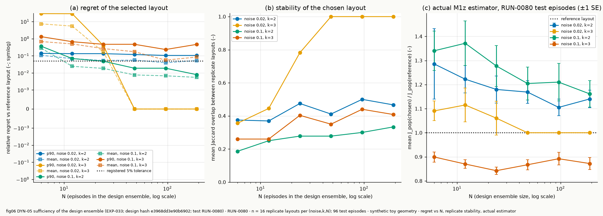

*Figure 5 — DYN-05 (EXP-033; design.json hash e3968dd3e90b6902; RUN-0078 design stage, RUN-0080 real-estimator check on 96 episodes, seeds 8400–8495; synthetic).*

Design objective: closed-form ridge risk (§3.5); 16 independent ensembles per $N\in\{6,12,24,48,96,192\}$; selection reference A and an **independent** evaluation reference B of 20 000 episodes each (the first version, RUN-0077, measured regret on the same reference that selected the optimum and was found to be selection-biased: two independent 4000-episode references disagreed by 15 % and chose different layouts; this is itself the Q-013 effect and the amendment D-018 was written *after* that output was printed and flipped one borderline cell — disclosed in F-046).

Registered criterion — 90th percentile of relative regret ≤ 5 %: **met** from N = 24 (noise 0.10, $k=2$: 4.8 %) and N = 48 (noise 0.02, $k=3$: all 16 ensembles identical); **not met** up to N = 192 for noise 0.02, $k=2$ (10.5 %) and noise 0.10, $k=3$ (23–46 %). At N ≤ 12, noise 0.02, $k=3$ regret reaches ×29 when an ensemble misses a wind (winds sampled at random).

**Real constrained estimator** (nonnegative ridge, ratio of mean $J_{\rm pop}$ vs the 20 000-episode reference layout, 95 % episode bootstrap, ensemble layouts fixed): noise 0.10, $k=2$: +34 % [15, 58] at N = 6, +28 % [8, 54] at N = 24, +16 % [2, 34] at N = 192; noise 0.02, $k=2$: +29 % [10, 51] at N = 6, +14 % [3, 26] at N = 192; noise 0.02, $k=3$: +9 % [3, 17] at N = 6, exactly 0 from N = 48; noise 0.10, $k=3$: −10 % [−27, +9] at N = 6 and −13 % [−22, −3] at N = 192. **Conclusion supported:** a 6-episode ensemble is insufficient by the proxy in every cell and by the real estimator in three of four; and the proxy and the real estimator disagree about where design is stable, so an unconstrained-ridge objective cannot certify sufficiency for the constrained estimator. **Not claimed:** that EXP-013/014/020/026 failed this way (their wind sampling was not checked). Link: Q-013 / RQ-D5 (Q-020).

---

## 11. P1 — numerical decision stability (EXP-027, F-048)

*Experiment.* Common padded Belauri domain (`configs/belauri_padded_geography`, `pad_to_m` 2000, so that 500, 250 and 2 km meshes share one domain), reference 250 m/dt 50, main 500 m/dt 100, **control 2 km/dt 400**, 8 independent replicate design draws × 6 cases (seeds 1101–1108), greedy total objective, budgets 3 and 5, noise fractions 0.05/0.15; mesh-induced displacement and $|$regret$|$ on each draw (8 paired values) vs 28 replicate-pair values at the reference mesh; admissible iff medians ≤ pair medians and a one-sided Mann–Whitney p > 0.05; the control **must fail**, else the test is void (registered stop). The 2 km control needed a control-only relaxation of the origin-tag tolerance (0.82 of the local road mass inside the 2 km study mask vs 0.94 required; user-approved, D-016).

*Result.* **VOID.** Median mesh-induced displacement (500 m | 2 km | replicate pairs): 2108 | 2262 | 3691 m (budget 3, 0.05); 2738 | 2567 | 3147 m (budget 5, 0.05); 1118 | 2370 | 3996 m (budget 3, 0.15); 1728 | 3234 | 3468 m (budget 5, 0.15). The control passes everywhere (p = 0.69–0.9997). Layouts from 6-case draws differ by 3–4 km between independent draws, more than degrading the mesh 4–8×, so mesh effects are invisible through design noise — the F-046 problem again. **The 500 m mesh remains provisionally admissible only.** A decisive version (EXP-027b) needs ≥ 48–96 cases per draw (≈ 90–190 core-hours at the observed ≈ 23 core-hours here) and requires approval.

---

## 12. Wind, transboundary and model-error experiments

### DYN-06 — local activity vs transboundary influx (F-044)

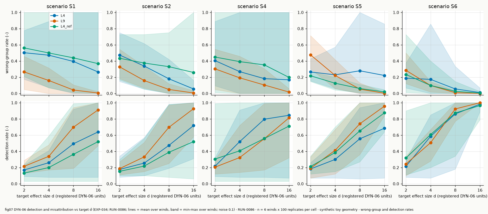
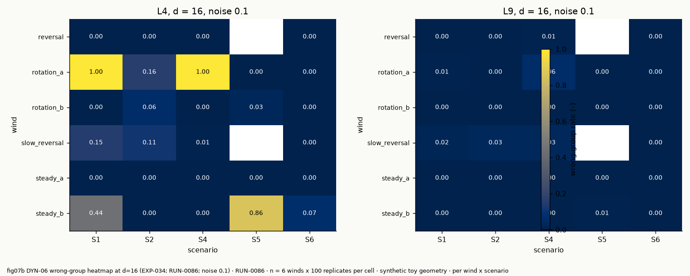

*Figure 6 — DYN-06 v3 (EXP-034, RUN-0086; 100 noise replicates per cell, seeds 9300–9499, noise 0.10; distinguishability $d$ asserted within 2 % of the target in every cell; synthetic). Mean over six winds with min–max bands.*

Misattribution among *detected* replicates (ambiguous excluded; detection uses a threshold calibrated on each operator's own no-change distribution): at $d=2/4/8/16$, 4 sensors: local increase vs influx (S1) 0.50/0.47/0.39/0.26; shutdown vs cessation (S2) 0.47/0.34/0.18/0.06; opposing changes (S4) 0.41/0.27/0.18/0.17; two similar local sources (S6) 0.19/0.17/0.06/0.01. 9 sensors: S1 0.27/0.16/0.04/0.01, S2 0.33/0.16/0.05/0.01, S4 0.30/0.19/0.10/0.02, S6 0.29/0.10/0.01/0.00, detection 0.7–1.0 at $d\ge 8$. **Structure:** with 4 sensors S1 at $d=16$ is attributed perfectly in steady_a, rotation_b and reversal and essentially not at all in steady_b and rotation_a (detection ≈ 0.1, identical at 2 % and 10 % noise) — a property of the (wind, layout) geometry: the group contribution is as poorly determined as the null fluctuation although the two fields differ by 16 noise sd. Registered predictions: P1 (misattribution falls with $d$) holds except S5; **P2 (≤ 10 % at $d=16$ when column cosine < 0.9) is contradicted** for 4 sensors on S1 (26 %) and for the reference layout on S1/S2; P3 holds in most cells; **P4 holds** — replacing one interior sensor by an upwind-boundary sensor changes misattribution at $d=16$ by +11 (S1), +20 (S2), +3 (S4), −20 (S5), −1 (S6) points: no general benefit. 48 of 720 scored cells are *perfectly confounded or invisible* ($d=0$): "influx ends" (S5) in the two reversing winds, because after reversal the boundary basis has no inflow face. Controls: perfectly confounded operator → detection 1.0 and ambiguity 1.0 (no group preferred); no-variation → detection 0.12 (false-alarm level ≈ 10 % for two groups). **Not reviewed in final form; earlier versions F-042/F-043 were wrong and are superseded** (uncalibrated detection rule; a distinguishability axis that missed its target by up to 10× for S2/S4/S5).

### DYN-07 — robustness to model error (F-049)

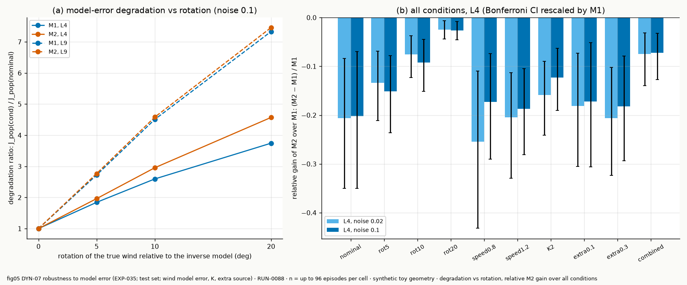

*Figure 7 — DYN-07 v2 (EXP-035, RUN-0088; same 96 episodes in 10 paired conditions, seeds 8500–8595; nominal inverse with frozen DYN-02 v3 hyperparameters; synthetic).* All three registered predictions hold: error rises monotonically with rotation (4 sensors, M1 ×1.84/2.59/3.74 at 5°/10°/20°; M2 ×1.96/2.95/4.57; 9 sensors M1 ×2.72/4.51/7.33); M2's advantage over M1 at 4 sensors erodes −20 % → −15 % → −9 % → −3 % (and −7 % combined) while M2's absolute error stays below M1's in all 20 cells; M2 beats the static M0 in 91–96 % (4 sensors) and 61–99 % (9 sensors) of episodes. Speed error costs ×1.7–2.2, doubling diffusion ×1.8 (4 sensors)/×3.4 (9 sensors), an unmodelled constant source at 10 %/30 % of emission ×1.04/×1.37 (4) and ×2.0/×4.6 (9). The 9-sensor layout is *more* sensitive to model error than the 4-sensor one (20°: 0.0150 vs 0.0140 µg m⁻³ in absolute terms). Hyperparameters were deliberately not re-tuned per condition.

---

## 13. HPC performance

Cluster: Duke (`plp-drcc-login2`, partition `defq`, AMD EPYC 7513 nodes, Slurm via Research OS). **No GPU used**, and none was warranted: a converged 30×30 BVLS fit takes milliseconds and a hard ADMM fit ~0.1–1 s; the dominant cost is FiPy (CPU, no GPU path), and a GPU rewrite of FiPy was out of scope. A GPU could pay off for the surrogate's exhaustive $k=5$ search ($\binom{70}{5}\approx1.2\times10^7$ subsets × 6 winds of batched 30×30 solves); that benchmark was not run.

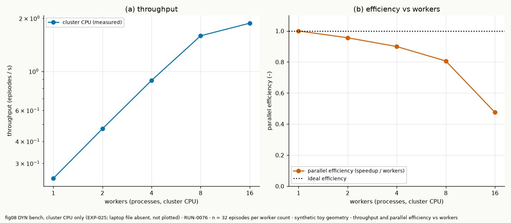

*Figure 8 — CPU scaling of the dominant workload (RUN-0076, Slurm 201977, 16 CPUs reserved; 32 independent synthetic episodes each, ~4 s per episode; parsed from the job log).* Parallel efficiency: 96 % (2 workers), 90 % (4), 81 % (8), 48 % (16 — tail-limited with only 2 episodes per worker; use more tasks per worker). Peak RSS per worker 0.16 GB. Scaling beyond 16 workers was not benchmarked (EXP-027 used 32).

**EXP-027 (RUN-0081)**: reservation 32 CPUs / 48 GB / 1.5 h; actual wall time 2647 s (44 min) after parallelising the per-case response bases (≈70 % of the cost) across cases, draws and meshes, previously ~4.8 h serial at the earlier estimate; peak RSS 0.59 GB/worker. **Regression gate on x86_64 (RUN-0066):** `21 files compared, 0 differ` against `results/solver-regression-x86_64/before`.

**Operational findings.** (i) Research OS collects logs, not run-directory files: result files must be printed to the log (done for tunes and via `scripts/hpc_cat.sh`) or registered; (ii) the cluster venv holds a *non-editable* old copy of `pravah`: launchers now prepend the bundle `src/`; (iii) the default bundle excludes `data/` (and apparently top-level `geodata/`), so small inputs live under `configs/`.

Reservations used (worst-case CPU-h): RUN-0066 gate 4; RUN-0067/0076 benchmark 8 each; RUN-0068/0069/0084/0085 tunes 32 each; RUN-0070/0075 EXP-027 attempts that failed on infrastructure (no compute) 48 each; RUN-0081 EXP-027 48; RUN-0089 1-CPU log job ~0.2. Total reserved ≈ 330 CPU-h worst case of the 512 ceiling; **actual consumption is much lower** (not instrumented per job). No job was cancelled; no job outstanding at the time of writing (RUN-0084/0085 tunes completed).

---

## 14. Critical scientific discussion

*What worked.* Reusing the linear response machinery made the dynamic problem cheap and exactly checkable; registered, frozen-hash protocols caught real errors; independent review was decisive (it found the solver cap, null-sensitivity columns, the wrong distinguishability axis, a vacuous verification check, and several overstated numbers).

*What failed or was invalid.* RUN-0060 (units); the first ADMM; the first DYN-06 metrics; the first DYN-05 reference; EXP-027's test (void by its own control). These are recorded, not hidden.

*Surprises.* (1) TV regularisation is not a general win: it helps only with scarce sensors and hurts abrupt shutdowns. (2) More sensors made the answer *worse* under model error. (3) The design objective needs far more than 6 episodes, and its cheap proxy disagrees with the real estimator. (4) Attribution failures are structural (wind-geometry) and do not improve with lower noise.

*Assumptions that could invalidate conclusions.* Exact known wind and a matched model in DYN-02/03/04/05/06 (DYN-07 shows this is the dominant error source); a single source geometry, one population fixture, two sensor layouts; 6 winds (so wind-level conclusions rest on 6 replications); piecewise-constant 6-bin basis; implicit-Euler numerical diffusion; the hyperparameter grids touch their bounds in several cells; the Gaussian/ridge design proxy; ERA5 winds (planned for Belauri) are too coarse to be "resolved local flow".

---

## 15. Novelty assessment

See §4. **None of the contributions is claimed as novel.** The combination of TV-regularised nonnegative inversion with local + boundary sources and a population-weighted goal-oriented design is plausibly *new as a combination* but each ingredient has close precedent (SRC-001, 005, 006, 007, 008, 009), and SRC-005 (Lin et al. 2026, the closest direct precedent for time-varying emissions with sensor optimisation) was **not accessible**. The most defensible project-specific results are *empirical characterisations*: the design-episode sufficiency analysis and its proxy-vs-estimator disagreement (C4), the structural wind-geometry dependence of local-vs-boundary attribution (C3), and the void mesh-stability test (C5).

---

## 16. Conclusions (only what completed experiments support)

- **Verified numerical behaviour:** DYN-00 (25/25), regression gate 21/0 on both architectures, linear superposition and bin expansion.
- **Preliminary synthetic results:** F-054 (TV helps at 4 sensors by 16–20 %, not at 9), F-053 (history helps by carry-over, not wind variation), F-050 (dynamic-optimal layouts beat random/spread, not the high-population heuristic at k ≥ 3), F-049 (model error dominates sensor count), F-046 (design sufficiency is cell-dependent; proxy unreliable), F-044 (attribution structure and predictions), F-048 (EXP-027 void).
- **Invalid and superseded:** F-036 (units), F-037/F-039/F-047 (solver, baseline, wrong count), F-040 (ratios), F-041/F-045 (overstatement), F-042/F-043 (metric and axis errors), F-052 (wrong count), F-038 (vacuous check).
- **Not run:** DYN-08, EXP-026 integration, EXP-027b, GPU benchmarks, wind-uncertain inversion, standalone DYN-01.
- **No empirical validation** of any kind.

## 17. Future experiments (by scientific priority)

1. **EXP-027b:** ≥ 48–96 cases per draw with the same paired design and the 2 km control (decides mesh adequacy for design).
2. **DYN-04 follow-up:** a design objective aware of nonnegativity (e.g., Monte-Carlo risk of the constrained estimator on stratified episodes), a stratified-wind design ensemble, and a population fixture without concentrated settlements to test the high-population heuristic.
3. **Wind-uncertain inversion** (Q-012): treat wind rotation as a nuisance; tune hyperparameters under model error; compare against known-wind.
4. **DYN-08:** Belauri synthetic dynamic deployment with ERA5 winds on the padded domain, reconciling EXP-026.
5. **Independent review of the final F-044/F-046/F-048/F-049/F-050/F-053/F-054** and a second source geometry/population fixture.
6. **GPU benchmark** for exhaustive $k=5$ surrogate search only if the project needs optimality certificates.

---

## Appendix A — Reproducibility

- **Repository:** `/Users/yubraj/Code/pravah`, branch `master`; Research OS `research current` reproduces the state; checkpoints `CP-011`…; this report is committed with the code it describes (see `git log`).
- **Environment:** Python 3.12, `requirements-lock-geo.txt`; local arm64 (Apple M-series) and Duke x86_64 (Python 3.12.12, numpy 2.5.3, scipy 1.18.1, FiPy 4.0.3).
- **Frozen files:** `results/dyn02v3/frozen_hparams.json` (hash 200ef2e894a62851), `results/dyn03/frozen_hparams.json` (be1de01dd5250121), `results/dyn04/layouts.json` (8bdef74d7c30fe2e), `results/dyn04/frozen_hparams.json` (103b54317bac1be5), `results/dyn05/design.json` (e3968dd3e90b6902), `results/exp027/*` (EXP-027 tables).
- **Seeds:** tune 6000–6047; DYN-02 v3 test 7300–7395; DYN-03 test 7600–7695; DYN-04 test 7800–7895; DYN-07 8500–8595; DYN-05 design streams SeedSequence([5,N,r,e]), references [6,e]/[7,e], check 8400–8495; DYN-06 noise 9300–9499. **Consumed (do not reuse):** 7000–7047 (RUN-0060), 7100–7147 (RUN-0061), 7200–7295 (RUN-0064), 8200–8295 (RUN-0065), and legacy 303.
- **Commands** (all through `research run exec EXP-… -- …`): `scripts/dyn00_verify.py`; `python -m pravah.studies.toy.dynamic_study --stage tune|test --freeze …`; `…dynamic_robustness --freeze …`; `…dynamic_sufficiency --stage design|test --design results/dyn05/design.json`; `…dynamic_separability_threshold --freeze …`; `…dynamic_design_study --stage design|tune|test`; `scripts/convergence_stage2.py --config configs/convergence_paired_padded.json --paired --workers 32` (cluster: `scripts/hpc_exp027.sh 32`); figures: `scripts/make_dynamic_figures.py`, `scripts/make_dyn34_figures.py`; DYN-03 test `…dynamic_history --stage test --freeze results/dyn03/frozen_hparams.json`.
- **Slurm jobs:** 201966 (RUN-0062, gate, stale venv), 201967 (RUN-0063, failed), 201971 (RUN-0066, x86 gate **OK**), 201972 (RUN-0067, failed: API), 201977 (RUN-0076, benchmark), 201973/201974 (RUN-0068/0069 tunes with capped solver, superseded), 201975/201976 (RUN-0070/0075 EXP-027 infrastructure failures), **201981 (RUN-0081, EXP-027)**, 201982 (RUN-0084, DYN-03 tune), 201983 (RUN-0085, DYN-04 tune), 201987 (RUN-0089, log retrieval).
- **Datasets:** `data/belauri` (unchanged), `configs/belauri_padded_geography` (padded levels 500/250/2000 m; raw hashes verified). A registry copy `belauri-geography-padded` on the cluster did not verify and was not used.

## Appendix B — Findings registry (Research OS)

Current: F-044 (DYN-06 v3), F-046 (DYN-05), F-048 (EXP-027), F-049 (DYN-07 v2), F-050 (DYN-04), F-051 (DYN-00 25/25), F-053 (DYN-03), F-054 (DYN-02 v3). Superseded: F-036 (invalid), F-037, F-038, F-039, F-040, F-041, F-042, F-043, F-045, F-047, F-052. Reviews: `F-037/R1`, `F-038/R1`, `F-039/R1`, `F-040/R1`, `F-041/R1`, `F-043/R1` (all *needs_work*), conducted by an independent `scientific-reviewer` agent that did not author the experiments.

## Appendix C — Decisions

D-010, D-011, D-013, D-021 (DYN-02 protocol chain); D-012, D-016 (EXP-027 control); D-014 (DYN-03/04); D-015, D-023 (DYN-07); D-017, D-018 (DYN-05); D-019, D-020, D-022 (DYN-06).

## References

1. Sharrock, L. & Kantas, N. (2022). *Joint Online Parameter Estimation and Optimal Sensor Placement for the Partially Observed Stochastic Advection-Diffusion Equation.* SIAM/ASA J. Uncertain. Quantif. https://doi.org/10.1137/20M1375073
2. Rauch, H. E., Tung, F. & Striebel, C. T. (1965). *Maximum likelihood estimates of linear dynamic systems.* AIAA J. https://doi.org/10.2514/3.3166
3. Tibshirani, R. et al. (2005). *Sparsity and smoothness via the fused lasso.* J. R. Stat. Soc. B. https://doi.org/10.1111/j.1467-9868.2005.00490.x
4. Adams, R. P. & MacKay, D. J. C. (2007). *Bayesian Online Changepoint Detection.* arXiv:0710.3742. https://arxiv.org/abs/0710.3742
5. Lin et al. (2026). *Sensor configuration optimization for source term estimation of time-varying emissions.* Sustainable Cities and Society. https://doi.org/10.1016/j.scs.2026.107186 (**not accessed**)
6. Liu et al. (2025). *Sparse Sensor Allocation for Inverse Problems of Detecting Sparse Leaking Emission Sources.* arXiv:2509.05559. https://arxiv.org/abs/2509.05559
7. Attia, A., Alexanderian, A. & Saibaba, A. K. (2018). *Goal-oriented optimal design of experiments for large-scale Bayesian linear inverse problems.* Inverse Problems. https://doi.org/10.1088/1361-6420/aad210
8. Wu, K., Chen, P. & Ghattas, O. (2023). *An offline-online decomposition method for efficient linear Bayesian goal-oriented optimal experimental design: application to optimal sensor placement.* SIAM J. Sci. Comput. https://doi.org/10.1137/21M1466542
9. Mattuschka et al. (2025). *Goal-oriented optimal sensor placement for PDE-constrained inverse problems in crisis management.* arXiv:2507.02500. https://arxiv.org/abs/2507.02500

(Author lists for 5, 6 and 9 were not compared against the registries; bibliographic identity was verified by title and identifier.)
