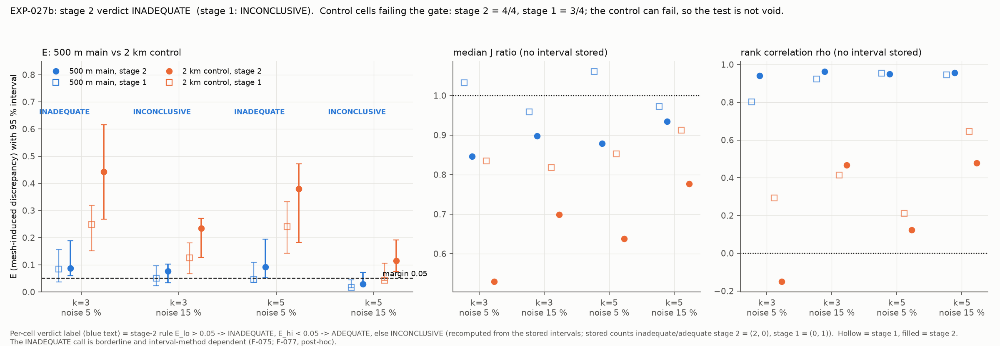
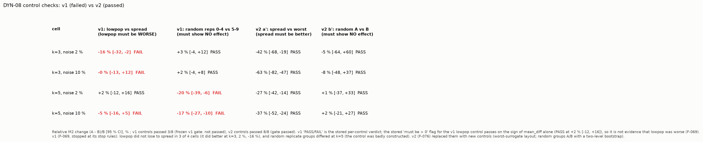
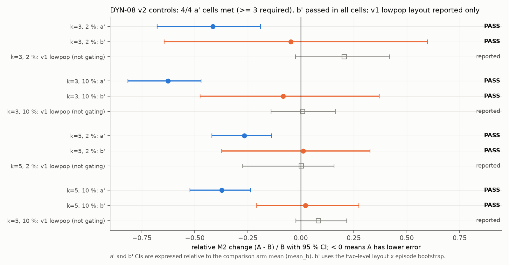
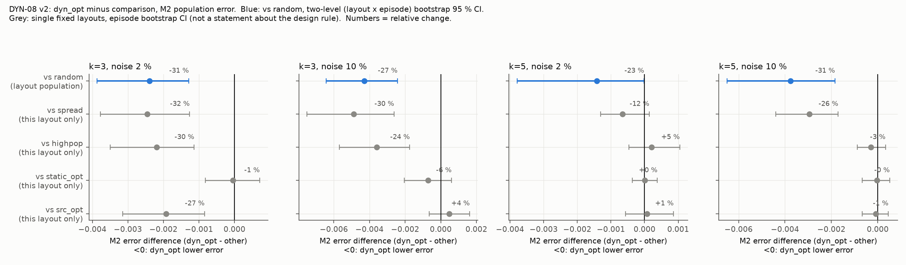
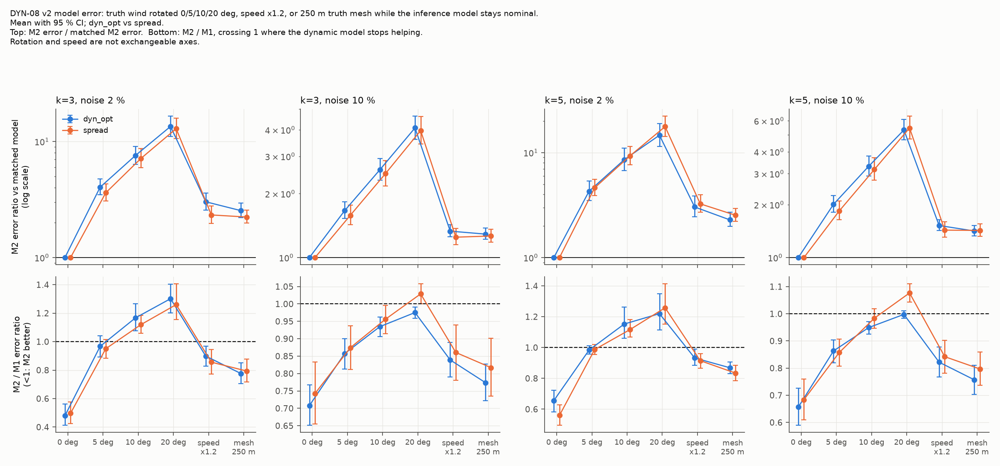
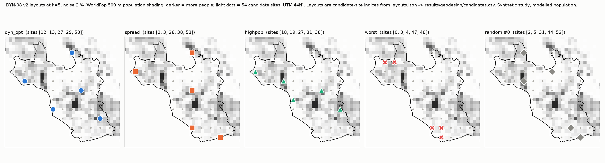
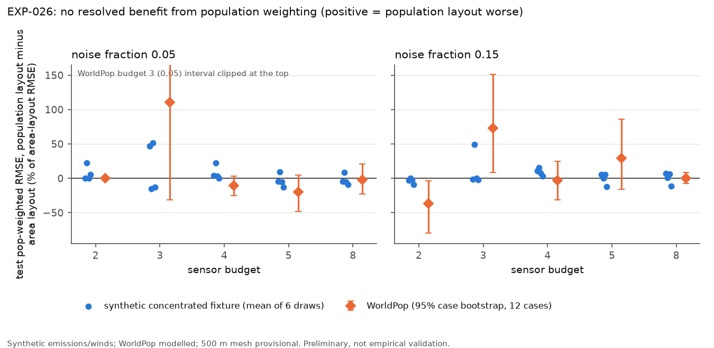
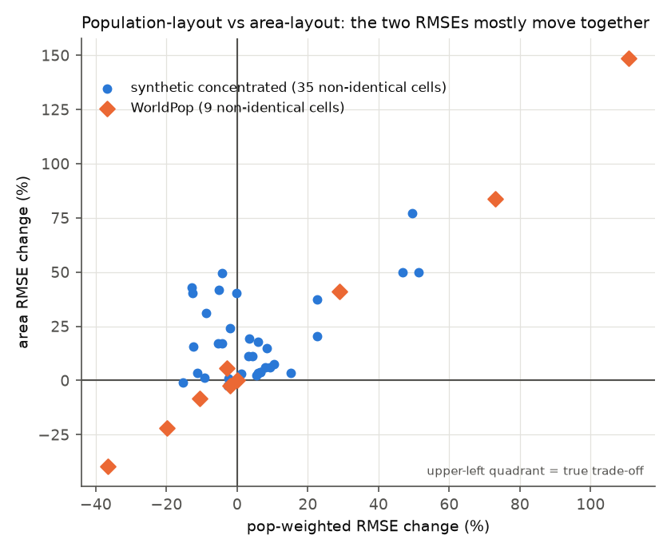
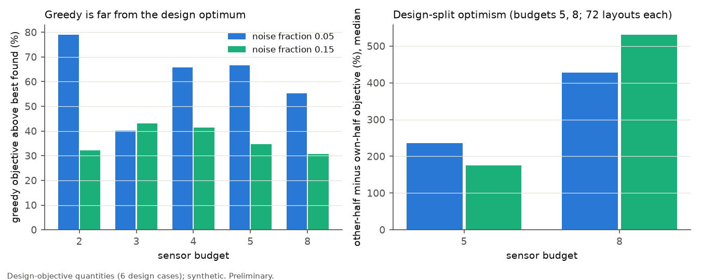

# PRAVAH: dynamic population-weighted sensor deployment and source-history inference. Final scientific report

**Status: final report, 2026-10-15. Assembled from stored and recorded results only; nothing was recomputed except one illustrative toy episode in Figure 3 (§9.5).** All experiments of the program have now been run and are reported: DYN-00..DYN-07, EXP-027 (void), EXP-027b, EXP-026 and DYN-08 (v1 stopped, v2 a post-hoc-corrected rerun). A post-hoc sensitivity analysis of EXP-027b has been run (RUN-0102, F-077; §6.8b). **Review status at the time of writing:** the first-round independent reviews of every result are recorded and their corrections applied; the *second-round* reviews of the corrected wording (F-061, F-062, F-063, F-065, F-069, F-070-F-072, F-075-F-077) and an independent audit of this report could not be completed because the reviewing agents hit a usage limit (resets 2026-10-19). They remain outstanding (§12, item 10). Q-013 is **not** closed (§6.5).

**Everything quantitative is synthetic.** Real Belauri geography and a modelled WorldPop population raster may appear as *inputs*; every emission, wind-as-truth, episode and sensor reading is generated by the model (the ERA5 winds used for DYN-08 are real reanalysis wind inputs, but the atmosphere, emissions and sensor readings are modelled). There is **no measured pollutant concentration and no empirical validation** anywhere in this report. "Inverse crime" (same solver, same grid for truth and inverse) is present in all toy studies except where stated (DYN-07 and the DYN-08 model-error block perturb the truth).

**Reference convention.** `[F-xxx / RUN-xxxx / path]`: F = Research OS finding (`.research/bin/research show F-xxx`), RUN = run record under `.research/runs/RUN-xxxx/`, paths are repository-relative. Only **F-051** (plus the early F-002, F-006, F-007, F-009) carries status *supported* (independently reviewed in its final wording). Every other current finding is *preliminary*: **F-055, F-056, F-057, F-061, F-062, F-063, F-065, F-069, F-070, F-071, F-072, F-075, F-076**. For most of them the predecessor was independently reviewed and corrected, but the corrected wording itself has not been reviewed (F-057 is the exception in spirit: its predecessor's "void" conclusion was endorsed by the reviewer, with arithmetic corrected). F-069, F-075 and F-076 have not been reviewed at all in their current wording. **Superseded findings are not cited as evidence.** Their ids appear only in the *Corrections log* (section "Corrections log" below), where each correction and its effect on the conclusions is explained.

**Status vocabulary.** *confirmatory* = hypothesis, criteria and frozen hyper-parameters registered before the held-out test; *exploratory* = no such registration; *post hoc* = protocol or analysis amended after seeing outputs (always disclosed); *reviewed* = an independent `scientific-reviewer` pass on the predecessor; *preliminary* = final wording not reviewed. *Registered decisions* are D-0xx records in Research OS (`research show D-0xx`).

Figures are in `docs/figures/final/` and produced by `scripts/make_final_figures.py` and the wrap-up scripts (index: `docs/figures/final/figure_index.json`; see §9.6 for caption-id discrepancies in that index).

---

## Contents

- Corrections log: what was found wrong and how it changed the conclusion
1. Motivation and questions
2. Governing equations, assumptions, discretisation, numerical diffusion
3. Forward operator, superposition and the dynamic (time-binned) extension
4. Inverse problem: estimators, regularisation, identifiability, "alpha as prior width"
5. Objective J_pop and sensor design (surrogate, exhaustive, greedy, swap)
6. Evidence, experiment by experiment (6.0-6.11, including EXP-027b, DYN-08 and EXP-026)
7. Successes, contradicted predictions, unresolved questions (incl. Q-013)
8. What is established versus speculative
9. Reproducibility: commands, configs, seeds, hashes, commits, HPC accounting, discrepancies
10. Literature positioning and defensible contributions
11. Limitations, including statistical lessons
12. Next research directions
- Appendix A: figure list. Appendix B: reference list.

---

## Corrections log: what was found wrong and how it changed the conclusion

This program ran under a rule that every finding is reviewed by an independent reviewer who re-derives the numbers and re-reads the code. Of the reviews listed below, all but one returned *needs_work* (the exception, the review of the EXP-027 "void" finding, agreed with its conclusion but corrected its arithmetic). Nothing was deleted: a wrong finding is *superseded* by a corrected one, and the old text stays on record. This section lists each chain, in plain language: what was claimed, what was wrong, what replaced it, and what that did to the scientific conclusion. The arrows read "replaced by". The *current* finding is the last id in each chain; it is the only one cited elsewhere in this report. All current findings remain *preliminary* (not independently reviewed in their final wording), so a further round of corrections is possible.

**How to read the recurring patterns.** Six kinds of error account for nearly every correction: (1) a *control or baseline that did not test what it was meant to test* (DYN-03, DYN-08 v1); (2) a *summary statistic that let a nuisance dominate* (DYN-06's unweighted average of per-wind rates); (3) *multiplicity or reference choices that flattered a result* (DYN-04's family-wise level, DYN-05's reference layout); (4) *interpretation beyond the evidence* (a "mechanism" that was never tested, a "design effect" that was only a layout effect); (5) *arithmetic and wording slips* (cost estimates, ratios); and (6) *low statistical power presented as a null* (EXP-026). Each is an argument for the controls and review that caught it.

### C1. DYN-03, value of measurement history: F-052 / F-053 -> F-064 -> F-065

* **F-052 -> F-053 (counting slip).** The first version counted "11 of 16" frozen hyper-parameter selections as sitting on a grid bound; the correct count was 9 of 20.
* **F-053 (RUN-0092) claimed:** a "causal" filter beats a "current-time-only" (CT) estimator by 56 % / 52 % at 4 sensors, and misses 2-5 % of changes against CT's 41-55 %. **Review F-053/R1 found it wrong in three ways.** (i) CT and CAUSAL were *not causal*: the static prior they used was fitted on the *whole* 6-hour window, so they had look-ahead. Refitting CAUSAL with a truly causal prior made it 13.7 % worse at 4 sensors / 10 % noise. (ii) The change-detection rule never checked that the estimate was on the *pre-change* side, so a constant estimate "detected" 15-17 of 30 changes with zero delay; 11-14 of CT's 16-21 hits were this artefact. (iii) A *registered stop rule* had fired (steady winds, the negative control, showed a gain with a confidence interval excluding zero) and the finding did not report it.
* **F-064 (RUN-0094, protocol D-024, new seeds 8600-8695)** fixed (i) and (ii): truly causal priors, pre-side detection, new seeds, a reduced grid. Numbers moved only by a few points (CAUSAL vs CT -57 % / -54 % at 4 sensors; miss rates CT 61 %, CAUSAL 9.7 %). D-024 *retired* the steady-wind negative control after it had fired on RUN-0092 (disclosed; retired before the v2 data were seen). **Review F-064/R1** then found a deeper interpretive problem. In v2 "CT" is not a current-time-only estimator: at its tuned alpha (1e9 at 4 sensors) it *equals the causal running static fit*. So CAUSAL-minus-CT compares a *time-varying model with a time-invariant model on the same causal data*; it does not measure "the value of history". At 4 sensors the gain on constant-emission episodes is about zero, and CAUSAL is *worse* than CT on activation episodes; the gain comes from the emission families that change. The "plume carry-over" explanation was neither tested nor supported. The wind-variation prediction holds in direction in 8 of 8 comparisons, but every interval for (variable minus steady) includes zero, the heterogeneity between the two steady winds exceeds the steady-versus-variable gap, and the relative prediction was formulated after seeing RUN-0092.
* **F-065 is the current statement.** Effect on the conclusion: from "history helps by 56-80 %, because of plume carry-over, and we falsified our own control" to "a causal *time-varying* model beats a causal *static* fit by 54-79 % in this synthetic, matched-model setting because emissions change; the mechanism is untested; the wind-variation hypothesis is undetermined (not confirmatory); the M1-minus-CAUSAL gain at 4 sensors does not generalise over the six winds (t-interval includes 0)". The steady-wind control *would fire* again (all 8 steady-group intervals exclude 0); it stays retired by D-024, so under the original D-014 this run would be invalid. See §6.3.

### C2. DYN-06, local versus transboundary attribution: F-044 -> F-060 -> F-063

* **F-044 (RUN-0086) claimed:** with 4 sensors, misattribution stays at 17-26 % even at distinguishability d = 16, so attribution is unreliable. **Review F-044/R1:** the per-wind misattribution rate was averaged *unweighted* across winds, including winds where detection was at the false-alarm level (about 0.10). In those winds the few "detected" replicates are mostly false alarms whose wrong-group labels are arbitrary (for example rate 1.00 at detection 0.08). Weighting by detections gives 0.06 for S1 (reported 0.26), 0.02 for S4 (0.17), 0.03 for S5 (0.22). The registered extension of P4 to all scenarios, and the scenario validity of several d axes (a look-alike with an identically zero signature; a match that failed), were also wrong.
* **D-025 (v4 protocol)** re-registered the scoring: misattribution counted only where detection is clearly above the false-alarm level, pooled (wrong over detected) rather than averaged, invalid scenarios flagged, new seeds. **F-060** reproduced the numbers but **review F-060/R1** found wording errors: P3 was reported "not evaluable" although it is contradicted where it can be evaluated; P4 was stated backwards relative to its registration; the no-variation false-alarm rate is 0.09, not 0.12; "attributed correctly" hid per-wind rates up to 0.22-0.36; P1 is not monotone in three cells.
* **F-063 is current.** Effect: from "4-sensor attribution is unreliable even at d = 16" to "where a change is detected it is attributed correctly (pooled wrong-group rate <= 0.02 at d = 16); the real 4-sensor limitation is *non-detection* in some winds (S1 detected clearly in only 4 of 6)". **Disclosure that matters:** the flip of P2 from "contradicted" to "holds" comes from the scoring rule adopted *after* the first result; under the old unweighted metric S1/L4 at d = 16 is 0.31. No confidence intervals on the confusion rates were stored (a registered requirement not met). See §6.6.

### C3. DYN-05, how many design scenarios: F-045 / F-046 -> F-058 -> F-062

* **F-046 claimed** the design objective was insufficiently sampled in 3 of 4 cells and "not demonstrably insufficient" at noise 0.10, k = 3. **Review F-046/R1:** the "not demonstrably insufficient" was an artefact of a poor *reference layout* (a split-half check shows the reference itself is +31 % [5, 71] worse than the best evaluated layout in that cell); the confidence intervals held the 16 ensemble layouts fixed (a two-stage bootstrap that resamples ensembles too is wider, turning "3 of 4 cells" into 2 clear plus 1 borderline); the "CI excludes zero" criterion for the real estimator was not registered; disclosures were only carried by reference. **F-058** repaired these; **review F-058/R1** found further problems: the real-estimator conclusion is *not an N effect* (N = 6 versus N = 192 intervals include 0 in all cells), a registered-H4 verdict was missing (supported for the surrogate in 2 of 4 cells; no stabilisation detectable for the real estimator), and the 0.02/k = 3 split-half is fragile.
* **F-062 is current.** Effect: the headline moved from "more episodes help, but 6 are not enough" to "by the proxy, 6 are insufficient everywhere and more help in only 2 of 4 cells; for the real constrained estimator more design episodes are *not shown* to help at all; an unconstrained-ridge surrogate cannot certify sufficiency for the constrained estimator". Disclosures kept: the independent reference B was introduced after one summary had been seen and flipped one borderline cell; an earlier real-estimator run had a key collision. See §6.5.

### C4. DYN-04, dynamic versus baseline layouts: F-050 -> F-059 -> F-061

* **F-050 claimed** the dynamic-optimal layout was supported against spread layouts "at k >= 2" and gave a short tally. **Review F-050/R1:** the multiplicity family was ambiguous; under the stricter family 0.05/40 several of the wins and losses become ties; the tuning of hyper-parameters on the *spread* layout (one of the comparators) put some M2 alphas on the grid edge, so the k = 1 loss to spread may be a tuning artefact; and several wording errors (greedy is 3.1x the exhaustive optimum, not 2.1x; "swap nearly closes the gap" is false at k = 3). **F-059** reported both families; **review F-059/R1** corrected the tally (four robust contrasts had been omitted), noted that "exhaustive optimum" at k = 5 is really the best of 11 multi-start swaps, and that the real bias is tuning on a comparator.
* **F-061 is current:** 23 robust wins, 1 robust loss under both families; 3 wins and 2 losses only under the lenient family; 11 ties. Effect: from "supported against spread at k >= 2" to "supported against random and against spread at k >= 3, partly against static and source layouts, and *not* against the high-population heuristic". See §6.4.

### C5. EXP-027, mesh stability: F-048 -> F-057

* **F-048** correctly reported the experiment as *void* (the deliberately coarse 2 km control passed the test it was registered to fail). **Review F-048/R1** agreed ("void is the correct registered conclusion") but corrected: a decisive re-run costs about 190-375 core-hours (8-16x the 23 core-hour run), not "90-190"; 500 m is 2x the 250 m spacing, not 4x; the control's regret medians are 10-25 % of the pair medians, not about zero; the statement that the test "could not fail" overreached; and p-values are approximate because nested budgets and 28 pairs from 8 draws violate independence.
* **F-057 is current.** Effect on the conclusion: none in direction (void; 500 m provisionally admissible only), but the cost of the decisive test was understated by about a factor two. See §6.8.

### C6. EXP-026, population-weighted design at Belauri scale: F-066 / F-067 / F-068 -> F-070 / F-071 / F-072

* **F-066 claimed** that population-weighted layouts "do not reduce population-weighted RMSE at Belauri scale (H1 not supported)". **Review F-066/R1:** the verdict is *optimiser-dependent*. The registered hypothesis names *greedy* layouts, but the tables compared exact or best-found layouts. Greedy-versus-greedy under the same criterion gives 24 beneficial and 5 harmful cells of 200. The "5 harmful" cells are only 2 distinct layout comparisons at cells where the single shared area reference layout ranks 2nd-3rd of about 50, so not evidence of a systematic penalty. The cross-fixture statistic (mean of per-case ratios) is biased. With 12 test cases the design detects only about 33 % of the area-layout RMSE (48-55 % at budgets 2-3), so benefits of 20 % or more are not excluded in 15 of 35 cells: *absence of evidence, not evidence of no benefit*.
* **F-067** (WorldPop "shows the same null") needed the biased cross-fixture ranges replaced and its "same harm cell" reading corrected: it is a shared-comparator effect (both compared against the same area layout), not transfer. **F-068** ("greedy gaps and near-ties swamp differences") was contradicted by its own numbers: differing layouts are near-tied in only 36 of 2151 rows; the effects are 1.7x the spread among draws; and all draws share the *same 6 design cases*, so design-sample noise was never replicated.
* **F-070 / F-071 / F-072 are current.** Effect: from "population weighting does not help" to "no robust reduction was resolved; the result depends on the optimiser; 12 cases give low power; the null is better explained by low power and a single shared reference layout than by ties". See §6.11.

### C7. EXP-027b, mesh adequacy on common cases: F-073 -> F-075

* **F-073 (stage 2 of RUN-0100)** reported the 500 m mesh INADEQUATE in 2 of 4 cells with the 2 km control failing its gate in 4 of 4. **Review F-073/R1** verified numbers, the rule and the staging (stage 2 was a gate-conditional continuation, not optional stopping) but found: the percentile bootstrap interval of a *median-absolute* statistic is biased toward INADEQUATE (a toy Monte Carlo gave P(E_lo95 > 0.05) of 0.01-0.65 at a true E of exactly 0.05, depending on heterogeneity; a basic interval would make both cells INCONCLUSIVE); one cell's margin (0.0516 against 0.05) is within bootstrap Monte Carlo error; the verdict rests on one cell; the menu of candidate layouts is built and scored on the same cases; the 5 % margin is a convention, not a calibrated tolerance; and the interpretation (link to numerical diffusion, decision equivalence) over-reached.
* **F-075 is current.** Effect: from "the 500 m mesh is inadequate" to "by the registered rule INADEQUATE, but borderline, resting on one cell, with an interval that is biased in that direction; the evidence is that 500 m shape error is probably around 5-10 %, not that it is reliably above 5 %; rankings are largely preserved (rho 0.94-0.96); decision equivalence is neither shown nor excluded; 500 m / dt 100 stays provisional". See §6.8b.

### C8. DYN-08 v1 and v2: F-069 (stopped), F-074 -> F-076

* **F-069 (v1, RUN-0099): the run stopped at its own registered stop rules**, so there is no H8 verdict. Control (a), a "low-population" layout that must lose to the spread layout, did not lose in 3 of 4 cells. Control (b), two groups of fixed random layouts that must show no difference, did differ at k = 5 (-20 % and -17.5 %). **The review of RUN-0099 found both controls badly constructed, not a pipeline bug** (all numbers reproduce to 3e-17): the design surrogate had already ranked the low-population layout next to spread (ranks 7/16 versus 8/16) and site-cell population is a weak proxy of layout quality here (only 9.4 % of people live in the 54 candidate cells); the null control used *fixed* layouts with an *episode-only* bootstrap, so any two groups of ten different layouts can differ by 10 % or more (33-48 % of all 126 distinct 5/5 splits do). A further defect: bin 0 of the CT and CAUSAL estimates was left at zero (no observation precedes t = 7200 s), which inflates both arms. v1 results are reported as *descriptive only* and stay on record.
* **D-029 registered v2 before any v2 run** as a *post-hoc-corrected rerun*, not a rescue of v1: a control that is bad *by construction* (worst-surrogate-risk layout from a pool of 516 candidates, checked at the design stage before tuning), random control groups of fresh layouts assessed with a *two-level* (layout x episode) bootstrap, the bin-0 fill, model-error confidence intervals, and fresh seeds.
* **F-074 -> F-076.** **Review F-074/R1** (numbers reproduced exactly) corrected the interpretation: (i) the two-level bootstrap and the reuse of the *same* winds, dyn_opt layouts and ten random layouts as v1 are post-hoc and were not all disclosed, so the layout-level part of the primary contrast is not replicated; against the 20 never-seen random layouts the criterion is met in 3 of 4 cells, and k = 5 / 2 % noise is not met; (ii) the statement that the margin over the high-population heuristic is "smaller than in the toy, as predicted" is *false* (it is larger at k = 3); (iii) the headline "dynamic design beats ..." over-claims: dyn_opt against the static-model-optimal layout is indistinguishable (-0.8, -5.9, +0.1, -0.4 %), so the evidence supports *surrogate-designed* layouts beating random ones, not a benefit specific to dynamic design; (iv) in the model-error block M2's advantage over M1 *reverses* (not merely erodes) in 4 of 8 rows at 10 degrees and 6 of 8 at 20 degrees; (v) the k = 5 / 2 % random contrast is fragile; (vi) "H8 supported as registered" needs the qualification "under the D-026 counting rule, with controls and analysis amended post hoc by D-029".
* **F-076 is current.** Effect: from "dynamic design beats random layouts at Belauri scale and H8 transfers" to "surrogate-designed layouts beat random layouts; a static design is indistinguishable; H8 is supported under the D-026 counting rule but this is not a clean confirmatory test". See §6.9.

### C9. Earlier corrections still shaping the text

* **DYN-02: F-054 -> F-055.** F-054 said the TV gain was robust across winds. Review: one wind (rotation_a) supplies 68 % / 48 % of the effect; without it the gain at 2 % noise is 6.8 %, below the 10 % criterion; a t-interval over the six wind means includes 0. F-055: an effect on these six winds, not shown to generalise. (Older DYN-02 numbers of 24-25 % and 30-45 % came from an under-converged solver and an under-tuned baseline and are withdrawn.)
* **DYN-07: F-049 -> F-056.** F-049 said extra sensors "tighten the fit to a wrong model". Review: the unmodelled source sits 354 m from the 9-sensor layout's centre sensor, which alone explains the extra-source cost; in absolute error the 9-sensor layout is still better up to 10 degrees. F-056 withdraws the claim.
* **DYN-00: F-038 -> F-051.** One verification check ("no import after reversal") was found vacuous and replaced; F-051 is supported.

---

## 1. Motivation and questions

A region of tens of kilometres is served by a handful of fixed sensors. Where to put them is decided once, before the sources, winds and episodes that will matter are known. Emissions are not constant (traffic cycles, kilns and brick factories switching on and off), and part of the pollution arrives across the boundary in episodes. Population, not area, is the quantity of interest: the error that matters is the error of the concentration people breathe.

Population is an **evaluation weight only**: not a source, not a boundary condition. Unpopulated cells stay in the physical model, and sensors may sit in zero-population cells [docs/DYNAMIC_POPULATION_SENSOR_RESEARCH_REPORT.md §2].

Scientific questions (RQ labels from Research OS in brackets; the presentation uses the same grouping):

* **Q1 Is the numerics trustworthy enough to be the subject of an inverse study?** [DYN-00; F-051; the FiPy regression gate, F-009; numerical diffusion, F-016/F-025]
* **Q2 Can a time-dependent inversion recover changing local sources, and does temporal regularisation help?** [DYN-02; F-055]
* **Q3 Does a causal time-varying estimator help, and why?** [DYN-03; F-065]
* **Q4 Do designs optimised for population-weighted dynamic reconstruction beat natural baselines?** [DYN-04; F-061]
* **Q5 How many design scenarios are enough, and can a cheap proxy objective be trusted?** [DYN-05; F-062; EXP-026 F-072; Q-013/Q-020 partly addressed, open]
* **Q6 Can local emission changes be told apart from transboundary influx?** [DYN-06; F-063]
* **Q7 What does model error (wind, diffusion, missing source) do?** [DYN-07; F-056; earlier Phase 2/3 results F-007, F-029]
* **Q8 Are discretisation choices (mesh) safe for sensor decisions?** [EXP-027 F-057 **void**; EXP-027b F-075 **INADEQUATE by the registered rule, borderline**]
* **Q9 Does any of this transfer to Belauri geography?** [DYN-08: v1 stopped F-069; v2 post-hoc-corrected rerun F-076; Q-024 investigating]
* **Q10 Does population-weighted design lower population-weighted error at Belauri scale, and with a WorldPop field?** [EXP-026; F-070, F-071, F-072; Q-009]

---

## 2. The forward model

### 2.1 Governing PDE

On a rectangular domain Omega, depth-averaged over a mixing height H (m) [src/pravah/config.py `Transport`: defaults K = 100 m^2/s, lambda = 1/21600 s^-1, H = 500 m]:

    dC/dt + div(u C) = div(K grad C) - lambda C + sum_j (q_j(t)/H) phi_j(x)        (1)

C concentration (ug/m^3); u(t) prescribed wind (piecewise constant in time, uniform in space); K isotropic constant diffusivity; lambda first-order removal (deposition and chemistry lumped; lifetime 6 h); q_j(t) >= 0 emission rate (ug/s); phi_j a **known** unit-integral footprint (integral of phi_j dA = 1 m^-2): Gaussian for a point source (sigma = 600 m in the toy), a road raster or a built-up raster for line and area sources. The unknowns of the inverse problem are the histories q_j(t) and the boundary inflow amplitudes below. [docs/DYNAMIC_POPULATION_SENSOR_RESEARCH_REPORT.md §3.1; footprint normalisation checked to 2e-16 in `scripts/dyn00_verify.py`, F-051]

**Boundary conditions.** On each outer face the sign of u.n classifies it, *per wind segment*, as inflow or outflow. Outflow faces export mass by upwinding. Inflow faces carry a prescribed concentration a_k phi_k(t), where a_k (ug/m^3) is an *inflow-basis amplitude*, a parameter of a different physical kind from an emission (ug/s): raw magnitudes are never compared across kinds. A basis on a face that is outflow under the current wind has **exactly zero** effect. Verified: a constant west basis through a 3600 s wind reversal has cell-summed supply 3.36e-2 before the reversal and exactly 0.0 after; an east basis is the mirror image; mass closure with both on is 2.1e-15 [F-051 / RUN-0091 / .research/runs/RUN-0091/dyn00_checks.json]. This is the physical origin of the structural non-identifiability in §6.6.

**Study polygon.** The Belauri municipality polygon is a *mask* for the evaluation, never a PDE wall.

### 2.2 Assumptions (and what each buys and costs)

| Assumption | Consequence |
|---|---|
| Depth-averaged, one layer, constant H | no vertical mixing, no inversion layer; the Kathmandu-valley literature stresses mixing height (Mues et al. 2017, SRC-020, title only) |
| Prescribed wind, spatially uniform per segment | no terrain-coupled flow (DEM is plotting-only context); ERA5 is too coarse to be "resolved local flow" |
| Constant K, lambda | no stability dependence, no chemistry |
| Linear in (q, a) | superposition; fast inversion; **excludes** nonlinear chemistry and the Van Leer limiter in the inverse |
| Known footprints phi_j | source locations known; only amplitudes are unknown |
| Piecewise-constant 6-bin temporal basis in the inverse | representation floor (the "projection floor", §4.4) |
| Inverse crime in DYN-02..06 | exact wind and operator; DYN-07 is the only study that perturbs the truth |

### 2.3 FiPy finite-volume discretisation

PRAVAH uses FiPy (cell-centred finite volume) with an **exponential** convection scheme (the Patankar power-law/exponential face weighting, which is exactly the 1-D steady solution of advection-diffusion between cell centres) and **implicit (backward) Euler** in time. One time step is a linear map

    c_{t+1} = A_t(u_t, K) c_t + B_t q_t + G_t b_t,        y_t = H_D c_t + eps_t,   eps_t ~ N(0, sigma^2)        (2)

with B_t the source injection, G_t the boundary-inflow injection, H_D the sampling operator for sensor set D. The matrix A_t is never formed; the solver is a black-box action. The scheme is unconditionally stable, mass-conservative and positivity-preserving on the tests run. Verified numerical behaviour [F-051 / RUN-0091 / dyn00_checks.json; F-016 / EXP-001]:

* mass-budget residuals <= 4.4e-15 relative for five dynamic cases (activation/shutdown, simultaneous change, pulse with wind reversal, rotating wind with changing inflow face, tangential wind, zero wind); no negative concentrations;
* superposition to 1.6e-15; the bin-expanded response sum reproduces a direct time-varying run to 1.2e-15 (constant and a non-trivial piecewise history);
* closed-box analytic mass history: error 1.7e-3 at dt = 30 s, observed temporal orders 0.73/0.99/1.0 as dt halves (0.997 in the DYN-00 summary), consistent with first order;
* spatial refinement is checked **only for monotone convergence** (dx 16 to 32 cells vs 64: 9.6 % to 2.5 %), not as an observed order; the Van Leer scheme and Belauri-scale dynamics are **not verified in DYN-00**.

Figure 0 (`fig00_dyn00_verification.png`, reused from the earlier script; same RUN-0091 data) shows the checks.

### 2.4 Numerical diffusion and its physical interpretation

A first-order-in-time, upwind-biased scheme adds an artificial diffusivity. In Fourier analysis, for wind along a grid axis and cell Peclet number Pe = |u| dx / K,

    K_eff/K - 1 = (Pe/2) coth(Pe/2) - 1 + u^2 dt / (2 K)        (3)

[docs/numerical-methodology.md §2; `geo.scenarios.numerical_diffusion_estimate`; reproduced to 3 % by `verification.py`; the periodic Gaussian test measures K_eff/K = 1 + (var_num - var_exact)/(2KT), F-016: about 1.6 K at 50 x 50, dt = 60 s]. The first term is spatial: when Pe >> 1 it tends to Pe/2 - 1, so the added diffusivity K (K_eff/K - 1) tends to u dx / 2 - K (the classical first-order upwind result u dx / 2). The second is the implicit-Euler temporal error, u^2 dt / 2.

Physical reading: **the model transports a plume that is wider than the nominal K implies.** In the Belauri runs the effective diffusivity exceeds K by a factor 2.4 to 9.4 over the winds drawn in Phase 2 (about 2.4 at 0.8 m/s and 9.4 at 2.5 m/s at the design mesh; up to 14-15 for unseen winds) [docs/phase2-validation.md lines 202, 237; K_eff/K 2.5-4.9 at the Belauri meshes, line 404]. At 500 m, K_eff/K is quoted as 6.3 (and 8.3 at the production dt of 100 s) in F-025 [F-025 / RUN-0028]. Consequences: (i) K in the config is not the physical diffusivity of the simulated field; report K_eff/K alongside K; (ii) the "truth" and the "inverse" share the same numerical diffusion, so diffusion error is invisible to the toy inverse studies and only appears when the truth is perturbed (DYN-07, the `K x 2` condition); (iii) mesh changes (EXP-027) change K_eff, so decisions can depend on the discretisation (§6.8).

*Derived here, not measured:* with the toy's K = 100 m^2/s, dx = 500 m, |u| about 1 m/s and dt = 120 s, equation (3) gives Pe = 5 and K_eff/K of about 3.1 (axis-aligned approximation; oblique winds are not exactly covered). With Belauri values (u = 1.5 m/s, dx = 500 m, dt = 100 s) equation (3) gives about 4.9, which is not the 8.3 quoted for the same dt in F-025; F-025's wind speed for that figure was not checked here (listed in §9.6).

Mesh error (Belauri, one synthetic case): the 500 m exponential field has 5.0 % relative space-time L2 error against the 125 m reference (250 m: 1.5 %), observed order about 1.0 to 1.2, so asymptotic errors are about 6 % and 2.6 %; these are lower bounds because the reference is one level finer; the reference floor (exponential vs Van Leer at 125 m) is 0.8 %; time-step self-error at 500 m is 0.64 % [F-025 / RUN-0028, preliminary, independently reviewed for numbers].

### 2.5 Concentration fields (what the model produces)

*Figure 1.* Top: truth field of one toy episode at 1, 3 and 5 h (rotating-segment "reversal" wind, source S1 activating at 2 h; sensors L4 as white squares; white contours enclose the three synthetic settlements). Bottom: stored Belauri forward fields for a synthetic WSW wind (combined and external-only), 500 m mesh. [re-simulation of seed 8667 in `scripts/make_final_figures.py`; results/belauri-forward/fields/from_west_southwest.nc; F-016/F-018 for context.] Not an inference result.

---

## 3. Forward operator, superposition and the time-binned extension

Because (2) is linear in theta = (q, a), the field is

    c(x,t) = c_0 + sum_{j,b} theta_{jb} g_{jb}(x,t)        (4)

with g_{jb} the response to a unit source j active only in temporal bin b (inflow bases likewise). The forward solver is **not modified**: a `GaussianSource` already accepts a piecewise-constant profile, so `pravah.dynamic.expand` replaces each source or basis by N_b = 6 copies with indicator profiles (1 h bins over 6 h), and the existing `ResponseCache` (keyed on scenario, solver, parameters, schema and package version, **not on code**) is reused. Five parameters x six bins = 30 solves per wind. The observation operator A_D stacks the sampled g_{jb} at the 36 observation times (every 600 s) and the sensor cells. A test and DYN-00 verify that the bin sum equals a direct run with the same piecewise history to 1e-15 [F-051 / RUN-0091].

This linearity is what makes everything downstream cheap and exactly checkable; it is also why the Van Leer scheme (nonlinear flux limiter) cannot be used inside the inverse.

**Why the inverse is hard.** Columns of A for different bins of one source are strongly correlated (a plume lasts hours); columns of different sources are correlated by the wind; boundary-basis columns can vanish identically when the face is outflow. The whitened operator has rank 24 of 30 for most (wind, layout) pairs [reviewer finding recorded in docs/DYNAMIC_POPULATION_SENSOR_RESEARCH_REPORT.md §3.4], so identifiability is checked per column (`dynamic.sensitivity`) and error metrics are only reported over identifiable columns.

---

## 4. The inverse problem

### 4.1 Estimators

With whitened data y~ = (y - y_0)/sigma and **fixed physical reference amplitudes** r_j (1e5 ug/s for emissions, 0.1 ug/m^3 for inflows; x = theta / r), nonnegative throughout:

* **M0 (static):** one constant per parameter, min over x >= 0 of 1/2 ||A~ S x - y~||^2 + alpha ||x||^2, S the bin-sum matrix.
* **M1 (independent bins):** min 1/2 ||A~ x - y~||^2 + alpha ||x - x_0||^2, prior mean x_0 the static M0 estimate (the *fair* baseline). M1z is the zero-prior variant.
* **M2 (temporally regularised):** adds beta ||D_t x||_1 with D_t the per-parameter first-difference operator: total variation (the fused-lasso idea; Tibshirani et al. 2005, SRC-003, examined). beta = 0 reproduces M1, so M2 nests M1.

Nonnegativity is a convex constraint and is *not* part of the fused-lasso paper (T-081 note). Solvers [src/pravah/dynamic.py]: beta = 0 is an exact bounded least-squares problem (stacked system, `scipy.optimize.lsq_linear`, BVLS); beta > 0 uses ADMM with variable splitting, over-relaxation 1.6, residual-balancing of rho (initialised from the data curvature), stopping on relative primal and dual residuals < 1e-7, and **raises** `NotConverged` at 3e5 iterations. This is not cosmetic: an earlier version with fixed rho and a 2e4 cap never converged and every reported M1/M2 number was an early-stopped iterate (found by independent review). The final solver matched an independent trust-constr QP to 1.3e-6 relative (reviewer re-derivation, recorded in the old report §3.4).

*Causal vs retrospective.* A smoother (RETRO = full-window M2) uses all data, including data after the bin being estimated. A causal filter (CAUSAL) for bin b uses data up to the end of bin b and keeps the bin-b estimate; CT ("current-time-only") uses only bin-b observations and bin-b columns. In the v2 protocol the static prior for bin k is the M0 ridge fit on data up to bin k only [F-065; D-024; `src/pravah/studies/toy/dynamic_history.py::estimate`].

### 4.2 "Alpha as prior width"

The ridge term alpha ||x - x_0||^2 is the negative log of a Gaussian prior x ~ N(x_0, (2 alpha)^-1 I) *in units of the reference amplitudes* (because x = theta / r, the prior std on theta_j is r_j / sqrt(2 alpha)). Consequences: alpha is not "a smoothing strength" but the inverse square of how far an amplitude may sit from the prior mean, in multiples of its reference scale; a small alpha is a wide prior and therefore a weakly regularised fit; and because the scale vector multiplies the prior width, **emission amplitudes (ug/s) and inflow amplitudes (ug/m^3) are only comparable through r**. A layout-dependent scale (an earlier mistake) silently changes the prior between layouts; the final code uses the fixed REF vector [AGENTS.md rules]. Practical note: in several cells the selected alpha is at the grid edge (0.01, a very wide prior, so the temporal TV term carries the regularisation); see limitations in F-055, F-065.

### 4.3 TV regularisation and nonnegativity

TV favours piecewise-constant histories, which is the right inductive bias for on/off events but wrong for smooth ramps and for abrupt shutdowns it can lag or oversmooth (M2 is worse than M1 on abrupt shutdowns in DYN-02, DYNAMIC_POPULATION_SENSOR_RESEARCH_REPORT.md §8; not re-derived from the stored data here). For layouts blind to the plumes the unregularised bounded least-squares fit was found unstable (F-005, a *failed direction*), which is the reason a ridge/prior term is always present (alpha > 0).

### 4.4 Identifiability, floors and distinguishability

* **Projection floor:** min over x >= 0 of ||W^(1/2) (c - sum x_jb r_j g_jb)||, the best any nonnegative 6-bin history can do regardless of sensors. It is a representation limit and the right comparison for "how close to the best possible" (an earlier "oracle" row was not such a floor).
* **Per-column sensitivity** (`dynamic.sensitivity`): columns with negligible whitened norm are unidentifiable and are excluded from error metrics.
* **Distinguishability d** of two change signatures Delta_a, Delta_b: d = min over c >= 0 of ||A_a Delta_a - c A_b Delta_b|| / sigma. It measures whether the *fields* differ, in noise standard deviations; *attribution* of the change to a group (local vs boundary) can fail even for large d (§6.6).

---

## 5. Objective and sensor design

### 5.1 J_pop

    J_pop(D) = E[ (1/T) sum_t sum_i w_i (C_{i,t} - C^_{i,t}(D))^2 ],   w_i = rho_i dA_i / sum_j rho_j dA_j

reported as sqrt(J_pop) in ug/m^3, trapezoidal weights in time. rho is the synthetic population density (separated settlements, 100 000 people) in the toy and a WorldPop 2025 raster in the Belauri studies (population-data.md).

### 5.2 Gaussian linear-Bayes surrogate

For a ridge estimator with prior x ~ N(0, I), Gram matrix H = I + sum_{c in D} A_c^T A_c / sigma^2 and truth second-moment matrix C = E[x x^T],

    J(D; C) = tr( Q H^-1 [C + H - I] H^-1 ),   Q = M^T M,  M = W^(1/2) G diag(r)        (5)

(noise expectation taken analytically). It is exact for the unconstrained ridge estimator (checked against Monte Carlo to 3 %; the closed form was not independently re-checked in F-062's limitations), depends on design episodes only through C, and admits exact exhaustive search. It **ignores nonnegativity and TV**, its principal limitation: §6.5 shows it cannot certify sufficiency for the real estimator.

### 5.3 Search

Candidate set: 70 cells (10 x 7 grid). Exhaustive search for k <= 3 (70 choose 3 = 54 740); for k = 5 (about 1.2e7 subsets) a multi-start swap refinement with **no optimality certificate**. Greedy forward selection is reported as a baseline: its surrogate risk is 3.1x the exhaustive optimum at k = 3 and 5.2x the best of 11 multi-start swap layouts at k = 5; greedy+swap remains +213 % at k = 3 [F-061 / RUN-0090 / .research/runs/RUN-0090/summary.json 'search_gaps'; results/dyn04/layouts.json]. Greedy path-dependence was already noted in the earlier static studies (F-030, F-032, preliminary).

---

## 6. Evidence, experiment by experiment

Common design [docs/DYNAMIC_POPULATION_SENSOR_RESEARCH_REPORT.md §6; frozen files]: 6 winds (steady_a, steady_b, rotation_a, rotation_b, reversal, slow_reversal; wind speeds about 0.5 to 1.1 m/s), 8 event families (constant, activation, shutdown, ramp, opposing, pulse, influx_end, compensating), 12-bin jittered truth at dt 60 s versus a 6-bin inverse at dt 120 s, 12 x 9 km domain on a 24 x 18 grid, three Gaussian sources S1 (3.0, 6.5 km), S2 (6.5, 3.0), S3 (9.0, 6.5), two inflow bases (WSW, ENE), layouts L4 and L9, noise 2 % and 10 % of a wind-specific reference mean concentration, independent seeds per stage. Statistical unit: the episode; wind is a blocking factor with leave-one-wind-out checks. Registered effect criterion: paired bootstrap CI at Bonferroni level 0.05/4 excludes 0 AND relative gain >= 10 % AND sign persists leaving each wind out. Six winds are six replicates, not a sample of "wind": wind-level generalisation rests on 6 points.

### 6.0 DYN-00 numerical verification (EXP-028)

* **Hypothesis:** the dynamic forward conserves mass and propagates time-varying sources and inflow bases correctly. **Method:** 25 pre-set checks on a 16 x 12 box (`scripts/dyn00_verify.py`). **Config:** `results/dyn00/dyn00_checks.json`. **Status:** confirmatory verification, **supported** (reviewed).
* **Result:** 25/25 pass. Values in §2.3 [F-051 / RUN-0091]. One check (west_no_import_after_reversal) was amended after the first run because ill-posed; a reviewer found the amended version vacuous; it was replaced by `basis_face_reclassification` (§2.1) [F-051; independent review of the predecessor].
* **Not verified:** Van Leer scheme, Belauri-scale dynamics, spatial order beyond monotone convergence.

### 6.1 DYN-01 (EXP-029)

Event generator coherence is exercised inside DYN-02..07 and tests; **not run as a stand-alone experiment** [docs/DYNAMIC_POPULATION_SENSOR_RESEARCH_REPORT.md §6].

### 6.2 DYN-02 historical source inversion, M0/M1/M2 (EXP-030)

* **Hypothesis (registered):** M2 (TV) lowers population-weighted RMSE relative to the fair independent-bin M1. **Method:** 96 test episodes (6 winds x 8 families x 2), 4 and 9 sensors, noise 2 %/10 %, hyper-parameters frozen from validation (hash 200ef2e894a62851). **Baselines:** M0 (static), M1z (zero prior), M1 (static prior; the fair baseline), projection floor. **Status:** confirmatory but protocol-amended twice after seeing outputs (D-010 to D-011 to D-013 to D-021); *preliminary*; the v3 tune stage was not run through Research OS (hash committed one second before the test; reviewer reproduced validation values) [F-055].
* **Result (4 sensors; sqrt(J_pop), paired, Bonferroni 98.75 % CIs):** M2 - M1 = -0.00051 [-0.00107, -0.00009] ug/m^3 (-15.7 %, M1 mean 0.00324) at 2 % noise; -0.00067 [-0.00122, -0.00022] (-20.1 %) at 10 % [F-055 / RUN-0087 / .research/runs/RUN-0087/episodes.csv]. M2 beats the zero-prior M1z by 26-32 %; local-source RMSE -34 %/-45 %; boundary amplitude -12 %/-23 % (episode CI includes 0). At 9 sensors the gain is 0.7 %/2.4 % (criterion not met). M1 and M2 beat static M0 by 72-85 %. M1 is 2.4x the projection floor (mean 0.00137) at 4 sensors, 1.09x/1.17x at 9 sensors.
* **Robustness is weak (the reviewer's correction):** one wind, rotation_a, supplies 68 % (2 %) / 48 % (10 %) of the effect; without it the gain is 6.8 % at 2 % (below the 10 % criterion) and 14.0 % at 10 %; only 56 %/74 % of episodes favour M2. A t-interval over the six wind means includes zero in every case (2 %: p = 0.195, [-0.00180, +0.00079]); the effect is **not shown to generalise to the population of winds** [F-055; Figure 10].
* **Interpretation:** TV regularisation helps only where sensors are scarce, and on these six winds it helps in the rotating/oblique ones. At 9 sensors the estimator is within 9-17 % of its representation limit, so there is nothing left for regularisation to gain. Hyper-parameter caveat: 9 of 16 selections sit on flat plateaus at a grid bound; 11 far-from-optimum M2 validation grid points still do not converge (D-021's "every candidate converges" is false for validation; test fits all converged; selection unaffected) [F-055].
* **Withdrawn earlier numbers:** "24-25 %" and "30-45 %" TV gains from earlier versions were artefacts of an under-converged solver and an under-tuned baseline; one earlier run used emissions of 3-8 ug/s instead of about 1e5 (invisible sources, invalid) (Corrections log C9).

*Figure 10.* Mean paired M2 - M1 sqrt(J_pop) per wind, 4 sensors (16 episodes per wind) [RUN-0087/episodes.csv]. rotation_a carries the effect; reversal is slightly positive (M2 no better).

### 6.3 DYN-03 value of measurement history (EXP-031)

* **Hypothesis (registered):** (H-a) a causal time-varying estimator beats a current-time/static estimator in detection and J_pop; (H-b, a *prediction*) the gain is larger in *relative* terms under varying wind than under steady wind (formulated after RUN-0092 had been seen, so not confirmatory). **Method:** CT, CAUSAL, RETRO, M1 on the same data, sensors and prior; 96 new test episodes; frozen hash 3c86b5e668181a3d; 0 non-converged fits. **Status:** confirmatory for H-a under the v2 protocol D-024 (registered after the first analysis was found to have non-causal estimators, see Corrections log C1); *preliminary* [F-065 / RUN-0094 / .research/runs/RUN-0094/summary.json]. The steady-wind negative control of D-014 was retired by D-024 after it had fired on RUN-0092 and before RUN-0094 was run (disclosed).
* **What "CT" is (important for reading every number below).** In v2, CT is *not* a current-time-only estimator. Its prior is the causal running static (M0) fit to all data up to the current bin, and at its tuned alpha (1e9 at 4 sensors; 3e4-1e6 at 9) it *equals that running static fit*. CAUSAL-minus-CT therefore compares a **time-varying model with a time-invariant model on the same causal data**. It does not measure "the value of history" as such [F-065].
* **Result (sqrt(J_pop), paired, family alpha 0.0125; values from RUN-0094/summary.json, verified by review):** CAUSAL vs CT: -57 % at 4 sensors / 2 % noise (-0.00798 [-0.01056, -0.00544] ug/m^3) and -54 % at 10 % (-0.00772 [-0.01021, -0.00532]); -79 % / -77 % at 9 sensors (-0.00839 [-0.01011, -0.00683]; -0.00812 [-0.00981, -0.00657]). RETRO vs CAUSAL (RETRO also uses future data): -56 % / -59 % (4 sensors), -33 % / -37 % (9). M1 vs CAUSAL: -48 % / -49 % (4), -33 % / -36 % (9). All 12 primary contrasts meet the registered effect criterion. **Change detection** (62 step episodes): CT misses 61 % (4 sensors) and 52-53 % (9), mean delay 1.96 / 1.6 bins; CAUSAL misses 9.7 % (4 sensors; 3.2 % at 9), delay 0.4-0.54 bins (1 bin = 1 h); RETRO and M1 miss 1.6-8 %, delay 0.18-0.24 [F-065; RUN-0094/summary.json 'change_detection'].
* **Where the gain comes from.** At 4 sensors the CAUSAL-CT gain on constant-emission episodes is about zero (-0.00002) and CAUSAL is *worse* than CT on activation episodes (+0.00124): the gain comes from the time-varying emission families, i.e. from **tracking emission changes**. The **plume carry-over mechanism proposed in D-024 was not tested and is not supported by this run** [F-065].
* **Wind-variation prediction: undetermined.** In relative terms the gain is larger on variable winds in direction in all 8 steady-vs-variable comparisons (4 sensors / 2 %: CAUSAL-CT -49 % steady vs -62 % variable; RETRO-CAUSAL -53 % vs -59 %), but every episode-bootstrap interval for the difference includes 0 (e.g. -0.125 [-0.368, +0.110]), the heterogeneity between the two steady winds (steady_a -71 %, steady_b -28 %) exceeds the steady-versus-variable gap, and the prediction was formed after RUN-0092. **Negative control:** under D-014 it *would fire* (all 8 steady-group CAUSAL-CT / RETRO-CAUSAL intervals exclude 0), so under that registration this run would be invalid; D-024 retired it before the run [F-065; Figure 4, right].
* **Generalisation across winds** (reviewer computation, t-interval over the six wind means, alpha 0.0125, 5 dof): the M1-minus-CAUSAL gain at 4 sensors does *not* generalise (2 %: [-0.00626, +0.00049]; 10 %: [-0.00702, +0.00062]); all other cells exclude 0 (L4 RETRO-CAUSAL only narrowly) [F-065].
* **Caveats:** 13 hyper-parameter edge selections (CT alpha 1e9 in L4 where the validation surface is flat; CAUSAL/RETRO alpha 0.01 in all four cells on a flat plateau); the v2 tune stage was not a registered run; the bootstrap ignores wind blocking; the stored summary's `note` still prints the stale seed string "7600-7695" (the seeds are 8600-8695, verified by regeneration, §9.5); matched model, known wind, one fixture.

*Figure 4.* Left: the 12 paired contrasts with Bonferroni 98.75 % CIs, labelled with relative change; every interval lies well to the left of zero. The three estimator pairs answer different questions (static vs time-varying; non-causal vs causal; independent bins vs causal). Right: CAUSAL-minus-CT split into steady winds (grey, n = 32) and variable winds (red, n = 64) for the four layout x noise cells; the grey intervals sit where the red ones do. The panel title calls this the registered negative control "failing"; under the final protocol the control is retired and "would fire" is the correct wording (F-065).

*Figure 3.* One median-gain "activation" episode (reversal wind, 4 sensors, 10 % noise), re-simulated (§9.5). The truth for S1 jumps at hour 2. The curve labelled "CT: current-time-only" (orange) jumps to about 0.25, rises in later bins and still sits near 0.7 against a truth of 1.2; the CAUSAL filter (blue) goes to about 1.0 at hour 2 and about 1.17 from hour 3; RETRO (green) is closest because it uses future data. Right: the re-simulated population-weighted error for each estimator matches the stored RUN-0094 value (hatched against filled bars). The figure's legend wording "current-time-only" predates the correction in F-065: CT here is the causal running static fit. Illustration of the mechanism in one episode, not evidence.

### 6.4 DYN-04 dynamic population-weighted design (EXP-032)

* **Hypothesis H3 (registered):** layouts optimised for time-resolved population-weighted J_pop beat random, spread, high-population, static-optimal and source-identification-optimal layouts on unseen episodes. **Method:** surrogate averaged over six winds, exhaustive k <= 3, swap k = 5; layouts frozen (hash 8bdef74d7c30fe2e) before any test episode; hyper-parameters (hash 103b54317bac1be5) tuned on the **spread layout only** and applied unchanged to all layouts; 96 test episodes (seeds 7800-7895), real nonnegative M2. **Status:** confirmatory; preliminary; no active DYN-04 protocol card after D-014 was superseded [F-061 limitations].
* **Result (tally of 40 contrasts, effect criterion):** 23 robust wins and 1 robust loss under both the lenient (0.05/4, registered) and strict (0.05/40) families; 3 wins and 2 losses only under the lenient family; 11 ties [F-061 / RUN-0090 / summary.json]. Selected numbers (sqrt(J_pop) change of dynamic-optimal relative to baseline, lenient CI as % of baseline mean):
  * vs random: -32 % to -84 % in all 8 budget x noise cells; at k = 3, 2 % noise 0.0030 vs 0.0128 ug/m^3 (-76 % [-108, -53]).
  * vs spread: k = 3 -67 %/-72 %, k = 5 -64 %/-65 % (robust); k = 2 -28 %/-29 % (lenient only); **k = 1 at 10 % noise +20 % [+11, +29]: spread is better** (robust loss; but see tuning caveat); at k = 1, 2 % noise the layouts are identical (difference exactly 0).
  * vs static-model-optimal: k = 1 -38 %/-29 %, k = 3 -40 %/-50 %; ties at k = 2 (+2 %) and k = 5 (-4 %/-5 %, below criterion).
  * vs source-optimal: k = 1 2 % noise -33 %, k = 2 2 % noise -63 %, k = 3 -60 %/-67 %; **k = 2 10 % noise +35 % [+4, +77]** (lenient only: a population-vs-source trade-off); ties at k = 5.
  * vs **high-population heuristic**: wins at k = 1 (-41 %/-31 %) and k = 2 at 10 % (-36 %); at k = 3 not better (+23 % [-4, +49] at 2 %, -7 % at 10 %) and at k = 5 the heuristic is marginally better (+13 % [+2, +25] at 2 % noise, lenient only; +8 % [0, +18] at 10 %).
* **Interpretation:** registered H3 is supported against random and (k >= 3) spread layouts, partly against static and source-oriented layouts, and **not supported against the high-population heuristic**. With three concentrated settlements "go where people live" is a strong baseline; this fixture flatters it.
* **Surrogate vs reality:** Spearman rank agreement of surrogate risk with held-out RMSE over 15 layouts per cell: k = 1 0.43/0.37 (p = 0.11/0.18, not significant), k = 2 0.61/0.67, k = 3 0.81/0.88, k = 5 0.89/0.95 (2 %/10 % noise). The proxy ranks well at larger budgets, poorly at k = 1.
* **Caveats:** hyper-parameters tuned on a comparator (spread); M2 alpha at the lower grid bound for k3/0.1, k5/0.02, k5/0.1, so the k = 1 10 % loss to spread may be a tuning artefact (a validation check was unfinished: unverified); one geometry and fixture; known nominal wind; layouts designed at the evaluation noise [F-061].

*Figure 2.* The designed layouts at k = 2, 3, 5 over the synthetic population (design noise 2 %).

*Figure 5.* All 40 contrasts with lenient CIs. Blue: criterion met; grey: tie; orange/red: baseline better.

### 6.5 DYN-05 / P0 statistical sufficiency of design scenarios (EXP-033)

* **Hypothesis H4 (registered):** more independent design episodes stabilise the design objective; criterion: the 90th percentile over 16 replicate ensembles of relative regret <= 5 % against an independent reference. **Method:** closed-form ridge risk (5); 16 ensembles per N in {6, 12, 24, 48, 96, 192}; selection reference A and an independent evaluation reference B of 20 000 episodes each; real constrained-estimator check on 96 fresh episodes (seeds 8400-8495). **Status:** confirmatory with disclosed post hoc change: D-018 (independent reference B) was written after the RUN-0077 summary was printed and flipped one borderline cell; an earlier real-estimator run RUN-0079 had a key collision and was re-run as RUN-0080 [F-062 / RUN-0078 (design.json hash e3968dd3e90b6902) / RUN-0080 (test_rows.json)]. Preliminary. Note the EXP-033 card says R = 8 while D-017 registered R = 16; the stored design uses 16 [F-062 limitations; docs/figures/dynamic/tables/fig06_design_summary.csv].
* **Result (surrogate):** criterion met from N = 24 (noise 0.10, k = 2: 4.8 %) and N = 48 (noise 0.02, k = 3; all 16 ensembles identical); **not met up to N = 192** for noise 0.02, k = 2 (10.5 %) and noise 0.10, k = 3 (p90 23-47 % for N >= 24, non-monotone: 23 % at N = 96, 46 % at N = 192). At N <= 12, noise 0.02, k = 3, relative regret reaches 29 (objective about 30x the optimum) when an unstratified ensemble misses the wind that matters (steady_b). **H4 is supported for the surrogate in 2 of 4 cells, not in the other two.** The prediction that more episodes monotonically stabilise design is **contradicted** in two cells.
* **Real constrained estimator (descriptive, not the registered criterion; ratio of mean sqrt(J_pop) vs the reference layout, 95 % episode bootstrap with ensemble layouts held fixed):** noise 0.10, k = 2: +34 % [15, 58] at N = 6, +28 % [8, 54] at N = 24, +16 % [2, 34] at N = 192; noise 0.02, k = 2: +29 % [10, 51] at N = 6, +14 % [3, 26] at N = 192; noise 0.02, k = 3: +9 % [3, 17] at N = 6, exactly 0 from N = 48; noise 0.10, k = 3: -10 % [-27, +9] at N = 6, -13 % [-22, -3] at N = 192. The N = 6 vs N = 192 two-stage CIs include 0 in all cells, so the real estimator **does not show** that more design episodes help [F-062].
* **Reference quality:** a split-half check shows the surrogate-selected reference S*_A is itself +31 % [5, 71] worse than the best evaluated layout at noise 0.10, k = 3 (S*_B is 22 % better than S*_A), and unresolved at noise 0.02, k = 3 (+21.5 % [-5, +59]). So regret against S*_A cannot certify sufficiency in those cells [F-062; docs/figures/dynamic/tables/dyn05_actual_regret_ci.json].
* **Interpretation:** design sufficiency is cell-dependent; 6 episodes are insufficient everywhere by the proxy and clearly insufficient in two cells by the real estimator; an unconstrained-ridge surrogate with a surrogate-selected reference **cannot certify sufficiency for the constrained estimator**. **Not claimed:** that the earlier static studies (EXP-013/014/020/026) failed this way (their wind sampling was not checked) [F-062].
* **Q-013 (open; partly addressed):** the original question "is the design objective identifiable with 6 design cases?" (eps_sd/J_ref 1.01-2.52 at 6 cases, F-035) is addressed here for the toy ridge proxy only; for the Belauri greedy-total objective see §7 (what EXP-026, EXP-027b and DYN-08 do and do not say). It is **not closed**.

*Figure 6.* Top: p90 and mean relative regret (surrogate) vs N with the registered 5 % line. Bottom: excess J_pop of the ensemble layout under the real estimator.

### 6.6 DYN-06 local activity vs transboundary influx (EXP-034)

* **Hypotheses (registered, restated in D-025):** P1 misattribution falls with distinguishability d; P2 misattribution <= 10 % at d = 16 when the column-space cosine of the two look-alikes < 0.9; P3 >= 25 % at d = 2; P4 (S7 only) replacing one interior sensor by an upwind-boundary sensor reduces misattribution by more than 5 points at equal d. **Method (v4, D-025):** six winds; d in {2, 4, 8, 16} asserted within 2 % of target; null-calibrated detection; misattribution scored only in (wind, cell) pairs where detection is clearly above the false-alarm level (one-sided binomial test vs 0.10, p < 0.01); pooled = wrong / detected summed over scored winds; 100 replicates, null seeds 9500-9599, signal seeds 9600-9699; noise shown 0.10. **Status:** **post hoc scoring**: the pooled-and-gated metric was adopted after the earlier headline was contradicted; under the earlier unweighted-mean metric S1/L4 at d = 16 is 0.31 (so a verdict reversal for P2 is a consequence of the scoring rule); preliminary [F-063 / RUN-0093 / .research/runs/RUN-0093/summary.json].
* **Result:** where the change is detected the group is attributed correctly: pooled wrong-group rate at d = 16 with 4 sensors is 0.01 (S1 local increase vs influx), 0.02 (S2 shutdown vs cessation), 0.00 (S4 opposing), 0.01 (S5 influx ends), 0.01 (S6 two local sources); <= 0.04 for the boundary-reference layout; 0.00-0.02 for 9 sensors; <= 0.08 everywhere at d = 8 [F-063]. **The real 4-sensor limitation is non-detection in some winds:** d = 16 mean detection 0.58 (S1), 0.63 (S2), 0.84 (S4), 0.66 (S5), 0.94 (S6); 9 sensors 0.93/0.90/0.79/0.97/1.00; S1 at 4 sensors is detected clearly in only 4 of 6 winds (steady_b and rotation_a at the false-alarm level). Per-wind rates in partially detected winds are higher: 0.12 (S4/L9 slow_reversal; S4/L4_ref rotation_b), 0.22 (S1/L4_ref slow_reversal), 0.36 (S2/L4_ref slow_reversal).
* **Predictions:** P1 holds where evaluable (S1/L9 0.24/0.13/0.03/0.01; S5/L4 0.62/0.26/0.04/0.01) but not monotonically in S1/L4_ref (0.04/0.14/0.08/0.04), S4/L9, S2/L4_ref. P2 **holds** in every scored cell for S1, S2, S6 (<= 0.04); S4 has cos_max = 1.00 and S5 has no cosine, so P2 does not apply. **P3 is CONTRADICTED where evaluable** (S6 L4 0.11, L4_ref 0.06, L9 0.05; S4/L4_ref 0.07), not evaluable for S1, S2, S4/L4/L9 (detection near the false-alarm level at d = 2). P4 **holds** (the boundary-reference layout gives no benefit: S1 pair at d = 16 pooled 0.04 vs 0.01; detection 0.49 vs 0.58). The status of P3 is stated differently in the two earlier stored versions of this finding (§9.6).
* **Structural non-identifiability:** S5 ("influx ends") has no observable look-alike (its change signature is identically zero), so its d is detectability against no change, not distinguishability (4/4 valid winds flagged); 48 cells (S5 in reversal and slow_reversal) are perfectly confounded or invisible because after the reversal the boundary basis has no inflow face. S2 is detectability-only in 2 of 5 valid winds (rotation_b match failed). Controls: confounded operator detection 1.0 and ambiguity 1.0 by construction (does not exercise the 10 % ambiguity band); no-variation false-alarm level 0.09 (9/100) [F-063].
* **Withdrawn:** the earlier headline "17-26 % misattribution at d = 16 with 4 sensors" was an averaging artefact [F-063].
* **Caveats:** no CIs on confusion rates (a registered requirement); 95th-percentile null threshold from 100 replicates, no multiplicity correction over about 650 cells; frozen alpha; no model error; matched model; noise 0.02 not re-examined.

*Figure 7.* Detection (top) and pooled wrong-group rate (bottom) vs d for three layouts at noise 0.10.

### 6.7 DYN-07 robustness to model error (EXP-035)

* **Hypotheses (registered, three predictions):** error rises monotonically with wind rotation; M2's advantage over M1 erodes with model error; M2 still beats M0. **Method:** the same 96 episodes (seeds 8500-8595) in 10 paired conditions (rotation 5/10/20 deg, speed x0.8/x1.2, K x2, extra constant source at 10 %/30 % of emission, combined); truth perturbed, inverse nominal; DYN-02 v3 hyper-parameters frozen and **deliberately not re-tuned per condition**. **Status:** confirmatory; preliminary [F-056 / RUN-0088 / .research/runs/RUN-0088/summary.json].
* **Result:** rotation 5/10/20 deg multiplies the 4-sensor M1 error by x1.84/2.59/3.74 and the 9-sensor M1 error by x2.72/4.51/7.33; M2's advantage over M1 at 4 sensors erodes from -20 % (nominal) to -3 % at 20 deg; M2 beats M0 in 91-96 % of episodes (4 sensors) and 61-99 % (9 sensors); M2 is below M1 in all 40 layout x noise x condition cells but by only 0.1-2 % at 9 sensors.
* **Corrected interpretation:** an earlier claim "extra sensors tighten the fit to a wrong model" is **not established**: the unmodelled source at (6000, 4500) m lies 354 m from the 9-sensor layout's centre sensor, which alone explains the extra-source cost x4.58 vs x1.37 and the 61 % minimum. In absolute error the 9-sensor M1 is still *better* than the 4-sensor M1 at 5 deg (0.00558 vs 0.00688), 10 deg (0.00923 vs 0.00969) and both speed errors, and *worse* only at 20 deg (0.01502 vs 0.01398), diffusion x2 (0.00696 vs 0.00672) and the extra source; the larger ratios partly reflect the lower nominal baseline (0.00205 vs 0.00373). **Supported:** wind/diffusion error costs a factor 1.7-9 depending on size and layout, and beyond about 15-20 deg of wind error the sensor-rich layout no longer has an absolute advantage [F-056]. Earlier Phase 3 toy results agree in direction: direction error raises nominal-wind error 3-4x at 30 deg and exceeds the sensor-count effect for >= 10 deg [F-029, preliminary, reviewed numbers].
* **Caveats:** global rotations/scalings only; one fixture; hyper-parameters not re-tuned.

*Figure 8.* Left: error multiplier vs rotation. Middle: absolute error, where the L4 and L9 curves cross. Right: M2 vs M1 by condition (the extra-source columns are confounded, see text).

### 6.8 EXP-027 / P1 numerical decision stability on a common padded Belauri domain (EXP-027)

* **Hypothesis (registered, the fix of the non-commensurable EXP-015 stage 2):** layouts designed at the 500 m mesh are as close to those designed at the 250 m reference as two independent replicate design draws are to each other. **Method:** padded domain (34 km square, `configs/belauri_padded_geography`), reference 250 m/dt 50, main 500 m/dt 100, **falsification control 2 km/dt 400** (the control must fail, else the test is void: registered stop), 8 independent replicate design draws x 6 cases (seeds 1101-1108), greedy total objective, budgets 3 and 5, noise fractions 0.05/0.15; admissible iff medians <= pair medians and one-sided Mann-Whitney p > 0.05. The 2 km control needed a control-only relaxation of the origin-tag tolerance (0.82 vs 0.94; user-approved D-016; labels only). **Status:** confirmatory; **VOID by its own registered stop** [F-057 / RUN-0081 / results/exp027/paired.csv, paired_verdict.csv, paired_summary.json]. F-057 records an independent review: "void is the correct registered conclusion".
* **Result:** median mesh-induced layout displacement (500 m | 2 km control | replicate pairs): 2108 | 2262 | 3691 m (budget 3, noise 0.05); 2738 | 2567 | 3147 m (5, 0.05); 1118 | 2370 | 3996 m (3, 0.15); 1728 | 3234 | 3468 m (5, 0.15). The control passes in all four cells (one-sided p = 0.69-1.000; the 28 replicate pairs come from 8 draws so p-values are approximate). Median |regret| (control 6.8e-6 to 4.4e-5; pairs 2.6e-5 to 1.9e-4): control medians are 10-25 % of the pair medians, not zero.
* **Interpretation:** layouts from 6-case ensembles move 3-4 km between independent draws, more than degrading the mesh 2x (500 m) or 8x (2 km); mesh effects are invisible through design noise (the DYN-05 problem). **The 500 m mesh remains provisionally admissible only; this is not evidence of adequacy.** It also does not show that mesh sensitivity is absent.
* **Cost correction:** a decisive EXP-027b with 48 or 96 cases per draw would cost about 190 or 375 core-hours for 8 draws (about 94 or 188 for 4 draws) at the observed efficiency; "48-96 cases suffice" extrapolates the toy DYN-05 ridge result to the Belauri greedy-total objective and is a guess [F-057].
* **Follow-up:** the decisive same-ensemble version was run as EXP-027b (§6.8b; 72 cases, 3 draws, about 21 core-hours in two stages rather than the 190-375 core-hours quoted here for 8 draws x 48-96 cases).

*Figure 9.* Displacement of the 500 m design, the 2 km control and replicate-pair layouts: the control does not separate from replicate noise.

### 6.8b EXP-027b / P1b decisive mesh adequacy test on common cases (EXP-037)

* **Question (Q-021, Q-011):** is the 500 m / dt 100 mesh adequate for *design decisions* at Belauri scale? **Why a new design:** EXP-027 was void because layouts from 6-case ensembles differ by 3-4 km between independent draws, more than degrading the mesh. EXP-027b removes design noise by evaluating *the same cases on every mesh* ("same-ensemble shape error"): protocol `docs/exp027b_design.md` section 3.
* **Method [F-075 / RUN-0096 (stage 1) and RUN-0100 (stage 2)]:** 3 draws x 24 cases = 72 cases, each simulated once per mesh at 250 m / dt 50 (reference), 500 m / dt 100 (main) and 2 km / dt 400 (falsification control); cells noise {0.05, 0.15} x budget {3, 5}; a menu of up to 36 layouts per cell, scored case by case on every mesh; E = median over the menu of the relative change of a scale-free objective between meshes; percentile case bootstrap (400 resamples). Rule: *INADEQUATE* if E_lo95 > margin 0.05, *ADEQUATE* if E_hi95 < 0.05, else *INCONCLUSIVE*; the **gate**: the 2 km control must have E_lo95 > 0.05 in the cells, else the test is void. The margin 0.05 is a convention carried from DYN-05, fixed after pilots, not a calibrated tolerance. Seeds 1201-1203 (fresh). Stage 2 (all 72 cases) was the registered gate-conditional continuation of stage 1 (48 cases), with stage-1 cases reused; the criterion did not change [F-075].
* **Result (stage 2, the registered final evaluation):**

| noise | budget | E, 500 m main [95 % interval] | E, 2 km control [95 % interval] | per-cell label (registered rule) |
|---|---|---|---|---|
| 0.05 | 3 | 0.0873 [0.0595, 0.1881] | 0.443 [0.268, 0.615] | INADEQUATE |
| 0.05 | 5 | 0.0919 [0.0516, 0.1948] | 0.379 [0.182, 0.471] | INADEQUATE (lower bound within bootstrap Monte Carlo error of the margin) |
| 0.15 | 3 | 0.0765 [0.0336, 0.1025] | 0.234 [0.128, 0.272] | INCONCLUSIVE |
| 0.15 | 5 | 0.0284 [0.0262, 0.0723] | 0.115 [0.075, 0.192] | INCONCLUSIVE |

  (Values from `results/exp027b-hpc/stage2/exp027b/exp027b_cells.csv`, matching F-075.)
* **Gate passed:** the 2 km control has E_lo95 > 0.05 in 4 of 4 cells, so *unlike EXP-027 this test is not void*: it can fail. No cell is ADEQUATE. Stage 1 (48 cases) had given INCONCLUSIVE (gate 3 of 4; main E 0.084 / 0.046 / 0.050 / 0.017) [F-075].
* **Verdict, with all qualifications [F-075]:** by the registered rule the 500 m mesh is **INADEQUATE (rule-based, borderline)**. It rests on **one cell** (noise 0.05 / budget 3); the other inadequate cell clears the margin by about 0.0016, within bootstrap Monte Carlo error (reviewer estimate SE about 0.003 at B = 400). The percentile interval of this median-absolute statistic is **biased upward**: point estimates sit near the lower bound; a basic interval would make both cells INCONCLUSIVE; a toy Monte Carlo gave P(E_lo95 > 0.05) between 0.01 and 0.65 at a true E of exactly 0.05, depending on case heterogeneity. The defensible reading is that **500 m shape error is probably around 5-10 %**, not that it is reliably above 5 %. E rose from stage 1 to stage 2 in 3 of 4 cells, suggesting that a few cases dominate.
* **Descriptive (no intervals):** Spearman rho of 500 m versus 250 m layout scores 0.94-0.96 (stage 1: 0.80 at 0.05 / 3); decision-regret point estimates 0-0.03 but R_hi95 0.11-0.32, so *decision equivalence is not established*; median J ratio 0.85-0.93 in stage 2 but 0.96-1.06 in stage 1 (direction not stable). **Rankings are largely preserved, and this experiment neither confirms nor rules out decision-relevant differences.** Not tested: whether the error stems from numerical diffusion (K_eff/K 2.4-9.4 measured elsewhere). The DYN-08 "mesh250" ratios (F-076) measure model error, not mesh adequacy. **500 m / dt 100 remains PROVISIONAL.**
* **Limitations [F-075]:** the menu is built and scored on the same cases (in-sample selection, fixed inside the bootstrap) and about a third of it derives from the 2 km control mesh; E is a scale-free shape statistic, not a decision-quality measure; no 1 km control; padded domain; synthetic.
* **Post-hoc sensitivity analysis of EXP-027b [F-077; RUN-0102, exploratory; the registered verdict above is unchanged].** (1) Bootstrap noise is not the issue: the registered percentile interval gives INADEQUATE in 20/20 seeds (B = 400) for both noise-0.05 cells (E_lo95 0.054-0.062 and 0.052-0.060) and at B = 10000 (0.0575, 0.0540). (2) The interval type is the issue: basic (reflected) intervals give INCONCLUSIVE for both cells (lower bounds -0.0125 and -0.0161), BCa also INCONCLUSIVE (0.0381, 0.0408). The 2 km control stays INADEQUATE in 4/4 cells under percentile and BCa (3/4 under basic), so the falsifiability gate is robust. (3) Not driven by one draw or a few cases: leave-one-draw-out and dropping the 5 most influential cases keep both cells INADEQUATE under the percentile rule (E 0.0746 and 0.1005 after dropping). (4) A menu without layouts derived only from the control mesh gives INCONCLUSIVE at 0.05/3 (lower bound 0.0476) and INADEQUATE at 0.05/5 (0.0501). (5) Out-of-sample menus (built on two draws, scored on the third): mean E 0.0997 (0.05/3), 0.1161 (0.05/5), 0.0724 (0.15/3), 0.0444 (0.15/5), so the shape error is not an artefact of in-sample menu selection. (6) A noise-debiased split-half estimate is 0.044 and 0.038 at the two noise-0.05 cells (at or below the margin). **Reading:** at noise 0.05 the 500 m shape error is probably between about 4 % (debiased) and 10-12 % (out-of-sample); whether it exceeds 5 % depends on the estimator and interval; the INADEQUATE label is reproducible under the registered method but is not robust to the interval choice; the evidence of inadequacy is stronger for the 2 km control than for 500 m. 500 m / dt 100 remains provisional. Many analyses, multiplicity uncontrolled, not independently reviewed.

*Figure 11.* EXP-027b. Left: E with 95 % intervals for the 500 m main mesh (blue) and the 2 km control (orange), for the four (budget, noise) cells, stage 1 hollow and stage 2 filled; the dashed line is the 0.05 margin; the printed per-cell labels (INADEQUATE, INCONCLUSIVE, INADEQUATE, INCONCLUSIVE, in the figure's left-to-right cell order k = 3 / 5 %, k = 3 / 15 %, k = 5 / 5 %, k = 5 / 15 %) are recomputed from the stored intervals by the plotting script. The orange control sits far above the margin in all four stage-2 cells (which is why the test is not void), while the blue 500 m intervals straddle or just clear the margin. Middle: median J ratio between meshes (no interval stored). Right: rank correlation rho of layout scores (no interval stored): about 0.94-0.96 at 500 m in stage 2, much lower for the control. The figure title records the verdict INADEQUATE for stage 2 and INCONCLUSIVE for stage 1.

### 6.9 DYN-08 Belauri synthetic dynamic deployment (EXP-036), v1 and v2

**What it asks (Q-024, H8).** Do the toy-geometry conclusions (designed layouts beat natural baselines; time-varying regularisation helps; model error costs a lot) hold on real Belauri geometry with a WorldPop population field and Everything else is synthetic: emissions, episodes, noise and sensor readings. **Design (reduced, registered in D-026, `docs/dyn08_plan.md` section 4):** padded Belauri domain, 500 m mesh, dt 100 (provisional mesh, F-075); 12 design / 6 validation / 12 test ERA5 wind windows; 54 interior candidate sites; budgets k in {3, 5}; noise 0.02 and 0.10; 192 test episodes of which 184 are valid (8 episodes in which a boundary event was unobservable are excluded consistently); hyper-parameters tuned on validation episodes and on the *spread* layout only; effect criterion as in DYN-04; 20 primary contrasts at level 0.0025. **H8 verdict rule (D-026):** arms H8a (designed layouts beat baselines), H8b (M2 beats M1) and H8d (error grows with model error; M2's advantage erodes) count; the history arm H8c is exploratory; H8 is *supported* if at least 2 of 3 arms transfer and none reverses with the criterion met.

#### 6.9.1 v1 (RUN-0099): stopped at registered stop rules; descriptive only [F-069]

* **No H8 verdict was issued.** The run stopped at stop rules 4.5(a) and 4.5(b) (layouts hash a54267ac1fcf370b, hyper-parameters 7b179f28f24f32e1; edge gate 1/12). (a) The control "low-population layout must lose to spread" did not lose in 3 of 4 cells (k3/0.02: -16 %, episode CI [-0.0029, -0.0002] but the wind-cluster CI includes 0; the other cells -0.3 %, +1.8 %, -5 %, not significant). (b) The null control (fixed random layouts 0-4 against 5-9, episode-only bootstrap) met the effect criterion at k = 5 (-20 % and -17.5 %), driven by two poor layouts. The post-hoc diagnosis of the review of RUN-0099: *no pipeline bug*; both controls were badly constructed (§ Corrections log C8).
* **Descriptive results (not confirmatory) [F-069]:** dyn_opt had lower M2 error than all 10 random layouts in all 4 cells (-23 % to -32 %; a two-level layout x episode bootstrap at 0.0025 excludes 0 in all four); against the single spread layout -23 %, -26 %, -10 % (not significant), -27 %; 9 of 20 primary contrasts met the effect criterion, but against high-population only at k3/0.10, against source-optimal only at k3/0.02 and against static-optimal in none (dyn_opt was numerically worse than static_opt at k3/0.02, +9.3 %, not significant). M2 was below M1 by 17-42 % in all spread/dyn_opt rows. Exploratory: CAUSAL below CT by 46-65 %, but both left bin 0 at zero (no observation precedes t = 7200 s), inflating both arms, so the size is uninterpretable. Model error (96-episode subset, ratios of means, **no intervals**): M2 error x1.5-4.1 at 5 degrees, x2.2-8.3 at 10, x3.5-15.6 at 20; M2's advantage over M1 vanishes or reverses by 10-20 degrees. The "mesh250" row (250 m truth block-averaged to 500 m) measures the 500 m numerical-transport error, not mesh adequacy.

#### 6.9.2 v2 (RUN-0101): post-hoc-corrected rerun [F-076]

* **Status.** A *post-hoc-corrected rerun* registered in D-029 **before any v2 run**; **not an independent replication of v1, and not a clean confirmatory test.** Only the episodes and noise are new (test seeds 44000-44191, validation 45000-45047, untouched by v1). The **winds, the dyn_opt layouts and the 10 primary random layouts are identical to v1**; the two-level bootstrap used as the primary analysis was adopted after F-069 had shown on v1 data that it excluded 0 in all four cells. Layouts hash 2bb1afbaecc2ce1a; hyper-parameters 123c6d12f5e12eaf; edge gate 2/12. Order verified: design, worst-layout check (ratios to the pool median 2.72 / 3.49 / 2.50 / 2.28, all >= 1.5, before tuning), tune on validation, freeze, test, model error.
* **Controls (redesigned post hoc; all passed).** (a') spread beats the worst-surrogate-risk layout in 4 of 4 cells (-41.5 %, -62.7 %, -26.7 %, -37.3 %; a gross-magnitude sensitivity check); (b') two groups of 10 fresh random layouts, two-level bootstrap: criterion not met in any cell (-4.8 %, -8.3 %, +1.1 %, +2.2 %). Caveat: the k = 3 signs persist leave-one-wind-out, so sign persistence protects little, and the gate is one-sided in the code.
* **Primary (dyn_opt vs the 10 primary random layouts, two-level bootstrap, 0.0025, M2 sqrt(J_pop)): criterion met in 4 of 4 cells:** k3/0.02 -31.5 % (-0.0024 [-0.00387, -0.00129]); k3/0.10 -27.4 % (-0.00429 [-0.00642, -0.00243]); k5/0.02 -23.3 % (-0.00142 [-0.00379, -0.00001]); k5/0.10 -31.5 % (-0.00376 [-0.0065, -0.00185]). **Fragility:** k5/0.02 is borderline (upper bound seed-dependent, -1.35e-4 to +1.9e-5 over 40 bootstrap seeds; the layout-level t interval [-0.0035, +0.00067] and the wind-cluster CI [-0.0040, +0.00055] include 0). An exploratory reanalysis against the 20 never-seen random layouts of the control groups meets the criterion in 3 of 4 cells; k5/0.02 (-15.6 % [-0.00217, +0.00010]) does not. The H8a count of at least 3 of 4 holds without that cell.
* **Single-layout contrasts (statements about that layout, not the design rule; episode bootstrap):** against spread met 3 of 4 (-32.0 %, -30.0 %, -26.5 %; k5/0.02 -12.2 % not significant); against high-population 2 of 4 (k3 -29.6 %, -24.0 %; k5 +4.6 %, -3.4 % not significant); against source-optimal 1 of 4 (k3/0.02 -26.9 %); against **static-optimal 0 of 4** (-0.8 %, -5.9 %, +0.1 %, -0.4 %). The evidence supports that *surrogate-designed layouts beat random layouts*, **not** a benefit specific to *dynamic* design over a static-model design.
* **A sub-prediction failed.** Contrary to the registered expectation, the margin over the high-population heuristic is *larger* than in the toy at the same budgets (toy: high-population better or tied at k = 3 and k = 5); that sub-prediction does not count toward H8a.
* **H8b:** M2 below M1 in all 8 layout x cell rows (-24 % to -52 %), criterion met 8 of 8.
* **H8d (model error; 92 episodes per row; ratios of means with 95 % episode-bootstrap CIs, unadjusted):** M2 error grows monotonically with truth wind rotation in 8 of 8 rows (for example k3/0.02 spread: x1.00, 3.62 [3.07, 4.31], 7.15 [5.94, 8.73], 12.92 [10.59, 15.9] at 0 / 5 / 10 / 20 degrees). **M2's advantage over M1 does not merely erode, it reverses** (M2/M1 above 1 with the CI excluding 1) in 4 of 8 rows at 10 degrees and 6 of 8 at 20 degrees, unlike the toy. dyn_opt's M2 error is below spread's in every perturbed row (episode CI excludes 0 in 19 of 20; the registered sub-claim cannot fail). A 250 m truth multiplies M2 error by x1.26-2.54 (spread and dyn_opt rows) and a speed error of x1.2 by x1.25-3.25.
* **Verdict.** **H8 is SUPPORTED under the D-026 counting rule** (H8a 3 of 4 on the spread threshold exactly and 4 of 4 against random; H8b yes; the registered direction of H8d holds; H8c exploratory), **with controls and analysis amended post hoc by D-029 after v1 was seen; this is not a clean confirmatory test.** Confidence is low.
* **Exploratory H8c:** CAUSAL below CT by 77-94 % with bin 0 filled from bin 1 in both arms and flagged acausal; CT's error (0.12-0.18) is mostly a property of the CT construction (bin 1 has a single observation time for five parameters; F-065 applies).
* **Limitations [F-076]:** not independent of v1; **the mesh250 error inflation (x1.26-2.54) is about as large as the design effects (24-32 %)** and F-075 reports the 500 m mesh INADEQUATE at the 5 % shape margin in 2 of 4 cells (a different objective from J_pop; rankings preserved), so design effects at Belauri scale cannot be separated from mesh error; M2's tuning grid has 96 points against 12 for M1 (favours M2) and the tuned M2 hyper-parameters changed between v1 and v2 (tuning on 48 episodes is unstable); model-error CIs are unadjusted and resample episodes, not winds; ERA5 wind is spatially uniform (two months of 2023); WorldPop is modelled; synthetic emissions; not empirical validation.

*Figure 12.* Control outcomes per cell, v1 (failed) against v2 (passed), shown unedited. Columns: v1 low-population layout versus spread (it must be *worse*); v1 random groups 0-4 versus 5-9 (must show *no* effect); v2 a' spread versus the worst-surrogate layout (spread must be better); v2 b' random group A versus B (no effect). Entries are the relative M2 change with 95 % CI and the stored pass/fail. v1 failed 3 of the 4 lowpop checks (the one "pass", +2 %, has a CI of [-12, +16]) and the random-groups check at both k = 5 cells (-20 % [-39, -6] and -17 % [-27, -10]); v2 passed everything: a' -42 % [-68, -19], -63 % [-82, -47], -27 % [-42, -14], -37 % [-52, -24]; b' -5 % [-64, +60], -8 % [-48, +37], +1 % [-37, +33], +2 % [-21, +27]. The footnote states that v1 controls passed 3 of 8 and v2 8 of 8. Why v2 exists, in one picture.

*Figure 13.* The v2 gating controls per cell, with the v1 low-population layout reported (not gating). The blue a' intervals lie wholly below zero (a bad-by-construction layout loses); the orange b' intervals are wide and centred near zero (random groups do not differ, with a wide interval because layouts, not episodes, are the unit of replication). The grey squares are the v1 low-population layout evaluated on the v2 episodes (reported, not gating): means are near zero or positive (about +20 % at k = 3 / 2 %) with intervals spanning zero in every cell, i.e. it is not distinguishable from spread, which is why it was a poor control. The title records "4/4 a' cells met (>= 3 required), b' passed in all cells".

*Figure 14.* dyn_opt minus comparison in M2 population error, four (k, noise) cells. Blue: against the random-layout population with the two-level bootstrap (-31 %, -27 %, -23 %, -31 %; the k = 5 / 2 % interval just reaches zero). Grey: single fixed layouts with an episode bootstrap, explicitly labelled "this layout only": large wins against spread and against high-population at k = 3 (-30 %, -24 %), but against static_opt the points sit at -1 %, -6 %, 0 %, 0 % with intervals spanning zero, and against src_opt only the k = 3 / 2 % cell is clearly below zero. This is the figure behind "surrogate-designed beats random; static design is indistinguishable".

*Figure 15.* Model error, dyn_opt (blue) against spread (orange), four cells. Top: M2 error divided by the matched-model M2 error (log axis) for truth rotated by 0 / 5 / 10 / 20 degrees, for speed x1.2 and for a 250 m truth mesh; error grows steeply with rotation (for example to about x13 at 20 degrees for k = 3 / 2 %) and the two layouts follow each other closely. Bottom: the M2/M1 error ratio; it starts well below 1 with the correct model (0.5-0.7) and rises towards or above 1 with rotation (crossing 1 at about 5-10 degrees in some panels and staying above 1 at 10-20 degrees in several), while the speed and mesh perturbations leave it below 1. Rotation and speed are not exchangeable axes.

*Figure 16.* Five k = 5 layouts at 2 % noise on the Belauri study polygon with WorldPop 500 m population shading (darker = more people; small dots are the 54 candidate sites): dyn_opt, spread, high-population, the worst-surrogate layout and the first random layout. The high-population layout concentrates sensors on the darkest cells; the worst layout sits in two clusters (north-west and south); spread places sensors around the perimeter and centre; dyn_opt is spread across the domain with sites near but not always on the darkest cells. Sites are mapped from candidate indices through the stored layouts. A map, not a result.

### 6.10 Earlier supported results (Phase 1-2) that this program builds on

* **F-002 (supported, high):** with 4 fit sensors and noise 0.005 ug/m^3, three-amplitude recovery within 2.5 % of truth, rank 3, condition 5.6; direct vs linear route agree to 4e-9 relative [F-002 / RUN-0003]. Limit: inverse crime, single noise draw and layout.
* **F-006 (supported, medium):** with alpha frozen on validation (alpha = 0.1, seed 44), on test seed 33 greedy layouts beat spread layouts (mean RMSE 0.021/0.017/0.0015/0.00045/0.00041 vs 0.022/0.020/0.014/0.014/0.0013 at budgets 1/2/3/5/8; paired win rates 78/61/78/100/78 %, n = 18; advantage clear from 3 sensors, not established at 1-2) [F-006 / RUN-0008, RUN-0009]. Limit: 6+6 scenarios, sd not CI, matched model.
* **F-007 (supported, medium):** hidden wind error and an unmodelled source dominate discretisation mismatch; greedy b = 8 RMSE: matched 4.1e-4, refined truth 1.0e-3 (lower bound), wind-perturbed 0.017, extra source 0.010; a poor corner layout has effective rank 0 in 18/18 rows, RMSE 0.049 vs greedy 0.0015 [F-007 / RUN-0011].
* **F-009 (supported, high):** routing every workflow through one `ForwardSolver` preserves 21 deterministic outputs bit-for-bit; gate `21 files compared, 0 differ` on arm64; an x86_64 run (RUN-0066) is recorded in the old report [F-009 / RUN-0012, RUN-0013]. The gate is architecture-scoped (D-005).
* Preliminary Phase 3 results not relied on here: F-029/F-034 (wind error), F-030/F-032 (greedy far from optimal at 2-4 sensors), F-026 (population-aware design: no objective effect established), F-035 (EXP-015 stage 2: H1 *untested*; reviewer: needs work).

### 6.11 EXP-026 population-aware design at Belauri scale with WorldPop and replicated fixtures (EXP-016v)

* **Hypotheses (registered, `EXP-016v`; amendment D-027):** H1 population weighting lowers population-weighted test RMSE on concentrated fixtures; H2 it raises area-weighted RMSE; H3 it changes attribution error; H4-H6 about trade-offs, WorldPop transfer (H5) and draw-to-draw variation. **Method [F-070 / RUN-0098]:** 12 held-out synthetic scenarios, fixture draws 6501-6506, noise fractions 0.05 and 0.15 both reported, budgets 2, 3, 4, 5, 8, 500 m / dt 100 (provisional); criterion: a case-bootstrap CI excludes 0 *and* at least 9 of 12 cases agree; difference = objective layout minus area layout (positive = worse); pooled % = sum of mean differences over the sum of area-layout RMSE across the four concentrated fixtures. **Deviation (D-028, disclosed):** the inherited Phase 2 regression check (area-greedy layouts equal `results/geodesign/layouts.csv`) was skipped, because it compared layouts selected under different noise scales (the validation-ensemble scale 0.012548 against the design scale 0.015370); the first run RUN-0097 failed on it, before any test case existed, and RUN-0098 is the rerun. Evaluators were verified against `design.score_layout` / `greedy_trace` within 1e-8.
* **H1: NOT RESOLVED, and OPTIMISER-DEPENDENT [F-070].** The primary comparison uses exact/best-found layouts: 0 of 200 cells beneficial, 5 harmful, but those 5 are only 2 distinct layout comparisons (mixed_rural_urban, noise 0.15, budget 3: +0.00578 [0.00183, 0.00996], 75 % agree, +49 % of the area RMSE 0.01169; and separated_settlements, noise 0.05, budget 4: mixed_0.25 +0.000901 [0.000104, 0.001787] with 83 % agreeing, mixed_0.5 exactly 9 of 12 with the run's two-way interval including 0), at cells where the single shared area reference layout ranks 2nd-3rd of about 50; they are not evidence of a systematic penalty. The registered wording names *greedy* layouts; greedy against greedy gives 24 beneficial and 5 harmful cells of 200 (pooled population-objective change at noise 0.05: -18.1 / +2.2 / -6.0 / -3.7 / -10.5 % at budgets 2 / 3 / 4 / 5 / 8; at 0.15: +9.5 / -1.5 / -13.8 / -11.2 / -13.6 %). Best-found pooled changes (0.05: +7.2 / +17.5 / +7.6 / -3.0 / -2.3 %; 0.15: -3.0 / +13.2 / +9.6 / 0.0 / +1.1 %) are driven by one or two fixtures; the expected largest benefit at small budgets is not observed.
* **Power.** With 12 cases the design detects only about 33 % (48-55 % at budgets 2-3) of the area-layout RMSE; benefits of 20 % or more are not excluded in 15 of 35 non-identical population-objective cells. **This is absence of evidence, not evidence of no benefit** [F-070].
* **H2:** area RMSE rises in direction (+14 / +35 / +21 / +21 / +34 % at 0.05), resolved harmful in 9 of 200 cells; the rise is not concentrated in the lowest-population quartile (13 of 35 cells); population-weighted and area RMSE move together (Pearson 0.79 on absolute differences, outlier-driven; Spearman 0.17): 19 cells both worse, 13 trade-off, 3 both better. **H3:** attribution error worse in 27 of 40 population-objective cells, resolved harmful in 20 of 200, beneficial in 4: not resolved, a tendency towards harm. **H4:** not resolved (no resolved matched benefit; the premise is untestable). **H6:** not resolved (all draws share the same 6 design cases, so design-sample noise is not replicated).
* **H5, WorldPop transfer: a joint null [F-071].** WorldPop (one fixture, one draw, 12 cases): no beneficial effect meets the criterion; the one resolved harmful budget 2-4 cell is noise 0.15 / budget 3 (+0.00778; case-bootstrap CI [0.00084, 0.01622]; 75 % = 9 of 12 agree, exactly at the threshold). It is the *same cell* as the synthetic harm cell and both are compared against the same area reference layout (17-23-30), which ranks 3rd of 48 on test: a shared-comparator effect, not evidence of transfer. Noise 0.15 / budget 2 has a CI excluding 0 (-0.00707) but only 67 % agree: not resolved. Sign counts for the population objective: 5 negative, 3 positive, 1 zero, 1 negligible. Cross-fixture ratio of mean population-RMSE to the area layout: population-designed synthetic layouts on WorldPop 1.02-1.31 (35 of 40 fixture-cells above 1, 5 identical layouts); WorldPop-designed layouts on synthetic fixtures 0.65-2.26.
* **Greedy gaps and design-sample optimism are large; objectives differ rather than tie [F-072].** Greedy design objectives are 28-79 % above the best found on average. The test-RMSE difference greedy minus best-found is mixed in sign (150 positive against 90 negative cells; 26 resolved under the two-way interval, 32 under the registered case-only interval). Optimism, measured on 3-case half-designs (draw 0, budgets 5 and 8 only): the other-half objective exceeds the own-half objective by a median of 175-531 % (this overstates optimism for 6-case designs). All draws and fixtures share the **same 6 design cases** (seed 101), so draws vary only the population field and design-sample noise is never replicated. Objectives pick the identical layout in 54 % of pair rows; when layouts differ the design-objective gap exceeds the 1 % tie threshold in 98 % of rows. Exact-search margin of the optimum over the second best: median 4.3 %; best-found search at budgets 5 and 8: 44 % of searches hit the best value from only 1 of 21 starts. **Reading:** the null of F-070 is better explained by the low power of 12 test cases and the single shared area reference layout than by ties between objectives.
* **Limitations [F-070, F-071, F-072]:** modelled WorldPop; 500 m provisional (F-075 reports shape error of probably 5-10 %); 12 test cases; one area reference layout shared by all cells; the D-028 deviation (an equivalent check at the Phase 2 sigma was possible and not run); the run's own two-way interval differs from the registered case-only interval; the registered random and spread baselines appear only as unlabelled layouts; provenance.json lacks the git revision; exact search only to budget 4; the uniform-fixture control is weak by construction.

*Figure 17.* Test population-weighted RMSE of the population layout minus the area layout, as a percentage of the area-layout RMSE (positive = the population layout is worse), by budget (2, 3, 4, 5, 8) for noise 0.05 (left) and 0.15 (right). Blue dots: each concentrated synthetic fixture (mean of 6 draws); orange diamonds: WorldPop with 95 % case-bootstrap intervals (12 cases). Most blue points lie within about +-20 %, with a few at +45 to +50 % at budget 3; the WorldPop intervals are very wide (at 0.05 / budget 3 the interval is clipped at the top of the panel). The panel title says "no resolved benefit from population weighting"; nothing in the figure shows a systematic gain, and the wide intervals illustrate the low power.

*Figure 18.* Population-weighted versus area-weighted RMSE change for each non-identical comparison (35 synthetic concentrated cells in blue, 9 WorldPop cells in orange). The cloud is elongated along the diagonal: when the population layout is worse for people it is usually worse for area too (upper right), and when it is better the area error also tends to be lower (lower left for several WorldPop cells). Only a minority of points fall in the upper-left "true trade-off" quadrant. The title reads "the two RMSEs mostly move together".

*Figure 19.* Left: the greedy design objective lies 30-79 % above the best-found layout, at every budget and both noise levels. Right: design-split optimism, i.e. the other-half objective minus the own-half objective for 3-case half designs at budgets 5 and 8, median about 175-530 %. These are the quantities that make the design objective, not the test set, the weak link (Q-013).

---

## 7. Successes, contradicted predictions, unresolved questions

**Successes (within the synthetic setting; matched model unless stated).**
1. The dynamic forward is verified (25 of 25 checks) and cheap because the existing linear response machinery is reused [F-051].
2. With scarce sensors (4), TV-regularised inversion lowers population-weighted error by 16-20 % over a fair baseline *on these six winds* [F-055].
3. A causal time-varying estimator beats a causal static fit by 54-57 % (4 sensors) and 77-79 % (9 sensors) and cuts missed change detections from 61 % to 9.7 % (4 sensors); the gain comes from tracking emission changes [F-065].
4. Surrogate-designed (dynamic-optimal) layouts beat random layouts in all 8 toy cells (-32 % to -84 %) and spread layouts at k >= 3 (-64 % to -72 %) [F-061]; at Belauri scale they beat random layouts in 4 of 4 cells (-23 % to -32 %, one cell borderline) under the D-026 counting rule with post-hoc amendments [F-076].
5. Where a local-vs-boundary change is detected, the group is attributed correctly at d >= 16 (pooled wrong-group rate <= 0.02 with 4 sensors for S1, S2, S4, S5, S6) [F-063].
6. Registered controls and stop rules worked: they caught the DYN-03 control firing, DYN-06's detection calibration problem, EXP-027's void, and the DYN-08 v1 control failures; EXP-027b's 2 km control *passed its gate* (the test is not void) [F-065, F-063, F-057, F-069, F-075].

**Contradicted or failed predictions (reported first in this report's logic).**
* **DYN-03 negative control:** the steady-wind control would fire (8 of 8 steady intervals exclude 0); it was retired by D-024, so the run is not valid under D-014 [F-065]. The "plume carry-over" explanation is untested.
* **DYN-06 P3** (>= 25 % misattribution at d = 2): contradicted where evaluable (0.05-0.11), mostly not evaluable because detection is at the false-alarm level; P2's flip to "holds" follows a scoring rule adopted after the first verdict [F-063].
* **DYN-05 H4** (more design episodes stabilise the objective): not met in 2 of 4 cells up to N = 192 for the surrogate; the real estimator shows no benefit from N = 6 to 192 [F-062].
* **EXP-027:** void; the 2 km control passed the test it was required to fail [F-057]. **EXP-027b:** the control gate passed, and the registered rule returns INADEQUATE for 500 m (borderline, one cell, biased interval) [F-075].
* **DYN-04 H3 against the high-population heuristic:** not supported at k = 3, 5; dynamic-optimal also loses to spread at k = 1 / 10 % noise (+20 %) and to source-optimal at k = 2 / 10 % noise (+35 %, lenient family) [F-061].
* **DYN-02 generalisation across winds:** the 16-20 % gain does not survive a wind-level t-interval; 68 % of the 2 %-noise effect is one wind [F-055].
* **DYN-07 claim withdrawn:** "more sensors make it worse" is not established [F-056].
* **DYN-08 v1:** both registered controls failed; the run stopped without a verdict [F-069]. **DYN-08 v2:** the registered sub-prediction that the margin over the high-population heuristic would be smaller than in the toy failed (it is larger); the "dynamic" (as against static) design benefit did not appear (0 of 4 against static-optimal); M2's advantage over M1 reverses under 10-20 degrees of wind error, unlike the toy [F-076].
* **EXP-026:** H1 *not resolved* (optimiser-dependent, 12 cases); no benefit from population weighting was shown; some harm tendencies for area error and attribution [F-070, F-071, F-072].

**Unresolved.**
* Mechanism of the history gain: tracking changes is where the gain sits, but carry-over versus de-confounding is not isolated (needs a design that varies plume persistence at fixed wind) [F-065].
* Whether a constrained-estimator-aware design objective restores design stability (stratified ensembles; Monte Carlo risk of the real estimator) [F-062].
* Whether the high-population heuristic's strength is an artefact of three concentrated settlements (in the toy) while at Belauri scale it is beaten by 24-30 % at k = 3 [F-061, F-076].
* **Mesh adequacy at Belauri:** the registered rule returns INADEQUATE (borderline), the interval is biased, rankings are preserved; decision equivalence is neither shown nor excluded [F-075]. The mesh error is about as large as the DYN-08 design effects [F-076].
* **Q-013 (is the sensor-design objective identifiable with 6 design cases?): partly addressed, not closed.** What the evidence says: (i) *toy ridge proxy* [F-062]: 6 design episodes are insufficient everywhere by the proxy, and the proxy cannot certify sufficiency for the constrained estimator; for the real estimator more episodes are not shown to help. (ii) *Belauri greedy-total objective, EXP-026* [F-072]: greedy designs are 28-79 % above the best found, design-sample optimism is large (175-531 % on 3-case halves), and objectives differ rather than tie; **but all fixtures and draws share the same 6 design cases, so the replicate-to-replicate spread that Q-013 asks about was not measured**. [F-070]: the population-weighting null is better explained by 12-case power and a shared reference layout. (iii) *EXP-027b* [F-075] used 3 draws x 24 cases to compare *meshes*, not to measure design-objective spread, so it does not answer Q-013, although it shows that mesh shape error of 5-10 % is detectable with 72 cases when the gate passes. (iv) *DYN-08* [F-076] shows that designs from the surrogate beat random layouts at Belauri scale despite the unresolved sufficiency question, but this does not tell how many design cases are needed. **Remaining unresolved:** the number of design cases needed for the Belauri greedy-total objective; whether the published small-budget rankings of earlier static studies change with more design cases; whether stratified-by-wind ensembles fix the instability. No result in this report closes Q-013.
* Belauri transfer beyond synthetic geometry: wind-uncertain inversion (Q-012 / Q-022 open); anything about real air quality.
* Independent review of the final wording of F-055, F-056, F-057, F-061, F-062, F-063, F-065, F-069, F-070, F-071, F-072, F-075 and F-076.

---

## 8. What is established versus speculative

| Class | Statement | Evidence |
|---|---|---|
| **Established (verified numerics, reviewed)** | the dynamic forward conserves mass to about 1e-15, superposes to 1e-15, is first-order in time (order 0.997), switches boundary faces exactly on wind reversal | F-051 / RUN-0091 |
| Established (reviewed, early) | 3-amplitude matched recovery works; greedy beats spread from 3 sensors; hidden wind error and an unmodelled source dominate discretisation mismatch; solver routing is bit-identical | F-002, F-006, F-007, F-009 |
| **Supported synthetic result, preliminary** (numbers reproduced by a reviewer on the predecessor or on the same run; wording unreviewed) | TV gain at 4 sensors on these six winds (16-20 %); causal time-varying model beats a causal static fit; surrogate-designed layouts beat random layouts (toy and Belauri scale); attribution correct where detected, non-detection limits 4 sensors; wind error multiplies error by 1.7-9 (toy) and about 1.5-16 (DYN-08, rotation 5-20 degrees; F-069 subset); 6-episode design ensembles are unreliable by the proxy | F-055, F-065, F-061, F-076, F-063, F-056, F-062 |
| **Descriptive or not independently reviewed** | DYN-08 v1 descriptive results; EXP-027b INADEQUATE-by-rule (borderline); DYN-08 v2 H8 "supported under the counting rule, post hoc amendments" (confidence low) | F-069, F-075, F-076 |
| **Inconclusive / not resolved** | mesh adequacy of design decisions (rankings preserved, shape error about 5-10 %); population weighting at Belauri scale (12 cases, optimiser-dependent); Q-013; whether more design episodes help the real estimator; wind-variation prediction for history | F-057, F-075, F-070, F-071, F-072, F-062, F-065 |
| **Contradicted** | negative-control logic of DYN-03 (control would fire; retired); DYN-06 P3; DYN-05 H4 in 2 of 4 cells; dynamic-optimal beating the high-population heuristic at k >= 3 in the toy; DYN-08 sub-prediction that the high-population margin would be smaller | F-065, F-063, F-062, F-061, F-076 |
| **Speculative** | carry-over (or any other mechanism) as the reason for the history gain; a benefit specific to *dynamic* over *static* design; that conclusions hold at a mesh finer than 500 m or under terrain-coupled flow; that TV benefit generalises over winds; that the surrogate ranking carries below k = 3; anything about real air quality | no test yet (F-065, F-076, F-055, F-061) |
| **Not claimed** | any empirical validation; that EXP-013/014/020/026 failed the DYN-05 way (wind sampling unchecked); novelty of any single ingredient | n/a |

---

## 9. Reproducibility

### 9.1 Environment

Python 3.12, `requirements-lock-geo.txt`; local arm64 (laptop) and Duke x86_64 cluster (partition defq, CPU only); FiPy 4.0.3. Research OS 1.0.0. Run through `.research/bin/research run exec EXP-... -- <cmd>` (local) or `research hpc` launchers (cluster); every run record is `.research/runs/RUN-xxxx/{command.sh, run.json}` and `command.sh` re-runs the command from the project root. Figures: `.venv/bin/python scripts/make_final_figures.py` (about 20 s, CPU) plus the wrap-up scripts that produced `wrapup_*.png` and `exp026_*.png`. The FiPy regression gate is architecture-scoped (D-005): `21 files compared, 0 differ`.

### 9.2 Per-experiment reproduction table

All seeds, hashes, commands and commits below are from run records, decisions and findings; "commit" is `git_commit` recorded in `.research/runs/RUN-xxxx/run.json` at submission. Commands are verbatim from `command.sh`.

| Experiment (finding) | RUN id(s) | Command / launcher | Config and frozen files (hash) | Seeds | Commit | Results |
|---|---|---|---|---|---|---|
| DYN-00 verification, EXP-028 (F-051) | RUN-0091 | `.venv/bin/python scripts/dyn00_verify.py` | 25 pre-set checks | none | 7eb73bcc | `results/dyn00/dyn00_checks.json`, `.research/runs/RUN-0091/dyn00_checks.json` |
| DYN-02 v3, EXP-030 (F-055) | RUN-0087 | `.venv/bin/python -m pravah.studies.toy.dynamic_study --stage test --freeze results/dyn02v3/frozen_hparams.json --workers 7` | `results/dyn02v3/frozen_hparams.json` (200ef2e894a62851) | test 7300-7395 | d0f01116 | `.research/runs/RUN-0087/` (episodes.csv, summary) |
| DYN-03 v2, EXP-031 (F-065) | RUN-0094 (v1 RUN-0092, superseded protocol, Corrections log C1) | `.venv/bin/python -m pravah.studies.toy.dynamic_history --stage test --freeze results/dyn03v2/frozen_hparams.json --workers 6` | `results/dyn03v2/frozen_hparams.json` (3c86b5e668181a3d); D-024 | test 8600-8695; validation 6000-6047 | 05049a56 | `.research/runs/RUN-0094/summary.json`, `episodes.csv` |
| DYN-04, EXP-032 (F-061) | RUN-0090 | `.venv/bin/python -m pravah.studies.toy.dynamic_design_study --stage test --layouts results/dyn04/layouts.json --freeze results/dyn04/frozen_hparams.json --workers 6` | layouts `results/dyn04/layouts.json` (8bdef74d7c30fe2e); hyper-parameters `results/dyn04/frozen_hparams.json` (103b54317bac1be5) | test 7800-7895 | 7eb73bcc | `.research/runs/RUN-0090/summary.json` |
| DYN-05, EXP-033 (F-062) | RUN-0078 (design), RUN-0080 (real-estimator check; RUN-0079 had a key collision) | `.venv/bin/python -m pravah.studies.toy.dynamic_sufficiency --stage design --workers 4`; `... --stage test --design results/dyn05/design.json --workers 6` | `results/dyn05/design.json` (e3968dd3e90b6902); D-017, D-018 | check 8400-8495 | 4c7d31cf; 8316b26e | `results/dyn05/`, `docs/figures/dynamic/tables/` |
| DYN-06 v4, EXP-034 (F-063) | RUN-0093 | `.venv/bin/python -m pravah.studies.toy.dynamic_separability_threshold --freeze results/dyn02v2/frozen_hparams.json --workers 2` | D-025 | null 9500-9599; signal 9600-9699 | 5e6c9719 | `.research/runs/RUN-0093/summary.json` |
| DYN-07, EXP-035 (F-056) | RUN-0088 | `.venv/bin/python -m pravah.studies.toy.dynamic_robustness --freeze results/dyn02v3/frozen_hparams.json --workers 7` | DYN-02 v3 frozen file (200ef2e894a62851), not re-tuned | 8500-8595 | 34d3826c | `.research/runs/RUN-0088/summary.json` |
| EXP-027 (F-057) | RUN-0081 (job 201981); RUN-0089 retrieved tables | `bash scripts/hpc_exp027.sh 32`; `bash scripts/hpc_cat.sh RUN-0081 paired paired_verdict.csv paired_summary.json paired.csv` | padded geography; D-012, D-016 | draws 1101-1108 | ad43078d; c26cc0d4 | `results/exp027/` (paired.csv, paired_verdict.csv, paired_summary.json) |
| EXP-027b stage 1 (F-075) | RUN-0096 (job 202524) | `bash scripts/hpc_exp027b.sh 16 convergence_paired_padded_exp027b_s1.json` | `configs/convergence_paired_padded_exp027b_s1.json`; `docs/exp027b_design.md` | draws 1201-1203 (noise seeds 4400 / 4500 / 4600) | fc2011e9 | `results/exp027b-hpc/stage1/` |
| EXP-027b stage 2 (F-075) | RUN-0100 (job 202542) | `bash scripts/hpc_exp027b.sh 16 convergence_paired_padded_exp027b.json <RUN-0096 paired_work/cases directory on the cluster>` | `configs/convergence_paired_padded_exp027b.json` | as stage 1 (stage-1 cases reused) | 32bd79ec | `results/exp027b-hpc/stage2/exp027b/` (exp027b_cells.csv, exp027b_verdict.json) |
| EXP-026 (F-070, F-071, F-072) | RUN-0098 (job 202528); RUN-0097 failed (job 202525, D-028 regression check) | `bash scripts/hpc_exp026.sh` | `configs/population_belauri_hpc.json` (frozen.regression_layouts_file = null per D-028); D-027 | design 101, 202, 305; noise 3500; fixture draws 6501-6506 | 1055b80d (RUN-0097); 32bd79ec (RUN-0098) | `results/exp026-hpc/` (cases.csv, layouts.csv, tables/, run_guard.json) |
| DYN-08 v1 (F-069) | RUN-0099 (job 202529); RUN-0095 timing job (202523) | `bash scripts/hpc_dyn08.sh all 16`; timing: `bash scripts/hpc_dyn08.sh time 1` | `configs/dyn08.json`; layouts a54267ac1fcf370b; hyper-parameters 7b179f28f24f32e1; D-026 | wind selection 41100; random layouts 41200+; validation 46000-46047; test 43000-43191 | 32bd79ec (RUN-0099); 150394fd (RUN-0095) | `results/dyn08-hpc/dyn08_all/` |
| DYN-08 v2 (F-076) | RUN-0101 (job 202548) | `bash scripts/hpc_dyn08.sh all 16 configs/dyn08_v2.json` | `configs/dyn08_v2.json`; layouts 2bb1afbaecc2ce1a; hyper-parameters 123c6d12f5e12eaf; D-029 | test 44000-44191; validation 45000-45047; fresh random control seeds 41200+; pool seed 41300; wind windows and design winds as v1 (selection seed 41100) | 2fb78561 | `results/dyn08-v2-hpc/dyn08_all/` (summary.json, modelerr_summary.json, layouts.json, episodes.csv, modelerr_rows.csv) |

Notes: the DYN-02 v3 tune stage was not run through Research OS (the frozen file was committed one second before RUN-0087; the reviewer reproduced all 16 validation scores); the DYN-03 v2 tune stage was likewise not a registered run (four validation scores reproduced). The test seeds for DYN-02 v3 (7300-7395) are quoted from the earlier version of this report and the DYN-02 protocol decisions; they were not re-derived here. Cluster stdout/stderr and status for each job are copied under `results/*-hpc/` (`status.json`, `stdout.log`, `stderr.log`, `submission.json`).

### 9.3 Git history of the sprint (most recent first; `git log`)

9928fc7 F-075, F-076 corrected findings after reviews of EXP-027b and DYN-08 v2; wrap-up figures. 4507a1c EXP-027b and DYN-08 v2 results and first findings (both since superseded, Corrections log C7, C8). 2fb7856 DYN-08 v2 implementation per D-029. c0b4a99 EXP-026 reviews and corrected findings F-070..F-072. 14d7248 task audit closures, syntheses, D-029 registration, docs hygiene. 2f1866b EXP-026 first findings (since superseded, Corrections log C6), figures, HPC result copies. 32bd79e EXP-026: skip inapplicable Phase 2 regression check (D-028). 1055b80 EXP-026 HPC launcher and config. 150394f register EXP-037 (EXP-027b), D-026, D-027, fresh EXP-027b seeds. 401f02e DYN-08 reduced plan, driver, tests, padded population. Earlier: 8c141fb DYN-03 v2 finding reviewed and replaced; db3b593 independent review of the DYN-05/04/06 findings (Corrections log C2-C4); 05049a5 DYN-03 v2 frozen hyper-parameters; 5e6c971 DYN-06 v4; dfa3988 DYN-03 v2; 898e488 provisional dynamic report; 7eb73bc / e955d69 DYN-04 / DYN-03 frozen hyper-parameters recovered from cluster logs. Untracked at the time of writing: `.mcp.json`, `.mcp.json.pre-linux-migration` (machine-specific). The EXP-027b sensitivity script `scripts/exp027b_sensitivity.py` is committed; its run is RUN-0102 (F-077).

### 9.4 HPC jobs and accounting (from `sacct`, read-only, queried 2026-10-15)

Billed core-hours = AllocCPUS x elapsed / 3600 (what Slurm charges: the reservation). The cluster does not record used CPU time (`TotalCPU` is 00:00:00 for every job), so only billed hours are available. **GPUs were not used by any job of this program's computation: the code is CPU-only. The sprint jobs below requested no GPU (AllocTRES shows only cpu, billing and node).** Some earlier jobs did request one GPU (the "gres/gpu" entries, 62 jobs, 351.1 billed core-hours of the cumulative total) and did not use it.

| Slurm job | RUN | Experiment | State | CPUs | Elapsed | Billed core-h |
|---|---|---|---|---|---|---|
| 202523 | RUN-0095 | EXP-036 timing run (`time 1`) | COMPLETED | 2 | 00:09:46 | 0.33 |
| 202524 | RUN-0096 | EXP-037 EXP-027b stage 1 | COMPLETED | 16 | 00:46:51 | 12.49 |
| 202525 | RUN-0097 | EXP-026 first run | **FAILED** (regression-check stop, D-028) | 8 | 00:07:10 | 0.96 |
| 202528 | RUN-0098 | EXP-026 rerun | COMPLETED | 8 | 00:13:08 | 1.75 |
| 202529 | RUN-0099 | EXP-036 DYN-08 v1 | COMPLETED (stopped at registered stop rules by the analysis, exit code 0) | 16 | 00:49:30 | 13.20 |
| 202542 | RUN-0100 | EXP-037 EXP-027b stage 2 | COMPLETED | 16 | 00:31:51 | 8.49 |
| 202548 | RUN-0101 | EXP-036 DYN-08 v2 | COMPLETED | 16 | 00:50:59 | 13.60 |
| | | **Sprint total (RUN-0095..RUN-0101)** | | | | **50.81** |

Earlier CPU-only jobs behind results cited in this report: 201981 (RUN-0081, EXP-027, 32 CPUs, 00:44:10, 23.56 core-h); 201973 (RUN-0068, EXP-031 tune, 16 CPUs, 00:32:12, 8.59) and 201982 (RUN-0084, EXP-031 tune for v2, 16 CPUs, 01:02:56, 16.78); 201974 (RUN-0069, EXP-032, 16 CPUs, 00:23:11, 6.18) and 201983 (RUN-0085, EXP-032, 16 CPUs, 00:36:46, 9.80); 201987 (RUN-0089, retrieval, about 0). Failed earlier jobs: 201975 and 201976 (EXP-027, failed within seconds, 0.04 and 0.03 core-h), and several short EXP-025 failures.

**Cumulative usage of all Slurm jobs named `EXP-*` since 2026-08-01: 506.4 billed core-hours** (104 jobs listed by `sacct -X`; 455.5 core-h before the sprint plus 50.8 in the sprint). Against the project's 512 core-hour ceiling that leaves about 5.6 core-hours. **Discrepancy:** `docs/HPC_BATCH_PROPOSAL.md` (written at the start of the sprint) states about 423.8 core-h before the sprint, of which 319 were on GPU-requesting jobs; recomputing from `sacct` now gives 455.5 core-h before the sprint (351.1 on GPU-requesting jobs). The 32 core-h difference was not traced (it may reflect job-name filters or jobs that had not finished at the time); the figures above are the ones recomputed here from `sacct` and should be re-checked on the login node before any further submission.

### 9.5 The re-simulated episode

Per-episode truth histories, fields and estimates were not stored for the toy studies. Figures 1 (top) and 3 re-simulate **one** episode (test episode 67, seed 8667, reversal/activation, L4, 10 % noise; the median-gain activation episode by the stored CT-minus-CAUSAL J_pop, chosen by a rule, not by appearance) using the cached FiPy responses (about 20 s total). The re-simulated J_pop for CT / CAUSAL / RETRO (0.0032344, 0.0026048, 0.0018021) equals the stored RUN-0094 values to 1e-15 relative. This also confirms for this episode that the test seeds are 8600 + id.

### 9.6 Discrepancies noticed (for the maintainers)

1. **Figure-index captions cite superseded findings.** `docs/figures/final/figure_index.json` and the captions inside several figures still cite the superseded DYN-03 v2 finding (fig03, fig04), the superseded EXP-027b finding (`wrapup_exp027b_adequacy`) and the superseded DYN-08 v2 finding (`wrapup_dyn08v2_forest`; see Corrections log C1, C7, C8); the current findings are F-065, F-075 and F-076. The data are the same runs; only the finding ids are stale. The figure files were not regenerated.
2. **Figure wording that predates corrections.** Fig. 3's legend calls CT "current-time-only" and Fig. 4's right panel says the negative control "FAILS"; per F-065, CT is the causal running static fit and the control (retired by D-024) "would fire". Fig. 1's lower-row titles overlap. `fig00_dyn00_verification.png` carries an internal label "fig03".
3. **Stored `summary.json` notes:** RUN-0094's `summary.json` `note` still prints the stale seed string "7600-7695" (the seeds are 8600-8695; the code strings were corrected, F-065).
4. **Pre-sprint cluster usage:** about 423.8 core-h in `docs/HPC_BATCH_PROPOSAL.md` against 455.5 recomputed (§9.4).
5. **EXP-033's card says R = 8 replicate ensembles; D-017 and the stored design use 16** (F-062 limitation).
6. **DYN-06 P3 wording** differs between the two superseded versions; F-063 is current ("contradicted where evaluable").
7. **Some cluster job names do not match local run ids** (for example Slurm jobs named `EXP-033-RUN-0086` ... `EXP-035-RUN-0093`, which requested a GPU, against local `.research/runs/RUN-0086` ... `RUN-0093`, which are local toy runs of other experiments); not traced. Use the `slurm_job_id` field of `run.json` where present.
8. **K_eff/K at the production mesh:** F-025 quotes 6.3 at dt 25 s and 8.3 at the production dt 100 s at 500 m; equation (3) with the `belauri_forward` config values gives about 4.9 at dt 100 s, and `docs/phase2-validation.md` quotes 2.5-4.9. The wind speed behind 8.3 was not traced.
9. **AGENTS.md / CP-014 still list** superseded findings as current in places (see Corrections log for the chains); the current ids are in the Corrections log.
10. **F-035** (EXP-015 stage 2) is flagged "reviewer disagrees"; its H1 is untested and it is not relied on here.
11. **Provenance gaps:** the EXP-026 `provenance.json` lacks the git revision (F-070); DYN-08's M2 tuning grid is larger than M1's (disclosed, favours M2).
12. **Finding statuses:** F-069's and F-076's reviews were reviews of the *runs* / predecessors; the findings in their current wording are unreviewed.

---

## 10. Literature positioning and defensible contributions

Sources and verification status are those of the Research OS registry (`.research/sources.jsonl`) and the T-073/T-081 notes (`.research/notes/t-081-literature-methods-review-pravah-c1-c5-nov.md`). Identity (title, DOI/arXiv) was verified by OpenAlex/arXiv lookups for SRC-001..020; **content** was read, in model-extracted form, only where stated. Absence claims ("not found") come from a short, non-systematic search (about 25 queries) and are not evidence of absence. Anything not in the registry is marked **to verify**.

**Closest prior art (limits any novelty claim).**
* Sharrock & Kantas 2022 (SRC-001, examined): joint online parameter estimation and optimal sensor placement for a stochastic advection-diffusion equation.
* Lin et al. 2026 (SRC-005): adjoint-based sensor configuration for source term estimation of time-varying emissions; only abstract, highlights, introduction and workflow paragraph were accessible; **method not read; the "about 25 % improvement" figure is unverified and must not be cited**; author-name form varies across databases.
* Goal-oriented optimal experimental design: Attia, Alexanderian & Saibaba 2018 (SRC-007), Wu, Chen & Ghattas 2023 (SRC-008), Mattuschka et al. 2025 (SRC-009), all examined: population exposure is a linear quantity of interest, so a population-weighted design is formally an instance.
* Population-weighted variational network design: Henriquez et al. 2015 (SRC-013): static emissions, zero boundary conditions.
* Time-varying emission inversion: Elbern et al. 2007 (SRC-010; abstract only), Wu, Elbern & Jacob 2021 (SRC-011).
* Identifiability under wind diversity: Bhardwaj & Subramanian 2026 (SRC-014; **preprint, not peer reviewed**): closest to our local-vs-boundary question.
* Boundary bias as a limit of regional inversions: Lauvaux et al. 2012 (SRC-015; abstract only); Nickless et al. 2019 (**to verify**).
* TV/fused lasso: Tibshirani et al. 2005 (SRC-003). Batch smoothing equals the Gaussian MAP: Rauch-Tung-Striebel 1965 (SRC-002; primary text not read). Change points: Adams & MacKay 2007 (SRC-004), conceptual only.
* Design-sample sufficiency (sample-average approximation): Kleywegt, Shapiro & Homem-de-Mello 2002 (SRC-017; not read); OED reviews (Alexanderian 2021; Huan et al. 2024; identity only).
* Transboundary context for Kathmandu: Kafle et al. 2026 (SRC-016); Islam et al. 2020 (SRC-019); Mues et al. 2017 (SRC-020), Tuladhar et al. 2021 and Bhatta & Yang 2023 (**to verify**; title only).

**Candidate contributions and honest verdicts (T-081 labels, updated for current findings).**

| Candidate | Verdict | Current supporting finding |
|---|---|---|
| C1 TV nonnegative inversion of local + boundary histories | each ingredient established; new only as a combination (weak); the TV gain is small, wind-concentrated and gone under model error: in DYN-08 v2 M2's advantage over M1 *reverses* under 10-20 degrees of wind error | F-055, F-056, F-076 |
| C2 population-weighted vs source-identification dynamic design | method established (goal-oriented OED, SRC-013); the *quantified conflict* is a plausible empirical result in the toy (+35 % against source-optimal at k = 2 / 10 % noise, lenient family only; no gain over the high-population heuristic at k = 3, 5); at Belauri scale surrogate-designed layouts beat random ones, but a static-model design is indistinguishable, so the "dynamic" part is not shown to matter | F-061, F-076 |
| C3 local vs transboundary separation limited by wind-sensor geometry | qualitative statement established (SRC-014/015); **quantified pooled misattribution vs distinguishability with non-detection as the real limitation** is the strongest candidate, after the v4 correction withdrew the earlier "17-26 %" headline; no confidence intervals stored | F-063 |
| C4 design-ensemble sufficiency incl. proxy-vs-real-estimator disagreement | SAA principle established; the surrogate-vs-constrained-estimator disagreement is a plausible empirical result, conditional on the reference-quality caveat; at Belauri scale greedy gaps and design-sample optimism are large (F-072) but the replicate spread of the design objective was not measured | F-062, F-072 |
| C5 mesh stability of design decisions; model-error vs sensor count | no prior found for the mesh question (search short); internal results: a *void* first test (EXP-027) and a *non-void but borderline* second (EXP-027b: shape error probably 5-10 %, rankings preserved); model-error principle established, the quantitative curve is plausible but partly confounded | F-057, F-075, F-056, F-076 |
| C6 (new, methodological) a falsification-control and independent-review record in an inverse-design study | not a scientific method claim; reported as practice: each control or review that returned *needs_work* changed a headline (Corrections log) | F-065, F-063, F-062, F-061, F-069, F-075, F-076 |

**Defensible contributions (conservative).** (i) A verified, linear, cheap dynamic response framework with an honest verification ledger (F-051). (ii) A quantified, structure-aware account of when local and boundary changes can be separated, including the "perfectly invisible" cases and the finding that non-detection, not misattribution, limits 4-sensor networks (F-063). (iii) An empirical demonstration that a cheap unconstrained surrogate cannot certify design sufficiency for a constrained estimator, that 6-episode design ensembles are unreliable, and (at Belauri scale) that greedy gaps and design-sample optimism are large (F-062, F-072). (iv) A **methodological record with transferable statistical lessons**: controls must be shown to be able to fail *and* to have the effect they are supposed to have (DYN-08 v1: two controls were badly constructed); a baseline must be checked for what it actually computes (DYN-03: "CT" was a causal static fit); statistics that average over nuisance units can be dominated by false alarms (DYN-06); null results from 12 cases need a power statement (EXP-026); verdicts can depend on the optimiser (EXP-026, greedy vs best-found) and on the interval type (EXP-027b: a percentile interval of a median-absolute statistic is biased); post-hoc corrections must be labelled as such and not counted as confirmation (DYN-08 v2). **None of this is claimed as a novel method.** The literature search should be repeated systematically before submission (**to verify**: regional CO2/CH4/ozone adjoint studies that optimise boundary conditions; Lerner et al. 2019; Bhattarai et al. 2026 (Research Square preprint); DHM/ICIMOD network descriptions; sample-average-approximation sufficiency results beyond SRC-017, all seen only in search results and unverified).

---

## 11. Limitations of the synthetic setting, and statistical lessons

1. **No data.** Truth is generated by the model; the inverse crime is only broken in DYN-07 and the DYN-08 model-error block (global wind rotations/scalings, speed, a 250 m truth mesh; DYN-07 also diffusion x2 and an extra source).
2. **One toy source geometry and one toy population fixture** (three concentrated settlements, 100 000 people); the high-population heuristic is flattered by it in the toy. Two sensor layouts (L4, L9). DYN-08 and EXP-026 add Belauri geometry and a modelled WorldPop field, but only one Belauri domain.
3. **Six toy winds** and, in DYN-08, 12 + 6 + 12 ERA5 windows (uniform wind, January and July 2023): wind-level conclusions have few replicates; DYN-02's gain is not shown to generalise over winds.
4. **Matched model, exact wind** in DYN-02..06 and the nominal DYN-08 arm; model error dominates the benefit of extra sensors beyond 15-20 degrees (toy), and in DYN-08 M2's advantage over M1 reverses at 10-20 degrees.
5. **Piecewise-constant 6-bin basis** (representation floor: M1 is already 9-17 % of the floor at 9 sensors).
6. **Numerical diffusion** (K_eff/K 2.4-9.4) shared by truth and inverse; 500 m / dt 100 remains provisional: EXP-027b reports a shape error of probably 5-10 %; the DYN-08 design effects (24-32 %) are of similar size to the mesh250 error inflation (x1.26-2.54). **Belauri claims should wait for a 250 m or finer mesh.**
7. **Hyper-parameter grids touch their bounds** (9 of 16 in DYN-02; 13 flagged in DYN-03; M2 alpha at 0.01 in several DYN-04 cells; 2 of 12 in DYN-08 v2); the tuned DYN-08 M2 hyper-parameters changed between v1 and v2 (tuning on 48 episodes is unstable); M2's tuning grid in DYN-08 is larger than M1's.
8. **Surrogate** ignores nonnegativity and TV; ranks well only for k >= 3 (toy).
9. **Winds from ERA5** are coarse; terrain-coupled flow is absent; the DEM is context only.
10. **Real input caveats:** OSM completeness unknown; the external patch lies near the Indian border but the geoBoundaries outline is coarse, so "international transboundary" is not asserted; WorldPop is a modelled raster [docs/dyn08_readiness.md §1.1, §1.3].
11. **Process caveats:** reviews are of predecessors; one tune (DYN-02 v3) and the DYN-03 v2 tune were not run through Research OS; the response cache key does not cover code; no finding after F-051 has been independently reviewed in its final wording.

**Statistical lessons from this program (each backed by a correction in the log).**
* *Controls.* A control must be validated as able to fail and able to show its effect; a control that fails by construction (fixed layouts with an episode-only bootstrap) or does not have the assumed property (a "low-population" layout that the surrogate rated like spread) tells nothing (C8). A retired control that would still fire must be reported as such (C1).
* *Power.* A null from 12 test cases that detects only about a third of the baseline RMSE is "not resolved", not "no effect" (C6). The design objective's own sampling noise (shared design cases, 6 cases) was never replicated.
* *Optimiser dependence.* A verdict that changes between greedy and best-found layouts (and with a shared reference layout that ranks 2nd-3rd) is a statement about the optimiser and the reference (C6).
* *Unit of replication and interval type.* Layouts, winds and episodes are different replication units; single-layout contrasts describe that layout; a bootstrap over episodes only is wrong for a claim about a design rule; percentile intervals of median-absolute statistics are biased (C8, C7).
* *Multiplicity and tuning on comparators.* The family-wise level can reclassify wins as ties; tuning on a comparator biases the comparison (C4).
* *Post-hoc corrections.* A corrected rerun that reuses winds, layouts and a post-hoc-adopted analysis is not a replication; its verdict must carry the label "post hoc" and a low confidence (C8, F-076). A scoring rule adopted after seeing a result must be disclosed with the number under the old rule (C2).
* *Reviewed claims remain fallible.* Every review in the log returned *needs_work* on the version it read; the current versions have not had that second look.

---

## 12. Next research directions

1. **A mesh finer than 500 m (250 m or finer) before any further Belauri claim.** EXP-027b leaves 500 m / dt 100 provisional with an INADEQUATE-by-rule borderline result and DYN-08's design effects are about the size of the mesh error [F-075, F-076]. The post-hoc sensitivity analysis of EXP-027b (F-077) shows the INADEQUATE label is interval-dependent; a 250 m DYN-08 inverse and a 1 km control would resolve whether the 500 m error is material.
2. **Larger and stratified design ensembles; resolve Q-013.** Measure the replicate-to-replicate spread of the Belauri greedy-total objective directly (independent design draws, not a shared set of 6 cases), stratified by wind, and compare against the 6-case version [F-062, F-072].
3. **Power analysis with more than 12 test cases** for population-weighted design (EXP-026): fix the reference layout problem (several reference layouts, not one shared), report both greedy and best-found, and state minimum detectable effects in advance [F-070].
4. **A registered test of the history mechanism.** Vary plume persistence (for example the lifetime or wind) at fixed wind; add a tuned short-window filter as a non-degenerate current-time baseline; pre-register the relative wind-variation prediction with a sample large enough to have a chance of excluding 0 [F-065].
5. **A constrained-estimator-aware design objective:** Monte Carlo risk of the real nonnegative TV estimator on stratified episodes; per-layout hyper-parameter tuning; repeat DYN-04 on a population fixture without concentrated settlements; a registered test of *dynamic* versus *static* design with enough layouts to separate the design rule from single-layout effects [F-061, F-076].
6. **Wind-uncertain inversion (Q-012 / Q-022):** treat rotation as a nuisance parameter and tune under model error; in DYN-08 a 10-degree rotation already reverses M2's advantage over M1 [F-076].
7. **Terrain-coupled flow:** replace the uniform ERA5 wind by a flow field that respects the DEM (diagnostic or CFD wind), because Belauri's valley geometry is exactly where a uniform wind is wrong.
8. **Empirical data for validation.** Station records (DHM, ICIMOD, US embassy) and low-cost sensor data for hindcast validation; none is in the repository. Without it nothing here transfers to real air quality.
9. **Nepal roadmap.** (a) obtain and curate the monitoring data in (8); (b) a verified national boundary and back-trajectory evidence before any "international transboundary" claim (Kafle et al. 2026); (c) population from a verified raster plus day/night variants; (d) independent review of every finding cited in this report; (e) a systematic literature search for the "to verify" items in §10; (f) a pilot deployment design that reports the model-error sensitivity measured here (wind-direction error of 5-10 degrees already costs a factor of about 1.5-8).
10. **Review debt:** commission independent reviews of the final wording of F-055, F-056, F-057, F-061, F-062, F-063, F-065, F-069, F-070, F-071, F-072, F-075, F-076, and F-077; plus an independent audit of this report. These second-round reviews were attempted on 2026-10-15 and did not complete because of a usage limit.

---

## Appendix A. Figures

| File | Fig. | Content | Sources |
|---|---|---|---|
| `fig00_dyn00_verification.png` (reused) | 0 | DYN-00 checks | RUN-0091 |
| `fig01_concentration_fields.png` | 1 | toy truth fields (re-simulated episode) and stored Belauri fields | RUN-0094 episode; results/belauri-forward/fields |
| `fig02_sensor_layouts.png` | 2 | DYN-04 layouts vs baselines | results/dyn04/layouts.json |
| `fig03_history_reconstruction.png` | 3 | truth vs CT/CAUSAL/RETRO for one episode | RUN-0094; results/dyn03v2 |
| `fig04_dyn03_forest.png` | 4 | DYN-03 paired contrasts, steady vs variable | RUN-0094/summary.json |
| `fig05_dyn04_forest.png` | 5 | DYN-04 40 contrasts | RUN-0090/summary.json |
| `fig06_dyn05_sufficiency.png` | 6 | DYN-05 sufficiency curves | RUN-0078, RUN-0080 (tables) |
| `fig07_dyn06_detection_misattribution.png` | 7 | DYN-06 detection and misattribution vs d | RUN-0093/summary.json |
| `fig08_dyn07_model_error.png` | 8 | DYN-07 model error | RUN-0088/summary.json |
| `fig09_exp027_void.png` | 9 | EXP-027 displacement vs control | results/exp027/paired.csv |
| `fig10_dyn02_by_wind.png` | 10 | DYN-02 per-wind M2 - M1 | RUN-0087/episodes.csv |
| `wrapup_exp027b_adequacy.png` | 11 | EXP-027b E, J ratio, rho, stage 1 vs 2 | results/exp027b-hpc/stage1,2 |
| `wrapup_dyn08_v1_v2_controls.png` | 12 | DYN-08 v1 failed vs v2 passed controls | results/dyn08-hpc, results/dyn08-v2-hpc |
| `wrapup_dyn08v2_controls.png` | 13 | DYN-08 v2 gating controls | results/dyn08-v2-hpc/dyn08_all/summary.json |
| `wrapup_dyn08v2_forest.png` | 14 | DYN-08 v2 dyn_opt contrasts | same |
| `wrapup_dyn08v2_model_error.png` | 15 | DYN-08 v2 model error | results/dyn08-v2-hpc/dyn08_all/modelerr_summary.json |
| `wrapup_dyn08v2_layout_map.png` | 16 | DYN-08 v2 layouts on Belauri | layouts.json; results/geodesign/candidates.csv; WorldPop |
| `exp026_fig1_pop_rmse_effect.png` | 17 | EXP-026 population-weighting effect | results/exp026-hpc |
| `exp026_fig2_tradeoff_plane.png` | 18 | EXP-026 population vs area RMSE | results/exp026-hpc |
| `exp026_fig3_greedy_gap_optimism.png` | 19 | EXP-026 greedy gap and design-split optimism | results/exp026-hpc |

Not produced (data not stored or analysis pending): per-episode histories for episodes other than the one re-simulated; DYN-06 confidence intervals (not stored); a dedicated figure for the EXP-027b sensitivity analysis (tables only, §6.8b); any figure for a direct Q-013 measurement (not measured).

## Appendix B. References (identity verified in the registry unless marked)

1. Sharrock & Kantas (2022), SIAM/ASA J. Uncertain. Quantif., doi 10.1137/20M1375073 (SRC-001).
2. Rauch, Tung & Striebel (1965), AIAA J. 3(8):1445-1450, doi 10.2514/3.3166 (SRC-002; primary text not read).
3. Tibshirani, Saunders, Rosset, Zhu & Knight (2005), J. R. Stat. Soc. B 67(1):91-108, doi 10.1111/j.1467-9868.2005.00490.x (SRC-003).
4. Adams & MacKay (2007), arXiv:0710.3742 (SRC-004).
5. Lin et al. (2026), Sustainable Cities and Society, art. 107186, doi 10.1016/j.scs.2026.107186 (SRC-005; method not read; author-name form to verify).
6. Liu et al. (2025), arXiv:2509.05559 (SRC-006).
7. Attia, Alexanderian & Saibaba (2018), Inverse Problems, doi 10.1088/1361-6420/aad210 (SRC-007).
8. Wu, Chen & Ghattas (2023), SIAM J. Sci. Comput., doi 10.1137/21M1466542 (SRC-008).
9. Mattuschka et al. (2025), arXiv:2507.02500 (SRC-009).
10. Elbern et al. (2007), Atmos. Chem. Phys. 7:3749, doi 10.5194/acp-7-3749-2007 (SRC-010; pages from memory).
11. Wu, Elbern & Jacob (2021), Stoch. Environ. Res. Risk Assess., doi 10.1007/s00477-021-02113-x (SRC-011).
12. Alexanderian, Diaz, Rao & Saibaba (2025), Found. Data Sci., arXiv:2502.00150 (SRC-012; abstract only).
13. Henriquez, Osses, Gallardo & Diaz Resquin (2015), Tellus B 67:25385, doi 10.3402/tellusb.v67.25385 (SRC-013).
14. Bhardwaj & Subramanian (2026), arXiv:2608.00050, preprint (SRC-014).
15. Lauvaux et al. (2012), Atmos. Chem. Phys. 12:337, doi 10.5194/acp-12-337-2012 (SRC-015).
16. Kafle et al. (2026), APN Science Bulletin, doi 10.30852/sb.2025.3056 (SRC-016).
17. Kleywegt, Shapiro & Homem-de-Mello (2002), SIAM J. Optim. 12(2):479-502, doi 10.1137/s1052623499363220 (SRC-017; pages from memory; not read).
18. Kelp et al. (2023), GeoHealth, doi 10.1029/2023gh000834 (SRC-018).
19. Islam et al. (2020), Atmos. Chem. Phys. 20:2927, doi 10.5194/acp-20-2927-2020 (SRC-019; title only).
20. Mues et al. (2017), Atmos. Chem. Phys. 17:8157, doi 10.5194/acp-17-8157-2017 (SRC-020; title only).

Identity-verified but not in the registry and not read (cite only after checking): Keats, Yee & Lien (2010) doi 10.1016/j.envsoft.2010.01.006; Araki et al. (2015) doi 10.1016/j.atmosenv.2015.09.030; Ajnoti et al. (2024) doi 10.5194/amt-17-1651-2024; Alexanderian (2021) doi 10.1088/1361-6420/abe10c; Huan, Jagalur-Mohan & Marzouk (2024) doi 10.1017/S0962492924000023; Nickless et al. (2019) doi 10.5194/acp-19-7789-2019; Ucinski & Patan (2010) doi 10.2478/v10006-010-0034-2 (all from T-081). Unverified (seen in search results only): Lerner et al. (2019); Bhattarai et al. (2026, Research Square); Haskell-Craig et al. (2025) was identity-verified but content unread.
