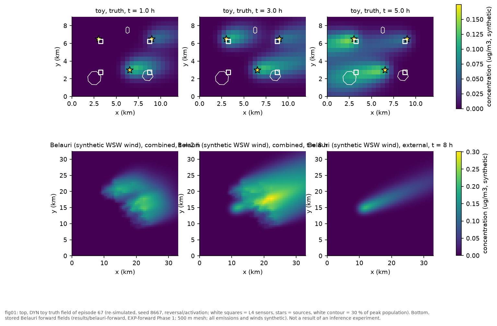
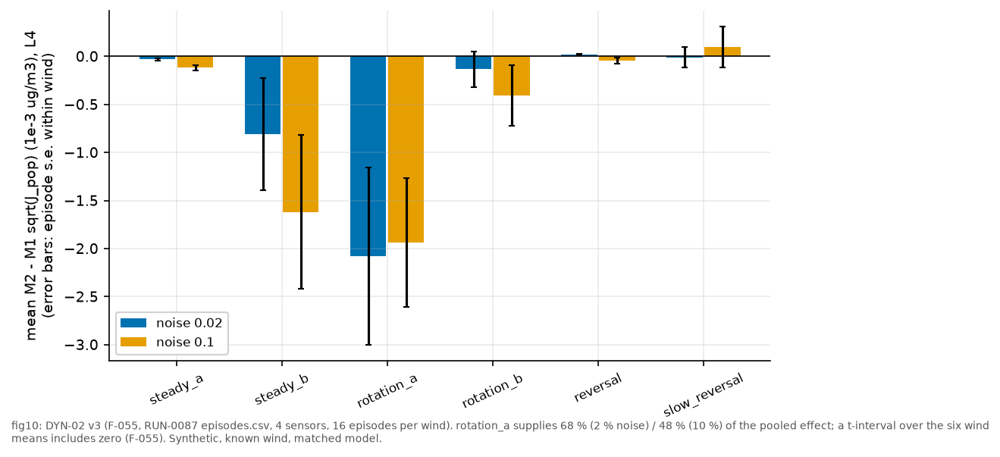
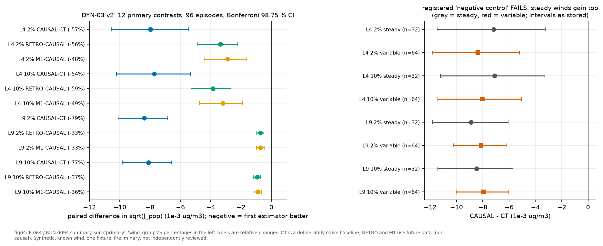
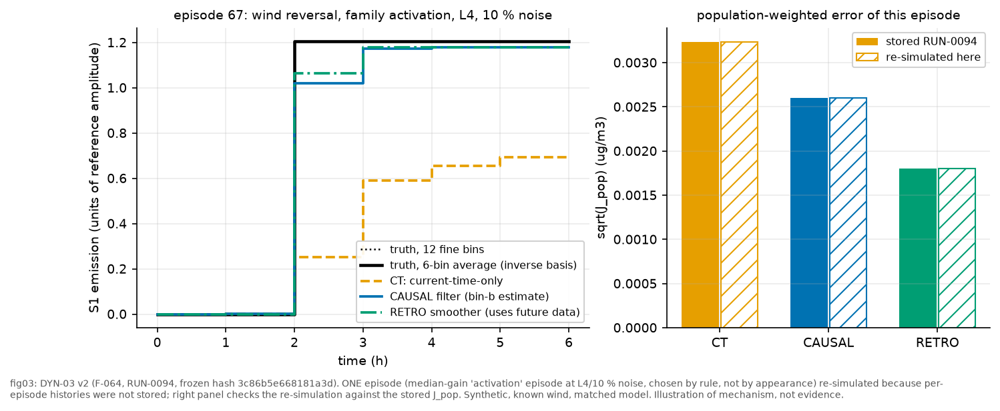
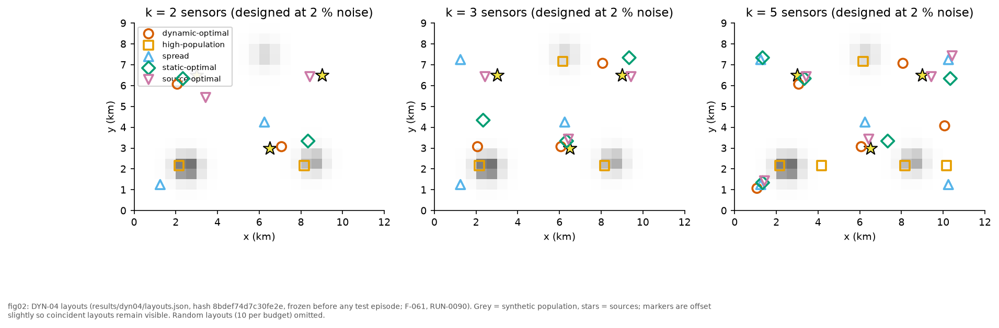
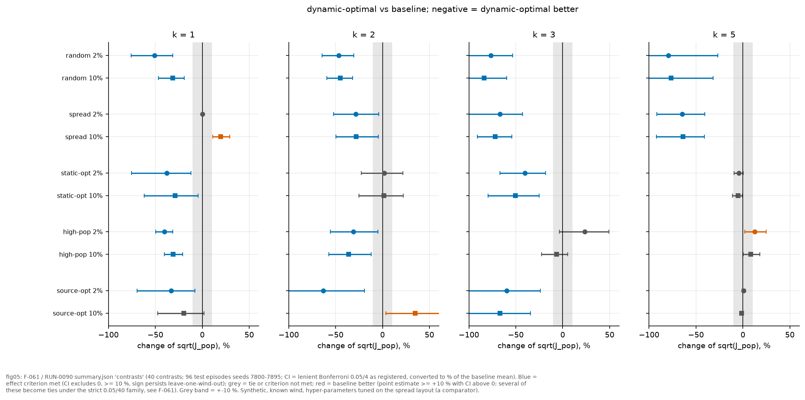
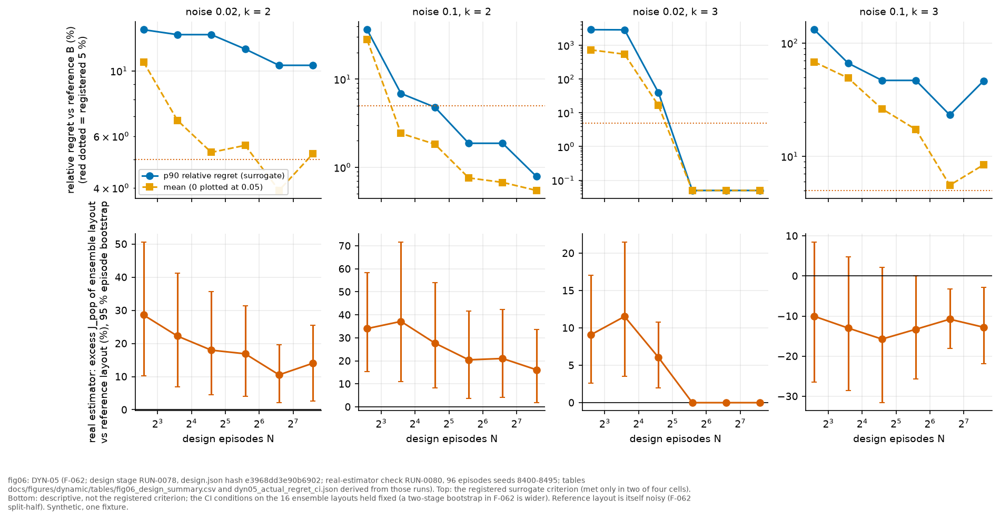
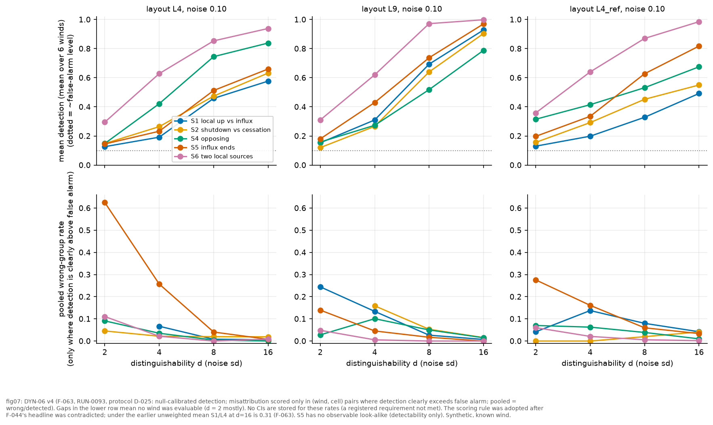
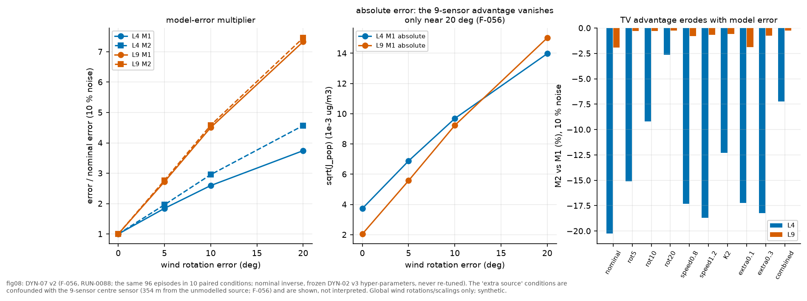
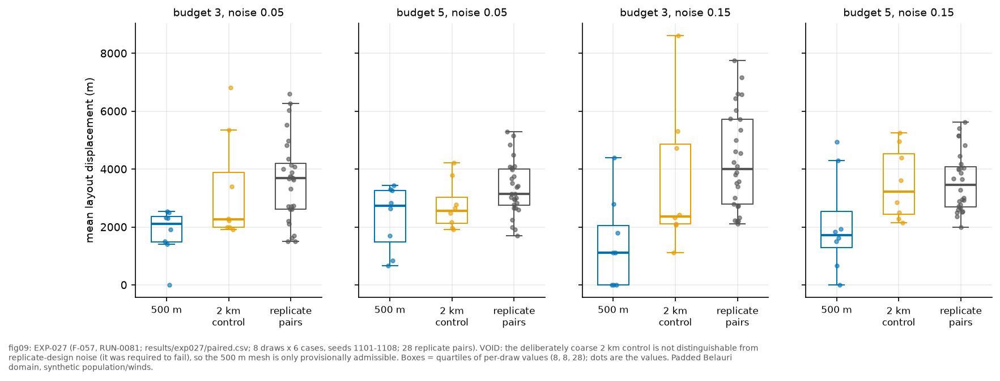

# PRAVAH: dynamic population-weighted sensor deployment and source-history inference. Final scientific report (DRAFT 1)

**Status: DRAFT, assembled from stored results only, in parallel with unfinished experiments.** Nothing here was recomputed except one illustrative toy episode in Figure 3 (checked against stored values, §9.3). Sections marked **[PENDING]** are placeholders for DYN-08, EXP-027b and Q-013; they contain no results.

**Everything quantitative is synthetic.** Real Belauri geography and a modelled WorldPop population raster may appear as *inputs*; every emission, wind-as-truth, episode and sensor reading is generated by the model. There is **no measured pollutant concentration and no empirical validation** anywhere in this report. "Inverse crime" (same solver, same grid for truth and inverse) is present in all toy studies except where stated (DYN-07 perturbs the truth).

**Reference convention.** `[F-xxx / RUN-xxxx / path]`: F = Research OS finding (`.research/bin/research show F-xxx`), RUN = run record under `.research/runs/RUN-xxxx/`, paths are repository-relative. Only **F-051** (plus the early F-002, F-006, F-007, F-009) carries status *supported* (independently reviewed in its final wording). Every other current finding (F-055, F-056, F-057, F-061, F-062, F-063, F-064) is *preliminary*: its predecessor was reviewed and corrected, but the corrected wording itself has not been reviewed. Superseded findings (F-036..F-050, F-052..F-054, F-058..F-060) are **not** cited as evidence; where an old number is mentioned it is flagged as withdrawn.

**Status vocabulary.** *confirmatory* = hypothesis, criteria and frozen hyper-parameters registered before the held-out test; *exploratory* = no such registration; *post hoc* = protocol amended after seeing outputs (disclosed). *reviewed* = an independent `scientific-reviewer` pass on the predecessor; *preliminary* = final wording not reviewed.

Figures are in `docs/figures/final/` and produced by `scripts/make_final_figures.py` (index: `docs/figures/final/figure_index.json`).

---

## 0. Contents

1. Motivation and questions
2. Governing equations, assumptions, discretisation, numerical diffusion
3. Forward operator, superposition and the dynamic (time-binned) extension
4. Inverse problem: estimators, regularisation, identifiability, "alpha as prior width"
5. Objective J_pop and sensor design (surrogate, exhaustive, greedy, swap)
6. Evidence: experiment by experiment
7. Successes, contradicted predictions, unresolved questions
8. What is established versus speculative
9. Reproducibility, the one re-simulation, discrepancies noticed
10. Literature positioning and defensible contributions
11. Limitations of the synthetic setting
12. Roadmap: DYN-08, EXP-027b, Q-013, Nepal/Belauri
- Appendix A: figure list. Appendix B: reference list.

---

## 1. Motivation and questions

A region of tens of kilometres is served by a handful of fixed sensors. Where to put them is decided once, before the sources, winds and episodes that will matter are known. Emissions are not constant (traffic cycles, kilns and brick factories switching on and off), and part of the pollution arrives across the boundary in episodes. Population, not area, is the quantity of interest: the error that matters is the error of the concentration people breathe.

Population is an **evaluation weight only**: not a source, not a boundary condition. Unpopulated cells stay in the physical model, and sensors may sit in zero-population cells [docs/DYNAMIC_POPULATION_SENSOR_RESEARCH_REPORT.md §2].

Scientific questions (RQ labels from Research OS in brackets; the presentation uses the same grouping):

* **Q1 Is the numerics trustworthy enough to be the subject of an inverse study?** [DYN-00; F-051; the FiPy regression gate, F-009; numerical diffusion, F-016/F-025]
* **Q2 Can a time-dependent inversion recover changing local sources, and does temporal regularisation help?** [DYN-02; F-055]
* **Q3 Does measurement history help, and why?** [DYN-03; F-064]
* **Q4 Do designs optimised for population-weighted dynamic reconstruction beat natural baselines?** [DYN-04; F-061]
* **Q5 How many design scenarios are enough, and can a cheap proxy objective be trusted?** [DYN-05; F-062; Q-013/Q-020 open]
* **Q6 Can local emission changes be told apart from transboundary influx?** [DYN-06; F-063]
* **Q7 What does model error (wind, diffusion, missing source) do?** [DYN-07; F-056; earlier Phase 2/3 results F-007, F-029]
* **Q8 Are discretisation choices (mesh) safe for sensor decisions?** [EXP-027; F-057 **void**]
* **Q9 Does any of this transfer to Belauri geography?** [DYN-08 **not run**; Q-024 open]

---

## 2. The forward model

### 2.1 Governing PDE

On a rectangular domain Omega, depth-averaged over a mixing height H (m) [src/pravah/config.py `Transport`: defaults K = 100 m^2/s, lambda = 1/21600 s^-1, H = 500 m]:

    dC/dt + div(u C) = div(K grad C) - lambda C + sum_j (q_j(t)/H) phi_j(x)        (1)

C concentration (ug/m^3); u(t) prescribed wind (piecewise constant in time, uniform in space); K isotropic constant diffusivity; lambda first-order removal (deposition and chemistry lumped; lifetime 6 h); q_j(t) >= 0 emission rate (ug/s); phi_j a **known** unit-integral footprint (integral of phi_j dA = 1 m^-2): Gaussian for a point source (sigma = 600 m in the toy), a road raster or a built-up raster for line and area sources. The unknowns of the inverse problem are the histories q_j(t) and the boundary inflow amplitudes below. [docs/DYNAMIC_POPULATION_SENSOR_RESEARCH_REPORT.md §3.1; footprint normalisation checked to 2e-16 in `scripts/dyn00_verify.py`, F-051]

**Boundary conditions.** On each outer face the sign of u.n classifies it, *per wind segment*, as inflow or outflow. Outflow faces export mass by upwinding. Inflow faces carry a prescribed concentration a_k phi_k(t), where a_k (ug/m^3) is an *inflow-basis amplitude*, a parameter of a different physical kind from an emission (ug/s): raw magnitudes are never compared across kinds. A basis on a face that is outflow under the current wind has **exactly zero** effect. Verified: a constant west basis through a 3600 s wind reversal has cell-summed supply 3.36e-2 before the reversal and exactly 0.0 after; an east basis is the mirror image; mass closure with both on is 2.1e-15 [F-051 / RUN-0091 / .research/runs/RUN-0091/dyn00_checks.json]. This is the physical origin of the structural non-identifiability in §6.6.

**Study polygon.** The Belauri municipality polygon is a *mask* for the evaluation, never a PDE wall.

### 2.2 Assumptions (and what each buys and costs)

| Assumption | Consequence |
|---|---|
| Depth-averaged, one layer, constant H | no vertical mixing, no inversion layer; the Kathmandu-valley literature stresses mixing height (Mues et al. 2017, SRC-020, title only) |
| Prescribed wind, spatially uniform per segment | no terrain-coupled flow (DEM is plotting-only context); ERA5 is too coarse to be "resolved local flow" |
| Constant K, lambda | no stability dependence, no chemistry |
| Linear in (q, a) | superposition; fast inversion; **excludes** nonlinear chemistry and the Van Leer limiter in the inverse |
| Known footprints phi_j | source locations known; only amplitudes are unknown |
| Piecewise-constant 6-bin temporal basis in the inverse | representation floor (the "projection floor", §4.4) |
| Inverse crime in DYN-02..06 | exact wind and operator; DYN-07 is the only study that perturbs the truth |

### 2.3 FiPy finite-volume discretisation

PRAVAH uses FiPy (cell-centred finite volume) with an **exponential** convection scheme (the Patankar power-law/exponential face weighting, which is exactly the 1-D steady solution of advection-diffusion between cell centres) and **implicit (backward) Euler** in time. One time step is a linear map

    c_{t+1} = A_t(u_t, K) c_t + B_t q_t + G_t b_t,        y_t = H_D c_t + eps_t,   eps_t ~ N(0, sigma^2)        (2)

with B_t the source injection, G_t the boundary-inflow injection, H_D the sampling operator for sensor set D. The matrix A_t is never formed; the solver is a black-box action. The scheme is unconditionally stable, mass-conservative and positivity-preserving on the tests run. Verified numerical behaviour [F-051 / RUN-0091 / dyn00_checks.json; F-016 / EXP-001]:

* mass-budget residuals <= 4.4e-15 relative for five dynamic cases (activation/shutdown, simultaneous change, pulse with wind reversal, rotating wind with changing inflow face, tangential wind, zero wind); no negative concentrations;
* superposition to 1.6e-15; the bin-expanded response sum reproduces a direct time-varying run to 1.2e-15 (constant and a non-trivial piecewise history);
* closed-box analytic mass history: error 1.7e-3 at dt = 30 s, observed temporal orders 0.73/0.99/1.0 as dt halves (0.997 in the DYN-00 summary), consistent with first order;
* spatial refinement is checked **only for monotone convergence** (dx 16 to 32 cells vs 64: 9.6 % to 2.5 %), not as an observed order; the Van Leer scheme and Belauri-scale dynamics are **not verified in DYN-00**.

Figure 0 (`fig00_dyn00_verification.png`, reused from the earlier script; same RUN-0091 data) shows the checks.

### 2.4 Numerical diffusion and its physical interpretation

A first-order-in-time, upwind-biased scheme adds an artificial diffusivity. In Fourier analysis, for wind along a grid axis and cell Peclet number Pe = |u| dx / K,

    K_eff/K - 1 = (Pe/2) coth(Pe/2) - 1 + u^2 dt / (2 K)        (3)

[docs/numerical-methodology.md §2; `geo.scenarios.numerical_diffusion_estimate`; reproduced to 3 % by `verification.py`; the periodic Gaussian test measures K_eff/K = 1 + (var_num - var_exact)/(2KT), F-016: about 1.6 K at 50 x 50, dt = 60 s]. The first term is spatial: when Pe >> 1 it tends to Pe/2 - 1, so the added diffusivity K (K_eff/K - 1) tends to u dx / 2 - K (the classical first-order upwind result u dx / 2). The second is the implicit-Euler temporal error, u^2 dt / 2.

Physical reading: **the model transports a plume that is wider than the nominal K implies.** In the Belauri runs the effective diffusivity exceeds K by a factor 2.4 to 9.4 over the winds drawn in Phase 2 (about 2.4 at 0.8 m/s and 9.4 at 2.5 m/s at the design mesh; up to 14-15 for unseen winds) [docs/phase2-validation.md lines 202, 237; K_eff/K 2.5-4.9 at the Belauri meshes, line 404]. At 500 m, K_eff/K is quoted as 6.3 (and 8.3 at the production dt of 100 s) in F-025 [F-025 / RUN-0028]. Consequences: (i) K in the config is not the physical diffusivity of the simulated field; report K_eff/K alongside K; (ii) the "truth" and the "inverse" share the same numerical diffusion, so diffusion error is invisible to the toy inverse studies and only appears when the truth is perturbed (DYN-07, the `K x 2` condition); (iii) mesh changes (EXP-027) change K_eff, so decisions can depend on the discretisation (§6.8).

*Derived here, not measured:* with the toy's K = 100 m^2/s, dx = 500 m, |u| about 1 m/s and dt = 120 s, equation (3) gives Pe = 5 and K_eff/K of about 3.1 (axis-aligned approximation; oblique winds are not exactly covered). With Belauri values (u = 1.5 m/s, dx = 500 m, dt = 100 s) equation (3) gives about 4.9, which is not the 8.3 quoted for the same dt in F-025; F-025's wind speed for that figure was not checked here (listed in §9.4).

Mesh error (Belauri, one synthetic case): the 500 m exponential field has 5.0 % relative space-time L2 error against the 125 m reference (250 m: 1.5 %), observed order about 1.0 to 1.2, so asymptotic errors are about 6 % and 2.6 %; these are lower bounds because the reference is one level finer; the reference floor (exponential vs Van Leer at 125 m) is 0.8 %; time-step self-error at 500 m is 0.64 % [F-025 / RUN-0028, preliminary, independently reviewed for numbers].

### 2.5 Concentration fields (what the model produces)

*Figure 1.* Top: truth field of one toy episode at 1, 3 and 5 h (rotating-segment "reversal" wind, source S1 activating at 2 h; sensors L4 as white squares; white contours enclose the three synthetic settlements). Bottom: stored Belauri forward fields for a synthetic WSW wind (combined and external-only), 500 m mesh. [re-simulation of seed 8667 in `scripts/make_final_figures.py`; results/belauri-forward/fields/from_west_southwest.nc; F-016/F-018 for context.] Not an inference result.

---

## 3. Forward operator, superposition and the time-binned extension

Because (2) is linear in theta = (q, a), the field is

    c(x,t) = c_0 + sum_{j,b} theta_{jb} g_{jb}(x,t)        (4)

with g_{jb} the response to a unit source j active only in temporal bin b (inflow bases likewise). The forward solver is **not modified**: a `GaussianSource` already accepts a piecewise-constant profile, so `pravah.dynamic.expand` replaces each source or basis by N_b = 6 copies with indicator profiles (1 h bins over 6 h), and the existing `ResponseCache` (keyed on scenario, solver, parameters, schema and package version, **not on code**) is reused. Five parameters x six bins = 30 solves per wind. The observation operator A_D stacks the sampled g_{jb} at the 36 observation times (every 600 s) and the sensor cells. A test and DYN-00 verify that the bin sum equals a direct run with the same piecewise history to 1e-15 [F-051 / RUN-0091].

This linearity is what makes everything downstream cheap and exactly checkable; it is also why the Van Leer scheme (nonlinear flux limiter) cannot be used inside the inverse.

**Why the inverse is hard.** Columns of A for different bins of one source are strongly correlated (a plume lasts hours); columns of different sources are correlated by the wind; boundary-basis columns can vanish identically when the face is outflow. The whitened operator has rank 24 of 30 for most (wind, layout) pairs [reviewer finding recorded in docs/DYNAMIC_POPULATION_SENSOR_RESEARCH_REPORT.md §3.4; review F-037/R1], so identifiability is checked per column (`dynamic.sensitivity`) and error metrics are only reported over identifiable columns.

---

## 4. The inverse problem

### 4.1 Estimators

With whitened data y~ = (y - y_0)/sigma and **fixed physical reference amplitudes** r_j (1e5 ug/s for emissions, 0.1 ug/m^3 for inflows; x = theta / r), nonnegative throughout:

* **M0 (static):** one constant per parameter, min over x >= 0 of 1/2 ||A~ S x - y~||^2 + alpha ||x||^2, S the bin-sum matrix.
* **M1 (independent bins):** min 1/2 ||A~ x - y~||^2 + alpha ||x - x_0||^2, prior mean x_0 the static M0 estimate (the *fair* baseline). M1z is the zero-prior variant.
* **M2 (temporally regularised):** adds beta ||D_t x||_1 with D_t the per-parameter first-difference operator: total variation (the fused-lasso idea; Tibshirani et al. 2005, SRC-003, examined). beta = 0 reproduces M1, so M2 nests M1.

Nonnegativity is a convex constraint and is *not* part of the fused-lasso paper (T-081 note). Solvers [src/pravah/dynamic.py]: beta = 0 is an exact bounded least-squares problem (stacked system, `scipy.optimize.lsq_linear`, BVLS); beta > 0 uses ADMM with variable splitting, over-relaxation 1.6, residual-balancing of rho (initialised from the data curvature), stopping on relative primal and dual residuals < 1e-7, and **raises** `NotConverged` at 3e5 iterations. This is not cosmetic: an earlier version with fixed rho and a 2e4 cap never converged and every reported M1/M2 number was an early-stopped iterate (review of the superseded F-037). The final solver matched an independent trust-constr QP to 1.3e-6 relative (reviewer re-derivation, recorded in the old report §3.4).

*Causal vs retrospective.* A smoother (RETRO = full-window M2) uses all data, including data after the bin being estimated. A causal filter (CAUSAL) for bin b uses data up to the end of bin b and keeps the bin-b estimate; CT ("current-time-only") uses only bin-b observations and bin-b columns. In the v2 protocol the static prior for bin k is the M0 ridge fit on data up to bin k only [F-064; D-024; `src/pravah/studies/toy/dynamic_history.py::estimate`].

### 4.2 "Alpha as prior width"

The ridge term alpha ||x - x_0||^2 is the negative log of a Gaussian prior x ~ N(x_0, (2 alpha)^-1 I) *in units of the reference amplitudes* (because x = theta / r, the prior std on theta_j is r_j / sqrt(2 alpha)). Consequences: alpha is not "a smoothing strength" but the inverse square of how far an amplitude may sit from the prior mean, in multiples of its reference scale; a small alpha is a wide prior and therefore a weakly regularised fit; and because the scale vector multiplies the prior width, **emission amplitudes (ug/s) and inflow amplitudes (ug/m^3) are only comparable through r**. A layout-dependent scale (an earlier mistake) silently changes the prior between layouts; the final code uses the fixed REF vector [AGENTS.md rules]. Practical note: in several cells the selected alpha is at the grid edge (0.01, a very wide prior, so the temporal TV term carries the regularisation); see limitations in F-055, F-064.

### 4.3 TV regularisation and nonnegativity

TV favours piecewise-constant histories, which is the right inductive bias for on/off events but wrong for smooth ramps and for abrupt shutdowns it can lag or oversmooth (M2 is worse than M1 on abrupt shutdowns in DYN-02, old report §8; not re-derived from the stored data here). For layouts blind to the plumes the unregularised bounded least-squares fit was found unstable (F-005, a *failed direction*), which is the reason a ridge/prior term is always present (alpha > 0).

### 4.4 Identifiability, floors and distinguishability

* **Projection floor:** min over x >= 0 of ||W^(1/2) (c - sum x_jb r_j g_jb)||, the best any nonnegative 6-bin history can do regardless of sensors. It is a representation limit and the right comparison for "how close to the best possible" (an earlier "oracle" row was not such a floor).
* **Per-column sensitivity** (`dynamic.sensitivity`): columns with negligible whitened norm are unidentifiable and are excluded from error metrics.
* **Distinguishability d** of two change signatures Delta_a, Delta_b: d = min over c >= 0 of ||A_a Delta_a - c A_b Delta_b|| / sigma. It measures whether the *fields* differ, in noise standard deviations; *attribution* of the change to a group (local vs boundary) can fail even for large d (§6.6).

---

## 5. Objective and sensor design

### 5.1 J_pop

    J_pop(D) = E[ (1/T) sum_t sum_i w_i (C_{i,t} - C^_{i,t}(D))^2 ],   w_i = rho_i dA_i / sum_j rho_j dA_j

reported as sqrt(J_pop) in ug/m^3, trapezoidal weights in time. rho is the synthetic population density (separated settlements, 100 000 people) in the toy and a WorldPop 2025 raster in the Belauri studies (population-data.md).

### 5.2 Gaussian linear-Bayes surrogate

For a ridge estimator with prior x ~ N(0, I), Gram matrix H = I + sum_{c in D} A_c^T A_c / sigma^2 and truth second-moment matrix C = E[x x^T],

    J(D; C) = tr( Q H^-1 [C + H - I] H^-1 ),   Q = M^T M,  M = W^(1/2) G diag(r)        (5)

(noise expectation taken analytically). It is exact for the unconstrained ridge estimator (checked against Monte Carlo to 3 %; the closed form was not independently re-checked in F-062's limitations), depends on design episodes only through C, and admits exact exhaustive search. It **ignores nonnegativity and TV**, its principal limitation: §6.5 shows it cannot certify sufficiency for the real estimator.

### 5.3 Search

Candidate set: 70 cells (10 x 7 grid). Exhaustive search for k <= 3 (70 choose 3 = 54 740); for k = 5 (about 1.2e7 subsets) a multi-start swap refinement with **no optimality certificate**. Greedy forward selection is reported as a baseline: its surrogate risk is 3.1x the exhaustive optimum at k = 3 and 5.2x the best of 11 multi-start swap layouts at k = 5; greedy+swap remains +213 % at k = 3 [F-061 / RUN-0090 / .research/runs/RUN-0090/summary.json 'search_gaps'; results/dyn04/layouts.json]. Greedy path-dependence was already noted in the earlier static studies (F-030, F-032, preliminary).

---

## 6. Evidence, experiment by experiment

Common design [old report §6; frozen files]: 6 winds (steady_a, steady_b, rotation_a, rotation_b, reversal, slow_reversal; wind speeds about 0.5 to 1.1 m/s), 8 event families (constant, activation, shutdown, ramp, opposing, pulse, influx_end, compensating), 12-bin jittered truth at dt 60 s versus a 6-bin inverse at dt 120 s, 12 x 9 km domain on a 24 x 18 grid, three Gaussian sources S1 (3.0, 6.5 km), S2 (6.5, 3.0), S3 (9.0, 6.5), two inflow bases (WSW, ENE), layouts L4 and L9, noise 2 % and 10 % of a wind-specific reference mean concentration, independent seeds per stage. Statistical unit: the episode; wind is a blocking factor with leave-one-wind-out checks. Registered effect criterion: paired bootstrap CI at Bonferroni level 0.05/4 excludes 0 AND relative gain >= 10 % AND sign persists leaving each wind out. Six winds are six replicates, not a sample of "wind": wind-level generalisation rests on 6 points.

### 6.0 DYN-00 numerical verification (EXP-028)

* **Hypothesis:** the dynamic forward conserves mass and propagates time-varying sources and inflow bases correctly. **Method:** 25 pre-set checks on a 16 x 12 box (`scripts/dyn00_verify.py`). **Config:** `results/dyn00/dyn00_checks.json`. **Status:** confirmatory verification, **supported** (reviewed).
* **Result:** 25/25 pass. Values in §2.3 [F-051 / RUN-0091]. One check (west_no_import_after_reversal) was amended after the first run because ill-posed; a reviewer found the amended version vacuous; it was replaced by `basis_face_reclassification` (§2.1) [F-051; review F-038/R1].
* **Not verified:** Van Leer scheme, Belauri-scale dynamics, spatial order beyond monotone convergence.

### 6.1 DYN-01 (EXP-029)

Event generator coherence is exercised inside DYN-02..07 and tests; **not run as a stand-alone experiment** [old report §6].

### 6.2 DYN-02 historical source inversion, M0/M1/M2 (EXP-030)

* **Hypothesis (registered):** M2 (TV) lowers population-weighted RMSE relative to the fair independent-bin M1. **Method:** 96 test episodes (6 winds x 8 families x 2), 4 and 9 sensors, noise 2 %/10 %, hyper-parameters frozen from validation (hash 200ef2e894a62851). **Baselines:** M0 (static), M1z (zero prior), M1 (static prior; the fair baseline), projection floor. **Status:** confirmatory but protocol-amended twice after seeing outputs (D-010 to D-011 to D-013 to D-021); *preliminary*; the v3 tune stage was not run through Research OS (hash committed one second before the test; reviewer reproduced validation values) [F-055].
* **Result (4 sensors; sqrt(J_pop), paired, Bonferroni 98.75 % CIs):** M2 - M1 = -0.00051 [-0.00107, -0.00009] ug/m^3 (-15.7 %, M1 mean 0.00324) at 2 % noise; -0.00067 [-0.00122, -0.00022] (-20.1 %) at 10 % [F-055 / RUN-0087 / .research/runs/RUN-0087/episodes.csv]. M2 beats the zero-prior M1z by 26-32 %; local-source RMSE -34 %/-45 %; boundary amplitude -12 %/-23 % (episode CI includes 0). At 9 sensors the gain is 0.7 %/2.4 % (criterion not met). M1 and M2 beat static M0 by 72-85 %. M1 is 2.4x the projection floor (mean 0.00137) at 4 sensors, 1.09x/1.17x at 9 sensors.
* **Robustness is weak (the reviewer's correction):** one wind, rotation_a, supplies 68 % (2 %) / 48 % (10 %) of the effect; without it the gain is 6.8 % at 2 % (below the 10 % criterion) and 14.0 % at 10 %; only 56 %/74 % of episodes favour M2. A t-interval over the six wind means includes zero in every case (2 %: p = 0.195, [-0.00180, +0.00079]); the effect is **not shown to generalise to the population of winds** [F-055; Figure 10].
* **Interpretation:** TV regularisation helps only where sensors are scarce, and on these six winds it helps in the rotating/oblique ones. At 9 sensors the estimator is within 9-17 % of its representation limit, so there is nothing left for regularisation to gain. Hyper-parameter caveat: 9 of 16 selections sit on flat plateaus at a grid bound; 11 far-from-optimum M2 validation grid points still do not converge (D-021's "every candidate converges" is false for validation; test fits all converged; selection unaffected) [F-055].
* **Withdrawn earlier numbers:** "24-25 %" (F-039) and "30-45 %" (F-037) were artefacts of an under-converged solver and an under-tuned baseline; RUN-0060 used emissions of 3-8 ug/s instead of about 1e5 (invisible sources, invalid, F-036) [F-055 'related'; old report §8].

*Figure 10.* Mean paired M2 - M1 sqrt(J_pop) per wind, 4 sensors (16 episodes per wind) [RUN-0087/episodes.csv]. rotation_a carries the effect; reversal is slightly positive (M2 no better).

### 6.3 DYN-03 value of measurement history (EXP-031)

* **Hypothesis (registered):** (H-a) a causal filter beats a current-time-only estimator in detection and J_pop; (H-b, the *prediction*) history helps **more under varying wind** than under steady wind (steady winds = negative control). **Method:** CT, CAUSAL, RETRO, M1 on the same data, sensors and prior; 96 new test episodes; frozen hash 3c86b5e668181a3d; 0 non-converged fits. **Status:** confirmatory, **v2 protocol D-024 registered after review of v1 (F-053/R1 found CT/CAUSAL used non-causal priors and the detection rule counted a constant estimate as a detection)**; preliminary [F-064 / RUN-0094 / .research/runs/RUN-0094/summary.json]. The negative control was retired post hoc after it failed (D-024 retires it *after* the result was seen; disclosed).
* **Result (sqrt(J_pop), paired, family alpha 0.0125):** CAUSAL vs CT: -57 % at 4 sensors/2 % noise (-0.00798 [-0.01056, -0.00544]) and -54 % at 10 % (-0.00772 [-0.01021, -0.00532]); -79 %/-77 % at 9 sensors (-0.00839 [-0.01011, -0.00683]; -0.00812 [-0.00981, -0.00657]). RETRO vs CAUSAL (RETRO also uses future data): -56 %/-59 % (4 sensors), -33 %/-37 % (9). M1 vs CAUSAL: -48 %/-49 % (4), -33 %/-36 % (9). All 12 primary contrasts meet the registered criterion. **Change detection** (62 step episodes): CT misses 61 % (4 sensors) and 52-53 % (9 sensors), mean delay 1.96/1.6 bins; CAUSAL misses 9.7 % (4 sensors; 3.2 % at 9), delay 0.4-0.54 bins (1 bin = 1 h); RETRO and M1 miss 1.6-8 %, delay 0.18-0.24 [F-064].
* **Prediction contradicted:** all 8 steady-group CAUSAL-CT and RETRO-CAUSAL intervals exclude 0 (the stop rule fires and is reported). Absolute CAUSAL-CT gain at 4 sensors/2 %: steady -0.00717 vs variable -0.00838 (larger on variable); at 9 sensors: steady -0.00889 vs variable -0.00814 (larger on steady); relative gain at 4 sensors -49 % vs -62 % (larger on variable), about equal at 9 sensors (-78 % vs -80 %). Verdict: **weakly supported at 4 sensors, not supported at 9**, and the gain is mostly "plume carry-over" (earlier emissions are still in later observations), **a mechanism not tested here** [F-064; Figure 4].
* **Caveats:** CT is a deliberately naive baseline (its tuned alpha sits at 1e6-1e9, collapsing it to the static prior), so the CT contrast mostly measures the cost of ignoring carry-over; CAUSAL/RETRO/M0 alpha is 0.01 (grid edge) in all cells; the stored summary's `note` still prints the stale seed string "7600-7695" while D-024 specifies 8600-8695 (§9.4); matched model, known wind, one fixture.

*Figure 4.* Forest plot of the 12 primary contrasts (left) and the steady-versus-variable split for CAUSAL-CT (right).

*Figure 3.* Mechanism illustration for ONE median-gain "activation" episode (reversal wind, 4 sensors, 10 % noise): CT lags and underestimates the new emission level for hours (it ignores that earlier emission is still being sensed); CAUSAL jumps at the right bin and is slightly low; RETRO is best because it sees the future. Right: re-simulated J_pop matches the stored RUN-0094 value to about 1e-15 (§9.3). Illustration, not evidence.

### 6.4 DYN-04 dynamic population-weighted design (EXP-032)

* **Hypothesis H3 (registered):** layouts optimised for time-resolved population-weighted J_pop beat random, spread, high-population, static-optimal and source-identification-optimal layouts on unseen episodes. **Method:** surrogate averaged over six winds, exhaustive k <= 3, swap k = 5; layouts frozen (hash 8bdef74d7c30fe2e) before any test episode; hyper-parameters (hash 103b54317bac1be5) tuned on the **spread layout only** and applied unchanged to all layouts; 96 test episodes (seeds 7800-7895), real nonnegative M2. **Status:** confirmatory; preliminary; no active DYN-04 protocol card after D-014 was superseded [F-061 limitations].
* **Result (tally of 40 contrasts, effect criterion):** 23 robust wins and 1 robust loss under both the lenient (0.05/4, registered) and strict (0.05/40) families; 3 wins and 2 losses only under the lenient family; 11 ties [F-061 / RUN-0090 / summary.json]. Selected numbers (sqrt(J_pop) change of dynamic-optimal relative to baseline, lenient CI as % of baseline mean):
  * vs random: -32 % to -84 % in all 8 budget x noise cells; at k = 3, 2 % noise 0.0030 vs 0.0128 ug/m^3 (-76 % [-108, -53]).
  * vs spread: k = 3 -67 %/-72 %, k = 5 -64 %/-65 % (robust); k = 2 -28 %/-29 % (lenient only); **k = 1 at 10 % noise +20 % [+11, +29]: spread is better** (robust loss; but see tuning caveat); at k = 1, 2 % noise the layouts are identical (difference exactly 0).
  * vs static-model-optimal: k = 1 -38 %/-29 %, k = 3 -40 %/-50 %; ties at k = 2 (+2 %) and k = 5 (-4 %/-5 %, below criterion).
  * vs source-optimal: k = 1 2 % noise -33 %, k = 2 2 % noise -63 %, k = 3 -60 %/-67 %; **k = 2 10 % noise +35 % [+4, +77]** (lenient only: a population-vs-source trade-off); ties at k = 5.
  * vs **high-population heuristic**: wins at k = 1 (-41 %/-31 %) and k = 2 at 10 % (-36 %); at k = 3 not better (+23 % [-4, +49] at 2 %, -7 % at 10 %) and at k = 5 the heuristic is marginally better (+13 % [+2, +25] at 2 % noise, lenient only; +8 % [0, +18] at 10 %).
* **Interpretation:** registered H3 is supported against random and (k >= 3) spread layouts, partly against static and source-oriented layouts, and **not supported against the high-population heuristic**. With three concentrated settlements "go where people live" is a strong baseline; this fixture flatters it.
* **Surrogate vs reality:** Spearman rank agreement of surrogate risk with held-out RMSE over 15 layouts per cell: k = 1 0.43/0.37 (p = 0.11/0.18, not significant), k = 2 0.61/0.67, k = 3 0.81/0.88, k = 5 0.89/0.95 (2 %/10 % noise). The proxy ranks well at larger budgets, poorly at k = 1.
* **Caveats:** hyper-parameters tuned on a comparator (spread); M2 alpha at the lower grid bound for k3/0.1, k5/0.02, k5/0.1, so the k = 1 10 % loss to spread may be a tuning artefact (a validation check was unfinished: unverified); one geometry and fixture; known nominal wind; layouts designed at the evaluation noise [F-061].

*Figure 2.* The designed layouts at k = 2, 3, 5 over the synthetic population (design noise 2 %).

*Figure 5.* All 40 contrasts with lenient CIs. Blue: criterion met; grey: tie; orange/red: baseline better.

### 6.5 DYN-05 / P0 statistical sufficiency of design scenarios (EXP-033)

* **Hypothesis H4 (registered):** more independent design episodes stabilise the design objective; criterion: the 90th percentile over 16 replicate ensembles of relative regret <= 5 % against an independent reference. **Method:** closed-form ridge risk (5); 16 ensembles per N in {6, 12, 24, 48, 96, 192}; selection reference A and an independent evaluation reference B of 20 000 episodes each; real constrained-estimator check on 96 fresh episodes (seeds 8400-8495). **Status:** confirmatory with disclosed post hoc change: D-018 (independent reference B) was written after the RUN-0077 summary was printed and flipped one borderline cell; an earlier real-estimator run RUN-0079 had a key collision and was re-run as RUN-0080 [F-062 / RUN-0078 (design.json hash e3968dd3e90b6902) / RUN-0080 (test_rows.json)]. Preliminary. Note the EXP-033 card says R = 8 while D-017 registered R = 16; the stored design uses 16 [F-062 limitations; docs/figures/dynamic/tables/fig06_design_summary.csv].
* **Result (surrogate):** criterion met from N = 24 (noise 0.10, k = 2: 4.8 %) and N = 48 (noise 0.02, k = 3; all 16 ensembles identical); **not met up to N = 192** for noise 0.02, k = 2 (10.5 %) and noise 0.10, k = 3 (p90 23-47 % for N >= 24, non-monotone: 23 % at N = 96, 46 % at N = 192). At N <= 12, noise 0.02, k = 3, relative regret reaches 29 (objective about 30x the optimum) when an unstratified ensemble misses the wind that matters (steady_b). **H4 is supported for the surrogate in 2 of 4 cells, not in the other two.** The prediction that more episodes monotonically stabilise design is **contradicted** in two cells.
* **Real constrained estimator (descriptive, not the registered criterion; ratio of mean sqrt(J_pop) vs the reference layout, 95 % episode bootstrap with ensemble layouts held fixed):** noise 0.10, k = 2: +34 % [15, 58] at N = 6, +28 % [8, 54] at N = 24, +16 % [2, 34] at N = 192; noise 0.02, k = 2: +29 % [10, 51] at N = 6, +14 % [3, 26] at N = 192; noise 0.02, k = 3: +9 % [3, 17] at N = 6, exactly 0 from N = 48; noise 0.10, k = 3: -10 % [-27, +9] at N = 6, -13 % [-22, -3] at N = 192. The N = 6 vs N = 192 two-stage CIs include 0 in all cells, so the real estimator **does not show** that more design episodes help [F-062].
* **Reference quality:** a split-half check shows the surrogate-selected reference S*_A is itself +31 % [5, 71] worse than the best evaluated layout at noise 0.10, k = 3 (S*_B is 22 % better than S*_A), and unresolved at noise 0.02, k = 3 (+21.5 % [-5, +59]). So regret against S*_A cannot certify sufficiency in those cells [F-062; docs/figures/dynamic/tables/dyn05_actual_regret_ci.json].
* **Interpretation:** design sufficiency is cell-dependent; 6 episodes are insufficient everywhere by the proxy and clearly insufficient in two cells by the real estimator; an unconstrained-ridge surrogate with a surrogate-selected reference **cannot certify sufficiency for the constrained estimator**. **Not claimed:** that the earlier static studies (EXP-013/014/020/026) failed this way (their wind sampling was not checked) [F-062].
* **Q-013 (open, [PENDING]):** the original question "is the design objective identifiable with 6 design cases?" (eps_sd/J_ref 1.01-2.52, F-035) is addressed here only for the toy ridge proxy; a direct answer for the Belauri greedy-total objective is not available (§12).

*Figure 6.* Top: p90 and mean relative regret (surrogate) vs N with the registered 5 % line. Bottom: excess J_pop of the ensemble layout under the real estimator.

### 6.6 DYN-06 local activity vs transboundary influx (EXP-034)

* **Hypotheses (registered, restated in D-025):** P1 misattribution falls with distinguishability d; P2 misattribution <= 10 % at d = 16 when the column-space cosine of the two look-alikes < 0.9; P3 >= 25 % at d = 2; P4 (S7 only) replacing one interior sensor by an upwind-boundary sensor reduces misattribution by more than 5 points at equal d. **Method (v4, D-025):** six winds; d in {2, 4, 8, 16} asserted within 2 % of target; null-calibrated detection; misattribution scored only in (wind, cell) pairs where detection is clearly above the false-alarm level (one-sided binomial test vs 0.10, p < 0.01); pooled = wrong / detected summed over scored winds; 100 replicates, null seeds 9500-9599, signal seeds 9600-9699; noise shown 0.10. **Status:** **post hoc scoring**: the pooled-and-gated metric was adopted after the earlier headline was contradicted; under the earlier unweighted-mean metric S1/L4 at d = 16 is 0.31 (so a verdict reversal for P2 is a consequence of the scoring rule); preliminary [F-063 / RUN-0093 / .research/runs/RUN-0093/summary.json].
* **Result:** where the change is detected the group is attributed correctly: pooled wrong-group rate at d = 16 with 4 sensors is 0.01 (S1 local increase vs influx), 0.02 (S2 shutdown vs cessation), 0.00 (S4 opposing), 0.01 (S5 influx ends), 0.01 (S6 two local sources); <= 0.04 for the boundary-reference layout; 0.00-0.02 for 9 sensors; <= 0.08 everywhere at d = 8 [F-063]. **The real 4-sensor limitation is non-detection in some winds:** d = 16 mean detection 0.58 (S1), 0.63 (S2), 0.84 (S4), 0.66 (S5), 0.94 (S6); 9 sensors 0.93/0.90/0.79/0.97/1.00; S1 at 4 sensors is detected clearly in only 4 of 6 winds (steady_b and rotation_a at the false-alarm level). Per-wind rates in partially detected winds are higher: 0.12 (S4/L9 slow_reversal; S4/L4_ref rotation_b), 0.22 (S1/L4_ref slow_reversal), 0.36 (S2/L4_ref slow_reversal).
* **Predictions:** P1 holds where evaluable (S1/L9 0.24/0.13/0.03/0.01; S5/L4 0.62/0.26/0.04/0.01) but not monotonically in S1/L4_ref (0.04/0.14/0.08/0.04), S4/L9, S2/L4_ref. P2 **holds** in every scored cell for S1, S2, S6 (<= 0.04); S4 has cos_max = 1.00 and S5 has no cosine, so P2 does not apply. **P3 is CONTRADICTED where evaluable** (S6 L4 0.11, L4_ref 0.06, L9 0.05; S4/L4_ref 0.07), not evaluable for S1, S2, S4/L4/L9 (detection near the false-alarm level at d = 2). P4 **holds** (the boundary-reference layout gives no benefit: S1 pair at d = 16 pooled 0.04 vs 0.01; detection 0.49 vs 0.58). The status of P3 is stated differently in the two stored versions of this finding (§9.4).
* **Structural non-identifiability:** S5 ("influx ends") has no observable look-alike (its change signature is identically zero), so its d is detectability against no change, not distinguishability (4/4 valid winds flagged); 48 cells (S5 in reversal and slow_reversal) are perfectly confounded or invisible because after the reversal the boundary basis has no inflow face. S2 is detectability-only in 2 of 5 valid winds (rotation_b match failed). Controls: confounded operator detection 1.0 and ambiguity 1.0 by construction (does not exercise the 10 % ambiguity band); no-variation false-alarm level 0.09 (9/100) [F-063].
* **Withdrawn:** the earlier headline "17-26 % misattribution at d = 16 with 4 sensors" was an averaging artefact [F-063].
* **Caveats:** no CIs on confusion rates (a registered requirement); 95th-percentile null threshold from 100 replicates, no multiplicity correction over about 650 cells; frozen alpha; no model error; matched model; noise 0.02 not re-examined.

*Figure 7.* Detection (top) and pooled wrong-group rate (bottom) vs d for three layouts at noise 0.10.

### 6.7 DYN-07 robustness to model error (EXP-035)

* **Hypotheses (registered, three predictions):** error rises monotonically with wind rotation; M2's advantage over M1 erodes with model error; M2 still beats M0. **Method:** the same 96 episodes (seeds 8500-8595) in 10 paired conditions (rotation 5/10/20 deg, speed x0.8/x1.2, K x2, extra constant source at 10 %/30 % of emission, combined); truth perturbed, inverse nominal; DYN-02 v3 hyper-parameters frozen and **deliberately not re-tuned per condition**. **Status:** confirmatory; preliminary [F-056 / RUN-0088 / .research/runs/RUN-0088/summary.json].
* **Result:** rotation 5/10/20 deg multiplies the 4-sensor M1 error by x1.84/2.59/3.74 and the 9-sensor M1 error by x2.72/4.51/7.33; M2's advantage over M1 at 4 sensors erodes from -20 % (nominal) to -3 % at 20 deg; M2 beats M0 in 91-96 % of episodes (4 sensors) and 61-99 % (9 sensors); M2 is below M1 in all 40 layout x noise x condition cells but by only 0.1-2 % at 9 sensors.
* **Corrected interpretation:** an earlier claim "extra sensors tighten the fit to a wrong model" is **not established**: the unmodelled source at (6000, 4500) m lies 354 m from the 9-sensor layout's centre sensor, which alone explains the extra-source cost x4.58 vs x1.37 and the 61 % minimum. In absolute error the 9-sensor M1 is still *better* than the 4-sensor M1 at 5 deg (0.00558 vs 0.00688), 10 deg (0.00923 vs 0.00969) and both speed errors, and *worse* only at 20 deg (0.01502 vs 0.01398), diffusion x2 (0.00696 vs 0.00672) and the extra source; the larger ratios partly reflect the lower nominal baseline (0.00205 vs 0.00373). **Supported:** wind/diffusion error costs a factor 1.7-9 depending on size and layout, and beyond about 15-20 deg of wind error the sensor-rich layout no longer has an absolute advantage [F-056]. Earlier Phase 3 toy results agree in direction: direction error raises nominal-wind error 3-4x at 30 deg and exceeds the sensor-count effect for >= 10 deg [F-029, preliminary, reviewed numbers].
* **Caveats:** global rotations/scalings only; one fixture; hyper-parameters not re-tuned.

*Figure 8.* Left: error multiplier vs rotation. Middle: absolute error, where the L4 and L9 curves cross. Right: M2 vs M1 by condition (the extra-source columns are confounded, see text).

### 6.8 EXP-027 / P1 numerical decision stability on a common padded Belauri domain (EXP-027)

* **Hypothesis (registered, the fix of the non-commensurable EXP-015 stage 2):** layouts designed at the 500 m mesh are as close to those designed at the 250 m reference as two independent replicate design draws are to each other. **Method:** padded domain (34 km square, `configs/belauri_padded_geography`), reference 250 m/dt 50, main 500 m/dt 100, **falsification control 2 km/dt 400** (the control must fail, else the test is void: registered stop), 8 independent replicate design draws x 6 cases (seeds 1101-1108), greedy total objective, budgets 3 and 5, noise fractions 0.05/0.15; admissible iff medians <= pair medians and one-sided Mann-Whitney p > 0.05. The 2 km control needed a control-only relaxation of the origin-tag tolerance (0.82 vs 0.94; user-approved D-016; labels only). **Status:** confirmatory; **VOID by its own registered stop** [F-057 / RUN-0081 / results/exp027/paired.csv, paired_verdict.csv, paired_summary.json]. F-057 records an independent review: "void is the correct registered conclusion".
* **Result:** median mesh-induced layout displacement (500 m | 2 km control | replicate pairs): 2108 | 2262 | 3691 m (budget 3, noise 0.05); 2738 | 2567 | 3147 m (5, 0.05); 1118 | 2370 | 3996 m (3, 0.15); 1728 | 3234 | 3468 m (5, 0.15). The control passes in all four cells (one-sided p = 0.69-1.000; the 28 replicate pairs come from 8 draws so p-values are approximate). Median |regret| (control 6.8e-6 to 4.4e-5; pairs 2.6e-5 to 1.9e-4): control medians are 10-25 % of the pair medians, not zero.
* **Interpretation:** layouts from 6-case ensembles move 3-4 km between independent draws, more than degrading the mesh 2x (500 m) or 8x (2 km); mesh effects are invisible through design noise (the DYN-05 problem). **The 500 m mesh remains provisionally admissible only; this is not evidence of adequacy.** It also does not show that mesh sensitivity is absent.
* **Cost correction:** a decisive EXP-027b with 48 or 96 cases per draw would cost about 190 or 375 core-hours for 8 draws (about 94 or 188 for 4 draws) at the observed efficiency; "48-96 cases suffice" extrapolates the toy DYN-05 ridge result to the Belauri greedy-total objective and is a guess [F-057].
* **EXP-027b [PENDING]:** no result. Placeholder table:

| budget | noise | 500 m displacement | 2 km control | replicate pairs (>= 48 cases) | control fails? | verdict |
|---|---|---|---|---|---|---|
| 3 | 0.05 | [PENDING] | [PENDING] | [PENDING] | [PENDING] | [PENDING] |
| 5 | 0.05 | [PENDING] | [PENDING] | [PENDING] | [PENDING] | [PENDING] |

*Figure 9.* Displacement of the 500 m design, the 2 km control and replicate-pair layouts: the control does not separate from replicate noise.

### 6.9 DYN-08 Belauri synthetic dynamic deployment (EXP-036) [PENDING]

Not run. Readiness assessment (no compute): `docs/dyn08_readiness.md`; padded WorldPop extract `data/population/belauri_padded_worldpop*.npy`, config `configs/dyn08.json`, script `scripts/dyn08_padded_population.py` (untracked working-tree files at the time of writing). Blocked on a Belauri-scale dynamic response build (hundreds of core-hours) and on the F-046/F-062 lesson that design ensembles must be much larger [CP-014; T-067]. **No result exists; none is reported.** Placeholder:

| quantity | 500 m | 250 m (secondary) |
|---|---|---|
| dynamic-optimal vs high-population/static/source layouts, sqrt(J_pop) change, CI | [PENDING] | [PENDING] |
| wind-uncertainty (ERA5-sampled) degradation | [PENDING] | [PENDING] |
| local vs transboundary attribution on Belauri geometry | [PENDING] | [PENDING] |

### 6.10 Earlier supported results (Phase 1-2) that this program builds on

* **F-002 (supported, high):** with 4 fit sensors and noise 0.005 ug/m^3, three-amplitude recovery within 2.5 % of truth, rank 3, condition 5.6; direct vs linear route agree to 4e-9 relative [F-002 / RUN-0003]. Limit: inverse crime, single noise draw and layout.
* **F-006 (supported, medium):** with alpha frozen on validation (alpha = 0.1, seed 44), on test seed 33 greedy layouts beat spread layouts (mean RMSE 0.021/0.017/0.0015/0.00045/0.00041 vs 0.022/0.020/0.014/0.014/0.0013 at budgets 1/2/3/5/8; paired win rates 78/61/78/100/78 %, n = 18; advantage clear from 3 sensors, not established at 1-2) [F-006 / RUN-0008, RUN-0009]. Limit: 6+6 scenarios, sd not CI, matched model.
* **F-007 (supported, medium):** hidden wind error and an unmodelled source dominate discretisation mismatch; greedy b = 8 RMSE: matched 4.1e-4, refined truth 1.0e-3 (lower bound), wind-perturbed 0.017, extra source 0.010; a poor corner layout has effective rank 0 in 18/18 rows, RMSE 0.049 vs greedy 0.0015 [F-007 / RUN-0011].
* **F-009 (supported, high):** routing every workflow through one `ForwardSolver` preserves 21 deterministic outputs bit-for-bit; gate `21 files compared, 0 differ` on arm64; an x86_64 run (RUN-0066) is recorded in the old report [F-009 / RUN-0012, RUN-0013]. The gate is architecture-scoped (D-005).
* Preliminary Phase 3 results not relied on here: F-029/F-034 (wind error), F-030/F-032 (greedy far from optimal at 2-4 sensors), F-026 (population-aware design: no objective effect established), F-035 (EXP-015 stage 2: H1 *untested*; reviewer: needs work).

---

## 7. Successes, contradicted predictions, unresolved questions

**Successes (within the synthetic, matched-model setting).**
1. The dynamic forward is verified (25/25) and cheap because the existing linear response machinery is reused [F-051].
2. With scarce sensors, TV-regularised inversion lowers population-weighted error by 16-20 % over a fair baseline on these six winds [F-055].
3. A causal filter beats a naive current-time-only estimator by 54-57 % (4 sensors) and 77-79 % (9 sensors) and cuts missed change detections from 61 % to 9.7 % (4 sensors) [F-064].
4. Dynamic-optimal layouts beat random layouts in all 8 cells (-32 % to -84 %) and spread layouts at k >= 3 (-64 % to -72 %) [F-061].
5. Where a local-vs-boundary change is detected, the group is attributed correctly at d >= 16 (pooled wrong-group rate <= 0.02 with 4 sensors for S1, S2, S4, S5, S6) [F-063].
6. Registered stop rules worked: DYN-03's negative control, DYN-06's detection calibration and EXP-027's falsification control all caught problems.

**Contradicted or failed predictions (report them first).**
* **DYN-03 negative control:** history was predicted to help more under varying wind; steady winds gain as much (8/8 steady intervals exclude 0) [F-064].
* **DYN-03 v1 non-causal estimators:** the first DYN-03 result (F-053) used a non-causal prior in CT/CAUSAL; withdrawn; v2 numbers differ by a few points [F-064; docs/dyn03_causality_fix.md].
* **DYN-06 P3** (>= 25 % misattribution at d = 2): contradicted where evaluable (0.05-0.11), mostly not evaluable because detection is at the false-alarm level [F-063]. P2's earlier "contradicted" verdict (F-044, withdrawn) flipped to "holds" only after the scoring rule changed.
* **DYN-05 H4 (more design episodes stabilise the objective):** not met in 2 of 4 cells up to N = 192 for the surrogate; the real estimator shows no benefit from N = 6 to 192 [F-062]. The proxy cannot certify sufficiency for the real estimator.
* **EXP-027:** void; the 2 km control passed the test it was required to fail [F-057].
* **DYN-04 H3 against the high-population heuristic:** not supported at k = 3, 5 (heuristic marginally better at k = 5) [F-061]; also dynamic-optimal loses to spread at k = 1/10 % noise (+20 %) and to source-optimal at k = 2/10 % noise (+35 %, lenient family).
* **DYN-02 generalisation across winds:** the 16-20 % gain does not survive a wind-level t-interval (CI includes 0); 68 % of the 2 %-noise effect is one wind [F-055].
* **DYN-07 claim withdrawn:** "more sensors make it worse" is not established; the extra-source condition is confounded with a sensor location [F-056].
* **Superseded numbers:** "24-25 %" and "30-45 %" TV gains (solver and baseline artefacts); eleven early findings were wrong, vacuous or overstated and are superseded; see Appendix B of the earlier report.

**Unresolved.**
* Mechanism of the history gain (carry-over vs de-confounding) is not isolated (needs a design that varies plume persistence at fixed wind).
* Whether a constrained-estimator-aware design objective restores design stability (stratified ensembles; Monte Carlo risk of the real estimator).
* Whether the high-population heuristic's strength is an artefact of three concentrated settlements.
* Mesh adequacy of design decisions at Belauri (EXP-027b [PENDING]).
* Q-013 for the Belauri greedy-total objective [PENDING].
* Belauri transfer (DYN-08 [PENDING]); wind-uncertain inversion (Q-012/Q-022 open).
* Independent review of the final wording of F-055, F-056, F-057, F-061, F-062, F-063, F-064.

---

## 8. What is established versus speculative

| Class | Statement | Evidence |
|---|---|---|
| **Established (verified numerics, reviewed)** | the dynamic forward conserves mass to about 1e-15, superposes to 1e-15, is first-order in time (order 0.997), switches boundary faces exactly on wind reversal | F-051 / RUN-0091 |
| Established (reviewed, early) | 3-amplitude matched recovery works; greedy beats spread from 3 sensors; hidden wind error and an unmodelled source dominate discretisation mismatch; solver routing is bit-identical | F-002, F-006, F-007, F-009 |
| **Supported synthetic result, preliminary** (numbers reproduce by reviewer on the predecessor; final wording unreviewed) | TV gain at 4 sensors on these six winds (16-20 %); causal filter >> current-time-only; dynamic-optimal >> random/spread; attribution correct where detected; wind error multiplies error by 1.7-9; 6-episode design ensembles are unreliable | F-055, F-064, F-061, F-063, F-056, F-062 |
| **Inconclusive / void** | mesh adequacy of design decisions; Q-013 for Belauri; whether more design episodes help the real estimator | F-057, F-062 |
| **Contradicted** | negative-control logic of DYN-03; DYN-06 P3; DYN-05 H4 in 2 of 4 cells; dynamic-optimal beating high-population at k >= 3 | F-064, F-063, F-062, F-061 |
| **Speculative** | carry-over as the mechanism of the history gain; that conclusions transfer to Belauri; that the surrogate ranking carries beyond k >= 3; that TV benefit generalises over winds; any statement about real air quality | no test yet |
| **Not claimed** | any empirical validation; that EXP-013/014/020/026 failed the DYN-05 way; novelty of any single ingredient | n/a |

---

## 9. Reproducibility, the one re-simulation, discrepancies

### 9.1 Environment and commands

Python 3.12, `requirements-lock-geo.txt`; local arm64 and (earlier) Duke x86_64; FiPy 4.0.3. Frozen files: `results/dyn02v3/frozen_hparams.json` (200ef2e894a62851), `results/dyn03v2/frozen_hparams.json` (3c86b5e668181a3d), `results/dyn04/layouts.json` (8bdef74d7c30fe2e), `results/dyn04/frozen_hparams.json` (103b54317bac1be5), `results/dyn05/design.json` (e3968dd3e90b6902), `results/exp027/*`. Tests: seeds DYN-02 v3 7300-7395; DYN-03 v2 8600-8695 (7600-7695 consumed by RUN-0092); DYN-04 7800-7895; DYN-07 8500-8595; DYN-05 check 8400-8495; DYN-06 null 9500-9599, signal 9600-9699 [F-064, F-063, F-062, F-061, D-024, D-025]. Figures: `.venv/bin/python scripts/make_final_figures.py` (about 20 s, CPU).

### 9.2 Figures and data sources

See Appendix A. All figures but Figures 1 (top) and 3 read stored artifacts. DYN-05's top row uses the table `docs/figures/dynamic/tables/fig06_design_summary.csv` (derived from RUN-0078) and its bottom row `dyn05_actual_regret_ci.json` (derived from RUN-0080 by `scripts/make_dynamic_figures.py`).

### 9.3 The re-simulated episode

Per-episode truth histories, fields and estimates were not stored. Figures 1 (top) and 3 re-simulate **one** episode (test episode 67, seed 8667, reversal/activation, L4, 10 % noise; the median-gain activation episode by the stored CT-minus-CAUSAL J_pop, a rule, not a visual choice) using the cached FiPy responses (about 20 s total). The re-simulated J_pop for CT/CAUSAL/RETRO (0.0032344, 0.0026048, 0.0018021) equals the stored RUN-0094 values to 1e-15 relative. This also confirms for this episode that the test seeds are 8600 + id (the question F-064 left unverified).

### 9.4 Discrepancies noticed (for the maintainers)

1. **F-054 is superseded** by F-055 (which weakens the robustness claim: one wind supplies 68 %/48 % of the effect; t-interval over wind means includes 0; 9-sensor gain 0.7 %/2.4 %, not -1 %/-2 %). The earlier report, AGENTS.md "Known state" and CP-014 still list F-054/F-044/F-046/F-048/F-049/F-050/F-053 as current.
2. **F-049 is superseded** by F-056, which withdraws "extra sensors tighten the fit to a wrong model" (confounded) and "9-sensor layout ends up worse in absolute terms" (true only at 20 deg, diffusion x2, extra source). The earlier report's executive summary and Figure 7 caption still make those statements.
3. **EXP-027b cost:** the earlier report says about 90-190 core-h for 48-96 cases per draw; F-057 corrects this to about 190-375 core-h for 8 draws (94-188 for 4 draws). Use F-057.
4. **P3 status in DYN-06:** F-063's statement says P3 "is CONTRADICTED where evaluable" (S6, S4/L4_ref) and "not evaluable" elsewhere; the `related` text (F-060) says "NOT EVALUABLE". Both are reported above; F-063 is the current wording.
5. **F-064's stored `summary.json` `note`** still says "test seeds 7600-7695"; D-024 and the re-simulation (§9.3) show 8600-8695.
6. **Figures `fig04/fig07/fig10` in `docs/figures/dynamic/`** predate the current findings: `fig10_dyn03_history.png` is from RUN-0092 (F-053, withdrawn: non-causal CT/CAUSAL), `fig07_dyn06_*` from RUN-0086 (F-044, withdrawn), `fig04_dyn02v2_inversion.png` carries "v2" in its name but is RUN-0087. This report uses the new `docs/figures/final/` versions for those.
7. **K_eff/K at the production mesh:** F-025 quotes 6.3 at dt 25 s and 8.3 at the production dt 100 s at 500 m; equation (3) with the `belauri_forward` config values (u = 1.5 m/s, K = 100) gives about 4.9 at dt 100 s, and phase2-validation.md quotes 2.5-4.9 at the Belauri meshes. The wind speed behind 8.3 was not traced.
8. F-062 limitation: EXP-033's card says R = 8 replicates; D-017 and the stored design use 16.
9. The superseded-finding list in the old report Appendix B is outdated (F-054, F-049, F-048, F-046, F-050, F-053, F-044 are now superseded).
10. **Ambiguity in "current":** the task brief lists F-054 and F-057 as current. F-054 is superseded by F-055; F-057 supersedes F-048 and is cited here.

---

## 10. Literature positioning and defensible contributions

Sources and verification status are those of the Research OS registry (`.research/sources.jsonl`) and the T-073/T-081 notes (`.research/notes/t-081-literature-methods-review-pravah-c1-c5-nov.md`). Identity (title, DOI/arXiv) was verified by OpenAlex/arXiv lookups for SRC-001..020; **content** was read, in model-extracted form, only where stated. Absence claims ("not found") come from a short, non-systematic search (about 25 queries) and are not evidence of absence. Anything not in the registry is marked **to verify**.

**Closest prior art (limits any novelty claim).**
* Sharrock & Kantas 2022 (SRC-001, examined): joint online parameter estimation and optimal sensor placement for a stochastic advection-diffusion equation.
* Lin et al. 2026 (SRC-005): adjoint-based sensor configuration for source term estimation of time-varying emissions; only abstract, highlights, introduction and workflow paragraph were accessible; **method not read; the "about 25 % improvement" figure is unverified and must not be cited**; author-name form varies across databases (use the publisher form and re-check against the PDF).
* Goal-oriented optimal experimental design: Attia, Alexanderian & Saibaba 2018 (SRC-007), Wu, Chen & Ghattas 2023 (SRC-008), Mattuschka et al. 2025 (SRC-009), all examined: population exposure is a linear quantity of interest, so a population-weighted design is formally an instance.
* Population-weighted variational network design: Henriquez et al. 2015 (SRC-013; abstract and Sec. 1, 3, 4.1): static emissions, zero boundary conditions.
* Time-varying emission inversion: Elbern et al. 2007 (SRC-010; abstract only), Wu, Elbern & Jacob 2021 (SRC-011).
* Identifiability under wind diversity: Bhardwaj & Subramanian 2026 (SRC-014; **preprint, not peer reviewed**): nonnegative source-by-temporal-basis coefficients and a low-dimensional background nuisance space; closest to our local-vs-boundary question.
* Boundary bias as a limit of regional inversions: Lauvaux et al. 2012 (SRC-015; abstract only); Nickless et al. 2019 (**to verify** content).
* TV/fused lasso: Tibshirani et al. 2005 (SRC-003, examined). Batch smoothing equals the Gaussian MAP: Rauch-Tung-Striebel 1965 (SRC-002; primary text not read, secondary sources used). Change points: Adams & MacKay 2007 (SRC-004, examined), conceptual only.
* Design-sample sufficiency: Kleywegt, Shapiro & Homem-de-Mello 2002 (SRC-017; not read); OED reviews (Alexanderian 2021; Huan et al. 2024; identity only).
* Transboundary context for Kathmandu: Kafle et al. 2026 (SRC-016; trajectory statistics, not an inversion); Islam et al. 2020 (SRC-019); Mues et al. 2017 (SRC-020), Tuladhar et al. 2021 and Bhatta & Yang 2023 (**to verify**; title only).

**Candidate contributions and honest verdicts (T-081 labels, updated for current findings).**

| Candidate | Verdict | Current supporting finding |
|---|---|---|
| C1 TV nonnegative inversion of local + boundary histories | each ingredient established; new only as a combination (weak); TV gain is small, wind-concentrated and gone under model error | F-055, F-056 |
| C2 population-weighted vs source-identification dynamic design | method established (goal-oriented OED, SRC-013); the *quantified conflict* is a plausible empirical result: dynamic-optimal loses to source-optimal at k = 2/10 % noise by +35 % (lenient family only) and does not beat the high-population heuristic at k = 3, 5 | F-061 |
| C3 local vs transboundary separation limited by wind-sensor geometry | qualitative statement established (SRC-014/015); **quantified pooled misattribution vs distinguishability with non-detection as the real limitation** is the strongest candidate, after the v4 correction withdrew the earlier "17-26 %" headline | F-063 |
| C4 design-ensemble sufficiency incl. proxy-vs-real-estimator disagreement | SAA principle established; the surrogate-vs-constrained-estimator disagreement is a plausible empirical result, conditional on the reference-quality caveat | F-062 |
| C5 mesh stability of design decisions; model-error vs sensor count | no prior found for the mesh question (search short), internal result is a *void test*, a methodological warning about test power; model-error principle established, the quantitative curve here is plausible but confounded in parts | F-057, F-056 |

**Defensible contributions (conservative).** (i) A verified, linear, cheap dynamic response framework with an honest verification ledger (F-051). (ii) A quantified, structure-aware account of when local and boundary changes can be separated, including the "perfectly invisible" cases and the finding that non-detection, not misattribution, limits 4-sensor networks (F-063; C3). (iii) An empirical demonstration that a cheap unconstrained surrogate cannot certify design sufficiency for a constrained estimator, and that 6-episode design ensembles are unreliable (F-062; C4). (iv) A methodological record: registered falsification controls (EXP-027, DYN-03's negative control) caught real problems, and independent review overturned eleven early findings. **None is claimed as a novel method.** Search for the literature should be repeated systematically before submission (**to verify**: regional CO2/CH4/ozone adjoint studies that optimise boundary conditions; Lerner et al. 2019; Bhattarai et al. 2026 (Research Square preprint); DHM/ICIMOD network descriptions, all seen only in search results and unverified).

---

## 11. Limitations of the synthetic setting

1. **No data.** Truth is generated by the model; the inverse crime is only broken in DYN-07 (global wind rotations/scalings, diffusion x2, one extra source).
2. **One source geometry and one population fixture** (three concentrated settlements, 100 000 people); the high-population heuristic is flattered by it. Two sensor layouts (L4, L9). A second fixture is untested.
3. **Six winds**: wind-level conclusions have six replicates; DYN-02's gain is not shown to generalise over winds.
4. **Matched model, exact wind** in DYN-02..06; DYN-07 shows model error dominates the benefit of extra sensors beyond 15-20 degrees.
5. **Piecewise-constant 6-bin basis** (representation floor: M1 is already 9-17 % of the floor at 9 sensors).
6. **Numerical diffusion** (K_eff/K 2.4-9.4) shared by truth and inverse; mesh-dependence of design decisions unresolved.
7. **Hyper-parameter grids touch their bounds** (9 of 16 in DYN-02; 13 of 20 flagged edge selections in DYN-03; M2 alpha at 0.01 in several DYN-04 cells).
8. **Surrogate** ignores nonnegativity and TV; ranks well only for k >= 3.
9. **Winds from ERA5** (planned for Belauri) are coarse; terrain-coupled flow is absent; the DEM is context only.
10. **Real input caveats:** OSM completeness unknown; the external patch lies near the Indian border but the geoBoundaries outline is coarse, so "international transboundary" is not asserted; WorldPop is a modelled raster [docs/dyn08_readiness.md §1.1, §1.3].
11. **Process caveats:** reviews are of predecessors; one hyper-parameter tune (DYN-02 v3) was not run through Research OS; the response cache key does not cover code.

---

## 12. Roadmap

1. **EXP-027b [PENDING]** (needs user approval of about 94-375 core-h; F-057): 48-96 cases per draw with the same paired design and 2 km control; decides whether 500 m is adequate for design. Fill the §6.8 table.
2. **Q-013 [PENDING]:** quantify replicate-to-replicate spread of the Belauri greedy-total design objective versus its magnitude as a function of cases per ensemble (eps_sd/J_ref was 1.01-2.52 at 6 cases, F-035); stratify design episodes by wind. This should precede or accompany EXP-027b.
3. **Design objective aware of nonnegativity:** Monte Carlo risk of the real estimator on stratified episodes (F-062); repeat DYN-04 on a population fixture without concentrated settlements, and with hyper-parameters tuned per layout.
4. **Wind-uncertain inversion** (Q-012/Q-022): treat rotation as nuisance; tune under model error; compare with known-wind.
5. **History mechanism test:** a design that varies plume persistence at fixed wind (to separate carry-over from de-confounding) and an uncontrolled-CT-free baseline (e.g. a tuned short-window filter).
6. **DYN-08 [PENDING]:** Belauri synthetic dynamic deployment on the padded domain with ERA5-sampled winds (`docs/dyn08_readiness.md`; `configs/dyn08.json`); blocked on a Belauri-scale response build (hundreds of core-hours) and on items 1-3.
7. **Nepal path:** (a) obtain DHM/ICIMOD/US-embassy station records and low-cost sensor data to move from "synthetic transfer test" to hindcast validation (none is in the repository); (b) replace the prescribed winds by reanalysis plus a local-flow model or measured winds; (c) verify the transboundary framing with a verified national boundary and back-trajectory evidence (Kafle et al. 2026, SRC-016); (d) population from a verified raster plus daytime/nighttime variants; (e) independent review of every finding cited here; (f) a systematic literature search for the "to verify" items in §10.

---

## Appendix A. Figures

| File | Content | Sources |
|---|---|---|
| `fig00_dyn00_verification.png` (reused) | DYN-00 checks | RUN-0091 |
| `fig01_concentration_fields.png` | toy truth fields (re-simulated episode) and stored Belauri fields | RUN-0094 episode; results/belauri-forward/fields |
| `fig02_sensor_layouts.png` | DYN-04 layouts vs baselines | results/dyn04/layouts.json |
| `fig03_history_reconstruction.png` | truth vs CT/CAUSAL/RETRO for one episode | RUN-0094; results/dyn03v2 |
| `fig04_dyn03_forest.png` | DYN-03 paired contrasts, steady vs variable | RUN-0094/summary.json |
| `fig05_dyn04_forest.png` | DYN-04 40 contrasts | RUN-0090/summary.json |
| `fig06_dyn05_sufficiency.png` | DYN-05 sufficiency curves | RUN-0078, RUN-0080 (tables) |
| `fig07_dyn06_detection_misattribution.png` | DYN-06 detection and misattribution vs d | RUN-0093/summary.json |
| `fig08_dyn07_model_error.png` | DYN-07 model error | RUN-0088/summary.json |
| `fig09_exp027_void.png` | EXP-027 displacement vs control | results/exp027/paired.csv |
| `fig10_dyn02_by_wind.png` | DYN-02 per-wind M2 - M1 | RUN-0087/episodes.csv |

Not produced (data not stored or experiment not run): DYN-08, EXP-027b, Q-013; per-episode histories for episodes other than the one re-simulated; DYN-06 confidence intervals (not stored).

## Appendix B. References (identity verified in the registry unless marked)

1. Sharrock & Kantas (2022), SIAM/ASA J. Uncertain. Quantif., doi 10.1137/20M1375073 (SRC-001).
2. Rauch, Tung & Striebel (1965), AIAA J. 3(8):1445-1450, doi 10.2514/3.3166 (SRC-002; primary text not read).
3. Tibshirani, Saunders, Rosset, Zhu & Knight (2005), J. R. Stat. Soc. B 67(1):91-108, doi 10.1111/j.1467-9868.2005.00490.x (SRC-003).
4. Adams & MacKay (2007), arXiv:0710.3742 (SRC-004).
5. Lin et al. (2026), Sustainable Cities and Society, art. 107186, doi 10.1016/j.scs.2026.107186 (SRC-005; method not read; author-name form to verify).
6. Liu et al. (2025), arXiv:2509.05559 (SRC-006).
7. Attia, Alexanderian & Saibaba (2018), Inverse Problems, doi 10.1088/1361-6420/aad210 (SRC-007).
8. Wu, Chen & Ghattas (2023), SIAM J. Sci. Comput., doi 10.1137/21M1466542 (SRC-008).
9. Mattuschka et al. (2025), arXiv:2507.02500 (SRC-009).
10. Elbern et al. (2007), Atmos. Chem. Phys. 7:3749, doi 10.5194/acp-7-3749-2007 (SRC-010; pages from memory).
11. Wu, Elbern & Jacob (2021), Stoch. Environ. Res. Risk Assess., doi 10.1007/s00477-021-02113-x (SRC-011).
12. Alexanderian, Diaz, Rao & Saibaba (2025), Found. Data Sci., arXiv:2502.00150 (SRC-012; abstract only).
13. Henriquez, Osses, Gallardo & Diaz Resquin (2015), Tellus B 67:25385, doi 10.3402/tellusb.v67.25385 (SRC-013).
14. Bhardwaj & Subramanian (2026), arXiv:2608.00050, preprint (SRC-014).
15. Lauvaux et al. (2012), Atmos. Chem. Phys. 12:337, doi 10.5194/acp-12-337-2012 (SRC-015).
16. Kafle et al. (2026), APN Science Bulletin, doi 10.30852/sb.2025.3056 (SRC-016).
17. Kleywegt, Shapiro & Homem-de-Mello (2002), SIAM J. Optim. 12(2):479-502, doi 10.1137/s1052623499363220 (SRC-017; pages from memory; not read).
18. Kelp et al. (2023), GeoHealth, doi 10.1029/2023gh000834 (SRC-018).
19. Islam et al. (2020), Atmos. Chem. Phys. 20:2927, doi 10.5194/acp-20-2927-2020 (SRC-019; title only).
20. Mues et al. (2017), Atmos. Chem. Phys. 17:8157, doi 10.5194/acp-17-8157-2017 (SRC-020; title only).

Identity-verified but not in the registry and not read (cite only after checking): Keats, Yee & Lien (2010) doi 10.1016/j.envsoft.2010.01.006; Araki et al. (2015) doi 10.1016/j.atmosenv.2015.09.030; Ajnoti et al. (2024) doi 10.5194/amt-17-1651-2024; Alexanderian (2021) doi 10.1088/1361-6420/abe10c; Huan, Jagalur-Mohan & Marzouk (2024) doi 10.1017/S0962492924000023; Nickless et al. (2019) doi 10.5194/acp-19-7789-2019; Ucinski & Patan (2010) doi 10.2478/v10006-010-0034-2 (all from T-081). Unverified (seen in search results only): Lerner et al. (2019); Bhattarai et al. (2026, Research Square); Haskell-Craig et al. (2025) was identity-verified but content unread.
