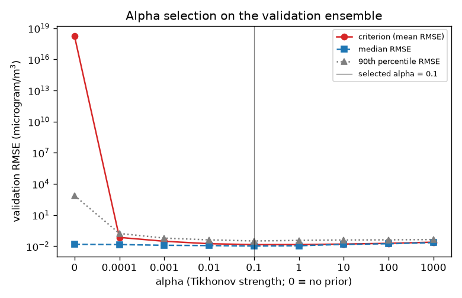
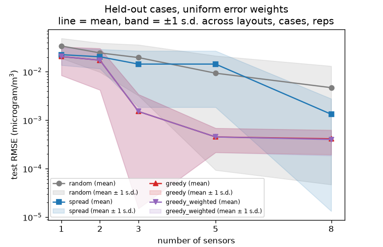
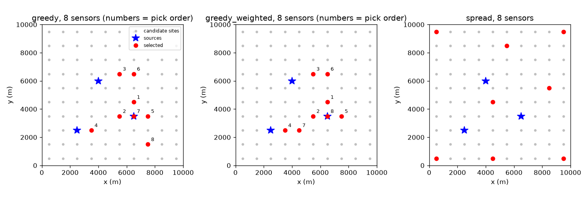
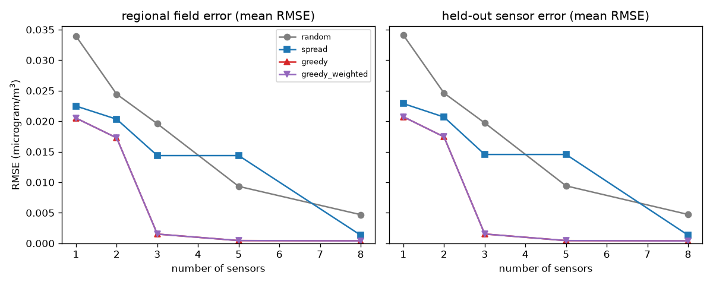
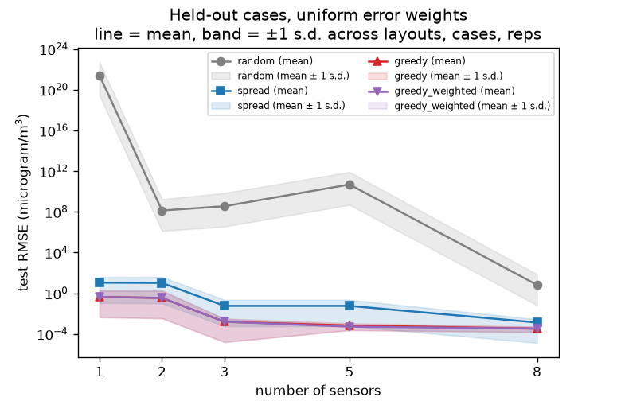
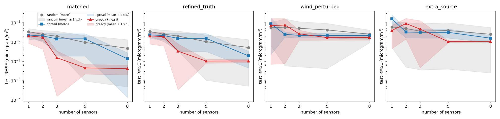
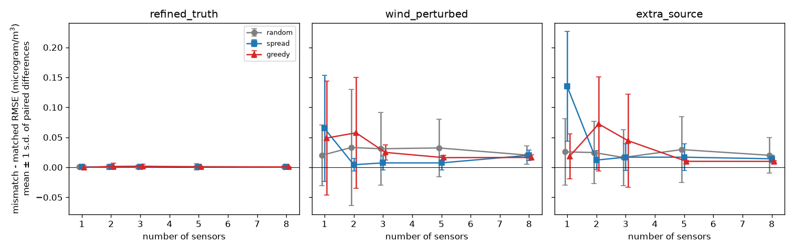
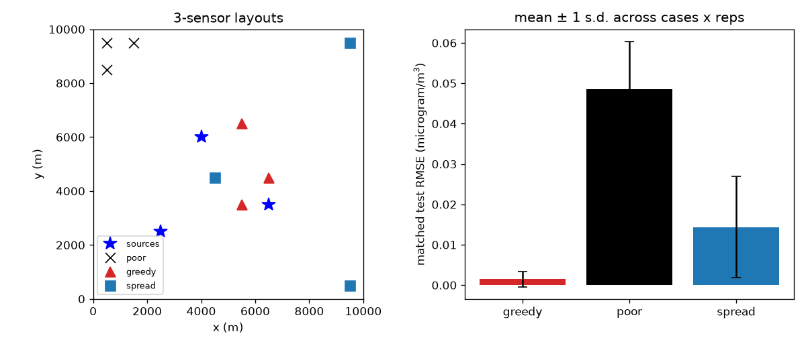

# Validation record (v0)

This is **synthetic verification**, not empirical validation. It shows that the code solves the stated equations
accurately, conserves mass, converges under refinement, recovers sources from data it generated itself, and how
sensor layouts compare *in that synthetic world*. No measurement of a real atmosphere (Belauri or anywhere) was used,
so nothing here says the model predicts real concentrations. All numbers below are read from files under `results/`
(frozen outputs; do not overwrite them) and from the tests; where something was not measured we say so.

## Status

| Check | Result |
|---|---|
| Type check | `.venv/bin/pyright` -> `0 errors, 0 warnings, 0 informations` |
| Tests collected | `.venv/bin/pytest --co -q` -> 184 tests collected (no test is marked `slow`) |
| Full test run | Full test run (coordinator, 2026-10-10, macOS, py3.12.7): `.venv/bin/pytest -q` -> 184 passed, 4 warnings in 81.8 s. `.venv/bin/pyright` -> 0 errors, 0 warnings, 0 informations. (re-verified after alpha-selection change: see coordinator note below) |
| Notebook execution | Notebooks (coordinator, clean kernels via `scripts/verify_notebooks.py`): 01_transport PASS 20.1 s; 02_inverse PASS 14.9 s; 03_sensor_design PASS 30.2 s. (re-verified after alpha-selection change: see coordinator note below) |

An earlier single execution of `scripts/verify_notebooks.py` (clean kernels) printed PASS for all three notebooks:
25.2 s, 18.2 s, 34.9 s. That run is not the coordinator's final check above.

**Coordinator note (to be filled by the coordinator):** re-verification of the test suite, pyright and the notebooks after the alpha-selection change: Re-verified by the coordinator after the alpha-selection change (commit following dcd75e1): `pytest -q` 196 passed in 102.8 s; `pyright` 0 errors, 0 warnings; notebooks (clean kernels, `scripts/verify_notebooks.py`) 01_transport PASS 19.3 s, 02_inverse PASS 14.4 s, 03_sensor_design PASS 29.8 s..

## Reproduce

```bash
.venv/bin/pytest -q                                            # unit + scientific checks
.venv/bin/pyright
.venv/bin/python scripts/verification.py --out results/verification     # 1m42s when recorded in Research OS
.venv/bin/python -m pravah simulate  --config configs/reference.json --out results/reference-v0
.venv/bin/python -m pravah inverse   --config configs/reference.json --out results/inverse-v0 --direct
.venv/bin/python -m pravah benchmark --config configs/smoke.json     --out results/smoke
.venv/bin/python -m pravah benchmark --config configs/alpha_selection.json --out results/alpha-selection
.venv/bin/python -m pravah benchmark --config configs/benchmark.json --out results/benchmark-final   # needs alpha-selection
.venv/bin/python -m pravah benchmark --config configs/benchmark_unregularized.json --out results/benchmark-unregularized-final
.venv/bin/python -m pravah benchmark --config configs/mismatch.json  --out results/mismatch-final   # needs benchmark-final
# Order matters: alpha-selection -> benchmark-final -> mismatch-final. benchmark_unregularized (alpha = 0) is a sensitivity run.
# Exploratory v0 runs (alpha = 1 chosen after seeing test results; test seeds 22/5000) are kept in results/benchmark,
# results/benchmark-unregularized and results/mismatch; they were produced by an earlier version of the configs and are superseded.
.venv/bin/python scripts/verify_notebooks.py
```

Use fresh `--out` directories (e.g. `results/rerun-1`) rather than `--overwrite` so the frozen results stay intact.
Seeds are explicit in the configs (`design_seed 11`, `test_seed 33`, `validation_seed 44`, `design_noise_seed 1000`,
`test_noise_seed 7000`, `validation_noise_seed 9000`, `layout_seed 7`; `layout_seed 77` for the alpha selection; the v0
runs used `test_seed 22`, `test_noise_seed 5000`); `tests/test_experiments.py::test_benchmark_deterministic` checks a rerun reproduces itself.
Whether a rerun on another machine or other library versions matches these tables to the last digit was **not tested**.

## Machine and timings

Apple M2 (`sysctl machdep.cpu.brand_string`), 8 logical CPUs, 8 GiB RAM, macOS 26.5.2 (build 25F84), arm64,
Python 3.12.7 (Clang 16.0.0), fipy 4.0.3, numpy 2.5.3, scipy 1.18.1, xarray 2026.9.0, pandas 3.0.6. The runs were made
in a working tree with uncommitted changes (`git_dirty: true` in every provenance file; revision `1c20446334` for the v0 and
exploratory runs, `dcd75e10df` for `alpha-selection` and the `*-final` runs).
Whether other jobs shared the CPU during the timed runs was **not recorded** in the run files; treat times as indicative.
Peak memory is `ru_maxrss` of the whole process from `timings.json` (the verification and `simulate` runs did not record it).

| Run | Wall time | Peak memory | Notes (from `timings.json` / `metrics.json` / `inverse_metrics.json`) |
|---|---|---|---|
| `simulate` reference (50x50, 240 steps) | 2.78 s solve | not recorded | `results/reference-v0/metrics.json` |
| `inverse` linear route | 22.4 s | not recorded | includes the 4 response solves and the reconstruction run |
| `inverse` direct route | 113.2 s | not recorded | `least_squares` on forward solves; both routes together took 2m21s |
| smoke benchmark | 17.2 s | 178.5 MB | cases 16.0, selection 0.09, evaluation 0.04, output 1.0 s |
| alpha-selection | 79.3 s | 174.3 MB | cases 75.4, evaluation 3.4 s |
| benchmark-final (alpha 0.1) | 152.9 s | 174.0 MB | cases 145.0, selection 5.5, evaluation 1.7, output 0.65 s |
| benchmark-unregularized-final (alpha 0) | 153.9 s | 177.3 MB | cases 146.0, selection 5.5, evaluation 1.7, output 0.65 s |
| mismatch-final | 188.8 s | 190.4 MB | matched 72.5, refined truth 85.4, wind perturbed 15.1, extra source 14.9 s |
| *exploratory, superseded:* benchmark (alpha 1) | 293.8 s | 175.8 MB | cases 278.2, selection 10.6, evaluation 3.7, output 1.2 s |
| *exploratory, superseded:* benchmark-unregularized | 285.4 s | 173.9 MB | cases 270.2, selection 10.9, evaluation 3.3, output 1.0 s |
| *exploratory, superseded:* mismatch | 469.7 s | 187.9 MB | matched 165.6, refined truth 239.6, wind perturbed 30.6, extra source 32.3 s |

The exploratory timings are about twice the final ones for the same work, consistent with other jobs sharing the CPU
(see the last note below); the final runs' CPU load was not recorded either. Most benchmark time is the forward solves of the 12 scenarios (each needs the truth run plus n+1 response solves);
selection and evaluation are cheap linear algebra because the model is affine in q.

## Tolerances asserted by the tests

Actual thresholds from `tests/`; the justification column paraphrases the comments there.

| What | Tolerance | Why |
|---|---|---|
| Uniform field stays uniform (periodic and open+background) | abs 1e-12 | exact for the scheme; LU round-off only |
| Open uniform case: inflow vs outflow budget | rel 1e-10 | same coefficients in equation and budget |
| Removal-only decay equals `(1 + lam dt)^-n` | abs 1e-10 | backward-Euler closed form; LU error ~1e-15 |
| Removal-only error vs `exp(-lam t)` as dt halves | ratio in (1.9, 2.1) | first order in time (measured 1.96, 1.98, 1.99) |
| Periodic Gaussian vs exact solution, nx = 20/40/80, dt 15 s | ratios > 2.0; error at nx 80 < 0.03 | pre-asymptotic spatial order (measured 0.155, 0.0607, 0.0238) |
| Same, dt = 60/30/15/7.5 s at nx = 40 | successive error differences in ratio (1.7, 2.3) | first-order time error halves |
| Single Fourier mode amplitude vs discrete symbol | rel 1e-9 | exact discrete prediction (EXP-001 synthesis reports agreement ~1e-14) |
| Fourier-mode phase | abs 0.06 rad; decay exponent rel 0.05 | dispersion error (measured 0.047 at 25 cells, 0.005 at 100) |
| Effective diffusivity vs `(Pe/2)coth(Pe/2) - 1 + u^2 dt/2K` (exponential and upwind) | 3% | finite-wavenumber corrections |
| Closed domain, no source: mass conserved | rel 1e-10 | LU round-off over 24 steps |
| Closed domain, source only: mass = integrated emission | rel 1e-10 | exact budget |
| Budget residual (periodic with decay) | rel 1e-10 | |
| Budget residual (open, with background/IC; wind reversal; wind change off output grid) | rel 1e-9 | looser because inflow/outflow coefficients are summed over faces |
| Steady through-flow balance | rel 1e-5 | relaxation `e^-20` |
| Steady open-boundary profile vs analytic, 25 to 200 cells | strictly decreasing, order > 1.5 | measured errors 6.8e-3, 1.5e-3, 2.8e-4, 5.8e-5 |
| Source normalisation `sum f dA = 1` | abs 1e-12 | round-off |
| Quadrature ratio discrete/continuous, nx = 25/50/100 (and > 1e-2 off at nx = 10) | worst `|ratio - 1| < 1e-6` | cell-centre sum of a smooth 500 m Gaussian; visibly off at dx = 2 sigma |
| Reference run: 240 steps, residual, runtime | rel 1e-9; < 15 s | no negative values |
| Bilinear sampling of affine fields | rel 1e-12 | exact for affine fields |
| Cached responses reproduce direct simulation (zero/uniform/Gaussian IC, background) | 1e-6 relative to max | superposition; LU tolerance 1e-12 |
| Cached operator vs `sample` of the direct field | rel 1e-6 | |
| Noise-free recovery of q | rel 1e-4 on q; weighted residual < 1e-6 | data are generated by the model being inverted |
| Direct vs linear fit (tiny fixture, noisy) | rel 1e-5 on q (observed here: 4e-9 at full size) | same convex problem, optimiser tol 1e-14 |
| Fit covariance vs prediction (300 noise draws) | std ratio in (0.8, 1.25); chi-square within 5 sd | sampling error ~4% |
| `q_std` vs the empirical-covariance quantity | rtol 1e-6 | same formula |
| Fast design fit vs brute-force `fit_sources` + `field_mse` | q: rtol 1e-8, atol 1e-6; MSE rel 1e-8; quadratic form rel 1e-10 | identical maths, different bookkeeping |
| Greedy step 1 / 2 equals exhaustive best single / pair | exact (rel 1e-12); optimum only reported | greedy is not claimed optimal |
| Mismatch run: matched baseline equals the benchmark's uniform test rows | rtol 1e-9 | same cases and noise, recomputed |

## Verification results (`results/verification/verification.csv`, `.json`)

Periodic box 10 km, Gaussian initial bump, uniform wind (1.0, 0.3), K = 100, decay lambda = 1/21600, exact
solution = translated, spread, decayed Gaussian (sum over periodic images), T = 1800 s.

| Study | Result |
|---|---|
| Spatial convergence, nx = 20/40/80 at dt = 15 s (relative L2 error) | 0.1552, 0.0607, 0.0238 (ratios 2.56, 2.55) |
| Time convergence at nx = 40, dt = 60/30/15/7.5 s | 0.0832, 0.0683, 0.0607, 0.0568 (differences 0.0149, 0.0076, 0.0038: halve with dt) |
| Reference dt refinement (60/30/15 s): field RMSE change | 60 vs 30: 1.76e-4 ug/m^3; 30 vs 15: 9.2e-5 (ratio 1.9, first order) |
| Reference grid refinement 50 vs 100 cells | RMSE 6.5e-4 ug/m^3 = 0.40% of the max concentration (0.1626 vs 0.1608); total mass differs 0.19%; solve 4.3 s vs 13.0 s |
| Budget residual, reference dt = 60/30/15 s | 1.6e-14, 1.9e-14, 4.1e-15 (relative); 0 negative values; final mass 1.6932e9 ug (60 s vs 15 s differ by 4.7e-6 relative) |
| Quadrature ratio (discrete / continuous Gaussian integral), per source | nx = 50: 1 + 9.0e-8, 1 + 7e-16, 1 + 7e-13; nx = 100: 1 + 2.4e-8, 1, 1 + 2e-13 |

**Numerical diffusion (known model error).** `K_eff/K - 1` measured by Fourier-mode projection vs theory
`(Pe/2)coth(Pe/2) - 1 + u^2 dt/(2K)` (exponential scheme) or `Pe/2 + u^2 dt/(2K)` (upwind); wind along a grid axis,
u = 1, K = 100. Measured (theory) for dt = 60 s / dt = 10 s:

| Scheme | nx = 25 | nx = 50 (reference) | nx = 100 |
|---|---|---|---|
| exponential | 1.349 (1.375) / 1.112 (1.125) | **0.606 (0.613)** / 0.361 (0.363) | 0.378 (0.382) / 0.131 (0.132) |
| upwind | 2.263 (2.300) / 2.031 (2.050) | 1.288 (1.300) / 1.046 (1.050) | 0.794 (0.800) / 0.549 (0.550) |

Largest deviation from theory over all 24 cases: 1.8% (3% asserted). So at the default grid and time step the
effective diffusivity is about 1.6 K, plumes are smoother than the nominal K suggests, and **all experiments
inherit this** (matched experiments use the same scheme for truth and inference; only the mismatch study's finer
grid, 100 x 100 with dt/2 = 30 s, lowers it in the truth: +0.23 vs +0.61 for the inference model, from the table).
Not re-measured for oblique wind. The 2-D open-boundary behaviour is checked against a 1-D strip analytic solution only.

## Inverse recovery, matched model (`results/inverse-v0/inverse_metrics.json`)

Reference scenario, 5 sensors every 600 s, S5 held out (4 used, 96 readings), noise 0.005 ug/m^3 (about 3% of the
0.161 peak), one noise draw (seed 1), alpha = 0.

| Quantity | Value |
|---|---|
| q true -> q_hat (ug/s) | 1.0e5 -> 97531; 1.5e5 -> 146718; 8.0e4 -> 78807 |
| relative L2 error of q | 0.0217 (per source -2.5%, -2.2%, -1.5%) |
| `q_std` (linear-Gaussian) | 5805, 6888, 3513 ug/s |
| rank / effective rank / condition | 3 / 3 / 5.62 (singular values 67.4, 21.4, 12.0) |
| weighted residual norm | 8.21 for 96 observations (expected about sqrt(96 - 3) = 9.6 if model and noise are right) |
| regional RMSE of the field / held-out sensor RMSE / fit-sensor RMSE | 9.7e-4 / 4.3e-4 / 9.2e-4 ug/m^3 |
| direct (`least_squares`) vs linear (`lsq_linear`) max relative difference in q | 4.0e-9 |

This is the inverse crime: truth and inference use the same solver, grid and (known) physics. Figure:
[truth vs fit](../results/inverse-v0/truth_vs_fit.png).

## What was selected on what data (final procedure)

| Quantity | Chosen on | Not used |
|---|---|---|
| Sensor layouts (greedy, greedy_weighted) | **design** scenarios (seed 11, noise seed 1000) | validation and test scenarios |
| Tikhonov strength alpha = 0.1 | **validation** scenarios (seed 44, noise seed 9000), random + spread layouts only | test scenarios, greedy layouts, true emission rates |
| Every reported error (`results/benchmark-final`, `benchmark-unregularized-final`, `mismatch-final`) | **test** scenarios (seed 33, noise seed 7000), fresh noise | nothing was tuned on them |

The three ensembles are disjoint (the code refuses to run if two share a seed, a noise-seed range or a drawn (q, wind)
set). The v0 test scenarios (seeds 22 / 5000) were seen while alpha was chosen and are not reused for headline evidence.

Order of commands: `alpha-selection` -> `benchmark-final` -> `mismatch-final` (the last two read the frozen
`results/alpha-selection/alpha_selected.json` and record its sha256; `mismatch-final` also reads the layouts of
`benchmark-final`). `benchmark_unregularized` (alpha = 0) is a **sensitivity** run, labelled `not selected:
sensitivity`; it does not feed back into any choice.

**Notebooks and smoke runs.** `notebooks/03_sensor_design.ipynb` loads `configs/smoke.json` (cell 3: `load_config("../configs/smoke.json")`)
and only overrides sizes (`candidates_n`, `budgets`, `n_design`, `n_test`, `noise_reps`, `n_random`, `weighted`, `heldout_n`)
and the poor-layout sites, not alpha. In `smoke.json`, `design.alpha = 1.0` and `alpha_selection_file` is `null`; its notes
say alpha 1.0 is "NOT selected on validation data". So the notebook runs with alpha = 1 as a **plumbing/demo value**, not the
selected alpha (0.1), and its numbers are not evidence. (Checked by reading the notebook source and the config; the
notebooks were not edited.)

## Alpha selection (`results/alpha-selection`)

`configs/alpha_selection.json`, declared before any final test run and independent of every test scenario: 6 matched
validation cases with fresh noise (3 draws each, noise std 0.005 ug/m^3); **only alpha-independent layouts** (20 seeded
random layouts per budget 1/2/3/5/8, `layout_seed 77`, plus the spread layout; greedy is excluded because its choice
depends on alpha); every alpha in {0, 1e-4, 1e-3, 1e-2, 1e-1, 1, 10, 100, 1000} is fitted on every layout x case x
draw (1890 rows per alpha). The **prior mean is zero** for every source (`prior_mean_uses_truth: false`; the true emission
rates are never used). `q_scale = 1e5` is a numerical scaling only: the penalty is alpha/q_scale^2 * ||q||^2, so only
that ratio matters, and alpha is quoted in units of `q_scale`.

**Selection rule:** the criterion is the mean over budgets, layouts, cases and noise draws of the regional RMSE (uniform
weights, ug/m^3, the same primary metric as the headline). The lowest value wins; an exact tie goes to the smaller alpha
(no preference for stronger regularisation). Recorded per alpha as well: median, 90th percentile, the number of rows with
RMSE above 10x the no-emission RMSE, and the mean source relative error. Output: `alpha_selected.json` (selected alpha, full
table, seeds, q_scale, config hash, package versions), `validation_raw.csv`, `figures/criterion_vs_alpha.png`.

| alpha | criterion (mean regional RMSE) | median RMSE | p90 RMSE | rows > 10x no-emission RMSE (of 1890) | mean source rel. error |
| --- | --- | --- | --- | --- | --- |
| 0 | 1.67e+18 | 0.0155 | 757.5756 | 413 | 6.8e+19 |
| 0.0001 | 0.07085 | 0.0145 | 0.1702 | 108 | 2.35 |
| 0.001 | 0.03019 | 0.0123 | 0.0609 | 17 | 0.989 |
| 0.01 | 0.01752 | 0.0116 | 0.0411 | 0 | 0.562 |
| **0.1** (selected) | 0.01431 | 0.0105 | 0.0322 | 0 | 0.446 |
| 1 | 0.01457 | 0.0112 | 0.0365 | 0 | 0.445 |
| 10 | 0.01623 | 0.0151 | 0.0401 | 0 | 0.489 |
| 100 | 0.01906 | 0.0174 | 0.0417 | 0 | 0.564 |
| 1000 | 0.02471 | 0.0224 | 0.0442 | 0 | 0.703 |

Selected **alpha = 0.1** (criterion 0.01431). The criterion curve is **flat between 0.1 and 1**
(0.01431 vs 0.01457, a 1.8% difference), so alpha = 0.1 is a point on a plateau, not a sharp optimum; 10 is 13% worse and 0.01 is 22%
worse. alpha = 0 is catastrophic on the mean (criterion 1.7e18; 413 of 1890 rows exceed 10x the no-emission RMSE) because plume-blind layouts leave amplitude
directions unconstrained, while its median (0.0155) is not much worse than the others. The choice is for this setting
(one noise level, one scenario family, 6 validation cases).



## Sensor-placement benchmark (`results/benchmark-final`, alpha = 0.1, matched model)

6 design + 6 test scenarios (q x U(0.5, 1.5), wind speed 0.6-1.6 m/s, direction +/-40 deg around nominal; every second
scenario has a two-segment wind), 3 noise draws each, 10 x 10 candidate sites, budgets 1/2/3/5/8, 20 random layouts per
budget. Layouts are chosen only from design scenarios; errors below come from the test scenarios with fresh noise. Metric:
regional RMSE of the reconstructed field, **uniform weights**, ug/m^3. Each cell of the greedy, spread and greedy_weighted
rows is 18 numbers (6 cases x 3 draws) for one layout; random pools 20 layouts (360 rows). "sd" is the standard deviation of
those individual results (CSV label: *sd of per-row RMSE across layouts x cases x noise reps*); **it is not a confidence
interval.** Source: `summary.csv`.

| Method | Stat | b = 1 | b = 2 | b = 3 | b = 5 | b = 8 |
| --- | --- | --- | --- | --- | --- | --- |
| greedy | mean | 0.0205 | 0.0173 | 0.0015 | 4.5e-4 | 4.1e-4 |
|  | median | 0.0208 | 0.0156 | 9.4e-4 | 3.9e-4 | 3.4e-4 |
|  | sd | 0.0121 | 0.0131 | 0.0019 | 2.3e-4 | 2.2e-4 |
| greedy_weighted | mean | 0.0205 | 0.0173 | 0.0015 | 4.5e-4 | 4.0e-4 |
| spread | mean | 0.0225 | 0.0203 | 0.0144 | 0.0144 | 0.0013 |
|  | median | 0.0214 | 0.0214 | 0.0126 | 0.0126 | 7.4e-4 |
|  | sd | 0.0088 | 0.0087 | 0.0125 | 0.0125 | 0.0014 |
| random (20 layouts) | mean | 0.0339 | 0.0244 | 0.0196 | 0.0093 | 0.0047 |
|  | median | 0.0338 | 0.0233 | 0.0162 | 0.0044 | 0.0013 |
|  | sd | 0.0150 | 0.0146 | 0.0164 | 0.0120 | 0.0084 |

Mean effective rank of the fitted problem (`summary.csv`): spread is 2.5 at b = 3 and b = 5 (identical results to 4 digits: the sites added at b = 5 see none of the plumes), 3.0 only at b = 8.

| Method | Quantity | b = 1 | b = 2 | b = 3 | b = 5 | b = 8 |
| --- | --- | --- | --- | --- | --- | --- |
| greedy | effective rank | 2.33 | 2.50 | 3.00 | 3.00 | 3.00 |
| spread | effective rank | 1.33 | 2.00 | 2.50 | 2.50 | 3.00 |
| random | effective rank | 0.89 | 1.70 | 2.02 | 2.62 | 2.86 |

**Paired differences** (`paired_comparisons.csv`, uniform weights, test scenarios): mean difference in per-row RMSE /
sd of the 18 differences / fraction of pairs where the first method is better (ties count as "not better"); negative mean
= first method better.

| a - b | b = 1 | b = 2 | b = 3 | b = 5 | b = 8 |
| --- | --- | --- | --- | --- | --- |
| greedy - spread | -0.0020 / 0.0105 / 78% | -0.0031 / 0.0107 / 61% | -0.0129 / 0.0134 / 78% | -0.0139 / 0.0124 / 100% | -9.1e-4 / 0.0015 / 78% |
| greedy - random (mean of 20) | -0.0134 / 0.0131 / 100% | -0.0072 / 0.0110 / 61% | -0.0181 / 0.0042 / 100% | -0.0089 / 0.0027 / 100% | -0.0043 / 0.0016 / 100% |
| spread - random (mean of 20) | -0.0115 / 0.0091 / 94% | -0.0041 / 0.0093 / 61% | -0.0052 / 0.0106 / 78% | +0.0050 / 0.0113 / 44% | -0.0034 / 0.0026 / 83% |
| greedy_weighted - greedy | 0 / 0 / 0% | 0 / 0 / 0% | 0 / 0 / 0% | 0 / 0 / 0% | -1.2e-5 / 2.9e-5 / 56% |

**Design versus test** (pooled RMSE = sqrt of mean MSE; the design and test scenarios differ, so the ratio is not a pure overfitting measure):

| Method | Quantity | b = 1 | b = 2 | b = 3 | b = 5 | b = 8 |
| --- | --- | --- | --- | --- | --- | --- |
| greedy | design RMSE | 0.0123 | 0.0067 | 0.0013 | 4.2e-4 | 2.9e-4 |
|  | test pooled RMSE | 0.0236 | 0.0214 | 0.0024 | 5.1e-4 | 4.6e-4 |
|  | test/design ratio | 1.92 | 3.19 | 1.79 | 1.22 | 1.61 |
|  | mean test RMSE / design RMSE | 1.66 | 2.57 | 1.14 | 1.09 | 1.44 |
| spread | design RMSE | 0.0221 | 0.0204 | 0.0165 | 0.0165 | 0.0064 |
|  | test pooled RMSE | 0.0241 | 0.0220 | 0.0188 | 0.0188 | 0.0019 |
|  | test/design ratio | 1.09 | 1.08 | 1.14 | 1.14 | 0.30 |
|  | mean test RMSE / design RMSE | 1.02 | 1.00 | 0.87 | 0.87 | 0.21 |
| random | design RMSE | 0.0330 | 0.0242 | 0.0212 | 0.0143 | 0.0068 |
|  | test pooled RMSE | 0.0371 | 0.0285 | 0.0255 | 0.0152 | 0.0096 |
|  | test/design ratio | 1.12 | 1.17 | 1.21 | 1.06 | 1.41 |
|  | mean test RMSE / design RMSE | 1.03 | 1.01 | 0.93 | 0.65 | 0.69 |

Timings and memory (`timings.json`): 152.9 s total, peak 174.0 MB (see the table above).

**Interpretation.**

* Greedy's advantage over spread is **clear from 3 sensors**: it wins in 78%, 100% and 78% of the 18 paired rows at b = 3, 5, 8, with
  mean differences of -0.0129, -0.0139 and -9.1e-4 ug/m^3 (greedy's mean test RMSE is 0.0015, 4.5e-4 and 4.1e-4 against
  0.0144, 0.0144 and 0.0013 for spread). It is **not established at 1-2 sensors**: greedy wins in 78% (b = 1) and 61% (b = 2) of
  pairs and the mean difference (-0.0020, -0.0031) is smaller than the sd of the differences (0.0105, 0.0107). Greedy vs random is
  clearer (100% of pairs at b = 1, 3, 5, 8) but also only 61% at b = 2. Spread does not reliably beat random (44% at b = 5).
* Greedy's test error is well above its design score where the design score is most optimistic. At b = 2 the mean test RMSE is
  2.6x the design RMSE (pooled ratio 3.2); at b = 1 the pooled ratio is 1.9, at b = 3, 5, 8 it is 1.8, 1.2, 1.6. Spread's ratio is
  at or below 1.14 for b <= 5 and random's is 1.06-1.41. Design-stage scores of a greedy layout should not be quoted as its expected performance.
* `greedy_weighted` (population-weighted objective) is essentially identical to greedy on the uniform metric: identical
  layouts at b = 1-5 and a mean difference of -1.2e-5 at b = 8. It gives no benefit here.
* Much of the advantage is avoiding plume-blind sites (identifiability: greedy has effective rank 3 for b >= 3, random only 2.0-2.9),
  not fine optimisation. Greedy is a heuristic: one tiny alpha = 0 exhaustive fixture in the tests showed greedy's design MSE
  3.7x the optimum (about 1.9x in RMSE; a single fixture, not a range).
* With 6 + 6 scenarios and 3 noise draws the evidence is modest; none of this is a statement about real networks.





### Sensitivity: no prior (alpha = 0, `results/benchmark-unregularized-final`)

Same design/test scenarios and layouts method as above with alpha = 0 (not selected; 153.9 s, peak 177.3 MB). Mean test RMSE
and median, uniform weights:

| Method | Stat | b = 1 | b = 2 | b = 3 | b = 5 | b = 8 |
| --- | --- | --- | --- | --- | --- | --- |
| greedy | mean | 0.437 | 0.343 | 0.0016 | 6.8e-4 | 3.3e-4 |
|  | median | 0.0243 | 0.0015 | 9.1e-4 | 5.6e-4 | 3.3e-4 |
|  | sd | 1.39 | 1.44 | 0.0016 | 4.5e-4 | 1.9e-4 |
| greedy_weighted | mean | 0.437 | 0.343 | 0.0016 | 5.2e-4 | 3.3e-4 |
| spread | mean | 11 | 10.3 | 0.0573 | 0.0573 | 0.0013 |
|  | median | 0.0825 | 0.0350 | 0.0126 | 0.0126 | 7.4e-4 |
|  | sd | 28.2 | 28.3 | 0.167 | 0.167 | 0.0014 |
| random (20 layouts) | mean | 2.5e+21 | 1.3e+8 | 3.5e+8 | 4.8e+10 | 6.55 |
|  | median | 0.0926 | 0.0370 | 0.0225 | 0.0044 | 0.0013 |
|  | sd | 4.8e+22 | 1.6e+9 | 6.7e+9 | 7.6e+11 | 65.4 |

Rows with RMSE above 1 ug/m^3 (the reference peak concentration is 0.16):

| Method (RMSE > 1 ug/m^3 rows / rows) | b = 1 | b = 2 | b = 3 | b = 5 | b = 8 |
| --- | --- | --- | --- | --- | --- |
| greedy | 2 / 18 | 1 / 18 | 0 / 18 | 0 / 18 | 0 / 18 |
| spread | 7 / 18 | 5 / 18 | 0 / 18 | 0 / 18 | 0 / 18 |
| random | 147 / 360 | 94 / 360 | 87 / 360 | 21 / 360 | 6 / 360 |

For comparison, with alpha = 0.1 no uniform-weight test row exceeds 0.073 (largest: 0.0725, random layout at b = 3).
**The greedy mean also blows up at b = 1 and b = 2 with alpha = 0** (0.437 and 0.343, sd 1.39 and 1.44; medians 0.024 and 0.0015)
because 2 of 18 and 1 of 18 rows are unconstrained (peaks 5.8 and 6.1); from b = 3 greedy is stable (mean 0.0016, 6.8e-4, 3.3e-4) and at b = 8
slightly better than with alpha = 0.1 (3.3e-4 vs 4.1e-4). Spread and random layouts are far worse (spread mean 11 and 10.3 at b = 1, 2; random means up to 2.5e21).
**Why the means explode:** without a prior, a layout that sees none of the plume leaves some amplitude directions
unconstrained, the bounded least-squares problem has a continuum of near-equal-residual solutions, and noise selects an
astronomically large one. Medians are therefore the sensible summary at alpha = 0. Prior strength, not just layout, decides how
bad a blind layout looks.



## Model mismatch (`results/mismatch-final`)

Fixed design-stage layouts from `results/benchmark-final` are evaluated on the same 6 test scenarios x 3 noise draws
(alpha = 0.1, read from the frozen file), changing one thing in the truth (the inversion keeps the matched model):
**refined truth** (100 x 100 grid, dt/2, block-averaged back to the inference grid), **wind perturbed** (+20% speed and
15 deg counter-clockwise rotation in every segment, hidden from the inversion), **extra source** (a 4th source of 60000 ug/s at
(3000, 4500) m, 15.9% of emissions on average (`mean_unmodelled_source_mass`) and absent from the inference model). One magnitude per kind. The
`greedy_weighted` layouts are in the raw rows but were scored on the uniform metric only. Mean test RMSE, ug/m^3
(`summary.csv`; 188.8 s, peak 190.4 MB):

| Method | Condition | b = 1 | b = 2 | b = 3 | b = 5 | b = 8 |
| --- | --- | --- | --- | --- | --- | --- |
| greedy | matched | 0.0205 | 0.0173 | 0.0015 | 4.5e-4 | 4.1e-4 |
|  | refined truth | 0.0204 | 0.0187 | 0.0033 | 0.0010 | 0.0010 |
|  | wind perturbed | 0.0694 | 0.0748 | 0.0263 | 0.0166 | 0.0169 |
|  | extra source | 0.0388 | 0.0895 | 0.0459 | 0.0104 | 0.0103 |
| spread | matched | 0.0225 | 0.0203 | 0.0144 | 0.0144 | 0.0013 |
|  | refined truth | 0.0231 | 0.0212 | 0.0153 | 0.0153 | 0.0019 |
|  | wind perturbed | 0.0874 | 0.0247 | 0.0218 | 0.0218 | 0.0214 |
|  | extra source | 0.157 | 0.0324 | 0.0312 | 0.0312 | 0.0155 |
| random | matched | 0.0339 | 0.0244 | 0.0196 | 0.0093 | 0.0047 |
|  | refined truth | 0.0345 | 0.0250 | 0.0201 | 0.0102 | 0.0051 |
|  | wind perturbed | 0.0541 | 0.0575 | 0.0506 | 0.0416 | 0.0251 |
|  | extra source | 0.0597 | 0.0491 | 0.0360 | 0.0389 | 0.0247 |

Greedy source-attribution error (mean relative error of the three modelled amplitudes):

| Method | Condition | b = 1 | b = 2 | b = 3 | b = 5 | b = 8 |
| --- | --- | --- | --- | --- | --- | --- |
| greedy | matched | 0.514 | 0.426 | 0.0493 | 0.0118 | 0.0113 |
| greedy | refined truth | 0.507 | 0.459 | 0.104 | 0.0148 | 0.0146 |
| greedy | wind perturbed | 1.42 | 1.54 | 0.619 | 0.257 | 0.259 |
| greedy | extra source | 0.789 | 2.49 | 1.6 | 0.190 | 0.205 |

Paired mismatch minus matched, **greedy** (`paired_mismatch.csv`; mean difference / sd / fraction of pairs where mismatch is worse):

| Condition | b = 1 | b = 2 | b = 3 | b = 5 | b = 8 |
| --- | --- | --- | --- | --- | --- |
| refined truth | -1.5e-4 / 0.0038 / 78% | +0.0015 / 0.0052 / 72% | +0.0018 / 0.0031 / 94% | +5.7e-4 / 2.5e-4 / 100% | +6.2e-4 / 2.4e-4 / 100% |
| wind perturbed | +0.0489 / 0.0953 / 83% | +0.0575 / 0.0924 / 89% | +0.0248 / 0.0128 / 100% | +0.0162 / 0.0043 / 100% | +0.0164 / 0.0045 / 100% |
| extra source | +0.0183 / 0.0374 / 83% | +0.0722 / 0.0786 / 100% | +0.0444 / 0.0780 / 100% | +0.0100 / 0.0013 / 100% | +0.0099 / 0.0014 / 100% |

Same for **spread**:

| Condition | b = 1 | b = 2 | b = 3 | b = 5 | b = 8 |
| --- | --- | --- | --- | --- | --- |
| refined truth | +5.7e-4 / 0.0034 / 50% | +8.5e-4 / 0.0023 / 61% | +8.9e-4 / 0.0024 / 50% | +8.9e-4 / 0.0024 / 50% | +5.7e-4 / 3.2e-4 / 100% |
| wind perturbed | +0.0649 / 0.0884 / 94% | +0.0043 / 0.0101 / 78% | +0.0074 / 0.0120 / 78% | +0.0074 / 0.0120 / 78% | +0.0201 / 0.0085 / 100% |
| extra source | +0.135 / 0.0914 / 100% | +0.0120 / 0.0158 / 94% | +0.0169 / 0.0222 / 94% | +0.0169 / 0.0222 / 94% | +0.0142 / 0.0062 / 100% |

Reading:

* The discretisation mismatch (refined truth) costs about 6e-4 ug/m^3 for greedy at b = 5 and 8 (+5.7e-4, +6.2e-4, worse in 100% of pairs); in
  relative terms the greedy RMSE rises 2.2-2.5x at b = 3, 5, 8 (0.0015 to 0.0033, 4.5e-4 to 0.0010, 4.1e-4 to 0.0010) and the b = 8 source error rises from 0.0113 to 0.0146.
  At b = 1-2 the refined-truth effect is within the sd (mean differences -1.5e-4 and +0.0015 vs sd 0.0038 and 0.0052).
  The refined truth still uses the same scheme (same numerical diffusion), source shapes and boundary conditions, so this is a
  **lower bound on the inverse-crime effect**, not an estimate of it.
* A hidden 20% / 15 deg wind error or a missing source costs about 16-28 times the refined-truth effect for greedy at b = 5 and 8
  (+0.016 vs +6e-4; +0.010 vs +6e-4) and **more sensors do not fix it**: greedy at b = 8 is 0.0169 (wind) and 0.0103 (extra source). The floor is model error.
  Under the missing source the greedy attribution error on the three modelled amplitudes rises from 0.0113 to 0.205 at b = 8.
* **Greedy is not uniformly better than spread under mismatch.** At b >= 5 greedy is better in the wind and extra-source conditions
  (wind 0.0166 vs 0.0218 at b = 5; extra source 0.0104 vs 0.0312), and at b = 1 (0.0694 vs 0.0874; 0.0388 vs 0.157). But at
  b = 2 and 3 greedy is *worse* than spread under both wind error (0.0748 vs 0.0247 at b = 2; 0.0263 vs 0.0218 at b = 3) and the
  extra source (0.0895 vs 0.0324; 0.0459 vs 0.0312), with large sd on greedy's paired differences (0.09 at b = 1, 2). This is a different picture from
  the exploratory v0 run and is based on 18 rows per cell.
* Not every individual draw worsens: refined truth is worse in 72-100% of greedy pairs and only 50-61% of spread pairs at b <= 5.

**Deliberately poor layout** (3 sensors in the upwind top-left corner: (500, 9500), (1500, 9500), (500, 8500) m). Diagnostics are from
`poor_layout_diagnostics.csv`, which **pools three methods** (greedy, spread, poor at b = 3; 18 rows each), so it must be grouped by the `method` column:

| Layout (b = 3) | rows | effective rank | mean RMSE | RMSE range | source rel. error range | sv_max range |
| --- | --- | --- | --- | --- | --- | --- |
| poor | 18 | 18 x rank 0 | 0.0486 | 0.0275 - 0.0604 | 0.932 - 1 | 2.63e-13 - 0.0129 |
| greedy | 18 | 18 x rank 3 | 0.0015 | 3.4e-4 - 0.0084 | 0.00843 - 0.333 | 52 - 93.6 |
| spread | 18 | 9 x rank 2, 9 x rank 3 | 0.0144 | 8.9e-4 - 0.0361 | 0.0166 - 0.879 | 22.3 - 66.5 |

The poor layout has effective rank 0 in **all 18** of its rows (the largest singular value is between 2.6e-13 and 0.013 across rows; condition number at least 4.2e6, infinite in 3 rows), its estimates collapse to the prior (relative source
error 0.93-1.0) and regional RMSE is 0.028-0.060 (mean 0.049). Greedy has effective rank 3 in all 18 rows (mean RMSE 0.0015) and
spread 2 or 3 (mean 0.014). Paired (`poor_layout_paired.csv`, n = 18):

| a - b | mean diff | sd | n | frac a better |
| --- | --- | --- | --- | --- |
| poor - greedy | +0.0470 | 0.0131 | 18 | 0% |
| poor - spread | +0.0342 | 0.0163 | 18 | 0% |

The poor layout is worse than both in every pair. Because its estimates collapse to the prior, its error changes little under mismatch
(paired mean differences: refined truth +3e-4, wind perturbed -0.0043, extra source +0.0097); the no-emission RMSE itself was not tabulated here.





## Exploratory (superseded): the first benchmark, unregularized and mismatch runs

`results/benchmark`, `results/benchmark-unregularized` and `results/mismatch` (test seeds 22 / 5000, alpha = 1) are
**exploratory and superseded** by the `*-final` runs. Why: alpha = 1 was chosen *after* the alpha = 0 results on those same test
scenarios had been seen, so those test scenarios were used for the choice and the runs are not an independent evaluation. An
earlier version of this document and the README described that choice as "a priori"; that was wrong. Key old numbers, briefly
(mean test RMSE, uniform weights, alpha = 1; b = 1, 2, 3, 5, 8): greedy 0.0190, 0.0037, 8.9e-4, 3.9e-4, 3.6e-4; spread 0.0225,
0.0153, 0.0086, 0.0086, 0.0018; random 0.0354, 0.0237, 0.0183, 0.0076, 0.0037. Greedy beat spread in 78-100% of pairs at every
budget (b = 1: 78%, b = 2: 100%), which is a stronger result at b = 1-2 than the final run supports (78% and 61%), and its test RMSE
at b = 2 was *below* the final run's (0.0037 vs 0.0173). The old alpha = 0 run had greedy means 0.0193, 0.0057, 0.0012, 4.7e-4, 2.6e-4 (no blow-up for greedy)
and spread/random means up to 4.9 and 2.3e19. Old mismatch: greedy b = 8 matched 3.6e-4, refined 0.0010, wind perturbed 0.0159, extra source
0.0105; the deliberately poor layout (sites c080, c090, c091 in the v0 run) had effective rank 0 in all 18 rows, mean RMSE 0.048. Differences between old and final
come from the different test scenarios, the different alpha (1 vs 0.1) and, for the greedy rows, different selected layouts; they were not
decomposed. Do not quote the old tables as evidence.

## Figures

Embedded in the sections above: `results/alpha-selection/figures/criterion_vs_alpha.png`, `results/benchmark-final/figures/*`,
`results/benchmark-unregularized-final/figures/error_vs_sensors_uniform.png`, `results/mismatch-final/figures/*`. Others:


Also available: `results/benchmark-final/figures/error_vs_sensors_population.png`,
`results/benchmark-unregularized-final/figures/{error_vs_sensors_population,heldout_vs_regional,selected_sites}.png`,
`results/smoke/figures/*.png` (smoke run; not for conclusions); exploratory/superseded: `results/benchmark/figures/*`,
`results/benchmark-unregularized/figures/*`, `results/mismatch/figures/*`.

## Known limitations

* **Numerical diffusion** about +61% of K at the default grid and dt (table above); first order in time; plumes
  smoother than nominal K. All experiments share it.
* **Inverse crime.** Matched experiments invert the same numerical model that generated the data. The mismatch study
  relaxes this in three specific ways only.
* **Known-everything-but-q.** Wind, K, lambda, H, geometry, initial state and boundary values are assumed known.
  The mismatch study shows how fast this assumption costs accuracy (wind error: roughly 26-28x the refined-truth effect for greedy at b >= 5).
* **Small samples.** 6 + 6 scenarios x 3 noise draws (18 rows per greedy/spread cell), one wind-ensemble definition, one noise level (0.005 ug/m^3),
  one magnitude per mismatch kind, one random-layout seed. sd values describe spread, not uncertainty of the mean.
* **Prior choice.** The exploratory v0 tables used alpha = 1, adopted after the alpha = 0 test results had been seen (disclosed above); the final runs use alpha = 0.1 selected on a separate validation ensemble (one noise level, one scenario family, 6 validation cases; the criterion is flat between 0.1 and 1), so it is a choice for this setting.
* **Greedy is a heuristic**; no optimality claim. Weighted layouts were scored on the uniform metric only under mismatch. The greedy advantage over spread is not established at 1-2 sensors and reverses at 2-3 sensors under mismatch.
* **Not measured:** peak memory of `simulate`/`inverse`/verification; CPU contention during timing; behaviour on other
  machines or library versions; oblique-wind numerical diffusion; anything about real data.
* **Synthetic verification vs empirical validation.** Everything above checks internal consistency and numerical
  accuracy against analytic and refined-model references. Empirical validation would compare model output with
  measurements of the real region; none exists in this repository, and the default parameters are demonstration values,
  not Belauri estimates. No claim in this document should be read as a statement about real air quality.

## Notes added after the final review

* Held-out evaluation sites (7 x 7 grid, `experiments.py`) never coincide with candidate sites but can lie within about
  half a cell (~100 m) of a fitted one (e.g. (6429, 6429) m vs candidate c066). They are noiseless and use the same
  bilinear operator, so held-out RMSE tracks regional RMSE closely and is weak independent evidence. Treat it as a
  consistency check, not an independent test.
* Paired tables count ties as "not better" (`frac_a_better`); the `greedy_weighted - greedy` row at b = 1 shows 0% only
  because the two layouts are identical.
* Provenance of the frozen runs records numpy/scipy/xarray/fipy/pravah versions and `git_dirty` but no diff. The pandas,
  matplotlib and netCDF4 versions are in `requirements-lock.txt` (later runs also record them in provenance.json).
  The exploratory `results/mismatch` recorded the `layouts_from` path but no hash of the layouts file (it is identical to
  `results/benchmark/layouts.json`). `results/mismatch-final` reads `results/benchmark-final` and records the alpha file's sha256.
* Timings in the exploratory run directories were measured while other jobs shared the CPU; an identical rerun of the
  (exploratory) benchmark took 152 s versus the recorded 294 s with the same peak memory (~177 MB) and bit-identical raw metrics.
  The final `benchmark-final` run took 152.9 s.
* Superseded wording: earlier notes called alpha = 1 "a priori"; it was chosen after the alpha = 0 test results and is
  exploratory. Earlier notes that a `greedy`-vs-`spread` ordering held at every budget and that spread was worse than greedy in every
  mismatch condition do not hold for the final runs (see above).
* The test and notebook status lines at the top were measured before the alpha-selection change and are marked for
  re-verification by the coordinator.

## Phase 2

This file is the v0 record and is unchanged by phase 2. The phase-2 record (reproduce commands, tolerances by test class, measured
results for solver regression, the external-versus-local study, geography verification, Belauri forward simulations and geographic
design, the requirement / status table and the known limitations) is `docs/phase2-validation.md`. As in v0, it is synthetic
verification and a geography acquisition check, not empirical validation: **Real geography; synthetic emissions and meteorology.**
