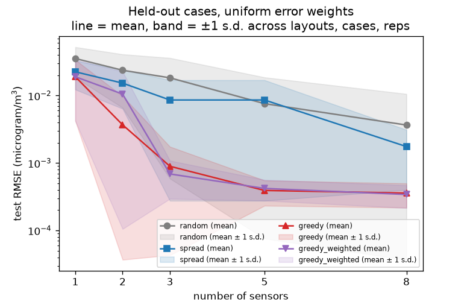
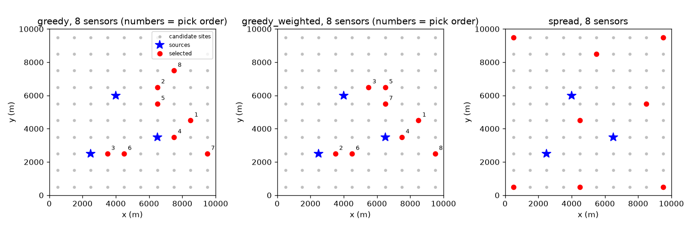
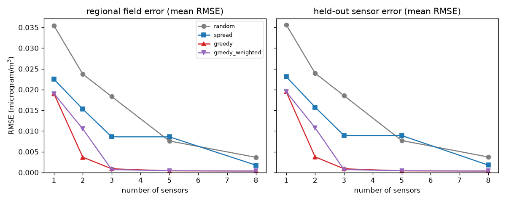
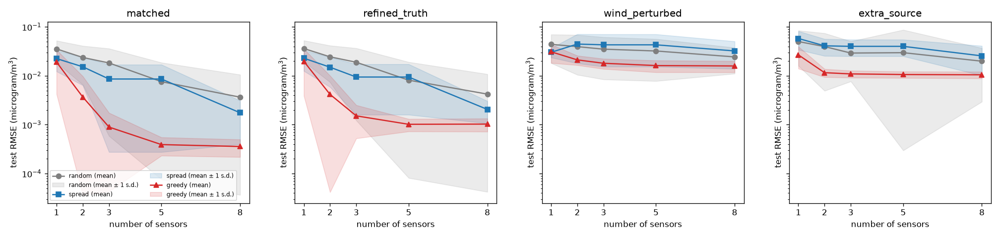
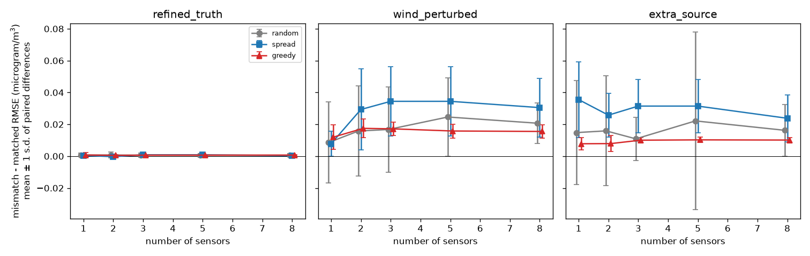

# Validation record (v0)

This is **synthetic verification**, not empirical validation. It shows that the code solves the stated equations
accurately, conserves mass, converges under refinement, recovers sources from data it generated itself, and how
sensor layouts compare *in that synthetic world*. No measurement of a real atmosphere (Belauri or anywhere) was used,
so nothing here says the model predicts real concentrations. All numbers below are read from files under `results/`
(frozen v0 outputs; do not overwrite them) and from the tests; where something was not measured we say so.

## Status

| Check | Result |
|---|---|
| Type check | `.venv/bin/pyright` -> `0 errors, 0 warnings, 0 informations` |
| Tests collected | `.venv/bin/pytest --co -q` -> 184 tests collected (no test is marked `slow`) |
| Full test run | Full test run (coordinator, 2026-10-10, macOS, py3.12.7): `.venv/bin/pytest -q` -> 184 passed, 4 warnings in 81.8 s. `.venv/bin/pyright` -> 0 errors, 0 warnings, 0 informations. |
| Notebook execution | Notebooks (coordinator, clean kernels via `scripts/verify_notebooks.py`): 01_transport PASS 20.1 s; 02_inverse PASS 14.9 s; 03_sensor_design PASS 30.2 s. |

An earlier single execution of `scripts/verify_notebooks.py` (clean kernels) printed PASS for all three notebooks:
25.2 s, 18.2 s, 34.9 s. That run is not the coordinator's final check above.

## Reproduce

```bash
.venv/bin/pytest -q                                            # unit + scientific checks
.venv/bin/pyright
.venv/bin/python scripts/verification.py --out results/verification     # 1m42s when recorded in Research OS
.venv/bin/python -m pravah simulate  --config configs/reference.json --out results/reference-v0
.venv/bin/python -m pravah inverse   --config configs/reference.json --out results/inverse-v0 --direct
.venv/bin/python -m pravah benchmark --config configs/smoke.json     --out results/smoke
.venv/bin/python -m pravah benchmark --config configs/benchmark.json --out results/benchmark
.venv/bin/python -m pravah benchmark --config configs/benchmark_unregularized.json --out results/benchmark-unregularized
.venv/bin/python -m pravah benchmark --config configs/mismatch.json  --out results/mismatch   # needs results/benchmark
.venv/bin/python scripts/verify_notebooks.py
```

Use fresh `--out` directories (e.g. `results/rerun-1`) rather than `--overwrite` so the frozen results stay intact.
Seeds are explicit in the configs (`design_seed 11`, `test_seed 22`, `design_noise_seed 1000`, `test_noise_seed 5000`,
`layout_seed 7`); `tests/test_experiments.py::test_benchmark_deterministic` checks a rerun reproduces itself.
Whether a rerun on another machine or other library versions matches these tables to the last digit was **not tested**.

## Machine and timings

Apple M2 (`sysctl machdep.cpu.brand_string`), 8 logical CPUs, 8 GiB RAM, macOS 26.5.2 (build 25F84), arm64,
Python 3.12.7 (Clang 16.0.0), fipy 4.0.3, numpy 2.5.3, scipy 1.18.1, xarray 2026.9.0, pandas 3.0.6. The runs were made
in a working tree with uncommitted changes (`git_dirty: true` in every provenance file; revision `1c20446334`).
Whether other jobs shared the CPU during the timed runs was **not recorded** in the run files; treat times as indicative.
Peak memory is `ru_maxrss` of the whole process from `timings.json` (the verification and `simulate` runs did not record it).

| Run | Wall time | Peak memory | Notes (from `timings.json` / `metrics.json` / `inverse_metrics.json`) |
|---|---|---|---|
| `simulate` reference (50x50, 240 steps) | 2.78 s solve | not recorded | `results/reference-v0/metrics.json` |
| `inverse` linear route | 22.4 s | not recorded | includes the 4 response solves and the reconstruction run |
| `inverse` direct route | 113.2 s | not recorded | `least_squares` on forward solves; both routes together took 2m21s |
| smoke benchmark | 17.2 s | 178.5 MB | cases 16.0, selection 0.09, evaluation 0.04, output 1.0 s |
| benchmark (alpha 1) | 293.8 s | 175.8 MB | cases 278.2, selection 10.6, evaluation 3.7, output 1.2 s |
| benchmark-unregularized (alpha 0) | 285.4 s | 173.9 MB | cases 270.2, selection 10.9, evaluation 3.3, output 1.0 s |
| mismatch | 469.7 s | 187.9 MB | matched 165.6, refined truth 239.6, wind perturbed 30.6, extra source 32.3 s |

Most benchmark time is the forward solves of the 12 scenarios (each needs the truth run plus n+1 response solves);
selection and evaluation are cheap linear algebra because the model is affine in q.

## Tolerances asserted by the tests

Actual thresholds from `tests/`; the justification column paraphrases the comments there.

| What | Tolerance | Why |
|---|---|---|
| Uniform field stays uniform (periodic and open+background) | abs 1e-12 | exact for the scheme; LU round-off only |
| Open uniform case: inflow vs outflow budget | rel 1e-10 | same coefficients in equation and budget |
| Removal-only decay equals `(1 + lam dt)^-n` | abs 1e-10 | backward-Euler closed form; LU error ~1e-15 |
| Removal-only error vs `exp(-lam t)` as dt halves | ratio in (1.9, 2.1) | first order in time (measured 1.96, 1.98, 1.99) |
| Periodic Gaussian vs exact solution, nx = 20/40/80, dt 15 s | ratios > 2.0; error at nx 80 < 0.03 | pre-asymptotic spatial order (measured 0.155, 0.0607, 0.0238) |
| Same, dt = 60/30/15/7.5 s at nx = 40 | successive error differences in ratio (1.7, 2.3) | first-order time error halves |
| Single Fourier mode amplitude vs discrete symbol | rel 1e-9 | exact discrete prediction (EXP-001 synthesis reports agreement ~1e-14) |
| Fourier-mode phase | abs 0.06 rad; decay exponent rel 0.05 | dispersion error (measured 0.047 at 25 cells, 0.005 at 100) |
| Effective diffusivity vs `(Pe/2)coth(Pe/2) - 1 + u^2 dt/2K` (exponential and upwind) | 3% | finite-wavenumber corrections |
| Closed domain, no source: mass conserved | rel 1e-10 | LU round-off over 24 steps |
| Closed domain, source only: mass = integrated emission | rel 1e-10 | exact budget |
| Budget residual (periodic with decay) | rel 1e-10 | |
| Budget residual (open, with background/IC; wind reversal; wind change off output grid) | rel 1e-9 | looser because inflow/outflow coefficients are summed over faces |
| Steady through-flow balance | rel 1e-5 | relaxation `e^-20` |
| Steady open-boundary profile vs analytic, 25 to 200 cells | strictly decreasing, order > 1.5 | measured errors 6.8e-3, 1.5e-3, 2.8e-4, 5.8e-5 |
| Source normalisation `sum f dA = 1` | abs 1e-12 | round-off |
| Quadrature ratio discrete/continuous, nx = 25/50/100 (and > 1e-2 off at nx = 10) | worst `|ratio - 1| < 1e-6` | cell-centre sum of a smooth 500 m Gaussian; visibly off at dx = 2 sigma |
| Reference run: 240 steps, residual, runtime | rel 1e-9; < 15 s | no negative values |
| Bilinear sampling of affine fields | rel 1e-12 | exact for affine fields |
| Cached responses reproduce direct simulation (zero/uniform/Gaussian IC, background) | 1e-6 relative to max | superposition; LU tolerance 1e-12 |
| Cached operator vs `sample` of the direct field | rel 1e-6 | |
| Noise-free recovery of q | rel 1e-4 on q; weighted residual < 1e-6 | data are generated by the model being inverted |
| Direct vs linear fit (tiny fixture, noisy) | rel 1e-5 on q (observed here: 4e-9 at full size) | same convex problem, optimiser tol 1e-14 |
| Fit covariance vs prediction (300 noise draws) | std ratio in (0.8, 1.25); chi-square within 5 sd | sampling error ~4% |
| `q_std` vs the empirical-covariance quantity | rtol 1e-6 | same formula |
| Fast design fit vs brute-force `fit_sources` + `field_mse` | q: rtol 1e-8, atol 1e-6; MSE rel 1e-8; quadratic form rel 1e-10 | identical maths, different bookkeeping |
| Greedy step 1 / 2 equals exhaustive best single / pair | exact (rel 1e-12); optimum only reported | greedy is not claimed optimal |
| Mismatch run: matched baseline equals the benchmark's uniform test rows | rtol 1e-9 | same cases and noise, recomputed |

## Verification results (`results/verification/verification.csv`, `.json`)

Periodic box 10 km, Gaussian initial bump, uniform wind (1.0, 0.3), K = 100, decay lambda = 1/21600, exact
solution = translated, spread, decayed Gaussian (sum over periodic images), T = 1800 s.

| Study | Result |
|---|---|
| Spatial convergence, nx = 20/40/80 at dt = 15 s (relative L2 error) | 0.1552, 0.0607, 0.0238 (ratios 2.56, 2.55) |
| Time convergence at nx = 40, dt = 60/30/15/7.5 s | 0.0832, 0.0683, 0.0607, 0.0568 (differences 0.0149, 0.0076, 0.0038: halve with dt) |
| Reference dt refinement (60/30/15 s): field RMSE change | 60 vs 30: 1.76e-4 ug/m^3; 30 vs 15: 9.2e-5 (ratio 1.9, first order) |
| Reference grid refinement 50 vs 100 cells | RMSE 6.5e-4 ug/m^3 = 0.40% of the max concentration (0.1626 vs 0.1608); total mass differs 0.19%; solve 4.3 s vs 13.0 s |
| Budget residual, reference dt = 60/30/15 s | 1.6e-14, 1.9e-14, 4.1e-15 (relative); 0 negative values; final mass 1.6932e9 ug (60 s vs 15 s differ by 4.7e-6 relative) |
| Quadrature ratio (discrete / continuous Gaussian integral), per source | nx = 50: 1 + 9.0e-8, 1 + 7e-16, 1 + 7e-13; nx = 100: 1 + 2.4e-8, 1, 1 + 2e-13 |

**Numerical diffusion (known model error).** `K_eff/K - 1` measured by Fourier-mode projection vs theory
`(Pe/2)coth(Pe/2) - 1 + u^2 dt/(2K)` (exponential scheme) or `Pe/2 + u^2 dt/(2K)` (upwind); wind along a grid axis,
u = 1, K = 100. Measured (theory) for dt = 60 s / dt = 10 s:

| Scheme | nx = 25 | nx = 50 (reference) | nx = 100 |
|---|---|---|---|
| exponential | 1.349 (1.375) / 1.112 (1.125) | **0.606 (0.613)** / 0.361 (0.363) | 0.378 (0.382) / 0.131 (0.132) |
| upwind | 2.263 (2.300) / 2.031 (2.050) | 1.288 (1.300) / 1.046 (1.050) | 0.794 (0.800) / 0.549 (0.550) |

Largest deviation from theory over all 24 cases: 1.8% (3% asserted). So at the default grid and time step the
effective diffusivity is about 1.6 K, plumes are smoother than the nominal K suggests, and **all experiments
inherit this** (matched experiments use the same scheme for truth and inference; only the mismatch study's finer
grid, 100 x 100 with dt/2 = 30 s, lowers it in the truth: +0.23 vs +0.61 for the inference model, from the table).
Not re-measured for oblique wind. The 2-D open-boundary behaviour is checked against a 1-D strip analytic solution only.

## Inverse recovery, matched model (`results/inverse-v0/inverse_metrics.json`)

Reference scenario, 5 sensors every 600 s, S5 held out (4 used, 96 readings), noise 0.005 ug/m^3 (about 3% of the
0.161 peak), one noise draw (seed 1), alpha = 0.

| Quantity | Value |
|---|---|
| q true -> q_hat (ug/s) | 1.0e5 -> 97531; 1.5e5 -> 146718; 8.0e4 -> 78807 |
| relative L2 error of q | 0.0217 (per source -2.5%, -2.2%, -1.5%) |
| `q_std` (linear-Gaussian) | 5805, 6888, 3513 ug/s |
| rank / effective rank / condition | 3 / 3 / 5.62 (singular values 67.4, 21.4, 12.0) |
| weighted residual norm | 8.21 for 96 observations (expected about sqrt(96 - 3) = 9.6 if model and noise are right) |
| regional RMSE of the field / held-out sensor RMSE / fit-sensor RMSE | 9.7e-4 / 4.3e-4 / 9.2e-4 ug/m^3 |
| direct (`least_squares`) vs linear (`lsq_linear`) max relative difference in q | 4.0e-9 |

This is the inverse crime: truth and inference use the same solver, grid and (known) physics. Figure:
[truth vs fit](../results/inverse-v0/truth_vs_fit.png).

## Sensor-placement benchmark (`results/benchmark`, alpha = 1, matched model)

6 design + 6 test scenarios (q x U(0.5, 1.5), wind speed 0.6-1.6 m/s, direction +/-40 deg around nominal; every
second scenario has a two-segment wind), 3 noise draws each, 10 x 10 candidate sites, budgets 1/2/3/5/8, 20 random
layouts per budget. Layouts are chosen only from design scenarios; errors below come from the test scenarios with
fresh noise. Metric: regional RMSE of the reconstructed field, uniform weights, ug/m^3. Each cell of the greedy,
spread and greedy-weighted rows is 18 numbers (6 cases x 3 draws) for one layout; random pools 20 layouts (360 rows).
"sd" is the standard deviation of those individual results (label in the CSV: *sd of per-row RMSE across layouts x
cases x noise reps*); **it is not a confidence interval.**

| Method | Stat | b = 1 | b = 2 | b = 3 | b = 5 | b = 8 |
|---|---|---|---|---|---|---|
| greedy | mean | 0.0190 | 0.0037 | 8.9e-4 | 3.9e-4 | 3.6e-4 |
|  | median | 0.0175 | 0.0011 | 5.4e-4 | 4.0e-4 | 3.5e-4 |
|  | sd | 0.0148 | 0.0061 | 8.5e-4 | 1.6e-4 | 1.4e-4 |
| greedy_weighted (selected with the population-weighted objective) | mean | 0.0190 | 0.0105 | 6.9e-4 | 4.2e-4 | 3.4e-4 |
| spread | mean | 0.0225 | 0.0153 | 0.0086 | 0.0086 | 0.0018 |
|  | median | 0.0237 | 0.0124 | 0.0080 | 0.0080 | 0.0014 |
|  | sd | 0.0102 | 0.0089 | 0.0083 | 0.0083 | 0.0014 |
| random (20 layouts) | mean | 0.0354 | 0.0237 | 0.0183 | 0.0076 | 0.0037 |
|  | median | 0.0323 | 0.0211 | 0.0142 | 0.0027 | 0.0011 |
|  | sd | 0.0168 | 0.0171 | 0.0177 | 0.0110 | 0.0069 |

Spread layouts for b = 3 and b = 5 give identical errors to 4 digits: the two sites added at b = 5 (`c000`,
`c090`, corners at x = 500 m, upwind of all sources) see none of the plumes. That is consistent with, but was not
separately proven by, the identical `effective_rank` (2.5).

**Paired differences** (mean difference in per-row RMSE, test scenarios; negative = first method better) /
sd of the 18 differences / fraction of pairs where the first method wins:

| a - b | b = 1 | b = 2 | b = 3 | b = 5 | b = 8 |
|---|---|---|---|---|---|
| greedy - spread | -0.0035 / 0.0077 / 78% | -0.0116 / 0.0070 / 100% | -0.0077 / 0.0085 / 83% | -0.0082 / 0.0083 / 94% | -0.0014 / 0.0014 / 94% |
| greedy - random (mean of 20) | -0.0164 / 0.0118 / 100% | -0.0200 / 0.0112 / 100% | -0.0174 / 0.0068 / 100% | -0.0072 / 0.0032 / 100% | -0.0033 / 0.0020 / 100% |
| spread - random (mean of 20) | -0.0129 / 0.0099 / 94% | -0.0084 / 0.0066 / 83% | -0.0097 / 0.0053 / 100% | +0.0010 / 0.0061 / 44% | -0.0019 / 0.0021 / 83% |
| greedy(pop-weighted) - greedy | 0 / 0 / 0% | +0.0068 / 0.0152 / 44% | -0.0002 / 0.0005 / 67% | +0.00003 / 0.0001 / 44% | -0.00002 / 0.0001 / 50% |

**Design versus test** (pooled RMSE = sqrt of mean MSE; the design and test scenarios differ, so "gap" is not a
pure overfitting measure):

| Method | Quantity | b = 1 | b = 2 | b = 3 | b = 5 | b = 8 |
|---|---|---|---|---|---|---|
| greedy | design | 0.0133 | 0.0079 | 8.2e-4 | 3.3e-4 | 2.6e-4 |
|  | test | 0.0238 | 0.0070 | 0.0012 | 4.2e-4 | 3.8e-4 |
|  | test - design | 0.0106 | -9.1e-4 | 4.0e-4 | 9.0e-5 | 1.3e-4 |
| spread | test - design | 0.0043 | -0.0012 | -9.1e-4 | -9.1e-4 | -9.7e-4 |
| random | test - design | 0.0055 | 0.0042 | 0.0041 | 5.2e-4 | 0.0013 |

What this supports: in this matched synthetic setting a layout chosen with the model on separate design scenarios
beat spread and random layouts on independent test scenarios on average at every budget, with an absolute test-minus-design gap that is small from
3 sensors up but large at 1 sensor (greedy: 0.0106 above its design score). Relative to its design score, greedy's
test RMSE is 27-49% higher at b = 3, 5 and 8 (pooled test/design RMSE ratio 1.80, 0.88, 1.48, 1.27, 1.49 for b = 1..8),
whereas spread's ratio is at or below 1.2; this positive gap is what selection-on-design optimism looks like, so the
design-stage score of a greedy layout should not be quoted as its expected performance. Much of the advantage is simply avoiding
plume-blind sites (identifiability), not fine optimisation. What it does not support: greedy winning every case
(78-100% of pairs), greedy being optimal (it is a one-site-at-a-time heuristic; one tiny alpha = 0 exhaustive fixture in the
tests showed greedy's design MSE 3.7x the optimum, i.e. about 1.9x in RMSE; a single fixture, not a range), the population-weighted objective helping (it was worse at b = 2, indifferent
elsewhere), or any statement about real networks. With 6 + 6 scenarios and 3 noise draws the evidence is modest.

### Sensitivity: no prior (alpha = 0, `results/benchmark-unregularized`)

The headline uses a weak ridge prior (alpha = 1, in units of q_scale = 1e5 ug/s). **That choice was made after
seeing the alpha = 0 test results**, so it is not independent of them; it was not searched (one value tried) and
it does not favour greedy (greedy is slightly worse with alpha = 1 at b = 8: 3.6e-4 vs 2.6e-4; the prior mainly rescues
spread and random), and the alpha = 0 run is kept as a
sensitivity result. Mean RMSE (median in brackets), uniform weights:

| Method | b = 1 | b = 2 | b = 3 | b = 5 | b = 8 |
|---|---|---|---|---|---|
| greedy | 0.0193 (0.0185) | 0.0057 (0.0017) | 0.0012 (9.2e-4) | 4.7e-4 (3.8e-4) | 2.6e-4 (2.5e-4) |
| spread | 4.83 (1.44) | 4.88 (0.053) | 1.43 (0.011) | 1.43 (0.011) | 0.0018 (0.0015) |
| random | 2.3e19 (0.63) | 2.2e11 (0.035) | 5.3e10 (0.019) | 2.0e7 (0.0027) | 0.057 (0.0012) |

**Why the means explode.** Without a prior, a layout that sees none of the plume leaves some amplitude directions
unconstrained: the observation matrix is numerically singular (rank 2 of 3, effective rank 0, condition infinite for
the worst rows), the bounded least-squares problem has a continuum of near-equal-residual solutions, and noise
selects an astronomically large one; the reconstructed field then has an enormous error far from the sensors.
Of 1800 random-layout rows, 361 have RMSE > 1 ug/m^3 (the peak concentration is 0.16); for spread 21 of 90; for
greedy none of 90. With alpha = 1 the worst of all 2070 uniform-weight test rows is 0.079. So medians are the
sensible summary of the alpha = 0 run; the greedy numbers are stable at alpha = 0 because its sites always constrain
the three amplitudes (effective rank 3 for b >= 3). Prior strength, not just layout, therefore decides how bad a
blind layout looks.

## Model mismatch (`results/mismatch`)

Fixed design-stage layouts from `results/benchmark` are evaluated on the same 6 test scenarios x 3 noise draws,
changing one thing in the truth (the inversion keeps the matched model): **refined truth** (100 x 100 grid, dt/2,
block-averaged back to the inference grid), **wind perturbed** (+20% speed and 15 deg counter-clockwise rotation in
every segment, hidden from the inversion), **extra source** (a 4th source of 60000 ug/s at (3000, 4500) m, which is
15.5% of emissions on average and absent from the inference model). One magnitude per kind; the `greedy_weighted` layouts are in the raw
rows but were scored on the uniform metric only (the population-weighted metric was not computed under mismatch). Mean RMSE, ug/m^3:

| Method | Condition | b = 1 | b = 2 | b = 3 | b = 5 | b = 8 |
|---|---|---|---|---|---|---|
| greedy | matched | 0.0190 | 0.0037 | 8.9e-4 | 3.9e-4 | 3.6e-4 |
|  | refined truth | 0.0197 | 0.0042 | 0.0015 | 0.0010 | 0.0010 |
|  | wind perturbed | 0.0310 | 0.0212 | 0.0180 | 0.0162 | 0.0159 |
|  | extra source | 0.0268 | 0.0116 | 0.0109 | 0.0106 | 0.0105 |
| spread | matched | 0.0225 | 0.0153 | 0.0086 | 0.0086 | 0.0018 |
|  | refined truth | 0.0229 | 0.0150 | 0.0094 | 0.0094 | 0.0021 |
|  | wind perturbed | 0.0302 | 0.0446 | 0.0430 | 0.0430 | 0.0323 |
|  | extra source | 0.0580 | 0.0410 | 0.0400 | 0.0400 | 0.0255 |
| random | matched | 0.0354 | 0.0237 | 0.0183 | 0.0076 | 0.0037 |
|  | refined truth | 0.0361 | 0.0244 | 0.0189 | 0.0081 | 0.0042 |
|  | wind perturbed | 0.0440 | 0.0395 | 0.0351 | 0.0322 | 0.0244 |
|  | extra source | 0.0502 | 0.0396 | 0.0292 | 0.0297 | 0.0199 |

Paired mismatch minus matched (greedy; mean difference / sd / fraction of pairs where mismatch is worse):

| Condition | b = 1 | b = 2 | b = 3 | b = 5 | b = 8 |
|---|---|---|---|---|---|
| refined truth | +0.0007 / 0.0014 / 78% | +0.0005 / 0.0004 / 78% | +0.0006 / 0.0003 / 100% | +0.0006 / 0.0002 / 100% | +0.0007 / 0.0003 / 100% |
| wind perturbed | +0.0120 / 0.0078 / 100% | +0.0175 / 0.0059 / 100% | +0.0172 / 0.0042 / 100% | +0.0158 / 0.0043 / 100% | +0.0155 / 0.0041 / 100% |
| extra source | +0.0078 / 0.0038 / 100% | +0.0079 / 0.0051 / 83% | +0.0100 / 0.0016 / 100% | +0.0102 / 0.0016 / 100% | +0.0101 / 0.0017 / 100% |

Reading: the discretisation mismatch (refined truth) costs about 6e-4 ug/m^3 at b >= 3, an absolute cost that is small next to the
greedy-vs-spread gaps but a large relative one: for greedy at b = 5 and 8 the refined-truth RMSE is 2.6-2.9x the matched
value (3.9e-4 to 1.0e-3; 3.6e-4 to 1.0e-3) and the b = 8 source error rises 1.7x (0.0089 to 0.015). The refined truth
still uses the same scheme (same numerical diffusion), source shapes and boundary conditions, so this is a lower bound
on the inverse-crime effect, not an estimate of it; a hidden 20%/15 deg wind error or a missing source costs roughly 15-35
times more at b >= 2 (about 11x at b = 1) and **more sensors do not fix it** (greedy b = 8 stays at 0.016 and 0.0105): the floor is model error. Under
the missing source the greedy source-attribution error (relative L2 on the three modelled amplitudes) rises from
0.009 to 0.16 at b = 8. Under mismatch spread layouts at b >= 2 are worse than greedy in every condition, and for
the wind error they are worse than at b = 1. Not every individual draw worsens (78-100% for refined truth).

**Deliberately poor layout** (3 sensors in the upwind top-left corner: c080, c090, c091). In all 18 rows
(6 cases x 3 draws) the effective rank is 0 and the largest singular value is at most 2.1e-5 (greedy at b = 3: 80-125;
spread at b = 3: at least 12.7); the condition number is infinite in 9 rows and at least 1.7e8 in the rest. Estimates collapse to the
prior (relative source error 0.99998-1.0) while regional RMSE is 0.029-0.079 (mean 0.048 matched). Figures
[poor_layout.png](../results/mismatch/figures/poor_layout.png) and the diagnostics table
`results/mismatch/poor_layout_diagnostics.csv` show it.

## Figures

Embedded below; all are under `results/` (PNG, generated by the run that wrote the directory).








Also available: `results/benchmark/figures/error_vs_sensors_population.png`,
`results/benchmark-unregularized/figures/{error_vs_sensors_uniform,error_vs_sensors_population,heldout_vs_regional,selected_sites}.png`,
`results/smoke/figures/*.png` (smoke run; not for conclusions), `results/mismatch/figures/poor_layout.png`.

## Known limitations

* **Numerical diffusion** about +61% of K at the default grid and dt (table above); first order in time; plumes
  smoother than nominal K. All experiments share it.
* **Inverse crime.** Matched experiments invert the same numerical model that generated the data. The mismatch study
  relaxes this in three specific ways only.
* **Known-everything-but-q.** Wind, K, lambda, H, geometry, initial state and boundary values are assumed known.
  The mismatch study shows how fast this assumption costs accuracy (wind error: roughly 15-35x the refined-truth effect at b >= 2).
* **Small samples.** 6 + 6 scenarios x 3 noise draws, one wind-ensemble definition, one noise level (0.005 ug/m^3),
  one magnitude per mismatch kind, one random-layout seed. sd values describe spread, not uncertainty of the mean.
* **Prior choice.** alpha = 1 adopted after the alpha = 0 failure (disclosed above).
* **Greedy is a heuristic**; no optimality claim. Weighted layouts were scored on the uniform metric only under mismatch.
* **Not measured:** peak memory of `simulate`/`inverse`/verification; CPU contention during timing; behaviour on other
  machines or library versions; oblique-wind numerical diffusion; anything about real data.
* **Synthetic verification vs empirical validation.** Everything above checks internal consistency and numerical
  accuracy against analytic and refined-model references. Empirical validation would compare model output with
  measurements of the real region; none exists in this repository, and the default parameters are demonstration values,
  not Belauri estimates. No claim in this document should be read as a statement about real air quality.

## Notes added after the final review

* Held-out evaluation sites (7 x 7 grid, `experiments.py`) never coincide with candidate sites but can lie within about
  half a cell (~100 m) of a fitted one (e.g. (6429, 6429) m vs candidate c066). They are noiseless and use the same
  bilinear operator, so held-out RMSE tracks regional RMSE closely and is weak independent evidence. Treat it as a
  consistency check, not an independent test.
* Paired tables count ties as "not better" (`frac_a_better`); the `greedy_weighted - greedy` row at b = 1 shows 0% only
  because the two layouts are identical.
* Provenance of the frozen runs records numpy/scipy/xarray/fipy/pravah versions and `git_dirty` but no diff. The pandas,
  matplotlib and netCDF4 versions are in `requirements-lock.txt` (later runs also record them in provenance.json).
  `results/mismatch` records the `layouts_from` path but no hash of the layouts file (it is identical to
  `results/benchmark/layouts.json`).
* Timings in the frozen run directories were measured while other jobs shared the CPU; an identical rerun of the
  benchmark took 152 s versus the recorded 294 s with the same peak memory (~177 MB) and bit-identical raw metrics.
