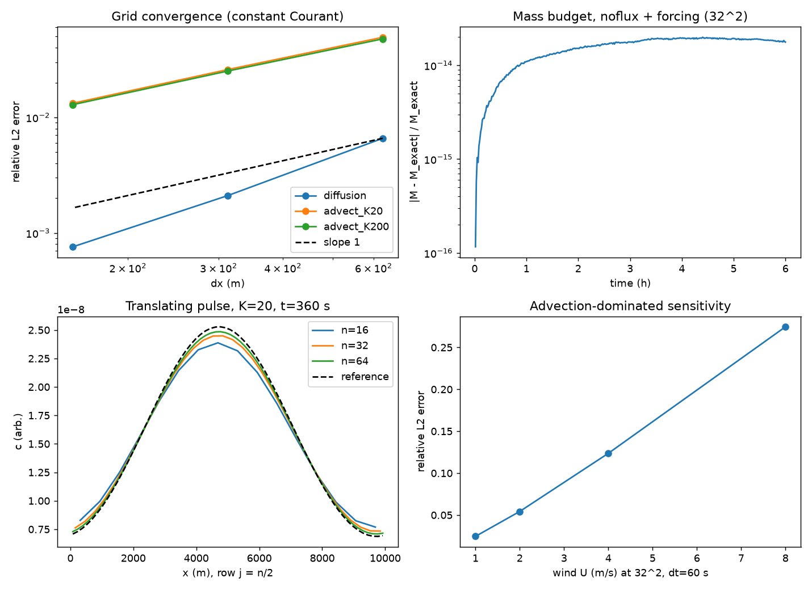

# E01 Forward-solver verification (local 16²/32²/64²)

**Question.** Does the FiPy solver solve the declared PDE accurately, conserve mass, and stay positive?
**Evidence label:** verified (conditionally cleared by gate-01) for the closed-box/periodic oracles; superseded for 64²
production runs by amendment A2 (section at the end).

Simulated passive tracer only; nothing here is evidence about ambient PM2.5. All numbers below are read from
`tables/e01-verification.csv`, written by `scripts/e01_verification.py` (one registered run) and rendered to markdown by `tables/make_e01_md.py`. References are the
closed-form oracles of `tests/test_forward_oracles.py`; tolerances come from `docs/research/pde-and-discretization.md`
§5 (order p = 1, margin 0.2, discrete-exact 1e-8), not from solver output.

## Grid convergence at constant Courant number





## Time-step refinement (32² fixed)



Error falls with dt but plateaus at the spatial error; halving dt does not halve the total error because the
fixed-grid error (numerical diffusion, central-diffusion truncation) is not removed by it.

## Advection-dominated sensitivity (32², K = 20 m² s⁻¹)



Peak ratio below 1 is numerical diffusion (peak smeared). `min_over_max` is the domain minimum over the maximum:
it is positive in every row, so no negative overshoot was observed for first-order upwind with backward Euler, as
predicted by the M-matrix argument (doc §5.5). This does not carry over to a higher-order scheme.

## Mass budget (closed box, prescribed forcing, 32²)



Maximum relative difference from the discrete-exact mass recurrence over the run; the preregistered tolerance is 1e-8.

## Audit outcome (gate-01)

Gate-01 **conditionally cleared** the solver for the three convergence oracles and three discrete-exact oracles on the
closed-box/periodic verification set (36 tests re-run, all pass). It did **not** clear the `study` boundary
conditions, the literal protocol §3 gates, or any physical claim, and it flagged that upwind numerical diffusion grows
strongly with Courant/Péclet number (relative L2 error 0.025 → 0.27 for U = 1 → 8 m s⁻¹ at 32²).

## Amendment A2: split VanLeer for 64²

The gate-00 risk B3 materialised. At 64² upwind's effective diffusivity is 350–2900 m² s⁻¹ against the physical
K = 50 m² s⁻¹, and it fails the dt-halving gate at every dt tried (`docs/research/gates/b3-advection-scheme.md`).
FiPy's only higher-order convection term, `VanLeerConvectionTerm`, is explicit (unstable for Courant > 1) and,
unsplit, misses the cross term so that it is anti-diffusive along oblique winds (fitted K_eff,along = −16.3 m² s⁻¹ for a
3 m s⁻¹ diagonal wind at 64², dt 30 s). PRAVAH applies it **dimensionally split** at dt = 30 s:

| Wind (64², puff σ₀ = 1 km, 1 h) | upwind dt 300 s: K_eff (rel. L2) | split VanLeer dt 30 s: K_eff (rel. L2) |
|---|---|---|
| 3 m s⁻¹ along x | 1371 (0.70) | 50.9 / 49.6 (0.0033) |
| 5 m s⁻¹ along x | 2933 (0.78) | 49.9 / 49.7 (0.0014) |
| 3 m s⁻¹ diagonal | 1407 / 208 (0.72) | 50.7 / 50.7 (0.0047) |

(Values along / across the wind, from the B3 note.) Split VanLeer converges at order ≈ 2, changes by 0.54–0.71 % on
dt-halving (gate ≤ 1 %), conserves mass to 1e-15 and stays non-negative; it costs about 17× upwind (7.8 s per simulated
hour at 64², serial). The lead reproduced K_eff independently (diagonal wind: upwind dt 300 s 1545 / 235, upwind dt 30 s
351 / 216, VanLeer dt 30 s 50.1 / 50.1). The limiter makes the scheme slightly non-linear (superposition error ~1 % in a
two-blob test). Upwind remains the default and is bit-identical to the earlier code, so the 32² results in E02–E06 and
the E07 pilot are unchanged.

## Limitations

- Only the three convergence oracles, one mass case and uniform wind are covered; the `study` boundary mass budget
  is diagnostic only (doc §3), and the wind-reversal face-switch test (gate item 3) is not covered here.
- Oracle (ii) uses the revised regime (doc §5.3); that revision was made after an earlier regime failed and has not
  been independently reviewed.
- Single deterministic run, no seeds involved; the figure's pulse snapshot is a 1-D cut, not a full 2-D snapshot.
- Findings from this chapter stay preliminary until an independent review.
