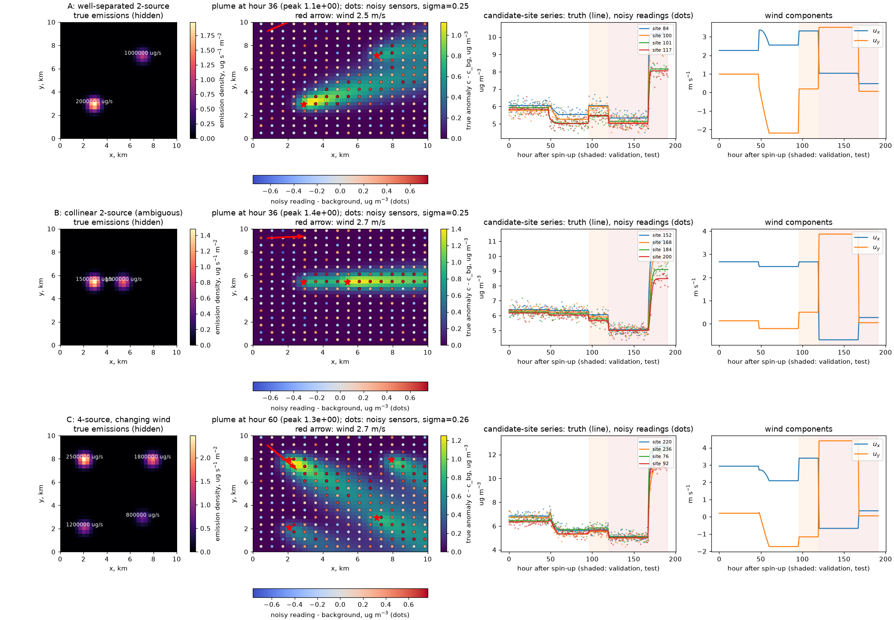

# E02 Tiny local benchmark: three hand-placed examples

**Question.** Can we generate reproducible synthetic truth, sensors and splits without leakage, and do sensors see
the plumes? **Evidence label:** verified engineering at smoke scale; benchmark not frozen as a scientific benchmark.
**Current status:** rerun at a_ref = 1 g s⁻¹ (amendment A1); the 65 checks still pass and peak plume SNR is 21–32.

Simulated passive tracer only; nothing here is evidence about ambient PM2.5. Every number below is generated from `tables/e02-checks.csv` and `tables/e02-splits.csv`, written by `scripts/e02_examples.py` (one registered run).
Scale is a smoke scale (32² grid, 12 h spin-up, 8-day calendar), not the preregistered 64² / 60-day design. Sources are
placed by hand (the random draw is overridden); each example uses its own replicate seed because `truth_id` does not encode
the fixed placement.

## Examples

## Split and manifest versioning



## Validity checks (pass/fail)



The checks cover source-rate/unit consistency, a mass-budget residual, positivity, leakage refusals (test data for
placement/tuning, non-test data for evaluation, held-out wind in fitting, inadmissible or too-close sites), read-only
inference views without truth fields, and identical truth and shared-site noise across two different sensor designs.
The mass budget is a residual: the outflow is *inferred* as emitted − removed − stored change, with removal from an hourly
trapezoid, so it checks plausibility (0 ≤ outflow ≤ emitted), not closure.

## Signal against noise



At the originally preregistered reference rate (a_ref = 100 µg s⁻¹) the plume anomaly was about 10⁻³ of the instrument noise,
and sensor readings carried no visible plume (negative result, kept in Git history at revision `a36b476^`). Following amendment A1
(`state/decisions/2026-11-12-source-scale.md`, a_ref = 1 g s⁻¹, everything else unchanged) the peak plume anomaly in these
examples is the multiple of σ shown above. The noise σ barely changes because it is set at 5% of the median training
concentration, which is dominated by the 5 µg m⁻³ background. The new scale was chosen after seeing the old results, so analyses
that use it are exploratory until the protocol is frozen.

## Audit outcome (gate-02)

Gate-02 **conditionally cleared** the smoke-scale pipeline as engineering (41 benchmark tests re-run; operator, truth
vs forcing and leakage refusals checked) and **did not clear** freezing `benchmark-v1` as a scientific benchmark. Its
first decision for the human was the SNR problem (B1): at the preregistered scale the peak anomaly was ~1e-3 of σ,
so "until decided, no E03 or placement result is interpretable". That decision became amendment A1. Other open items
(separate tuning/evaluation seeds, mismatch magnitudes, windowing, version constants in the hashed config) were partly
absorbed by the protocol approval; the spin-up wind choice remains an unreviewed decision (E02 journal).

## Limitations

- Perfect-model truth only; no imperfect-wind or mismatched-model variants; single replicate per example.
- Small grid and short calendar; held-out wind regimes appear only in the test days.
- Collinearity ambiguity is set up geometrically but not quantified here (no response matrix or inverse); that belongs to the static-inverse experiment.
- Mass check is a residual, not an independent closure; positivity is exactly zero minimum anomaly by construction of the anomaly solve.
- Generator workaround from the truth-generator implementation (solving the anomaly with zero background) is inherited.
