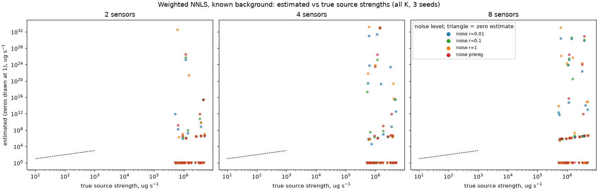

# E03 Static source-strength inverse (known wind)

**Question.** With fixed (non-optimised) sensors, known wind and a perfect model, can a weighted non-negative inverse
recover source strengths? **Evidence label:** exploratory; a **negative result**. **Current status:** rerun at
a_ref = 1 g s⁻¹ (A1); the tables below are from that rerun (commit 04bbd28).

**Headline.** The weighted sensitivity matrix is rank-deficient (tolerance 1e-8) in **all 648 fits**, at both the old
and the new source scale. Rank does not depend on scale, so the cause is structural: ≤ 8 fixed sensors and a 24 h
window cannot separate the sources. For K = 2, two of three seeds put every sensor outside the plumes. The lever is
sensor placement (E06/E07) and wind change (E05), not the estimator.

Simulated passive tracer only; nothing here is evidence about ambient PM2.5. Every number below is generated from
`tables/e03-inversion.csv`, `tables/e03-estimates.csv`, `tables/e03-validity.csv` and `tables/e03-nonidentifiable.json`,
written by `scripts/e03_inversion.py` (one registered run) and rendered by `tables/make_e03_md.py`.

## Design

- Perfect model: the response matrix is built from the same transient solver, winds and spin-up as the hidden truth, so
  this measures the inverse problem only, not model mismatch. Source locations and shapes are known; the unknowns are the
  source strengths (nonnegative) and, in one arm, a constant background.
- Smoke scale (32² grid, 12 h spin-up, one 24 h window of hourly readings), not the preregistered 64² / 60-day design.
  Three replicate seeds per cell; each seed has its own truth and its own noise stream.
- Sources K ∈ {2, 4, 8}, sensors ∈ {2, 4, 8} chosen by a fixed deterministic rule from the admissible candidate sites
  (not optimised).
- Noise levels. Three data-relative levels set σ₀ to a fixed fraction r of the rms noise-free anomaly at the chosen
  sensors, with per-site σ varying by a factor up to 9 (heteroscedastic, so weighting is not a no-op). A fourth level is
  the preregistered homoscedastic noise (5% of the median background-dominated truth), read through the leak-checked
  inference view; there weighting and no weighting are mathematically identical.
- Estimators: unweighted NNLS, noise-weighted NNLS, noise-weighted ridge NNLS (one fixed relative ridge, chosen before
  any run, not tuned); each with the background known (subtracted) or estimated as a sign-free nuisance coefficient.
- Scores: source relative RMSE (‖â − a‖/‖a‖), field RMSE over the whole grid and window against the noise-free truth
  anomaly (compared with the RMSE of the all-zero estimate), measurement fit (rms of residual over true σ; about 1 when the
  model and noise are consistent), and identifiability diagnostics (rank and conditioning of the weighted sensitivity
  matrix at relative tolerance 1e-8, and the fraction of sources whose local Cramér–Rao standard deviation is at most half
  the true strength). The CRB is an unconstrained local approximation. No pass/fail threshold on error was preregistered
  for this experiment, so none is applied; outcomes are described, not graded.

## Validity checks on the operator



## Main results (weighted NNLS, background known; mean [min, max] over three seeds)





## Estimator and background comparison

Paired on identical data, restricted to cells where both fits are full rank with a non-zero estimate; a negative change
is an improvement.



## Failures, characterised



Non-identifiable means the rank of the weighted sensitivity matrix is below the number of sources, so the data cannot
determine the strengths; the estimate is then one member of a family and its error says nothing about the method. An
all-zero estimate means the nonnegativity constraint set every strength to zero, which the protocol counts as a failure.
Neither is tuned away.

## Intentionally non-identifiable case

Four sources, two sensors, a single snapshot hour, noiseless. A nonnegative alternative strength vector is constructed
along a null direction of the sensitivity matrix.



The alternative reproduces the readings to round-off while differing from the truth, and the whole-field difference shows
that a non-identifiable source set does not give a determined field either.

## Limitations

- Smoke scale and perfect model only: no wind, diffusivity, removal or location error, single noise realisation per
  cell, three seeds, deterministic non-optimised sensor sites. No claim about generality or about the preregistered
  64² design.
- The tables use the amended source scale a_ref = 1 g s⁻¹ (A1), chosen after seeing data, so they are exploratory.
  The data-relative noise levels are chosen so the signal is visible; they are not the preregistered noise, which is
  reported separately. (Earlier text here describing the preregistered 100 µg s⁻¹ scale is superseded.)
- The estimate is scored in-window on the analysis field, not as a held-out forecast, so it is not the primary endpoint.
- Rank decisions depend on the 1e-8 relative tolerance; badly conditioned but nominally full-rank cells are not
  identifiable in practice, which the conditioning column shows.
- The ridge strength is a single fixed value; no validation-based selection was run.
- Sources whose plume barely reaches any chosen sensor give near-zero columns of the sensitivity matrix; unregularised NNLS can then assign them enormous strengths for negligible change in the readings. Errors many orders above 1 are this numerical effect, reported as observed and not clipped. The fixed, non-optimised sensor rule and 24 h window may be a main cause; sensor placement is a later experiment and was not varied here.
- The run budget for this experiment was used up, so no redesign (different window, tolerance or sensor rule) was run after seeing these results.
- Findings from these runs stay preliminary.

## Audit outcome (gate-03)

Gate-03 found the code engineering-sound (23 tests pass) but **did not clear** the baseline for fair placement
comparisons: no fit is full rank, so the estimator has no demonstrated recovery regime. It recommended a regime where
rank = K is achievable (longer window, optimised sensors or larger source scale), a noise-referenced rank criterion,
and validation-only ridge tuning. What changed: the source scale (A1), the noise-referenced **practical rank** used from
E04 on, a prior-referenced ridge (MAP) in E05/E07, and optimised placement (E06/E07). The "identifiable recovery" half of
the E03 hypothesis remains untested in this configuration.
