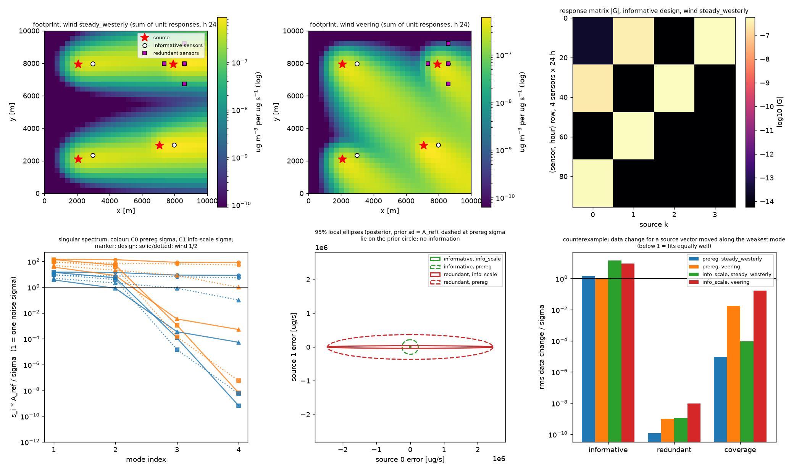

# E04 Footprints, Fisher information and identifiability

**Question.** Which source combinations can a sensor network actually distinguish, and does the singular spectrum of the
stacked response predict this better than sensor count or coverage? **Evidence label:** exploratory (one scenario
layout, one replicate). **Current status:** rerun at a_ref = 1 g s⁻¹ (A1, commit 04bbd28).

**Headline.** At the preregistered σ (0.253 µg m⁻³) the greedy D-optimal ("informative") 4-sensor design reaches
practical rank 4/4 under both winds; the coverage design 1 (westerly) or 2 (veering); the redundant design 2. Moving
the source vector along the weakest mode changes the data by less than 1σ in 9 of 12 cases, all for non-informative
designs. At the old 100 µg s⁻¹ scale the practical rank was 0/4 for every design (superseded).

Simulated passive tracer only; nothing here is evidence about ambient PM2.5. Every number below is generated by
`scripts/e04_footprints.py` (one registered run) into `tables/e04-identifiability.csv`, `tables/e04-identifiability.md`
and `tables/e04-results.md`; the figure is `figures/e04-footprints.png`. Settings are in `tables/e04-meta.json`.

## Design

- Smoke scale (32² grid, 12 h spin-up, 24 h window), perfect model, known source locations (four sources), two training
  wind regimes (steady westerly, veering). G is built from the truth's own solver; no estimator sees the truth strengths
  except the counterexample below, where they define the "true vector".
- Three 4-sensor designs, chosen from G and the admissible sites only: informative (greedy Bayesian D-optimal, prior sd
  equal to the reference rate), redundant (the four admissible sites nearest the first informative site that respect the
  minimum separation) and coverage (farthest-point spreading). Designs are chosen under the first wind and evaluated under both.
- Practical rank: the number of singular values s of G/σ with s·A_ref ≥ 1, i.e. the modes in which a reference-sized
  source change moves the data by at least one noise σ. This is our operationalisation of "rank at the preregistered noise
  scale"; it is not a preregistered threshold. Floating-point rank (relative tolerance 1e-8) is reported beside it.
- Noise scales: the preregistered σ, and an extra non-preregistered "information scale" σ (0.1 × rms reference signal over
  admissible sites). It was added when, at the old 100 µg s⁻¹ scale, no mode was above noise; it is a rescaling, not a
  realistic instrument.
- Counterexample: the true strength vector is moved along the weakest right singular vector of G/σ (nonnegativity kept, step
  at most half of ‖a‖). If the data change is below one σ, the two vectors fit equally well yet differ.
- Ellipses are local 95% ellipses of the posterior covariance (Fisher plus a prior of sd A_ref), because the unregularised
  Fisher matrix is singular in several cases.

## Results





## Audit outcome (gate-04)

Gate-04 **partly cleared** E04. The Fisher/CRB machinery is correct in the linear-Gaussian interior case and
conservative under the NNLS constraint, but **badly miscalibrated when the noise model is wrong**, and it cannot be
evaluated for designs whose Fisher matrix is singular. The hypothesis (spectrum beats count or coverage) remained
**unresolved**: one replicate, at the time at a scale where nothing was above noise. It also noted that the 1e-8 rank
rule is applied to singular values in one place and eigenvalues in another. What changed: A1 rescaled the problem, the
Bayesian (prior-regularised) D-criterion is used so singular designs stay comparable, and the paired-seed comparison
moved to E06/E07.

## Limitations

One scenario layout, one replicate, smoke scale, perfect model, local linear (Fisher) analysis, an ad hoc practical-rank
threshold and a rescaled noise level. This does not yet test the hypothesis (spectrum versus sensor count or coverage) across
seeds; that comparison remains unresolved here.
