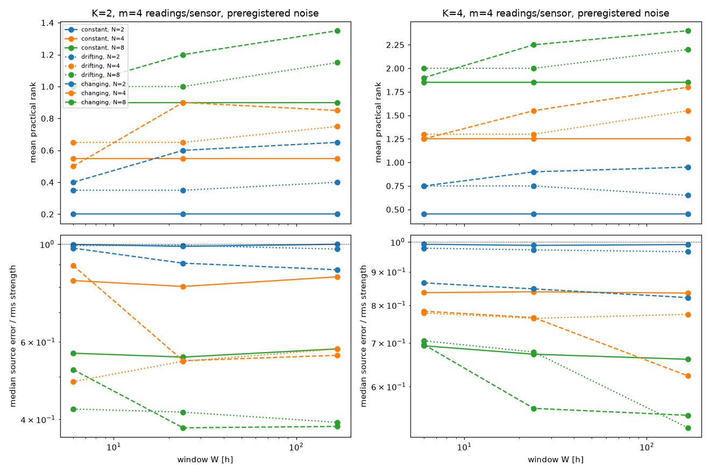
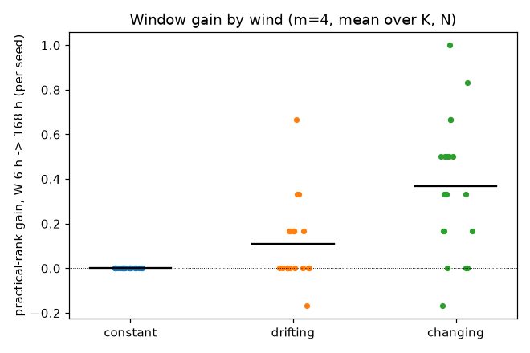

# E05 Temporal observability: sensor count versus observation window

**Question.** When does a longer measurement history compensate for fewer sensors? **Hypothesis (plan 2):** changing
wind directions raise the effective rank for constant sources, while repeated readings under the same transport only
reduce noise. **Evidence label:** exploratory (v2, rerun after the gate-05 audit, commit c04a3a4).

**Headline (v2).**

- **Elapsed time alone adds nothing.** Under an exactly constant wind the practical rank is identical at W = 6, 24 and
  168 h in every seed (mean window gain 0, CI 0 to 0).
- **Wind change adds rank.** Window gain (6 → 168 h) minus the constant-wind gain is +0.37 for veering (16 of 17
  non-tied seeds, sign p = 3e-4, bootstrap CI 0.24–0.49) and +0.11 for drifting (p = 0.02).
- **Fewer sensors over a longer window helps only when the wind changes.** At equal readings, N = 4 over 168 h beats an
  N = 8 snapshot under veering, K = 4 (9/1 seeds, p = 0.02), and is worse under constant wind (1/9, p = 0.02).
- **At a matched reading budget, more sensors win** (K = 4, B = 16: N = 8 vs N = 4 10/1 seeds; vs N = 2 18/0).
- Errors remain large: median source error / rms strength ≈ 0.6–0.9.

::: {.callout-warning}
## Superseded: E05 v1 overstated its findings
The first rerun at 1 g s⁻¹ (v1, commit 0569822) reported that practical rank and error improve *monotonically with
window length* and that a longer window *substitutes for sensors* (e.g. K = 4, N = 4 over 168 h: rank 2.40 vs an N = 8
snapshot 1.75). Gate-05 showed (i) that the "window" effect was entirely caused by the benchmark's "steady" westerly
drifting by up to ~30° between 48 h blocks — with the drift removed, a 7-day window added exactly zero rank over 24 h in
24/24 paired cases — and (ii) that every mean-based table was dominated by estimator blow-ups (relative source error up
to 1e23) in the ~5 % of cells with no signal. v1 also labelled every wind-diversity row "contradicted" although 85–100 %
of pairs were ties. v1 numbers are kept in `state/experiments/e05.md` for the record only; the tables below are v2.
:::

Simulated passive tracer only; nothing here is evidence about ambient PM2.5 or real exposure. Numbers are computed by
`scripts/e05_report.py` from `tables/e05-duration.csv`, written by `scripts/e05_duration.py` (run records in `reports/runs/runs.jsonl`).
Chapter generated at revision `770a6a7`. **Everything here is exploratory**: the source scale (amendment A1, a_ref = 1e+06 µg s⁻¹,
`state/decisions/2026-11-12-source-scale.md`), the constant-wind control and the analysis contrasts were chosen after seeing earlier
E05 results and the independent audit (`docs/research/gates/gate-05-duration.md`).

## Design (what was actually run)

- 32² grid, 12 h spin-up, perfect model, known source locations and winds, ideal white sensors, 20 seeds (each seed changes
  sources, strengths, random nested sensor sites and noise draws; noise draws are identical across winds).
- Sensors N ∈ {2, 4, 8} (random, nested, never optimised); sources K ∈ {2, 4}; window W ∈ {1, 6, 24, 168} h ending at the issue
  hour; readings per sensor m ∈ {1, 2, 4, 8, 16} spread over W (m = 1 is the reading at the issue hour; m > W is not run).
- Winds: **constant** = exactly 3 m s⁻¹ from 270° (null control); **drifting** = the benchmark's steady westerly, whose direction is
  re-drawn N(270°, 10°) every 48 h; **changing** = veering 270° → 315° during the first 12 h of each 48 h block. Drifting and changing
  share speed factors.
- Unknowns: Branch A p = K constant amplitudes; Branch B p = 3K diurnal coefficients (K = 2) while the true source is constant.
- Noise: preregistered σ (= 0.25 µg m⁻³ median) and a non-preregistered 0.1× level.
- Estimator: unconstrained MAP / ridge least squares with prior sd a_ref per coefficient (no positivity). Practical rank = number of
  singular values s of G/σ with s·a_ref ≥ 1 (a mode a reference-sized change moves by ≥ 1σ; lenient, see audit finding 7).

## Validation checks

| check | value | branch |
|---|---|---|
| O4_constant_dup_rank_change | 0 | A |
| O4_constant_dup_info_ratio_err | 0 | A |
| O4_drifting_dup_rank_change | 0 | A |
| O4_drifting_dup_info_ratio_err | 0 | A |
| O4_changing_dup_rank_change | 0 | A |
| O4_changing_dup_info_ratio_err | 0 | A |
| O1_basis_b0_vs_branchA_rel_err | 0 | B |
| O4_constant_dup_rank_change | 0 | B |
| O4_constant_dup_info_ratio_err | 0 | B |
| O4_drifting_dup_rank_change | 0 | B |
| O4_drifting_dup_info_ratio_err | 0 | B |
| O4_changing_dup_rank_change | 0 | B |
| O4_changing_dup_info_ratio_err | 0 | B |

## Results (Branch A, preregistered σ)

### Window length at fixed readings per sensor (m = 4)

| wind | K | N | W | mean_prank | frac_full | median_rel_err |
|---|---|---|---|---|---|---|
| constant | 2 | 2 | 6 | 0.2 | 0 | 0.999 |
| constant | 2 | 2 | 24 | 0.2 | 0 | 0.989 |
| constant | 2 | 2 | 168 | 0.2 | 0 | 1 |
| constant | 2 | 4 | 6 | 0.55 | 0.05 | 0.827 |
| constant | 2 | 4 | 24 | 0.55 | 0.05 | 0.802 |
| constant | 2 | 4 | 168 | 0.55 | 0.05 | 0.844 |
| constant | 2 | 8 | 6 | 0.9 | 0.2 | 0.566 |
| constant | 2 | 8 | 24 | 0.9 | 0.2 | 0.554 |
| constant | 2 | 8 | 168 | 0.9 | 0.2 | 0.579 |
| constant | 4 | 2 | 6 | 0.45 | 0 | 0.992 |
| constant | 4 | 2 | 24 | 0.45 | 0 | 0.988 |
| constant | 4 | 2 | 168 | 0.45 | 0 | 0.991 |
| constant | 4 | 4 | 6 | 1.25 | 0 | 0.836 |
| constant | 4 | 4 | 24 | 1.25 | 0 | 0.839 |
| constant | 4 | 4 | 168 | 1.25 | 0 | 0.835 |
| constant | 4 | 8 | 6 | 1.85 | 0 | 0.693 |
| constant | 4 | 8 | 24 | 1.85 | 0 | 0.673 |
| constant | 4 | 8 | 168 | 1.85 | 0 | 0.661 |
| drifting | 2 | 2 | 6 | 0.35 | 0.05 | 0.994 |
| drifting | 2 | 2 | 24 | 0.35 | 0.05 | 0.994 |
| drifting | 2 | 2 | 168 | 0.4 | 0.05 | 0.975 |
| drifting | 2 | 4 | 6 | 0.65 | 0.1 | 0.488 |
| drifting | 2 | 4 | 24 | 0.65 | 0.1 | 0.542 |
| drifting | 2 | 4 | 168 | 0.75 | 0.15 | 0.579 |
| drifting | 2 | 8 | 6 | 1 | 0.3 | 0.423 |
| drifting | 2 | 8 | 24 | 1 | 0.3 | 0.416 |
| drifting | 2 | 8 | 168 | 1.15 | 0.25 | 0.394 |
| drifting | 4 | 2 | 6 | 0.75 | 0 | 0.978 |
| drifting | 4 | 2 | 24 | 0.75 | 0 | 0.973 |
| drifting | 4 | 2 | 168 | 0.65 | 0 | 0.966 |
| drifting | 4 | 4 | 6 | 1.3 | 0 | 0.778 |
| drifting | 4 | 4 | 24 | 1.3 | 0 | 0.764 |
| drifting | 4 | 4 | 168 | 1.55 | 0 | 0.775 |
| drifting | 4 | 8 | 6 | 2 | 0 | 0.706 |
| drifting | 4 | 8 | 24 | 2 | 0 | 0.678 |
| drifting | 4 | 8 | 168 | 2.2 | 0.05 | 0.519 |
| changing | 2 | 2 | 6 | 0.4 | 0 | 0.98 |
| changing | 2 | 2 | 24 | 0.6 | 0.1 | 0.906 |
| changing | 2 | 2 | 168 | 0.65 | 0.1 | 0.875 |
| changing | 2 | 4 | 6 | 0.5 | 0 | 0.895 |
| changing | 2 | 4 | 24 | 0.9 | 0.15 | 0.544 |
| changing | 2 | 4 | 168 | 0.85 | 0.15 | 0.56 |
| changing | 2 | 8 | 6 | 1 | 0.15 | 0.519 |
| changing | 2 | 8 | 24 | 1.2 | 0.35 | 0.383 |
| changing | 2 | 8 | 168 | 1.35 | 0.4 | 0.386 |
| changing | 4 | 2 | 6 | 0.75 | 0 | 0.866 |
| changing | 4 | 2 | 24 | 0.9 | 0 | 0.847 |
| changing | 4 | 2 | 168 | 0.95 | 0 | 0.822 |
| changing | 4 | 4 | 6 | 1.25 | 0 | 0.783 |
| changing | 4 | 4 | 24 | 1.55 | 0 | 0.766 |
| changing | 4 | 4 | 168 | 1.8 | 0.05 | 0.623 |
| changing | 4 | 8 | 6 | 1.9 | 0.05 | 0.696 |
| changing | 4 | 8 | 24 | 2.25 | 0.1 | 0.556 |
| changing | 4 | 8 | 168 | 2.4 | 0.1 | 0.542 |

### Does elapsed time help, or only new wind directions?

Per seed: gain in practical rank from W = 6 h to 168 h (m = 4, averaged over K and N), and the difference between each varying
wind and the constant control. 95 % CI: bootstrap over seeds; sign test over seeds.

| contrast | mean | ci_lo | ci_hi | seeds_pos | seeds_neg | sign_p |
|---|---|---|---|---|---|---|
| window gain under constant | 0 | 0 | 0 | 0 | 0 | 1 |
| window gain under drifting | 0.108 | 0.0333 | 0.192 | 9 | 1 | 0.0215 |
| window gain under changing | 0.367 | 0.242 | 0.492 | 16 | 1 | 0.000275 |
| drifting minus constant (DiD) | 0.108 | 0.0417 | 0.192 | 9 | 1 | 0.0215 |
| changing minus constant (DiD) | 0.367 | 0.242 | 0.492 | 16 | 1 | 0.000275 |

Under the exactly constant wind the mean window gain is 0 (CI 0 to 0).

### Fewer sensors over a longer window, at equal readings (N = 4, m = 2, W = 168 h vs N = 8 snapshot)

| wind | K | prank_N4_m2_W168 | prank_N8_snapshot | seeds_pos | seeds_neg | sign_p |
|---|---|---|---|---|---|---|
| constant | 2 | 0.4 | 0.65 | 1 | 5 | 0.219 |
| constant | 4 | 1.1 | 1.55 | 1 | 9 | 0.0215 |
| drifting | 2 | 0.7 | 0.75 | 2 | 3 | 1 |
| drifting | 4 | 1.4 | 1.65 | 2 | 6 | 0.289 |
| changing | 2 | 0.5 | 0.55 | 3 | 4 | 1 |
| changing | 4 | 1.6 | 1.1 | 9 | 1 | 0.0215 |

### Matched reading budget at W = 168 h, constant wind

| K | B | N | m | mean_prank | median_rel_err |
|---|---|---|---|---|---|
| 2 | 8 | 2 | 4 | 0.2 | 1 |
| 2 | 8 | 4 | 2 | 0.4 | 0.928 |
| 2 | 8 | 8 | 1 | 0.65 | 0.755 |
| 2 | 16 | 2 | 8 | 0.3 | 0.998 |
| 2 | 16 | 4 | 4 | 0.55 | 0.844 |
| 2 | 16 | 8 | 2 | 0.75 | 0.666 |
| 2 | 32 | 2 | 16 | 0.35 | 0.99 |
| 2 | 32 | 4 | 8 | 0.55 | 0.797 |
| 2 | 32 | 8 | 4 | 0.9 | 0.579 |
| 4 | 8 | 2 | 4 | 0.45 | 0.991 |
| 4 | 8 | 4 | 2 | 1.1 | 0.855 |
| 4 | 8 | 8 | 1 | 1.55 | 0.752 |
| 4 | 16 | 2 | 8 | 0.5 | 0.991 |
| 4 | 16 | 4 | 4 | 1.25 | 0.835 |
| 4 | 16 | 8 | 2 | 1.75 | 0.722 |
| 4 | 32 | 2 | 16 | 0.6 | 0.989 |
| 4 | 32 | 4 | 8 | 1.25 | 0.819 |
| 4 | 32 | 8 | 4 | 1.85 | 0.661 |

Paired by seed:

| K | B | comparison | mean_diff | seeds_pos | seeds_neg | sign_p |
|---|---|---|---|---|---|---|
| 2 | 16 | N=8 vs N=4 | 0.2 | 6 | 2 | 0.289 |
| 2 | 16 | N=8 vs N=2 | 0.45 | 9 | 1 | 0.0215 |
| 2 | 16 | N=4 vs N=2 | 0.25 | 4 | 0 | 0.125 |
| 2 | 32 | N=8 vs N=4 | 0.35 | 7 | 0 | 0.0156 |
| 2 | 32 | N=8 vs N=2 | 0.55 | 11 | 1 | 0.00635 |
| 2 | 32 | N=4 vs N=2 | 0.2 | 4 | 1 | 0.375 |
| 4 | 16 | N=8 vs N=4 | 0.5 | 10 | 1 | 0.0117 |
| 4 | 16 | N=8 vs N=2 | 1.25 | 18 | 0 | 7.63e-06 |
| 4 | 16 | N=4 vs N=2 | 0.75 | 14 | 0 | 0.000122 |
| 4 | 32 | N=8 vs N=4 | 0.6 | 11 | 0 | 0.000977 |
| 4 | 32 | N=8 vs N=2 | 1.25 | 18 | 0 | 7.63e-06 |
| 4 | 32 | N=4 vs N=2 | 0.65 | 13 | 0 | 0.000244 |

### Basis branch B (p = 3K, true source constant)

| noise_scale | wind | p | mean_prank | median_rel_err_const |
|---|---|---|---|---|
| 0.1 | changing | 6 | 2.54 | 9.98e+05 |
| 0.1 | constant | 6 | 1.91 | 1.09e+06 |
| 0.1 | drifting | 6 | 2.24 | 1.08e+06 |
| 1 | changing | 6 | 1.3 | 1.32e+06 |
| 1 | constant | 6 | 0.956 | 1.42e+06 |
| 1 | drifting | 6 | 1.28 | 1.31e+06 |

Paired median ratio of B's constant-component error to A's error, same cell and noise draws:

| noise_scale | median ratio B/A |
|---|---|
| 0.1 | 1.06 |
| 1 | 1 |

## Interpretation (kept separate from the observations)

The hypothesis is that changing wind directions raise effective rank for constant sources, while repeated readings under the same
transport only reduce noise. Read the window-gain table first: the constant-wind row isolates elapsed time, and the
difference-in-differences rows isolate wind change. A gain under constant wind would contradict the second half of the
hypothesis; a positive DiD supports the first. The equal-readings and matched-budget tables address the sensor-savings question
without letting reading count stand in for window length. Practical rank ≥ 1 still allows roughly 100 % error per mode, so the median
error columns matter as much as the rank columns.

## Audit outcome (gate-05)

Gate-05: the computation is valid and reproduces bit-for-bit, the look-ahead guard and seed pairing are correct, but
the **v1 chapter was not cleared for interpretation** (see the warning box). What changed in v2: an exactly constant
wind as a null control, the drifting wind as a separate level, a prior-based ridge (sd a_ref) to stop blow-ups, medians
instead of means, a fixed m = 4, seed as the unit with bootstrap and sign tests, and an equal-readings comparison. The
audit judged the hypothesis **unresolved with a positive exploratory signal** for "wind change, not elapsed time, adds
rank"; v2 strengthens that signal but stays exploratory because the contrasts were chosen after the audit.

## Limitations

Random, not optimised, sites; synthetic perfect model; 32² grid; one random-site draw per seed; white noise only (no AR(1) arm);
no held-out forecast or off-sensor field evaluation (the earlier in-sample field score was retired); the veering regime turns only
during the first 12 h of each block; Branch B is K = 2 only. These results motivate, and do not replace, a preregistered E08.
