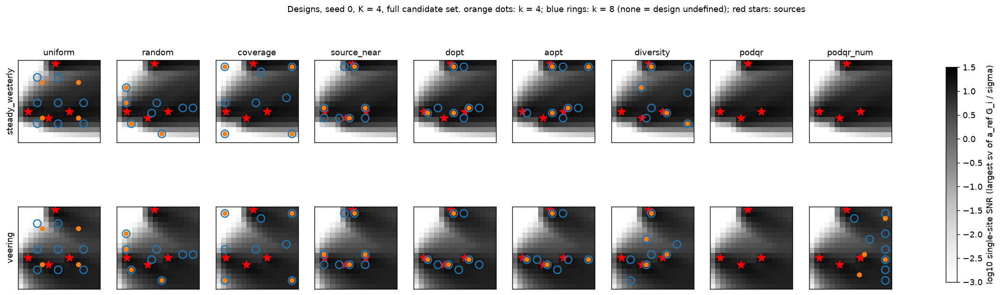

# E06 Placement algorithms and their own objectives

Simulated passive tracer only; nothing here is evidence about ambient PM2.5. Every number below is generated by
`scripts/e06_placement.py` into `tables/e06-criteria.csv` (one row per scenario × candidate set × design × budget) and the
`tables/e06-*.md` fragments computed from it; settings and the code revision are in `tables/e06-meta.json`; the figure is
`figures/e06-designs.png`. Objective definitions: `docs/research/placement-objectives.md`. Independently reviewed
by gate-06 (`docs/research/gates/gate-06-methods.md`); see the audit section at the end.

**Question.** Can we reproduce simple uniform, random, greedy information and POD/QR placements under shared
candidate constraints? **Evidence label:** verified as a methods/reproduction step; all performance numbers are
in-sample and exploratory.

## What was run

- Smoke scale (32² grid, 12 h spin-up, 4 training days), perfect model, ideal white sensors. Winds: steady westerly and
  veering (training regime). Two seeds × K ∈ {2, 4} sources from the benchmark draw. Budgets k ∈ {2, 4, 8}.
- Scale: a_ref from amendment A1 (1 g/s), σ = each scenario's preregistered noise sd.
- Design inputs (training split only): sensitivities G over all 96 training hours (known source locations, the
  truth's solver and winds); POD snapshots = noise-free field at all sites over the 96 training hours. Validation-split
  fields are used only to score field reconstruction; the test split is not read.
- Two candidate sets: **full** = all admissible lattice sites (the 1250 m minimum spacing binds); **small** = admissible
  sites on every third lattice node (≤ 25 candidates, 1875 m apart, spacing never binds), where exhaustive search over all
  feasible k-subsets gives the gap of each greedy design to the optimum of its *own* objective.
- Designs: uniform, random, coverage, source_near (baselines); dopt and aopt (greedy Bayesian D/A, prior sd a_ref);
  diversity (footprint coherence with an SNR ≥ 1 eligibility rule); podqr (POD/QR with the noise-aware mode count r_eff);
  podqr_num (exploratory, noise-unaware: numerical mode count).
- Practical rank: number of singular values s of G_S/σ with s·a_ref ≥ 1, over the 96 h training window.

## Results



### Does each greedy design reach the optimum of its own objective? (small candidate set)

Gap = exhaustive optimum − design value (for coherence: design − optimum; smaller coherence is better). `exact` counts
cases with gap ≤ 1e-9. Coherence gaps are absolute only.



### Does each design attain the best value of its own objective among all designs? (full candidate set)



### Undefined designs and the number of POD modes





### Cross-criterion values (median over the 8 scenarios, full candidate set)

`field_rel_err_val`: relative error of reconstructing the validation-day field at all sites from noise-free readings at the
design sites with min(k, r_eff) training POD modes (1 = no better than the training mean).



### Practical rank at the preregistered σ (mean [min–max] over the scenarios where the design is defined: 4 per K, podqr 1, podqr_num 2)



### Design runtime (seconds, full candidate set; excludes simulation)



## Interpretation

Read against the tables above (qualitative statements only; the numbers are in the generated fragments):

- **Own goals.** Greedy D-opt matched the exhaustive optimum of its objective on the small set and had the largest D value
  of all designs on the full set in every case. Greedy A-opt was close to its exhaustive optimum on the small set but on the
  full set D-opt designs usually had an equal or slightly larger A value, which is possible because A is not submodular and
  greedy A has no guarantee. Footprint diversity often missed the minimum coherence by a noticeable margin: its lexicographic
  greedy rule is a heuristic for that goal. Unconstrained QR pivots matched scipy and PySensors (tests); on the small set the
  exploratory noise-unaware variant reached the optimum of the log-det objective in some cases and not others.
- **POD/QR at this noise level.** At the preregistered σ the time-varying part of the 4-day training field has at most a
  couple of above-noise modes (often none), so the noise-aware POD/QR design is undefined for almost every budget. This is a
  property of the smoke calendar (two to four piecewise-steady wind blocks, constant sources), not of POD/QR in general; the
  same reason makes the field-reconstruction score uninformative (equal to the training-mean baseline) for almost every
  design. The exploratory noise-unaware variant places sensors that serve a basis made partly of sub-noise structure.
- **Cross-criterion trade-offs.** Source-informed designs (D, A, diversity, source_near) reached full practical rank at
  small budgets far more often than the uniform, random and coverage baselines, which use no source information. This is
  in-sample (scored on the same 96 training hours the designs optimise) and mostly reflects knowing the source locations: the
  locations-only `source_near` design ties D-opt in 21 of 24 cases (gate-06). It agrees with E04 at a_ref = 1 g/s, where the
  greedy D-opt design also reached 4/4; practical rank was 0 everywhere only at the old 100 µg/s scale. The D/A designs are not
  low-coherence designs, and the low-coherence designs give up D value: the objectives pick different networks. Nothing here
  says which network is better for source, field or forecast error; that is E07's question.

## Audit outcome (gate-06)

Gate-06 **cleared E06 as a methods/reproduction step**: every strategy sees the same candidates, budget and spacing;
the Bayesian D/A/E formulas and scaling are right; tie-breaking is deterministic; QR pivots match PySensors 0.4.3; the
committed CSV reproduces bit-for-bit (108/108 rows on two re-run scenarios). It set **three conditions before E07**:

1. **Declare what each design knows.** "Training-only" meant training *hours*, not training *information*: sources are
   constant, so the noise-free POD archive contains the true strengths. The source-informed designs also know the true
   source locations; the locations-only `source_near` ties D-opt in 21 of 24 cases, so most of the advantage is
   knowing where the sources are.
2. **Score on held-out hours**, with an AR(1) noise arm and per-site σ (in-sample practical rank flatters designs; in
   one spot case A-opt and diversity dropped from 4 to 3 on held-out hours).
3. **Fix the POD mode-count rule in advance** and check greedy optimality where spacing binds: on a synthetic 5 × 5
   lattice with binding spacing greedy D was exact in only 35/80 cases (max relative gap 19.8 %), whereas the small
   candidate set used above never binds.

All three were built into the E07 design note before any E07 computation.

## Limitations

Smoke scale, 8 scenarios, a 96 h design window that is also the POD training window, a perfect model and noise-free POD archives. The small candidate set never
makes the spacing rule bind, so the exhaustive gaps say nothing about greedy behaviour under binding spacing. The POD
results are dominated by the short, piecewise-steady training calendar (few above-noise modes) and should not be read as a
property of POD/QR in general. No design was evaluated on a held-out inference task; that is E07.
