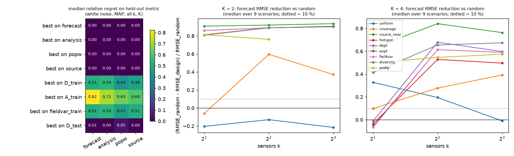
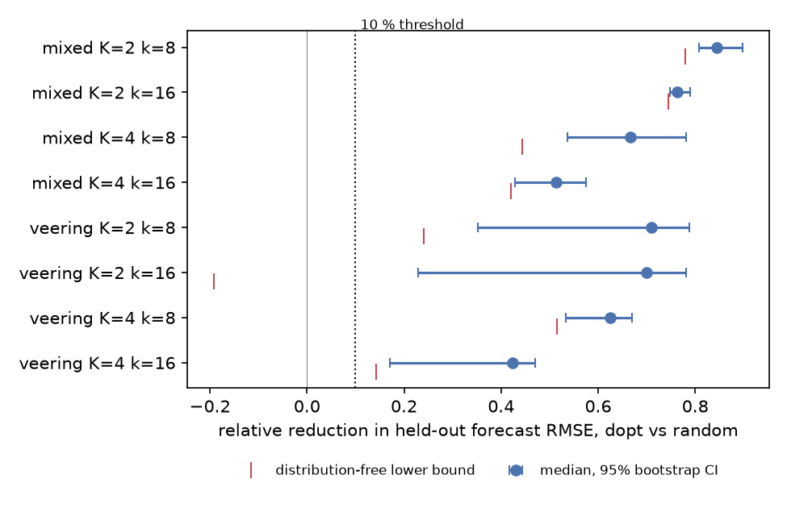
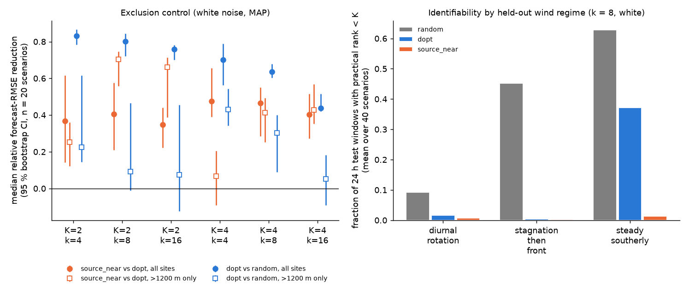

# E07 Cross-objective placement on held-out winds

Simulated passive tracer only; nothing here is evidence about ambient PM2.5, real sources or deployment.

**Question (plan 2).** Which placement objective is best for which held-out inference task (forecast, analysis field,
source strengths, population-weighted field)? The plan's hypothesis was that no single network wins on all of them.
**Confirmatory test (protocol §12):** does the D-optimal network (`dopt`) reduce held-out one-step forecast RMSE by
≥ 10 % relative to random networks, for k ≥ 8?

**Evidence label.** 32² pilot: exploratory. 64² sweep, dopt vs random: **confirmatory, supported in the cells run**
(scope pending user sign-off). Everything else in the sweep (source_near vs dopt, mechanism, endpoint agreement):
exploratory.

**Evidence.** Design note `docs/research/cross-objective-design.md` (committed in 3e7d4d2 before any E07 computation;
deviations in its §12); tables `tables/e07-local-*` and `tables/e07-sweep-*`; audit
`docs/research/gates/gate-07-cross-objective.md` (with check scripts); journal `state/experiments/e07.md`. Report-only
summaries below are produced from the committed sweep tables by `scripts/report_e07.py`.

## What we did

- **Designs** (see [Methods](00-methods.qmd)): random (10 networks), uniform, coverage, source_near (locations-only
  control), hotspot, dopt (greedy Bayesian D + 1-swap), diversity and podqr in the sweep; the pilot also had aopt and
  fieldvar. Each design declares what it knows and sees **training hours only** (gate-06 condition 1); the POD archive
  comes from a prior ensemble of strengths, not the truth.
- **Training winds:** `veering`, or `mixed` (steady westerly, veering, weak/variable); the pilot also had an exactly
  `constant` westerly. **Test winds are always held out:** steady southerly, stagnation then front, diurnal rotation.
- **Estimator and score:** MAP over a 24 h window ending at each issue time, then a one-hour forecast with the known
  wind, scored against the noise-free truth over 425 test issue times (64²). Noise arms: white (primary), AR(1) ρ = 0.8,
  per-site σ. R = 5 paired noise draws per arm.
- **32² local pilot:** upwind, dt 300 s, shortened 4/1/6-day calendar, K ∈ {2, 4}, k ∈ {2, 4, 8}, seeds 0–2; 18/18
  scenarios (commit e3f7de0).
- **64² HPC sweep:** split VanLeer, dt 30 s (A2), protocol calendar, K ∈ {2, 4}, k ∈ {4, 8, 16}, seeds 0–9, 2 training
  winds: 40/40 scenarios, Slurm job 204894, code dd2c51c, ~12 h on 64 CPUs. This is a **user-requested scope cut**
  (design-note deviation 6, decided before any 64² run): K = 8, k = 32 and seeds 10–19 were not run.

## Pilot (32², exploratory)

{#fig-e07-pilot}

- Optimised designs beat random by a median 0.6–0.9 forecast-RMSE reduction, except at K = 4, k = 2. Uniform layouts
  are worse than random.
- The locations-only `source_near` beat `dopt` in 44 of 54 (scenario, k) pairs, by 27–48 % at k ≥ 4.
- The network best on forecast was also best on field, source and population-weighted error (median cross-endpoint
  regret 0).
- Choosing the network by training-wind D gives a median forecast regret of 0.51; choosing by D on the test winds,
  0.006.
- AR(1) and per-site arms gave the same ordering; NNLS was within ~0.05 of MAP. `podqr` was undefined in 36 of 162 cases.
  Where spacing binds, greedy was exact in 29/36 blocks, greedy + swap in 34/36.

Lead decisions before the sweep: `dopt` stays the confirmatory network (re-designating `source_near` after seeing the
pilot would have been outcome-driven); A2 numerics; no wind-robust arm (that is E15's question).

## 64² sweep: confirmatory result



{#fig-e07-confirm}

**Verdict.** In the 64² synthetic sweep (K ∈ {2, 4}, k ∈ {8, 16}, training winds veering or mixed, 10 seeds per cell,
white noise, MAP with a 24 h window), the D-optimal network reduced held-out one-step forecast RMSE relative to the mean
of 10 random networks by a median of **42–84 % per cell**. The 95 % bootstrap CI lay above 10 % in **8/8 cells**, so the
preregistered hypothesis is **supported in the cells run**. With distribution-free intervals it is supported in 7/8
(veering K = 2, k = 16 straddles because dopt lost to random in 2 of 10 seeds); with a bootstrap of the mean, 8/8.
K = 8 and k = 32 were **not run**; by the protocol's own rule those cells are unresolved, so at protocol level the verdict
is "supported in the run cells, unresolved overall" unless the user confirms the reduced cell set as the confirmatory
population (gate-07 issue 1, open). **A locations-only control placing sensors next to the known sources did better
still, so the gain over random is attributable to knowing source locations, not to D-optimisation.**

## 64² sweep: exploratory results

{#fig-e07-sweep}

### Sensors next to the sources beat D-optimisation



- `source_near` beats `dopt` in 115/120 paired (scenario, k) comparisons with white noise (110 with AR(1), 118 with
  per-site σ), in all 20 source layouts, by a median relative margin of ≈ 0.4 (gate-07: IQR 0.23–0.60; bootstrap CI over
  layouts 0.28–0.56). At scenario level source_near is better at every k in 36/40 (white), 31/40 (AR(1)), 39/40
  (per-site). Pairs share layouts and test winds, so pooled-pair p-values are not quoted. This contrast was not
  preregistered.

### Mechanism: per-window rank loss under an unseen wind

Field checks on two scenarios (gate-07, `veering:2:7` and `mixed:4:9`):

- dopt networks have no rank-deficient 24 h windows during training but 17.6 % in the test period; all 75 deficient
  windows fall in the held-out **steady southerly** blocks — a direction never seen in training. source_near has none.
- Those windows carry 97.5 % (veering:2:7) and 37 % (mixed:4:9) of dopt's squared forecast error.
- Sweep-wide (table above), dopt has at least one deficient test window in 30/40 scenarios at k = 8 against 7/40 for
  source_near.
- Whole-period information criteria miss this: D on the test winds favours source_near in only 35/120 cases, and
  selecting by D_test still costs a median forecast regret of 0.37.

Reading (inference): designs tuned to the training winds do not transfer to an unseen wind direction, while sensors at
the sources stay informative whatever the wind. The evidence rests on **one** unseen direction, and the window analysis
covers 2 scenarios in detail.

### Endpoint agreement is close to built in

The network best on forecast is also best on source, analysis and population-weighted error (forecast-best equals
source-best in 116/120; median off-diagonal regret 0). But all four endpoints are functions of the same static estimate
under a perfect model and constant sources, so agreement is expected; it is weak evidence about the plan's
"no single network wins" hypothesis and must not be stated as a general finding.

### Other checks

- **Leakage:** designs rebuilt with every non-training hour set to NaN give the committed sites; forecast scores were
  reproduced to 5 digits by an independent implementation.
- **VanLeer superposition (A2):** the max superposition error over the full calendar is a median 0.038 µg m⁻³ and
  0.183 at worst (0.73σ at a single cell-hour), ~27× the 96 h figure quoted in A2; re-scoring on a perfectly linear
  truth changed RMSE by ≤ 1e-4 and kept the ordering.
- **Greedy optimality:** greedy + swap is exact in 146/160 block checks (greedy alone 91/160); hotspot has higher D_train
  than dopt in 10/120 cases. This does not affect the comparison (source_near never has the highest D_train).
- **podqr** was undefined in 1 (k = 8) and 3 (k = 16) of 40 scenarios per arm — fewer than the design note predicted.

## Audit outcome (gate-07): pass with conditions

Numbers reproducible, no leakage, confirmatory rule implemented faithfully. Conditions concern what the results may be
said to show:

1. **Scope:** state the verdict as "supported in the 8 cells run"; the user must confirm the reduced cell set (open).
2. **Credit:** every statement of the confirmatory result carries the source_near caveat.
3. **Mechanism:** per-window rank loss under one unseen wind direction; make it sweep-wide from cached fields.
4. **Artefact risk:** source_near's sites (456–643 m from source centres) sit inside the 1200 m truncated emission disc
   (σ = 400 m), where they see local emission under any wind. With every site within 1200 m excluded, source_near still
   won in the two scenarios checked (k = 8: 0.043 vs 0.203 and 0.115 vs 0.229).
5. **Statistics:** percentile bootstrap of a median at n = 10 is anti-conservative; report the distribution-free and
   mean variants (done above).

## What changed because of the audit

The confirmatory table now carries the distribution-free and mean-bootstrap variants; the verdict wording is the
gate's; the A2 decision file was updated with the full-calendar superposition error; the source_near contrast is
labelled exploratory and pooled p-values were dropped.

## Follow-up controls (post hoc, exploratory; all 40 scenarios, no new solves)

These two analyses were prompted by gate-07. They re-use the cached 64² fields and change no confirmatory number.
Evidence: `tables/e07-followup-*.csv`; code `scripts/e07_followup.py` and the driver's `--exclude-radius` option.

**1. Sensors kept out of the emission discs.** All candidate sites within 1200 m of any source centre were removed,
which is the 3σ truncation radius of the area source. That leaves 152–188 of about 195 candidates, and every design
was rebuilt on the reduced set.

- **Near-source still beats D-optimal.** Median advantage 0.375 (95 % CI 0.31–0.45; distribution-free 0.31–0.46),
  104/120 pairs, 19/20 source layouts. Without exclusion it was 0.41, 115/120, 20/20. The exception is the sparsest
  cell (K = 4, k = 4), where the two are indistinguishable.
- **But D-optimal's gain over random shrinks sharply,** from 0.71 to **0.20** (CI 0.15–0.33; 87/120). On the reduced
  candidate set no cell clears the 10 % confirmatory threshold, so the exclusion version of the test is unresolved.
  Much of D-optimal's margin came from sites inside or next to the emission discs. The confirmatory verdict above
  stands for the protocol's candidate set only.

**2. Where identifiability is lost.** This is the fraction of 24 h test windows in which a k = 8 network cannot
separate all sources (practical rank < K):

| Held-out wind regime | D-optimal | near-source | random |
|---|---|---|---|
| steady southerly (absent in training) | 0.37 (28/40 scenarios) | 0.01 (3/40) | 0.63 |
| stagnation then front | 0.005 | 0.002 | 0.45 |
| diurnal rotation | 0.017 | 0.007 | 0.09 |

- Pooled, 79 % of D-optimal's squared forecast error falls in such windows (per-scenario median 55 %); for
  near-source the share is 6 %.
- The loss is a signal-to-noise effect, not a structural one: exact rank is full for k ≥ 8.
- Gate-07's 2-scenario finding therefore generalises. D-optimal networks tuned to training winds go blind mainly when
  the unseen southerly wind blows. This is still one unseen direction, and 12/40 scenarios show no such loss.

{#fig-e07-followup}

## Limitations

- Perfect model: known wind, known source locations, constant sources, known background; the estimator uses the truth's
  solver.
- Sensors may sit inside the 400 m-σ area-source footprint; point sources were not studied.
- One unseen wind direction (southerly) drives the mechanism; a 24 h estimator window only.
- 10 seeds per cell; cells are not independent (two training-wind arms share layouts, test winds and noise seeds).
- σ ≈ 0.25 ≈ 0.05·c_bg is effectively a fixed instrument noise, and near-source SNR is ~50–80, which is why the per-site
  arm changes little.
- The forecast is from a static inverse, not a filter; calibration endpoints are deferred to E09.
