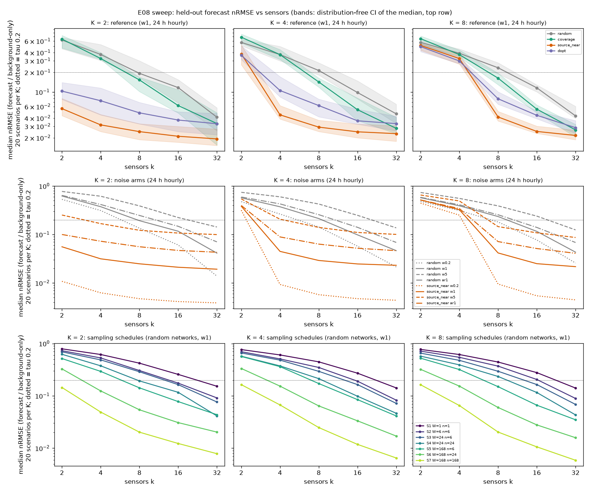
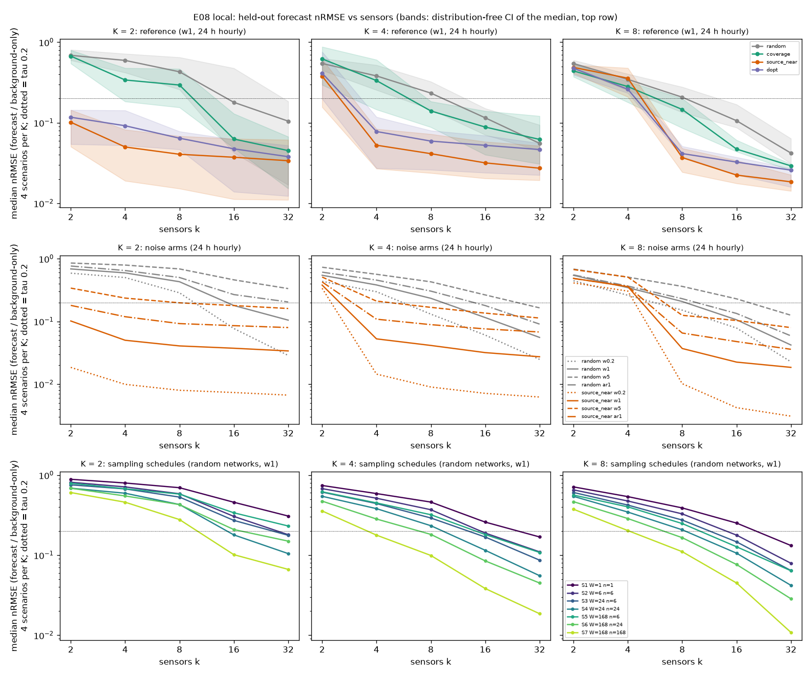

# E08 Sensor sufficiency

Simulated passive tracer only; nothing here is evidence about ambient PM2.5 or real deployment.

**Question (plan 2).** How do sensor count k, number of sources K, noise level, sampling cadence and observation span
interact? For each setting, what is the smallest network that is "sufficient"?

**Evidence label.** 64² sweep (cluster job 205039, 20 scenarios per K): the five preregistered tests form one Holm
family; everything else is exploratory. The 32² pilot (4 scenarios per K) is indicative only. The stage-2 reruns were
audited in gate-12-17; the main H1–H5 tests were not independently re-run.

**Evidence.**
- Design note: `docs/research/sufficiency-design.md`, committed alone before any E08 computation. Hypotheses H1–H5 come
  from E05 and E07; lead decisions are in §13.
- Tables `tables/e08-sweep-*` and `tables/e08-local-*`; journal `state/experiments/e08.md`.

## Design

- **Scenario:** (K, seed) under the protocol's mixed training wind. K ∈ {2, 4, 8}.
- **Factors:** k ∈ {2, 4, 8, 16, 32}; white noise at 0.2×, 1× and 5× the protocol σ, plus AR(1); seven sampling
  schedules that separate span from reading count. These include exact matched-budget pairs: k sensors × 24 readings
  against 4k sensors × 6.
- **Strategies:** random, coverage (no source knowledge), near-source and D-optimal.
- **Breakpoint k\*(τ):** the smallest k from which held-out forecast nRMSE (relative to background-only) stays ≤ τ.
  The headline is τ = 0.2.
- **64² sweep:** 20 seeds per K. It reuses 78 of E07's cached simulations and adds 256 new ones.
- **Scope:** the K = 8 and k = 32 protocol cells that E07 left unrun are reported as secondary. E07's approved
  confirmatory scope is unchanged.

## 64² sweep results

{#fig-e08-sweep}

| Median k\*(0.2) | K = 2 | K = 4 | K = 8 |
|---|---|---|---|
| near-source | 2 | 4 | 8 |
| D-optimal | 2 | 4 | 8 |
| coverage | 8 | 8 | 8 |
| random | 8 | 16 | 16 |

**Preregistered tests (Holm family):**

| Hypothesis | Unit | Result | Verdict |
|---|---|---|---|
| H1: D-optimal k\* larger at K = 8 than at K = 2 | 20 seeds | 19 wins, 0 losses, 1 tie | supported |
| H2: 5× noise hurts random more than near-source (k = 8) | 60 scenarios | 0 / 60 | **contradicted** |
| H3: D-optimal's 24 → 168 h span gain is larger in southerly hours (k = 8) | 60 scenarios | 60 / 60 | supported |
| H4: 4k × 6 readings beat k × 24 (random, W = 168 h, k = 2 → 8) | 60 scenarios | 58 / 60 | supported |
| H5: near-source beats D-optimal (k = 8, 40 fresh scenarios) | 40 scenarios | 39 / 40 | supported |

- **Location knowledge sets the requirement.** Location-aware designs reach τ = 0.2 with about as many sensors as
  sources. Location-blind designs need 8–16 sensors whatever K is.
- **Noise (H2 reversed).** Near-source designs lose more in *relative* terms when noise rises fivefold. Their error
  starts very low, so they remain far better in absolute terms.
- **Span and readings.** For random networks, more sensors beat more readings at every budget tested. For location-aware
  designs this flips at large k: once the sources are covered (k = 8 → 32), extra readings per sensor beat extra
  sensors (near-source 0/60, D-optimal 5/60 at W = 168 h). Near-source also gains from a longer span, contrary to H3's
  secondary prediction.
- **Protocol cells left unrun by E07 (secondary).** D-optimal cuts error against random by at least 10 % in 8 of 9
  cells (K = 2, 4, 8 × k = 8, 16, 32). The exception, K = 4 with k = 32, straddles the threshold. These cells were not
  added to E07's confirmatory set.

### Follow-up: all past data, and no sites near the sources (64², exploratory)

These reruns were declared in advance and reuse the stored 64² simulations (cluster job 205394).

| Median k\*(0.2), K = 2 / 4 / 8 | 24 h window (reference) | sites within 1200 m excluded | all past data |
|---|---|---|---|
| near-source | 2 / 4 / 8 | 4 / 8 / 8 | 2 / 2 / 2 |
| D-optimal | 2 / 4 / 8 | 4 / 8 / 16 | 2 / 2 / 2 |
| coverage | 8 / 8 / 8 | 12 / 8 / >32 | 2 / 2 / 2 |
| random | 8 / 16 / 16 | 16 / 24 / >32 | 2 / 2 / 2 |

- **With all past data, sufficiency at τ = 0.2 becomes trivial.** Every strategy gets there with 2 sensors for every K.
  This is a genuine floor effect, not leakage (gate-12-17 checked causality exactly). It depends on the benchmark's
  constant emissions over 60 days and a perfect transport model. E10, E12 and E13 each remove most of the memory gain.
- **H5 reverses with memory.** At k = 8 on the 40 fresh scenarios, D-optimal beats near-source in 36 of 40 cases
  (the 24 h window gave 39 of 40 the other way). This replicates gate-09's E07 finding on new scenarios.
- **Without in-footprint sites, about twice as many sensors are needed.** Near-source still beats D-optimal (34 of 40
  at k = 8), by a smaller margin.

## Pilot results (32², exploratory)

{#fig-e08-pilot}

| Median k\*(0.2) | K = 2 | K = 4 | K = 8 |
|---|---|---|---|
| near-source | 2 | 3 | 8 |
| D-optimal | 2 | 4 | 8 |
| coverage | 12 | 8 | 8 |
| random | 24 | 12 | 16 |

- **Location knowledge sets the requirement.** Location-aware designs need about as many sensors as sources; random
  layouts need 12–24.
- **Span and sensor count beat reading density.** For random networks at K = 4, k = 8, nRMSE is 0.46 for a snapshot,
  0.23 over 24 h and 0.10 over 168 h. At equal total readings, 4k sensors × 6 readings beat k × 24 in 11 of 12 scenarios.
- **H2 reversed in the pilot.** Near-source is more noise-sensitive in relative terms, though far better in absolute
  terms. The preregistered test is unchanged.
- **H3** is inconclusive. **H5** (near-source beats D-optimal): 10 of 12 scenarios at k = 8.

::: {.callout-warning}
## Estimator-memory caveat (gate-09)
E08 uses windowed estimators (windows of 1–168 h). Gate-09 showed that strategy orderings flip between short and
unlimited estimator memory (see the E07 and E09 chapters). E08's strategy comparisons, H5 especially, therefore hold
for windowed estimators only. The all-past-data rerun above confirms this: H5 reverses.
:::
