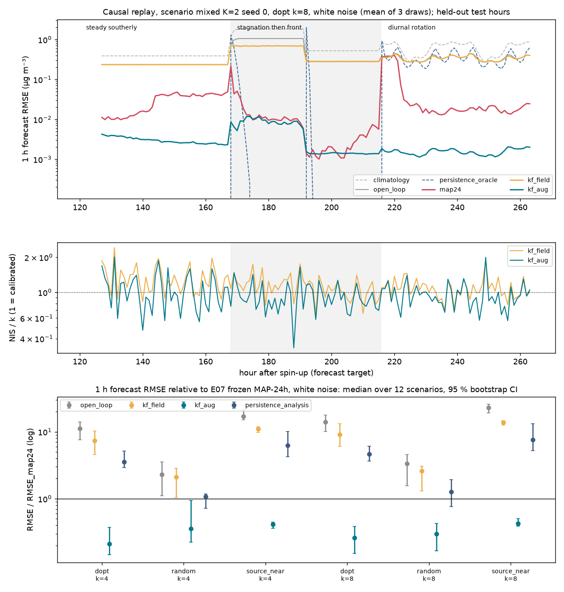

# E09 Causal sequential filtering

Simulated passive tracer only; nothing here is evidence about ambient PM2.5 or real deployment.

**Question (plan 2).** Does a causal sequential filter (Kalman filter) of the concentration state, using only data up
to each forecast time, improve held-out forecasts over E07's one-shot 24 h estimator? Are its uncertainties calibrated?

**Evidence label.** Exploratory: 32² with the upwind operator, 12 scenarios from the E07 pilot world. Independently
audited (gate-09: pass with conditions).

**Evidence.**
- Design note `docs/research/filter-design.md`, committed before any code.
- Code `src/pravah/filter.py` and tests `tests/test_filter.py`.
- Tables `tables/e09-local-*`; audit `docs/research/gates/gate-09-filter.md`.

## What we did

- **Hour-to-hour transition:** the linear operator of the FiPy upwind step, recovered by probing the solver and
  checked against fresh probes.
- **Field-only filter (`kf_field`):** corrects the concentration field only.
- **Augmented filter (`kf_aug`):** estimates the field and the constant source strengths jointly.
- **AR(1) variant (`kf_aug_ar1`):** adds sensor-error states for correlated noise.
- **Baselines:** E07's frozen 24 h-window MAP (`map24`), the open-loop model, persistence and climatology.
- **Tests:** against independent references (a scalar case, equivalence with the batch posterior, causality, missing
  sensors, NEES and NIS on a perfect-model Monte Carlo).

## Results

{#fig-e09-traces}

- **Memory is what matters.** With a perfect model, `kf_aug` is exactly the batch MAP over all past data. It cuts
  1-hour forecast error by a median 58–74 % against `map24` (10–12 of 12 scenarios per design), and by 77–91 % at 24 h.
  Gate-09's 2×2 control attributes a median 0.99 of the log-RMSE gain to using all past data. The prior adds
  essentially nothing.
- **Correcting the field alone is almost useless.** `kf_field` beats open loop only at 1 h and is 1.6–13× worse than
  `map24`. Corrections leave a 10 km domain with the wind within hours, so forecast skill comes from estimating the
  persistent sources.
- **Calibration:**
  - Under white noise, `kf_aug` is calibrated: 50/80/95 % coverage of 0.50/0.82/0.97. At 64² with all past data, 95 %
    coverage is 0.95.
  - Under AR(1) noise it is overconfident: 95 % coverage 0.48. The usual NIS check misses this; lag-1 innovation
    autocorrelation (0.80) catches it.
  - Modelling the correlated noise (`kf_aug_ar1`) restores calibration (0.945) and beats `map24` in 12 of 12 scenarios.
- **Consequence for placement (64²):** with all past data, D-optimal beats near-source in 103/120 E07 pairs, reversing
  E07's 24 h-window ordering (see the E07 chapter).

## Limits and what carries forward

- 32² only, with the upwind operator. VanLeer, the 64² scheme, is non-linear and has no exact Kalman operator.
- At 64², the planned baseline is the growing-window MAP on cached unit responses, which is equivalent to `kf_aug`.
  An ensemble filter is used only where process noise or model error is needed.
- **E10** reuses the augmented filter; **E11** reuses the causal scorer. Because the covariance recursion does not
  depend on data, a design's forecast-variance trace can be computed before any data exists, which gives a
  training-only forecast-placement objective.
- **Estimator memory, or assumed source persistence, is a declared factor in E10 and E11.**
