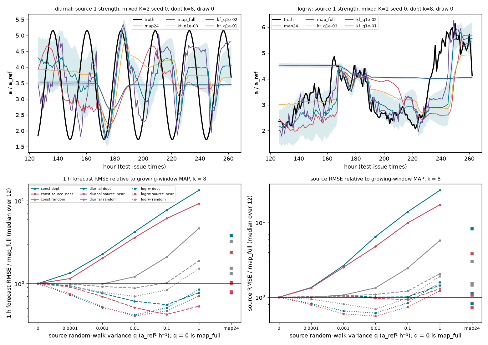

# E10 Joint source–field sequential inference

Simulated passive tracer only; nothing here is evidence about ambient PM2.5 or real deployment.

**Question (plan 2).** When source strengths change over time, does a filter that lets them drift (a random walk with
variance q) beat the all-past-data estimator? Are its uncertainties calibrated?

**Evidence label.** Exploratory: 32² with the upwind operator, 12 scenarios. These come from only 6 independent
clusters. Independently audited (gate-10/11: pass with conditions).

**Evidence.**
- Design note `docs/research/joint-assimilation-design.md`, committed before any code.
- Driver `scripts/e10_joint.py`; filter code `src/pravah/filter.py`.
- Tables `tables/e10-local-*`; journal `state/experiments/e10.md`; audit `docs/research/gates/gate-10-11.md`.

## What we did

- **Augmented filter:** source strengths follow a random walk of variance q. q = 0 is the all-past-data MAP
  (`map_full`), so q is the declared memory factor.
- **Truths:**
  - constant strengths;
  - a diurnal cycle (protocol §4);
  - a log random walk (exploratory).
- **Selecting q:** `kf_qsel` picks q on validation blocks only.
- **Nonnegativity:** `nonneg_mode` reports the truncated-Gaussian posterior mode.

## Results

{#fig-e10-traces}

- **Constant truth: q = 0 is best.** Validation picks q = 0 in 157 of 216 cases. Forecast error grows with q, at least
  for informative designs.
- **Time-varying truth: the gain is real but short-range.** At k = 8, the validation-selected filter cuts 1 h forecast
  RMSE by 0.24–0.55 against `map_full`, and by 0.30–0.42 against a MAP whose window was tuned on validation.
  - Under the diurnal truth it is 12–15 % *worse* than `map_full` at 6 h: the random walk carries a lagged strength
    forward.
  - It never improves source-strength RMSE.
- **Calibration.**
  - Under time-varying truth, `map_full` is badly overconfident (95 % coverage 0.09–0.25).
  - The filter is calibrated (0.91–0.98) only when q matches the truth.
  - With q > 0 under constant truth, the bands are too wide (above 0.99).
  - Coverage for the validation-selected q was not computed.
- **Placement × memory.** Under constant truth, the strategy ordering depends on memory, as E09 found. Under
  time-varying truth, near-source is as good or better at every q. D-optimal beats random under every estimator.
- **Nonnegativity.** Weak designs produce negative mean strengths in up to 46 % of rows. Enforcing nonnegativity never
  increased error.

## Limits

- The time-varying truths come from the filter's own model, which favours the filter.
- There is no ensemble filter, AR(1) noise or background confounding (E13 covers background).
- n = 6 independent clusters.
