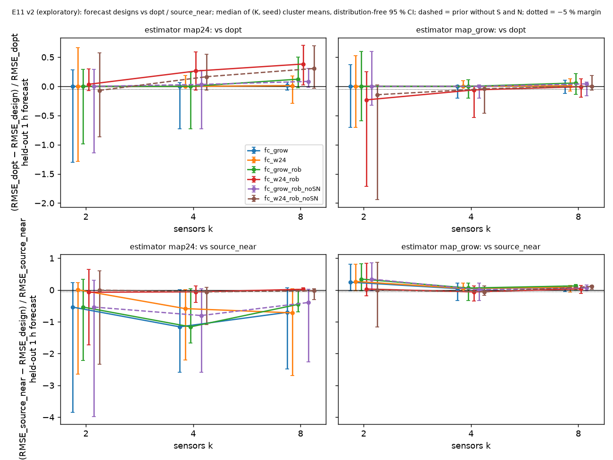

# E11 Placement optimised for causal forecasting

Simulated passive tracer only; nothing here is evidence about ambient PM2.5 or real deployment.

**Question (plan 2).** Does a placement chosen to minimise *expected forecast variance* beat D-optimal and near-source
placement for held-out forecasts?

**Evidence label.** Exploratory: 32², 12 scenarios forming 6 clusters. Audited (gate-10/11: pass with conditions).
The 64² run (cluster job 205282) was running when this chapter was written.

**Evidence.**
- Design note `docs/research/forecast-design-placement.md` (addenda A1–A5).
- Code `src/pravah/experiments/forecast_design.py`, driver `scripts/e11_forecast_design.py`.
- Tables `tables/e11-local-*` and `tables/e11-local-v2-*`; journal `state/experiments/e11.md`.

## What we did

- **Objective:** the expected multi-horizon forecast variance tr(Q Σ(S)). The covariance recursion does not depend on
  data (E09), so the objective needs no measurements.
- **Two memories:** a 24 h window (`fc_w24`) and all past data (`fc_grow`).
- **Wind-robust versions (`_rob`):** average the objective over a prior of 8 compass wind directions.
- **Out-of-sample prior (`noSN`):** drops the two test directions, south and north.
- **Optimiser:** greedy + swap with multiple starts.
- **Scoring:** both estimators, on held-out winds.

## Results

{#fig-e11}

- **No single design wins under both memories.**
  - Under the 24 h estimator at k = 8, the wind-robust forecast design beats D-optimal (+0.38, 6/6 clusters,
    p = 0.031).
  - Under the all-past-data estimator it is worse than D-optimal (−0.13).
- **About 40 % of the gain was in-sample.** With the test directions removed from the prior, the gain over D-optimal
  falls to +0.31 [−0.03, 0.70] (5 of 6 clusters). That is not significant, and non-inferiority to near-source is lost.
  All Holm-adjusted p = 1.0 at n = 6.
- **Holds only at k = 8.** At k = 2 and 4 the gain does not survive at cluster level.
- **The non-robust forecast objectives mostly reproduce D-optimal**, with the same sites in 50–64 % of cases.
- **Predicted vs realised error.** The objective's predicted RMSE is miscentred because the prior assumes a smaller
  E[a²] than the truth. With the declared prior's second moment it over-predicts instead (median ratio 0.80).

## Limits and what carries forward

- Greedy + swap is a local optimum: it misses the exhaustive optimum in 12 of 48 small cases.
- The robust prior is a choice, and it decides how much "robustness" the design buys. E15 tests this directly.
- The 64² run reuses E07's cached fields with per-direction prior blocks.
