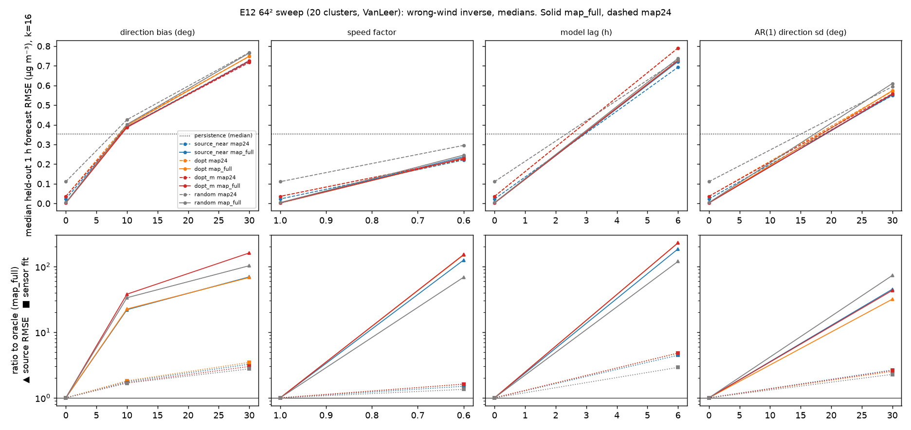

# E12 Wind mismatch

Simulated passive tracer only; nothing here is evidence about ambient PM2.5 or real deployment.

**Question (plan 3).** How do errors in the wind given to the inverse model affect source estimates and forecasts? Can
wrong source strengths absorb wind errors and still fit the sensors?

**Evidence label.** Exploratory pilot: 32², upwind operator, 6 clusters, k = 2/4/8. Audited (gate-12-17: pass with
conditions; claims below corrected). The 64² sweep (20 clusters) is reported at the end of this chapter; it confirms
the pilot's conclusions, with one change: compensation is less hidden at 64².

**Evidence.**
- Design note `docs/research/wind-mismatch-design.md`.
- Code `src/pravah/uncertainty.py`, driver `scripts/e12_wind_mismatch.py`.
- Tables `tables/e12-local-*`; journal `state/experiments/e12.md`.

## What we did

- **Truth** always uses the true wind. The inverse and the forecast use a perturbed wind:
  - direction bias of +10° or +30°;
  - speed × 0.8 or × 0.6;
  - a 2 h or 6 h timing lag;
  - AR(1) direction noise with sd 15° or 30°.
- **Oracle branch:** uses the true wind.
- **Isolation check:** tests confirm the inverse never sees the true wind outside the oracle.

## Results

::: {.callout-note}
## "Persistence" here is an oracle bound (gate-12-17)
The persistence baseline carries the *true* field at hour t to t + 1 in every grid cell. No sensor network can do
that, so "worse than persistence" means worse than an unreachable bound, not worse than a naive forecast.
:::

{#fig-e12}

- **Forecast skill collapses quickly.** Direction errors of 30° or more, a lag of 2 h or more, and AR(1) noise with
  sd 30° all make the 1 h forecast worse than persistence (0/6 clusters). A +10° error is about level with
  persistence. Underestimating the speed keeps skill (6/6).
- **Source–transport compensation.**
  - Source RMSE rises 1.6–16×.
  - The fit stays near perfect (ratio 1.01–1.33) only for speed errors, +10° and AR 15°: that is where compensation is
    deceptive. For a 30° direction error, a lag or AR 30°, the fit ratio rises to 1.6–4.3 and does warn.
  - Speed errors bias the strengths low (−15 % for × 0.8, −32 % for × 0.6).
  - 95 % coverage of the strengths collapses to 0.00–0.54.
  - The fit looks good while the answer is wrong: 298 "deceptive fit" cells.
- **Warning sign.** Lag-1 innovation autocorrelation rises to 0.13–0.89. It stays weak for speed × 0.8.
- **Memory.** The large gain from using all past data (+0.6 to +0.77 with the true wind) mostly vanishes under any wind
  error.
- **Placement.** Under the wrong wind, D-optimal and near-source are within a few per cent of each other. Rankings
  built on ratios flip with memory, but that is an artefact of the denominator.

## Limits

- Pilot: n = 6, upwind numerics and a short calendar. The 64² sweep (n = 20) is not yet audited.
- The persistence baseline was added after seeing results.
- The 64² sweep used five of the eight wind errors.

## 64² sweep (2026-11-17)

**Evidence label.** Exploratory, 64², split VanLeer (A2), 20 clusters (K = 2/4 × 10 seeds), k = 4/8/16, five wind
errors (+10°, +30°, speed × 0.6, 6 h lag, AR(1) 30°) plus the true wind. Run under job 205982 (node004, 64 CPUs,
19.9 h, ≈ 1,290 CPU-h of new solves; code d8c007b). Not yet independently audited. Tables `tables/e12-sweep-*`.

{#fig-e12-sweep}

- **Forecast skill (vs the persistence bound).** +30°, a 6 h lag and AR 30° are worse than persistence in **0/20**
  clusters for every design, estimator and k (median skill −0.6 to −1.5). +10° is level (about 10/20 for informed
  networks; random 0–8/20). Speed × 0.6 keeps skill with informed networks (20/20; skill +0.3 to +0.4 at k = 16).
  Same picture as the pilot.
- **Compensation is less hidden at 64².** The sensor-fit ratio to the true-wind run is 1.12–1.40 for speed × 0.6 and
  1.29–1.65 for +10° (pilot: 1.01–1.33), and 1.9–6.2 for the large errors. Source RMSE still grows faster than the
  fit in nearly every cell (H2 gap > 0, up to 20/20). 248 cluster-level "deceptive fit" cases remain (fit < 1.1 while
  forecast > 1.5×; speed 174, +10° 74).
- **Strengths.** Speed × 0.6 biases strengths −35 % to −53 % (pilot −32 %). 95 % coverage of the strengths falls from
  0.83–0.95 to 0.02–0.59.
- **Warning sign.** Lag-1 innovation autocorrelation is 0.08–0.31 for speed and +10°, 0.37–0.71 for the large errors
  (true wind ≤ 0.03).
- **Memory.** With the true wind, using all past data cuts 1 h forecast error by 89–97 % vs a 24 h window (20/20).
  Under every wind error the gain for informed networks is within ±0.1, and for speed × 0.6 memory *hurts* (−8 % to
  −16 % at k = 16, 15–17/20 clusters). Only random networks still gain. This is stronger than the pilot's "mostly
  vanishes".
- **Placement.** Under the wrong wind, D-optimal and near-source differ by 0–5 % in absolute forecast error, except
  speed × 0.6 with all past data, where D-optimal is 5–13 % better (18–20/20). Ratio-based robustness rankings still
  flip with memory (denominator artefact). Random networks are worse than D-optimal everywhere (0–1/20 wins).
- **Not run at 64²:** speed × 0.8, a 2 h lag and AR 15° (the pre-set sweep list `SWEEP_SPECS` has five errors).
