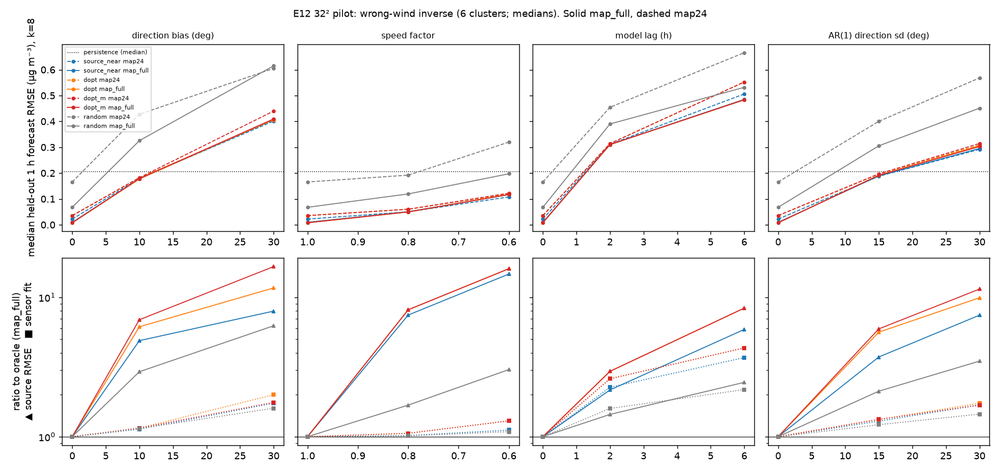

# E12 Wind mismatch

Simulated passive tracer only; nothing here is evidence about ambient PM2.5 or real deployment.

**Question (plan 3).** How do errors in the wind given to the inverse model affect source estimates and forecasts? Can
wrong source strengths absorb wind errors and still fit the sensors?

**Evidence label.** Exploratory pilot: 32², upwind operator, 6 clusters, k = 2/4/8. Not yet independently audited.
The 64² run is deferred.

**Evidence.**
- Design note `docs/research/wind-mismatch-design.md`.
- Code `src/pravah/uncertainty.py`, driver `scripts/e12_wind_mismatch.py`.
- Tables `tables/e12-local-*`; journal `state/experiments/e12.md`.

## What we did

- **Truth** always uses the true wind. The inverse and the forecast use a perturbed wind:
  - direction bias of +10° or +30°;
  - speed × 0.8 or × 0.6;
  - a 2 h or 6 h timing lag;
  - AR(1) direction noise with sd 15° or 30°.
- **Oracle branch:** uses the true wind.
- **Isolation check:** tests confirm the inverse never sees the true wind outside the oracle.

## Results

{#fig-e12}

- **Forecast skill collapses quickly.** Direction errors of 30° or more, a lag of 2 h or more, and AR(1) noise with
  sd 30° all make the 1 h forecast worse than persistence (0/6 clusters). A +10° error is about level with
  persistence. Underestimating the speed keeps skill (6/6).
- **Source–transport compensation.**
  - The sensor fit barely changes (residual ratio 1.02–1.3) while source RMSE rises 5–16×.
  - Speed errors bias the strengths low (−15 % for × 0.8, −32 % for × 0.6).
  - 95 % coverage of the strengths collapses to 0.00–0.54.
  - The fit looks good while the answer is wrong: 298 "deceptive fit" cells.
- **Warning sign.** Lag-1 innovation autocorrelation rises to 0.13–0.89. It stays weak for speed × 0.8.
- **Memory.** The large gain from using all past data (+0.6 to +0.77 with the true wind) mostly vanishes under any wind
  error.
- **Placement.** Under the wrong wind, D-optimal and near-source are within a few per cent of each other. Rankings
  built on ratios flip with memory, but that is an artefact of the denominator.

## Limits

- n = 6, upwind numerics and a short calendar.
- The persistence baseline was added after seeing results.
- The 64² plan is in the design note.
