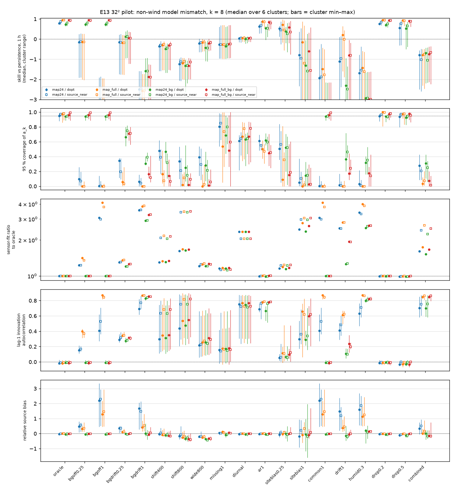

# E13 Background, source-basis and sensor-error mismatch

Simulated passive tracer only; nothing here is evidence about ambient PM2.5 or real deployment.

**Question (plan 3).** What happens when the assumptions about the background, the source shapes or the sensors are
wrong? Which errors can be repaired by estimating one extra term, and which can at least be detected?

**Evidence label.** Exploratory pilot: 32², 6 clusters, k = 8 shown. Audited (gate-12-17: pass with conditions; claims below corrected). The 64² run
(≈ 616 CPU-h) is deferred.

**Evidence.**
- Design note `docs/research/model-mismatch-design.md`.
- Code `src/pravah/model_mismatch.py`, driver `scripts/e13_model_mismatch.py`.
- Tables `tables/e13-local-*`; journal `state/experiments/e13.md`.

## What we did

- The inverse always uses the nominal model; only the world changes. There are 18 pre-declared mismatches:
  - **background:** an offset, and a drift over time;
  - **source basis:** a shifted source, a wider footprint, a missing source, and diurnal emission;
  - **sensors:** AR(1) noise, bias, drift, gain errors and outages;
  - a **combined** case.
- Each estimator also runs with an unknown background term (`_bg`).

## Results

::: {.callout-note}
## "Persistence" here is an oracle bound (gate-12-17)
The persistence baseline carries the *true* field at hour t to t + 1 in every grid cell. No sensor network can do
that, so "worse than persistence" means worse than an unreachable bound, not worse than a naive forecast.
:::

{#fig-e13}

- **A wrong background is fixable.** A +1 µg/m³ offset (4σ) destroys forecasts (skill vs persistence −3.5), biases the
  sources by +128 % and gives zero coverage. Estimating the background repairs this fully (skill +0.94, coverage 0.96,
  6/6). A drifting background is only partly repaired.
- **Silent failure.** At the sensors, a background offset and a bias common to all sensors look identical.
  - The background term fixes the offset but makes the common bias worse (skill −3.9).
  - Every diagnostic looks perfect: fit ratio 1.00, white innovations, coverage 0.96. Yet forecasts are far worse
    than persistence.
  - Telling the two apart needs outside information, such as a reference instrument or an upwind background site.
- **Wrong source assumptions are not fixable.** For a shifted source, a wider footprint or a missing source, no
  estimator beats persistence at k = 8. A shifted source does show in the residuals (fit ratio 1.3–3.5, lag-1
  0.30–0.82). A wide footprint or a missing source barely does (fit ratio 1.12–1.27).
- **Sensor errors.**
  - AR(1) noise leaves strengths unbiased, but coverage falls to 0.45–0.60. Lag-1 autocorrelation warns (0.78).
  - Random outages are benign, even at 50 % missing.
  - Per-site bias destroys coverage.
  - Under drift, all past data helps (+0.57 vs the 24 h window, 6/6).

## Limits

- The stress magnitudes are synthetic choices, and n = 6.
- The rule for field-level silent failure was added after seeing results. The audit found it flags 65 cells, 46 of which
  are already worse than persistence with the true wind. It needs a comparison against the true-wind run.
  The common-bias silent failure itself is structural and confirmed exactly.
