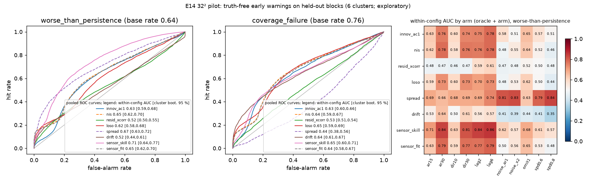
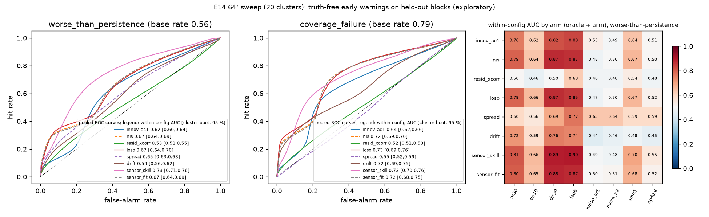
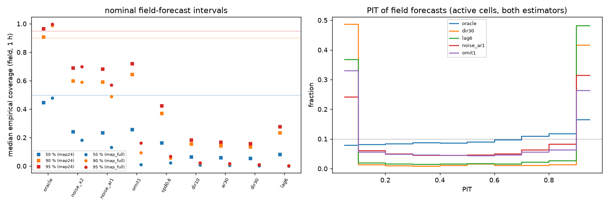

# E14 Reliability diagnostics

Simulated passive tracer only; nothing here is evidence about ambient PM2.5 or real deployment.

**Question (plan 3).** Can a method tell, without knowing the truth, when its own forecast or uncertainty is unreliable?

**Evidence label.** Exploratory pilot: 32², 6 clusters. The within-config AUC was added after seeing results (deviation
1). Audited (gate-12-17: pass with conditions; claims below corrected). A 64² sweep (20 clusters, unaudited) is at the end
of this chapter; it confirms the pilot and sharpens the intervals.

**Evidence.**
- Design note `docs/research/reliability-design.md`.
- Code `src/pravah/experiments/reliability.py`, driver `scripts/e14_reliability.py`.
- Tables `tables/e14-local-*`; journal `state/experiments/e14.md`.

## What we did

- **Diagnostics:** eight truth-free diagnostics, each computed from the data *before* each 24 h block. Tests confirm
  they are unchanged when all truth is replaced by NaN.
- **Failure labels:**
  - L1: the 1 h forecast is worse than persistence;
  - L2: 90 % coverage is below 0.70.
- **Thresholds:** chosen on validation blocks only.
- **Stresses:** E12's wind errors, plus doubled noise, AR(1) noise and an omitted source.

## Results

::: {.callout-note}
## "Persistence" here is an oracle bound (gate-12-17)
The persistence baseline carries the *true* field at hour t to t + 1 in every grid cell. No sensor network can do
that, so "worse than persistence" means worse than an unreachable bound, not worse than a naive forecast.
:::

{#fig-e14-roc}

{#fig-e14-cal}

- **Early warning works only moderately.** The best warning of forecast failure is the sensor skill over the previous
  day, with AUC 0.71 [0.64, 0.77]. It reaches 0.81–0.86 for large direction or timing errors. Spread, fit and NIS give
  0.63–0.65. For coverage failure, the best AUC is 0.63–0.65.
- **Calibration depends on the wind.** With the true wind, 90 % coverage is 0.91–0.995, but 50 % coverage is only
  0.44–0.47. With a wrong wind it collapses: 0.07 for a 30° direction error.
- **Failures nobody flags.**
  - A speed error of × 0.8 is undetectable (AUC 0.46–0.57).
  - An omitted source is only weakly flagged by any network (AUC ≈ 0.64 for NIS and lag-1; median NIS 1.1–1.2,
    lag-1 0.03–0.05). An earlier version reported clear detection by D-optimal and near-source networks (NIS ≈ 4,
    AUC 0.84–0.89), but those designs had been built knowing the omitted source; with that bug fixed (2026-11-16) the
    signal disappears.
  - NIS misses AR(1) noise. Lag-1 autocorrelation detects it (0.63 vs −0.03), but as a warning of forecast failure it is
    weak (AUC 0.58).

## Limits

- The 6 clusters are dependent.
- The within-config AUC was chosen after seeing results. It lowers the best score (0.74 to 0.71) rather than flattering it.
- Together with E13's silent failure, these results mean that truth-free checks cannot certify a map. They can only flag
  some failures.

## 64² sweep (2026-11-17)

**Evidence label.** Exploratory, 64² (E12 sweep fields; VanLeer), 20 clusters, k = 4/8/16, E12's five wind errors plus
noise × 2, AR(1) noise and an omitted source (with the 2026-11-16 design fix). 385,560 units. Job 206079 (node001,
code 7ddd45f); no new solves. Not yet independently audited. Tables `tables/e14-sweep-*`.

{#fig-e14-sweep-roc}

{#fig-e14-sweep-cal}

- **Early warning of forecast failure is still moderate.** Best is again the previous day's sensor skill:
  within-config AUC 0.735 [0.706, 0.758] (pilot 0.71 [0.64, 0.77]). NIS, fit and leave-one-site-out give 0.67;
  lag-1 0.62.
- **Coverage failure is easier to flag at 64²:** AUC 0.72–0.73 for NIS, fit, leave-one-site-out, drift and sensor skill
  (pilot 0.63–0.65).
- **By stress (within-config, forecast failure):** large wind errors (+30°, 6 h lag, AR 30°) 0.79–0.90; +10° 0.66;
  **speed × 0.6 0.50–0.55, i.e. undetectable**, as in the pilot. Noise × 2 and AR(1) noise do not cause detectable
  forecast failure (≈ 0.5), but their coverage failure is flagged (NIS/fit 0.75 for noise × 2, lag-1 0.76 for AR(1)).
  An omitted source gives 0.67–0.70 (0.70–0.74 for coverage), a little higher than the pilot's ≈ 0.64.
- **Calibration.** With the true wind, 90 % coverage is 0.91 (24 h window) and 0.99 (all past data); 50 % coverage is
  0.45–0.48. Under the wrong wind it collapses, and harder with all past data: +30° gives 0.13 vs 0.01; speed × 0.6
  0.37 vs 0.06.
- **Caveat.** In 4 blocks (0.9 % of evaluation units) the truth field does not change, so persistence error is exactly
  0 and every forecast is labelled a failure. The effect on the AUCs is at most about 1 %; not re-scored.
