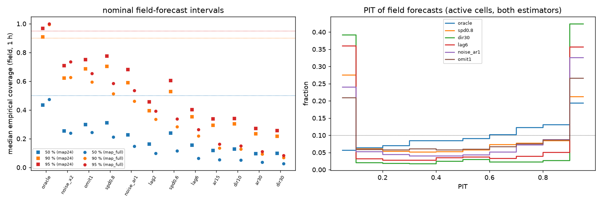

# E14 Reliability diagnostics

Simulated passive tracer only; nothing here is evidence about ambient PM2.5 or real deployment.

**Question (plan 3).** Can a method tell, without knowing the truth, when its own forecast or uncertainty is unreliable?

**Evidence label.** Exploratory pilot: 32², 6 clusters. The within-config AUC was added after seeing results (deviation
1). Not yet independently audited. The 64² run is deferred.

**Evidence.**
- Design note `docs/research/reliability-design.md`.
- Code `src/pravah/experiments/reliability.py`, driver `scripts/e14_reliability.py`.
- Tables `tables/e14-local-*`; journal `state/experiments/e14.md`.

## What we did

- **Diagnostics:** eight truth-free diagnostics, each computed from the data *before* each 24 h block. Tests confirm
  they are unchanged when all truth is replaced by NaN.
- **Failure labels:**
  - L1: the 1 h forecast is worse than persistence;
  - L2: 90 % coverage is below 0.70.
- **Thresholds:** chosen on validation blocks only.
- **Stresses:** E12's wind errors, plus doubled noise, AR(1) noise and an omitted source.

## Results

{#fig-e14-roc}

{#fig-e14-cal}

- **Early warning works only moderately.** The best warning of forecast failure is the sensor skill over the previous
  day, with AUC 0.71 [0.64, 0.77]. It reaches 0.81–0.86 for large direction or timing errors. Spread, fit and NIS give
  0.65–0.67. For coverage failure, the best AUC is 0.63–0.65.
- **Calibration depends on the wind.** With the true wind, 90 % coverage is 0.91–0.995, but 50 % coverage is only
  0.44–0.47. With a wrong wind it collapses: 0.07 for a 30° direction error.
- **Failures nobody flags.**
  - A speed error of × 0.8 is undetectable (AUC 0.46–0.57).
  - An omitted source gives overconfident blocks that no diagnostic flags: forecasts are about 4× worse than
    persistence, with NIS ≈ 0.8 and lag-1 ≈ 0.
  - NIS misses AR(1) noise, while lag-1 autocorrelation catches it.

## Limits

- The 6 clusters are dependent.
- The within-config AUC was chosen after seeing results.
- Together with E13's silent failure, these results mean that truth-free checks cannot certify a map. They can only flag
  some failures.
