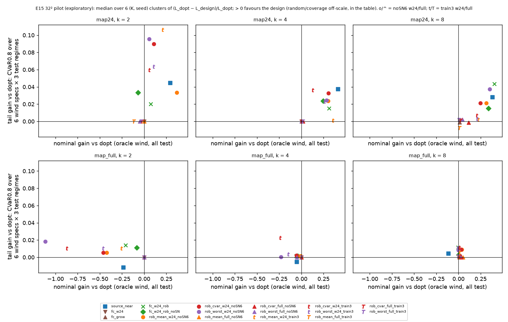
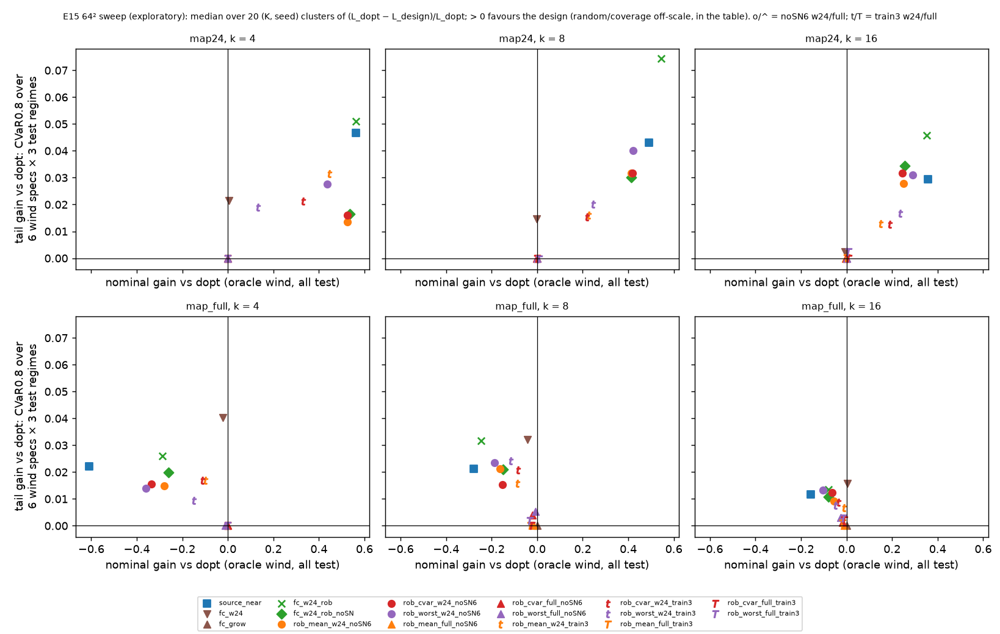

# E15 Robust placement over wind scenarios

Simulated passive tracer only; nothing here is evidence about ambient PM2.5 or real deployment.

**Question (plan 3).** Does choosing sites for the *average*, *tail* (CVaR) or *worst* case over an ensemble of wind
scenarios give networks that hold up better under wind errors and unseen regimes?

**Evidence label.** Exploratory 32² pilot: 6 clusters, upwind numerics, no multiplicity correction. Audited (gate-12-17:
pass with conditions). A 64² sweep (20 clusters, Holm-corrected, unaudited) is at the end of this chapter.

**Evidence.**
- Design note `docs/research/robust-placement-design.md`, committed before any computation.
- Code `src/pravah/experiments/robust_design.py` and `scripts/e15_robust_placement.py`.
- Tables `tables/e15-local-*`; journal `state/experiments/e15.md`.

## What we did

- **Loss per scenario:** for each 24 h wind scenario, the expected forecast error, normalised by the error with no
  sensors.
- **Criteria:** the mean, the CVaR at 0.8 and the worst case over the scenarios.
- **Two scenario ensembles, neither containing a test direction:**
  - six compass directions (N and S left out) × three speeds, plus veering days;
  - the training regimes only.
- **Two memories:** each design is built for the 24 h window or for all past data.
- **Scoring:** nominal 1 h forecast error, and the tail over 18 held-out conditions (6 E12 wind errors × 3 regimes).

## Results

{#fig-e15}

- **The tail gain is small.**
  - The largest gain is against D-optimal with 2 sensors and a 24 h window: about 9–10 % lower tail risk, 6 of 6
    clusters. This **cannot be told apart from chance**: of 648 tail contrasts, 9 came out 6/0, and about 10 would
    be expected by chance.
  - With 4 or 8 sensors it is 2–4 % and not resolved.
  - There is no gain over near-source.
- **Robustness costs nothing nominal with a 24 h window.** The robust networks behave like near-source networks there.
- **Memory decides again.**
  - Robust designs built for the 24 h window lose heavily when the estimator uses all past data.
  - Designs built for all past data score like D-optimal.
- **The criteria and ensembles behave about the same.** Mean, CVaR and worst case are indistinguishable.
- **Why the gain is small:** wind errors degrade every design by a similar amount (as in E12), which compresses the
  differences between designs.

## Limits

- n = 6, upwind numerics, and one training wind.
- Leaving N and S out of the ensemble was informed by the test set; this works against the robust designs.
- The optimiser finds local optima.
- The 64² sweep (design note §10) cost about 110 CPU-h after E12's 64² run.

## 64² sweep (2026-11-17)

**Evidence label.** Exploratory, 64² (split VanLeer), 20 clusters (K = 2/4 × 10 seeds), k = 4/8/16, R = 5. Tail scored
over E12's five 64² wind errors plus the true wind × 3 regimes. Job 206079 (node001, code 7ddd45f): 1,032 new
design-prior solves (≈ 102 CPU-h) plus ≈ 7 CPU-h of evaluation, reusing the E07 and E12 fields. Holm correction
within each pre-stated family (robust designs × tail metric × estimator × k = 144 contrasts per comparator). Not yet
independently audited. Tables `tables/e15-sweep-*`.

{#fig-e15-sweep}

- **The tail gain over D-optimal is real but small.** Designs built for the 24 h window lower tail risk (CVaR or worst
  case) by a median 1.6–2.8 % (up to 7 %). 3 of 144 contrasts survive Holm, all worst-case designs with 16 sensors and
  a 24 h window: 3–5 %, 19/20 clusters. Designs built for all past data give no tail gain (≈ 0).
- **No gain over near-source.** No robust design beats near-source on the tail. 25 of 144 contrasts are significantly
  *worse* than near-source (2–10 %, mostly designs built for all past data and scored with a 24 h window).
- **Memory decides again.** Built for the 24 h window, robust designs match near-source nominally (14–53 % better than
  D-optimal with a 24 h window) but lose up to 36 % when scored with all past data. Built for all past data, they
  behave like D-optimal.
- **Compared with the pilot:** the pilot's 9–10 % gain at k = 2 was indistinguishable from chance. At 64² with 20
  clusters, gains of 3–5 % are resolvable, but too small to matter next to the placement and memory effects above.
