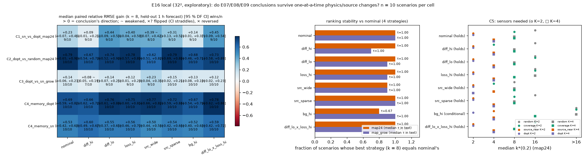

# E16 Generalization and ablation

Simulated passive tracer only; nothing here is evidence about ambient PM2.5 or real deployment.

**Question (plan 3).** Do the main conclusions survive changes in diffusion, removal, source shape and spacing, and
background level?

**Evidence label.** Exploratory 32² pilot: K = 2 and 4 × 5 seeds (n = 10 per cell), upwind numerics. The verdicts are
not corrected for multiplicity. The 64² run (about 2,760 CPU-h) is deferred. Audited (gate-12-17: pass; the
background cell's reuse of fields is exact).

**Evidence.**
- Design note `docs/research/generalization-ablations.md`, committed before any computation.
- Code `src/pravah/experiments/generalization.py` and `scripts/e16_generalization.py`.
- Tables `tables/e16-local-*`; journal `state/experiments/e16.md`.

## What we tested

Each cell changes one physical setting at a time. Every conclusion is scored on held-out 1 h forecast RMSE at k = 8.

| Conclusion | Comes from |
|---|---|
| C1: near-source beats D-optimal with a 24 h window | E07, E08 |
| C2: D-optimal beats random with a 24 h window | E07 (confirmatory) |
| C3: D-optimal beats near-source with all past data | gate-09, E08 rerun |
| C4: all past data beats a 24 h window | E09 |
| C5: location-aware designs need k\* ≤ K | E08 |

## Results

{#fig-e16}

| Median contrast at k = 8 (wins/10) | nominal | K ×20 (effective ×1.5 at 32²) | faster loss | wider sources | sparser sources | higher background |
|---|---|---|---|---|---|---|
| C1 near-source > D-opt, 24 h | +0.23 (9) | +0.09 (9) | +0.40 (9) | +0.39 (8) *weakened* | +0.31 (9) | +0.14 (9) |
| C2 D-opt > random, 24 h | +0.79 (10) | +0.67 | +0.78 | +0.62 | +0.79 | +0.68 |
| C3 D-opt > near-source, all past data | +0.14 (10) | +0.08 (7) *weakened* | +0.12 (9) | +0.23 (9) | +0.15 (10) | +0.13 (10) |
| C4 memory gain (D-opt) | +0.69 | +0.66 | +0.75 | +0.77 | +0.72 | +0.67 |

- **No change reversed any conclusion.**
- **Robust everywhere:** D-optimal beats random, and using all past data helps (10 of 10 in every cell).
- **The memory flip appears in every cell.** Near-source is best with a 24 h window, and D-optimal is best with all
  past data.
- **Weaker in some regimes:**
  - near-source's 24 h advantage shrinks when sources are wider;
  - D-optimal's all-past-data advantage shrinks with much stronger diffusion.
- **Conditional:** with a higher background, the protocol noise grows about 4×. Then k\* ≤ K holds in only 60–70 % of
  scenarios.

## Limits

- At 32² the upwind scheme's numerical diffusion is about 10³ m² s⁻¹, so the diffusion cell changes effective
  diffusion by only about 1.5×. The 64² VanLeer run is the real test.
- Sparser sources changed the layout in only 4 of 10 scenarios.
- The higher-background cell changes signal-to-noise; it does not test an unknown background (E13 does).
- The two VanLeer cells (lower diffusion, and lower diffusion × faster loss) were still solving when this chapter was
  written.
