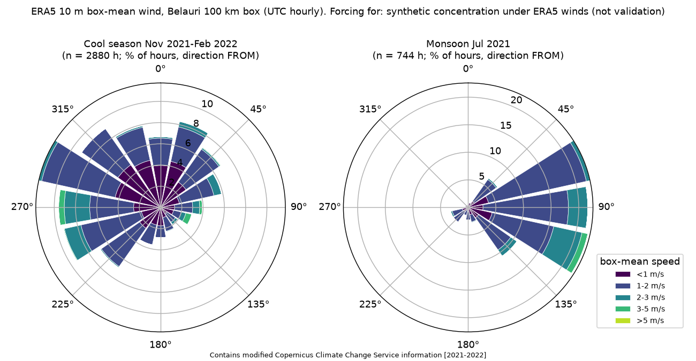
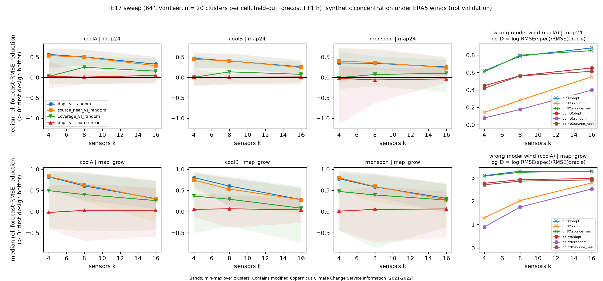

# E17 Regional case: synthetic tracer under ERA5 winds

**Synthetic concentration under ERA5 reanalysis winds. This is not validation:** no real pollution data are used, and
nothing here is evidence about ambient PM2.5 or exposure near Belauri.

**Question (plan 3).** Do the method comparisons from the synthetic study hold up under realistic wind sequences from a
real place?

**Evidence label.** Exploratory.
- 64² VanLeer run (cluster job 205400): 3 cases × 20 clusters.
- 32² pilot: 6 clusters.

Audited (gate-12-17: pass with conditions; one scenario re-solved from the raw ERA5
files matches to 4e-16; claims below corrected).

**Evidence.**
- Design note `docs/research/regional-case-design.md`.
- Feasibility audit `docs/research/regional-feasibility.md`.
- Data manifest with sha256 hashes: `docs/research/data/e17-manifest.json`.
- Code `src/pravah/data/region.py` and `scripts/e17_regional.py`.
- Tables `tables/e17-*`; journal `state/experiments/e17.md`.

## Setup

- **Domain:** a ~100 km box around Belauri, Kanchanpur (79.80–80.82 E, 28.34–29.24 N). Benchmark lengths are scaled
  ×10, with K = 500 m² s⁻¹.
- **Wind:** ERA5 hourly 10 m wind, averaged over the box. The solver takes a spatially uniform wind.
- **Sources:** synthetic, placed only where WorldPop population exists. That is Nepal only, so the Indian part of the
  box has no sources.
- **Cases (date blocks):**
  - coolA (Nov–Dec 2021) and coolB (Jan–Feb 2022);
  - monsoon: trained on November, tested on July 2021, a wind regime absent from training.
- **Estimators and endpoint:** the same as E07 and E08 (24 h window `map24`, all past data `map_grow`; held-out 1 h
  forecast RMSE).
- **Wrong-wind tests:** the model gets either the ERA5 point nearest Belauri or the box mean veered by 30°.

{#fig-e17-rose}

The cool season is calm and has no dominant direction. Mean speed is 1.0–1.5 m s⁻¹, 27–50 % of hours are below
1 m s⁻¹, and there is a day–night swing. July has steady easterlies.

## Results (64²)

{#fig-e17}

| 1 h forecast RMSE, k = 8, median | D-optimal | near-source | random | persistence |
|---|---|---|---|---|
| 24 h window, true wind | 0.018–0.024 | 0.018–0.021 | 0.034–0.038 | 0.017–0.019 |
| all past data, true wind | 0.0014–0.0020 | 0.0016–0.0020 | 0.0035–0.0043 | 0.017–0.019 |
| nearest-point wind (coolA) | 0.034 / 0.032 | 0.034 / 0.032 | 0.045 / 0.033 | 0.017 |
| 30° veer (coolA) | 0.046 / 0.045 | 0.046 / 0.045 | 0.052 / 0.045 | 0.017 |

Wrong-wind rows show 24 h window / all past data.

- **Placement still matters with the true wind.** D-optimal and near-source beat random in every case (20 of 20
  clusters at k = 8), by 35–50 % under the 24 h window and 53–64 % with all past data.
- **The D-optimal vs near-source ordering mostly disappears.**
  - The two tie in the cool season.
  - In the unseen monsoon regime, near-source edges ahead under the 24 h window (16 of 20). This is E07's direction,
    much weaker, and it does not survive Holm correction over the 18 such tests.
  - With all past data they tie. E07/E08's clear D-optimal win does not appear under these calm, rotating winds.
- **Only memory beats the persistence bound.** Persistence here carries the *true* field forward one hour, which no
  network can do. The 24 h-window forecasts are 1.2–1.4× its error, beating it in only 3–5 of 20 clusters.
  All-past-data forecasts beat it by about 10×.
- **The wrong wind cancels both advantages.** The ERA5 point nearest Belauri differs from the box mean by about 17°
  and 13 % in speed (a 40 % vector error). Using it instead of the box mean puts every forecast at 1.8–3.7× the
  persistence bound (still 0.43–0.76× the background-only error). All strategies become nearly equal and the memory
  gain disappears. This is a **transport floor**: forecasts using the *true* source strengths with the wrong wind are
  just as bad (0.047 vs 0.0465), so better estimation cannot fix it. This reproduces E12 under realistic winds.

## Limits

- **Uniform wind.** The ERA5 wind varies inside the box by about as much as its mean, so a spatially varying wind is
  the main missing ingredient.
- **No Indian sources or inflow.** The boundary is clean.
- **Mixing depth.** The cool-season boundary layer (median 47–88 m) is much shallower than the model's 500 m.
- **Short calendar.** The 20 clusters in each case share one wind history.

## Data attribution

- Contains modified Copernicus Climate Change Service information [2021–2022]. Neither the European Commission nor
  ECMWF is responsible for any use that may be made of the Copernicus information or data it contains. ERA5: Hersbach
  et al. (2023), ERA5 hourly data on single levels from 1940 to present, C3S Climate Data Store,
  doi:10.24381/cds.adbb2d47 (CC-BY 4.0).
- Population: WorldPop (www.worldpop.org), Nepal 2020 UN-adjusted 1 km, CC BY 4.0.
