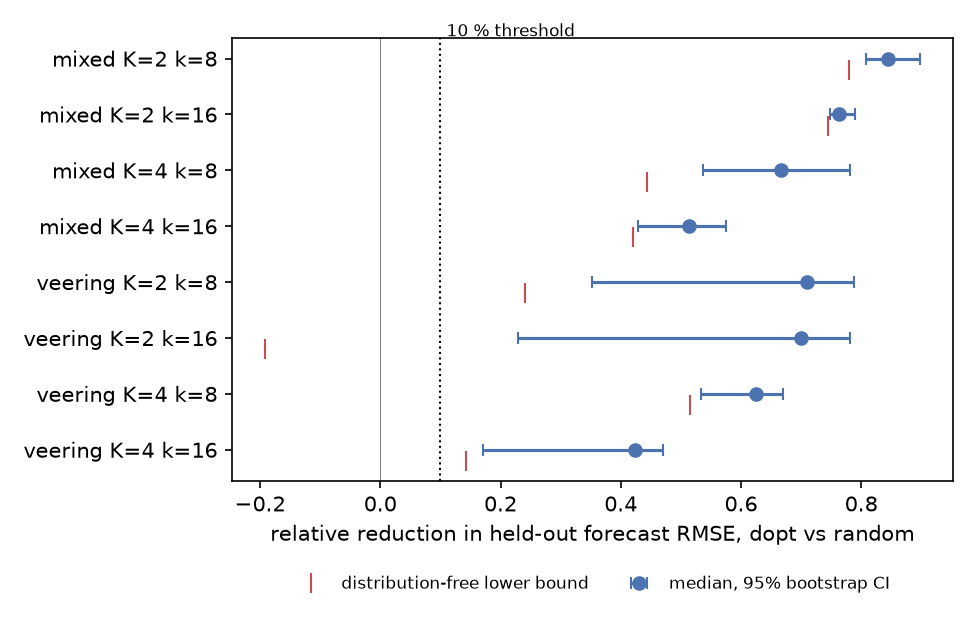

# Executive summary {.unnumbered}

::: {.callout-important}
## Scope
Everything in this report is a **synthetic** study: a 2-D, depth-averaged passive tracer simulated with FiPy on a
10 km × 10 km square, with known truth. It is **not** PM2.5, not validated against observations, and makes **no
real-world exposure or deployment claim**. Most results are exploratory; one test (E07) is confirmatory, and only for
the cells that were run.
:::

## The question

How few **low-cost, noisy sensors** do we need, and **where** should they go, to reconstruct and forecast a pollution
field when the **wind and the emissions are uncertain**? Plan 2 (`plans/plan-02-identifiability-placement-forecast.yaml`)
breaks this into: which source combinations a network can actually distinguish (identifiability), whether a longer
history can replace sensors, which placement rule is best for which task, and finally sequential forecasting (E08–E11).

## Where we started: Green (2006)

Our methodological starting point is Kary Green's Rice master's thesis on optimal sensor placement for parameter
identification [@green2006]. Green linearises sensor readings around the parameters of a semi-discretised PDE, forms
the **Fisher information matrix** M = GᵀR⁻¹G, and chooses sensor locations that maximise log det M
(**D-optimal design**). His worked example is a **1-D advection–diffusion** problem with **two** unknown parameters
(diffusivity and advection coefficient); the optimised design shrinks the 95 % confidence-ellipse area by about 36 %
relative to equal spacing (reading notes, `docs/research/green-2006-reading-notes.md`).

PRAVAH keeps the Fisher/D-optimal machinery but changes almost everything around it:

| | Green (2006) | PRAVAH |
|---|---|---|
| Space | 1-D | 2-D, 64 × 64 grid (32² for pilots) |
| Unknowns | 2 transport parameters | K = 2–8 source strengths (plus, later, the field) |
| Sensors | ideal, few | low-cost, noise σ = 5 % of median concentration; AR(1) and per-site arms |
| Wind | known, fixed | time-varying; **test winds held out** from design |
| Endpoint | parameter confidence ellipse | **held-out one-hour-ahead field forecast RMSE** (protocol primary) |
| Truth | analytic | synthetic simulator with known truth, independent audits |

## The testbed

A FiPy finite-volume solver of ∂c/∂t + u·∇c = ∇·(K∇c) − λ(c − c_bg) + S, with K = 50 m² s⁻¹,
λ = 1/12 h, Gaussian area sources (σ = 400 m), background 5 µg m⁻³, hourly-piecewise wind, a 60-day calendar split
into train (days 1–30), validation (31–42) and test (43–60) with **held-out test wind regimes**. Sensors sit on a
16 × 16 candidate lattice with 1.25 km minimum spacing. Every experiment received an independent audit ("gate").

## Results at a glance

Evidence labels: **verified** = engineering check passed an independent gate; **exploratory** = smoke scale and/or
settings chosen after seeing data; **confirmatory (cells run)** = preregistered test, supported only in the cells run.

| Exp | Question | What we did | What we found | Evidence |
|---|---|---|---|---|
| [E00](chapters/e00-protocol.qmd) | Can we fix endpoints and rules before data? | Preregistered protocol, evaluation contract; audit | Audit found 3 blockers: signal 1000× below noise (B1), no approval (B2), upwind numerics (B3). All resolved: amendment A1, user approval, amendment A2 | approved baseline, amendable |
| [E01](chapters/01-forward.qmd) | Does the solver solve the PDE? | Convergence, mass, dt-halving oracles 16²–64² | Upwind converges at ~1st order, mass to ~1e-14, but at 64² its numerical diffusivity is 350–2900 m² s⁻¹ vs K = 50. Split VanLeer at dt 30 s gives K_eff ≈ 50 (A2) | verified (conditionally cleared) |
| [E02](chapters/02-benchmark.qmd) | Is the benchmark sound and leak-free? | Generator, splits, 65 validity/leakage checks | Checks pass; at 100 µg/s the plume was invisible (SNR ~2e-3); at 1 g/s peak SNR is 21–32 | verified (smoke) |
| [E03](chapters/03-inverse.qmd) | Can fixed sensors recover source strengths? | NNLS inverse, 648 fits, 24 h window | Rank-deficient in **all 648** fits, at both scales: a structural failure of fixed, non-optimised sensors | exploratory (negative) |
| [E04](chapters/04-footprints.qmd) | Which source combinations can a network distinguish? | Footprints, Fisher information, SVD | At 1 g/s a D-optimal 4-sensor design has practical rank 4/4; coverage 1–2, redundant 2. One replicate | exploratory |
| [E05](chapters/05-time.qmd) | Can a longer window replace sensors? | Window × sensors × wind ablation, 20 seeds | Elapsed time alone adds **nothing** (constant wind); **wind change** adds rank (+0.37, 16/17 seeds). v1 claims were overstated and withdrawn | exploratory |
| [E06](chapters/06-placement-methods.qmd) | Can we reproduce standard placement algorithms? | uniform/random/coverage/source-near/D/A/diversity/POD-QR | Implementations check out (QR = PySensors). Source-informed designs reach full rank; most of that is **knowing source locations** | verified methods; results in-sample |
| [E07](chapters/07-cross-objective.qmd) | Which placement is best for which held-out task? | 32² pilot + 64² sweep (40 scenarios, held-out winds) | D-opt beats random on held-out forecast RMSE by a median 42–84 % per cell (8/8 cells), and under every estimator tried. **Which strategy wins depends on estimator memory:** near-source beats D-opt with a 24 h window (115/120 pairs), D-opt wins with all past data (103/120) | **confirmatory in cells run**; strategy ordering exploratory |
| [E08](chapters/08-sufficiency.qmd) | How many sensors are enough? | Preregistered factorial; 32² pilot; 64² sweep (60 scenarios) | Location-aware designs need k ≈ K sensors; random layouts need 8–16. More sensors beat more readings for random networks, but not once sources are covered. H1, H3, H4 and H5 supported; H2 contradicted. **With all past data, 2 sensors suffice for every strategy and H5 reverses** | 64²: preregistered tests (windowed estimator); stage-2 reruns audited |
| [E09](chapters/09-filter.qmd) | Does sequential filtering help? | Kalman filters with independent tests; 32² replay; audit | Estimating sources from **all past data** cuts forecast error 58–74 % vs a 24 h window. The gain is memory, not filtering. A field-only filter is nearly useless | exploratory, audited |
| [E10](chapters/10-joint.qmd) | Do drifting-source filters help? | Random-walk augmented filter; constant, diurnal and log-random-walk truths; audit | Constant sources: all past data is best. Time-varying: 1 h error falls 24–55 %, but the filter is 12–15 % worse at 6 h under a diurnal cycle. Calibrated only when q matches the truth | exploratory, audited |
| [E11](chapters/11-forecast-design.qmd) | Placement optimised for forecasting? | Data-free forecast-variance objective, wind-robust prior; audit | 64² (20 clusters): under a 24 h window, beats D-optimal even with an out-of-sample prior (+0.34 at k = 8, 19/20) but loses to near-source. Worse than D-optimal with all past data | exploratory; pilot audited |
| [E12](chapters/12-wind-mismatch.qmd) | What do wind errors do? | Biased direction, speed, timing and noise in the inverse wind | Direction ≥ 30° or a lag ≥ 2 h destroys forecast skill. Wrong strengths absorb wind errors while the fit stays good. The memory benefit vanishes (64²: and can reverse) | exploratory pilot + 64² sweep (20 clusters, unaudited) |
| [E13](chapters/13-model-mismatch.qmd) | What do background, source or sensor errors do? | 18 mismatches, with and without an estimated background | Background offset: fixable. Common-mode sensor bias: a **silent failure**. Wrong source shapes or locations: unfixable. Outages: benign | exploratory pilot |
| [E14](chapters/14-reliability.qmd) | Can the method flag its own failures? | 8 truth-free diagnostics; ROC by stress | Moderate at best (AUC 0.71). Speed errors and common sensor bias are undetectable; a missing source is flagged by informed networks but not random ones | exploratory pilot |
| [E15](chapters/15-robust.qmd) | Do scenario-robust networks hold up better? | Mean/CVaR/worst-case placement over wind ensembles; tail over 18 wind-error conditions | Tail gain indistinguishable from chance. Robust ≈ near-source with a 24 h window; no gain with all past data | exploratory pilot |
| [E16](chapters/16-generalization.qmd) | Do conclusions survive other physics? | One-at-a-time ablations: diffusion, loss, source shape and spacing, background | No reversal. D-opt > random and the memory gain are robust. The memory flip holds in every cell. Some margins weaken | exploratory pilot (32²) |
| [E17](chapters/17-regional.qmd) | Do the conclusions survive real winds? | Synthetic tracer under ERA5 winds near Belauri; 64², 3 cases × 20 clusters | Placement still beats random (35–64 %). D-optimal vs near-source mostly ties. Only all-past-data forecasts beat the persistence bound. A single-site wind instead of the box mean cancels every advantage (a transport floor) | exploratory, audited; **not validation** |
| E18 | Can real monitors validate it? | Audit of public PM2.5 data near Belauri | Not conducted: only 2 stations within 100 km, short records; a passive tracer cannot be validated against PM2.5 | gap assessment |

## Key figures

{#fig-summary-confirm}

{#fig-summary-sweep}

## What we learned, in plain language

1. **Scale matters before cleverness.** At the originally declared emission rate, sensors could not see the plumes at
   all; no placement rule can fix that (E00–E05, amendment A1).
2. **Numerics matter.** The first-order scheme smeared plumes with 7–60× the physical diffusivity at 64²; switching to a
   split VanLeer scheme was necessary before any 64² result could mean anything (A2).
3. **Time helps only when the wind changes.** Repeated readings under the same wind reduce noise but do not separate
   sources; a change in wind direction does (E05, exploratory).
4. **Optimised placement beats random**, confirmed in the 8 cells run (E07).
5. **Which placement wins depends on how much history the estimator uses.** With a 24 h estimation window, sensors
   next to the known sources beat D-optimal (115/120), because D-optimal networks go blind when an unseen southerly
   wind blows: 79 % of their error falls in those windows. When the estimator uses all past data, the blind spells are
   bridged and D-optimal wins (103/120) (E07 + gate-09, exploratory).
6. **Memory matters more than the algorithm.** Estimating the persistent sources from all past data cuts forecast error
   by 58–74 % against a 24 h window; a filter that corrects only the field does almost nothing (E09, exploratory).

7. **Drifting sources need drifting estimates, but only for short horizons.** A filter that lets strengths drift helps
   1 h forecasts when sources really change, and hurts 6 h forecasts under a daily cycle (E10).
8. **Placement tuned for one estimator loses under another.** Forecast-optimised networks win only with a 24 h window,
   and part of their gain was in-sample (E11).
9. **Model errors dominate placement differences.** Under a 30° wind error, a 2 h timing lag or a wrong source map,
   no estimator beats an oracle persistence bound. Strategies stop mattering. Some of these errors stay hidden in the
   residuals (speed errors, common sensor bias) (E12–E13).
10. **Self-diagnosis is limited.** Truth-free checks catch some failures (timing and direction errors, correlated noise)
    but not speed errors, a common sensor bias, or (for random networks) a missing source (E13–E14).

## Honest limitations

- Synthetic, perfect-model world: known source locations, known wind, constant sources, ideal sensors, uniform wind.
- Smoke scale (32²) for E02–E06. Runs at 64²: E07 (K ∈ {2, 4}, k ∈ {4, 8, 16}, 10 seeds), E08 (20 seeds), E11, E12 and E17.
  E09, E10 and E13–E16 are 32² pilots.
- The source scale (1 g/s) was chosen after seeing data, so E02–E06 at that scale are exploratory.
- The E07 mechanism rests on one unseen wind direction; the "source-near" advantage may partly reflect sensors sitting
  inside the 1200 m emission disc. Across all 40 scenarios, excluding those sites keeps near-source ahead (104/120) but
  shrinks D-optimal's gain over random from 71 % to 20 %, and no single cell then clears the 10 % test threshold (exploratory control).
- E09–E14 are 32² pilots with an upwind surrogate and 6 independent clusters. Their 64² runs are documented but deferred

## What's next

E08's and E11's 64² runs are done; E09 is done at 32² and audited. E10–E17 have results (E18 not conducted: no data). E12–E17 are audited (gate-12-17), and the synthesis (E19) is done; see [Conclusions](chapters/19-conclusions.qmd).
Next: independent replication and release review (E20), and the deferred 64² runs. See
[Next steps](chapters/91-next.qmd).

## How to read this report

Chapters [Background](chapters/00-background.qmd) and [Methods](chapters/00-methods.qmd) set the stage; one chapter per
experiment follows; [Lessons and corrections](chapters/90-lessons.qmd) collects what the independent audits caught.
Every number is read from versioned tables under `reports/quarto/tables/`, figures under `figures/`, the experiment
journals in `state/experiments/`, or the audits in `docs/research/gates/`.
